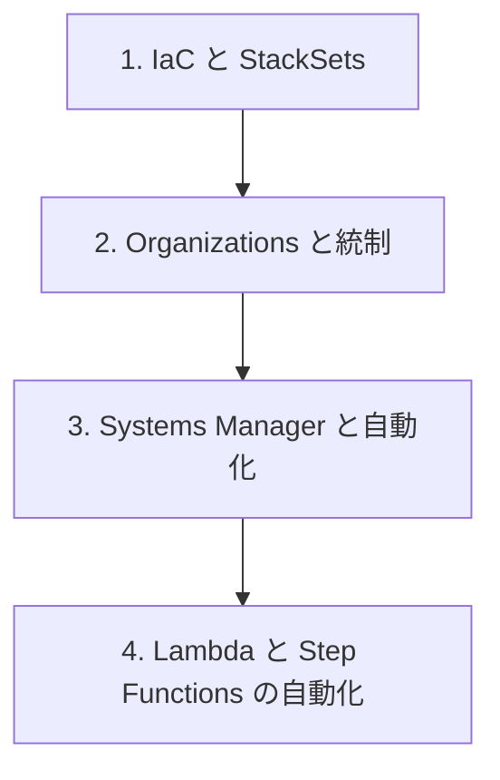

# 分野2: サービス別の学習

分野2（構成管理と IaC）は DOP-C02 の配点の 17% です。IaC の部品化、複数アカウントの統制、大規模な自動化の順に進めます。

| 順番 | 話題 | 問われること | 重要度 |
|---|---|---|---|
| 1 | [IaC と StackSets](iac.md) | テンプレートの機能、変更管理、StackSets、モジュール | 高 |
| 2 | [Organizations と統制](organizations.md) | OU、Control Tower、発行の自動化、SCP、統制の段階 | 高 |
| 3 | [Systems Manager と自動化](systems-manager.md) | サービスの選択、パッチ、Inventory、State Manager、準拠 | 高 |
| 4 | [Lambda と Step Functions の自動化](serverless.md) | 分散、人の承認、冪等性、スロットリング | 中 |

重要度は公式のスキル一覧を見たこの wiki の判断で、公式の数字ではありません。

## 他のサービスにまたがる問題 {#other-questions}

<!-- questions:start -->

この分野の問題は、すべてサービス別のページに載っています。

<!-- questions:end -->
