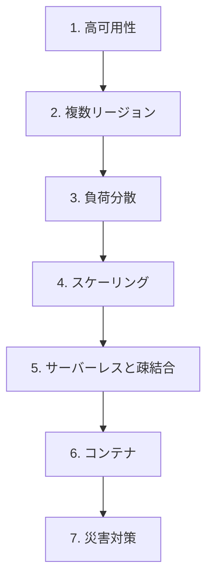

# 分野3: サービス別の学習

分野3（回復力のあるクラウドソリューション）は DOP-C02 の配点の 15% です。高可用性からスケーリング、災害対策の順に進めます。

| 順番 | 話題 | 問われること | 重要度 |
|---|---|---|---|
| 1 | [高可用性](high-availability.md) | Multi-AZ、SLA の計算、ビジネス要件の変換、単一障害点 | 高 |
| 2 | [複数リージョン](multi-region.md) | 複製の方式、切り替え、ルーティング、グローバルな配置 | 高 |
| 3 | [負荷分散](load-balancing.md) | クロスゾーン、ELB ヘルスチェック、フェイルオープン | 中 |
| 4 | [スケーリング](scaling.md) | 指標の選択、問題の解消、ポリシーとキャッシュ | 高 |
| 5 | [サーバーレスと疎結合](serverless.md) | キューの導入、ファンアウト、同時実行、スロットリング | 中 |
| 6 | [コンテナ](containers.md) | プラットフォームの選択 | 中 |
| 7 | [災害対策](disaster-recovery.md) | RTO と RPO の計算、DR 戦略、復旧の手順、テスト、バックアップ | 高 |

重要度は公式のスキル一覧を見たこの wiki の判断で、公式の数字ではありません。

## 他のサービスにまたがる問題 {#other-questions}

<!-- questions:start -->

この分野の問題は、すべてサービス別のページに載っています。

<!-- questions:end -->
