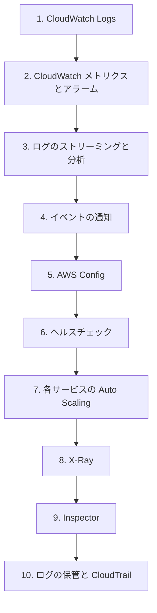

# 分野4: サービス別の学習

分野4（監視とログ）は DOP-C02 の配点の 15% です。ログとメトリクスの基本から、分析、自動対応の順に進めます。

| 順番 | 話題 | 問われること | 重要度 |
|---|---|---|---|
| 1 | [CloudWatch Logs](cloudwatch-logs.md) | フィルター、サブスクリプション、保持、暗号化、権限 | 高 |
| 2 | [CloudWatch メトリクスとアラーム](cloudwatch-metrics.md) | 標準とカスタムのメトリクス、ストリーム、異常検知、アラーム、エージェント | 高 |
| 3 | [ログのストリーミングと分析](log-streaming.md) | Kinesis、Firehose、Athena、S3 イベント | 中 |
| 4 | [イベントの通知](messaging.md) | S3 イベントと EventBridge、パターン、通知の権限 | 中 |
| 5 | [AWS Config](config.md) | ルールと修復 | 中 |
| 6 | [ヘルスチェック](load-balancing.md) | ALB と Route 53 のチェックの違い | 中 |
| 7 | [各サービスの Auto Scaling](scaling.md) | ECS、RDS、DynamoDB、EKS の仕組み | 中 |
| 8 | [X-Ray](troubleshooting.md) | 実行環境ごとの設定、アノテーション、新しい計装 | 中 |
| 9 | [Inspector](threat-detection.md) | スキャンの対象と現在の使い方 | 低 |
| 10 | [ログの保管と CloudTrail](security-audit.md) | Object Lock、ログファイルの検証、イベントの種類 | 高 |

重要度は公式のスキル一覧を見たこの wiki の判断で、公式の数字ではありません。

## 他のサービスにまたがる問題 {#other-questions}

<!-- questions:start -->

この分野の問題は、すべてサービス別のページに載っています。

<!-- questions:end -->
