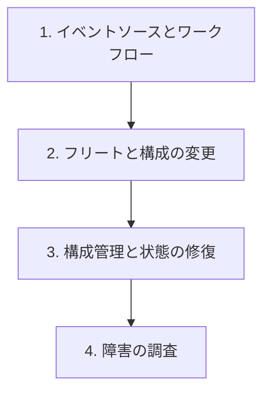

# 分野5: サービス別の学習

分野5（インシデントとイベントへの対応）は DOP-C02 の配点の 14% です。イベントの受け取り、構成の変更、障害の調査の順に進めます。

| 順番 | 話題 | 問われること | 重要度 |
|---|---|---|---|
| 1 | [イベントソースとワークフロー](messaging.md) | AWS Health、CloudTrail 経由のイベント、ファンアウト、失敗の受け皿 | 高 |
| 2 | [フリートと構成の変更](systems-manager.md) | ライフサイクルフック、段階的な適用、イベントでの変更 | 高 |
| 3 | [構成管理と状態の修復](config.md) | 準拠のイベント、集約、修復の手段 | 中 |
| 4 | [障害の調査](troubleshooting.md) | 手がかりの選択、AWS Health、根本原因、失敗したデプロイとプロセス | 高 |

重要度は公式のスキル一覧を見たこの wiki の判断で、公式の数字ではありません。

## 他のサービスにまたがる問題 {#other-questions}

<!-- questions:start -->

| 問題 | スキル | 内容 |
|---|---|---|
| [containers 問10](../../exercises/containers.md#q10) | プロセスの障害 | ECS（EC2 起動）のサービスイベントに unable to place a task が出ていま… |
| [containers 問11](../../exercises/containers.md#q11) | プロセスの障害 | EKS の Pod の状態を確認します。(1) Pending のまま。(2) 新しいイメージのデプ… |

<!-- questions:end -->
