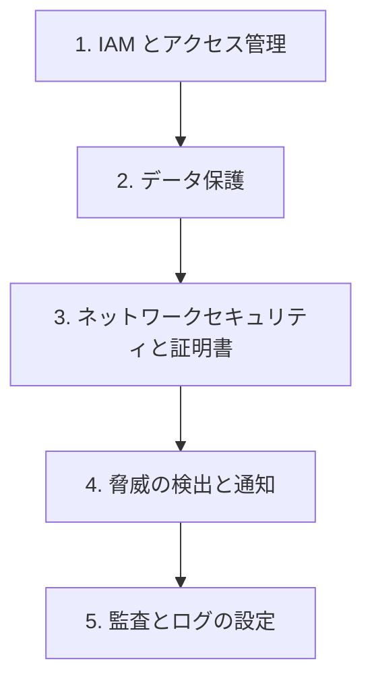

# 分野6: サービス別の学習

分野6（セキュリティとコンプライアンス）は DOP-C02 の配点の 17% です。IAM から順に進めると、後のページの権限の話が読みやすくなります。

| 順番 | 話題 | 問われること | 重要度 |
|---|---|---|---|
| 1 | [IAM とアクセス管理](iam.md) | 要素、フェデレーション、権限境界、SCP、最小権限、ABAC、MFA | 高 |
| 2 | [データ保護](data-protection.md) | ローテーション、データ管理、Macie、暗号化 | 高 |
| 3 | [ネットワークセキュリティと証明書](network-security.md) | 層ごとの要素、証明書のリージョン、多層防御 | 中 |
| 4 | [脅威の検出と通知](threat-detection.md) | 自動適用、検出のサービス、脅威、通知、分析 | 高 |
| 5 | [監査とログの設定](security-audit.md) | 監査のサービス、仕組みの保護、ログの設定 | 中 |

重要度は公式のスキル一覧を見たこの wiki の判断で、公式の数字ではありません。

## 他のサービスにまたがる問題 {#other-questions}

<!-- questions:start -->

この分野の問題は、すべてサービス別のページに載っています。

<!-- questions:end -->
