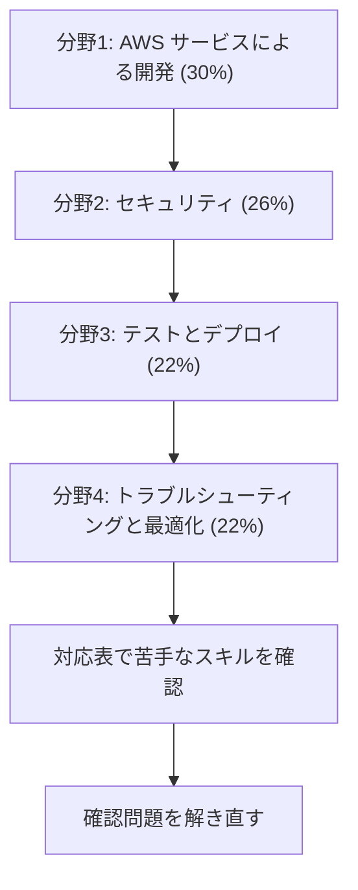

# Developer - Associate（DVA）

AWS 上のアプリケーションを開発、テスト、デプロイ、デバッグする力を問う試験です。このコースは **DVA-C03** を基準にしています。DVA-C02 の範囲も[対応表](coverage.md)ですべて確認できます。

!!! warning "2026年12月に試験が切り替わります"
    **DVA-C02 の最終受験日は 2026年11月30日**で、2026年12月1日からは **DVA-C03** が実施されます。受験日に合わせて範囲を確認してください。

## 試験の概要 {#overview}

| 項目 | 内容 |
|---|---|
| 問題数 | 65問（採点対象50問 + 採点対象外15問） |
| 試験時間 | 130分 |
| 合格点 | 720点（100〜1,000点） |
| 受験料 | 150 USD |
| 形式 | 択一、複数選択。複数選択は正解をすべて選んだときだけ得点になります |
| 採点方式 | 全体の得点で合否を判定します。分野ごとの合格点はありません |
| 受験方法 | テストセンターまたはオンライン |
| 減点 | 誤答による減点はありません。未回答は不正解になるので、すべて回答します |

## 学習の順番 {#study-path}

配点の大きい分野から順に進めます。各分野のページでスキルごとの要点を確認し、足りないところはサービス解説で補います。サービスごとの[問題集](exercises/index.md)で理解を確かめます。

| 分野 | C03 の配点 | C02 の配点 | 主なサービス |
|---|---|---|---|
| [分野1: AWS サービスによる開発](domain1.md) | 30% | 32% | Lambda、API Gateway、DynamoDB、SQS、SNS、EventBridge |
| [分野2: セキュリティ](domain2.md) | 26% | 26% | IAM、Cognito、KMS、Secrets Manager、Bedrock Guardrails |
| [分野3: テストとデプロイ](domain3.md) | 22% | 24% | SAM、CloudFormation、CodeDeploy、CodePipeline、ECS |
| [分野4: トラブルシューティングと最適化](domain4.md) | 22% | 18% | CloudWatch、X-Ray、ElastiCache、DAX |

## C02 と C03 の違い {#c02-vs-c03}

範囲が大きく変わるのは AI 関連とコンテナです。それ以外は、分野の移動やスキルの統合が中心です。

| 変更 | 内容 |
|---|---|
| 新しいタスク | タスク 2.3: AI サービスの利用に伴うセキュリティリスクへの対応（5スキル） |
| AI の追加 | AI による開発支援、マネージド AI サービスの組み込み、AI によるテスト、CI/CD、エラー分析、最適化 |
| 新しいサービス | Amazon Bedrock、Bedrock AgentCore、Amazon Quick、Kiro |
| その他の追加 | 署名付き URL、コンテナイメージの作成と管理、ECS や EKS へのデプロイ |
| 分野の移動 | SAM の単体テスト → 分野3、Lambda の性能調整 → 分野4、シリアライズ → タスク 1.1、API Gateway のステージ → タスク 3.1 |
| 統合 | DynamoDB、暗号化と機密データ、テスト、オブザーバビリティ、最適化のスキルをまとめ直しました。出題の重要度が下がったわけではありません |

## 範囲外のもの {#out-of-scope}

次の作業は受験者に求められていません。

- アーキテクチャやデータベーススキーマの設計
- CI/CD パイプラインの設計と作成
- IAM ユーザーやグループの管理、サーバーや OS の管理
- AWS ネットワークの設計
- 基盤モデルの選定、プロンプトエンジニアリング、RAG の設計（C03）
- AI の安全性フレームワークやガバナンスの設計、ガードレールの実装（C03）
- ETL パイプラインの設計と作成（C03）

範囲外のサービスの例は、SageMaker AI、Quick Sight、Polly、Rekognition、Strands Agents、Shield、Storage Gateway、Snow Family、Transfer Family です。

## 参考 {#references}

- [DVA-C03 試験ガイド](https://docs.aws.amazon.com/aws-certification/latest/developer-associate-03/developer-associate-03.html)
- [DVA-C02 と DVA-C03 の比較](https://docs.aws.amazon.com/aws-certification/latest/developer-associate-03/dva-03-comparison.html)
- [DVA-C02 試験ガイド](https://docs.aws.amazon.com/aws-certification/latest/developer-associate-02/developer-associate-02.html)
- [認定の公式ページ](https://aws.amazon.com/certification/certified-developer-associate/)
