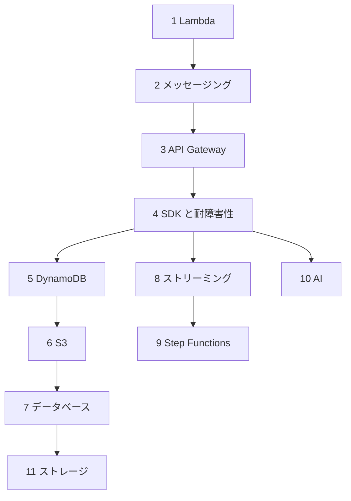

# 分野1: サービス別の学習

分野1は C03 の配点が **30%** で、4分野の中で最大です。Lambda のコード、サービス同士のつなぎ方、データストアの選択と設定を、順番に学びます。

| 順番 | サービス | 問われること | 重要度 |
|---|---|---|---|
| 1 | [Lambda](lambda.md) | VPC 接続、関数の設定、再試行と送信先、イベントソースマッピング | 高 |
| 2 | [メッセージング](messaging.md) | 疎結合、同期と非同期、SQS、SNS、EventBridge の選択と設定 | 高 |
| 3 | [API Gateway](api-gateway.md) | 統合タイプ、リクエストとレスポンスの変換、検証 | 高 |
| 4 | [SDK と耐障害性](sdk-resilience.md) | 再試行、タイムアウト、冪等性、ページネーション、シリアライズ | 高 |
| 5 | [DynamoDB](dynamodb.md) | キー設計、整合性、Query と Scan、インデックス、容量の計算 | 高 |
| 6 | [S3](s3.md) | ライフサイクル、ストレージクラス、イベント通知、SDK での操作 | 中 |
| 7 | [データベース](databases.md) | データストアの選択、キャッシュの選択とキャッシュ戦略 | 中 |
| 8 | [ストリーミング](streaming.md) | Kinesis Data Streams と Firehose の選択、シャード、Lambda での読み取り | 中 |
| 9 | [Step Functions](step-functions.md) | ワークフローの種類、`Retry` と `Catch`、入出力の処理 | 中 |
| 10 | [AI](ai.md) | Kiro の機能、Bedrock の Converse API、スロットリングの処理 | 中 |
| 11 | [ストレージ](storage.md) | S3、EBS、EFS の使い分け、Lambda からの EFS 接続 | 低 |

重要度は、公式のスキルをもとにしたこの wiki の判断で、公式の数値ではありません。

## 他のサービスにまたがる問題 {#other-questions}

分野1のスキルを扱う問題のうち、上の表にないサービスの問題集に入っているものです。

<!-- questions:start -->

| 問題 | スキル | 内容 |
|---|---|---|
| [containers 問15](../../exercises/containers.md#q15) | 1.1.3 | Fargate Spot のタスクが中断されたときに、処理中のデータを保存したいと考えています。適切… |
| [ec2-beanstalk 問4](../../exercises/ec2-beanstalk.md#q4) | 1.1.3 | 新しいインスタンスを InService にする前に、設定ファイルを取得してアプリを準備したいと考え… |
| [ec2-beanstalk 問13](../../exercises/ec2-beanstalk.md#q13) | 1.3.1 | アプリのバージョンが増え、新しいバージョンを作れないエラーが発生しました。アプリケーションバージョン… |
| [iac 問5](../../exercises/iac.md#q5) | 1.1.5 | aws s3api list-objects-v2 を大きなバケットで実行すると、タイムアウトで失敗… |
| [iac 問18](../../exercises/iac.md#q18) | 1.1.5 | AWS CLI の動作について、正しいものはどれですか。（2つ選択） |
| [networking 問3](../../exercises/networking.md#q3) | 1.2.1 | プライベートサブネットのアプリから Secrets Manager へ、インターフェイスエンドポイン… |
| [networking 問4](../../exercises/networking.md#q4) | 1.2.1 | VPC エンドポイントについて正しい説明はどれですか。（2つ選択） |
| [networking 問5](../../exercises/networking.md#q5) | 1.2.1 | Lambda 関数を VPC のパブリックサブネットに接続しましたが、外部 API の呼び出しがタイ… |
| [networking 問15](../../exercises/networking.md#q15) | 1.1.3 | オリジングループでオリジンフェイルオーバーを設定し、条件に 500、502、503、504 を選びま… |
| [observability 問10](../../exercises/observability.md#q10) | 1.3.1 | 開発者は、複数のロググループを同じアカウントの S3 へ CreateExportTask で並行し… |
| [observability 問11](../../exercises/observability.md#q11) | 1.1.5 | JSON のログを、平均 200 バイトで 5,000 件ずつ PutLogEvents で送ってい… |
| [observability 問13](../../exercises/observability.md#q13) | 1.1.6 | ログストリームが少数のロググループを、サブスクリプションフィルターで Kinesis Data St… |
| [secrets 問6](../../exercises/secrets.md#q6) | 1.2.2 | Lambda に Parameters and Secrets Lambda Extension を… |

<!-- questions:end -->
