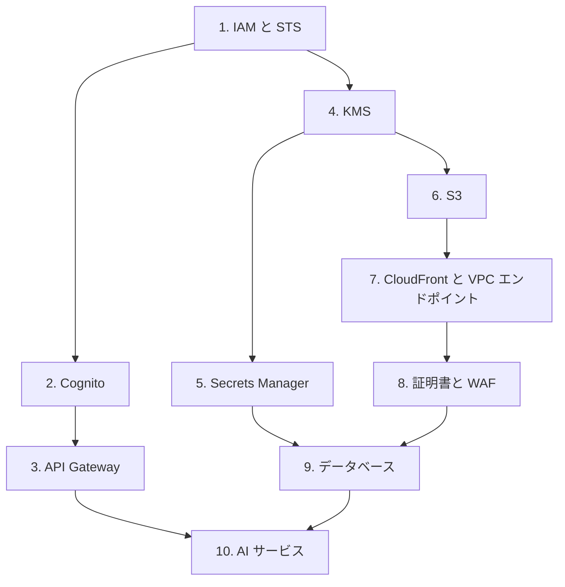

# 分野2: サービス別の学習

分野2（セキュリティ）は C03 の配点の 26% を占め、認証と認可、暗号化と機密データ、AI サービスのリスク対策の3つを扱います。IAM から順に進めると、後のページの権限の話が読みやすくなります。

| 順番 | サービス | 問われること | 重要度 |
|---|---|---|---|
| 1 | [IAM と STS](iam.md) | ポリシー評価、ロールの引き受け、フェデレーション、SigV4 | 高 |
| 2 | [Cognito](cognito.md) | ユーザープールと ID プール、トークン、ロールマッピング | 高 |
| 3 | [API Gateway](api-gateway.md) | オーソライザーの選択、IAM 認証、リソースポリシー | 中 |
| 4 | [KMS](kms.md) | エンベロープ暗号化、キーポリシー、クライアント側暗号化 | 高 |
| 5 | [Secrets Manager と Parameter Store](secrets.md) | シークレットの選択とローテーション、ログのマスキング | 高 |
| 6 | [S3](s3.md) | 署名付き URL、暗号化方式の選択と強制 | 中 |
| 7 | [CloudFront と VPC エンドポイント](networking.md) | CloudFront の署名付き URL と Cookie、TLS、閉域接続 | 中 |
| 8 | [証明書と WAF](certificates.md) | ACM のリージョン、Private CA、開発用の鍵、WAF | 中 |
| 9 | [データベース](databases.md) | IAM データベース認証、SSL/TLS の強制、テナントの分離 | 低 |
| 10 | [AI サービス](ai.md) | モデルアクセス、データプライバシー、Guardrails、エージェントの保護 | 高 |

重要度は公式のスキル一覧を見たこの wiki の判断で、公式の数字ではありません。

## 他のサービスにまたがる問題 {#other-questions}

<!-- questions:start -->

| 問題 | スキル | 内容 |
|---|---|---|
| [cicd 問2](../../exercises/cicd.md#q2) | 2.2.7 | ビルドでデータベースのパスワードを使います。値を buildspec に残さず、ログにも出さないよう… |
| [cicd 問3](../../exercises/cicd.md#q3) | 2.2.7 | 開発者は、ログ出力の前に Secrets Manager の値を Base64 に変換しました。ログ… |
| [containers 問20](../../exercises/containers.md#q20) | 2.1.6 | 複数の EKS クラスターで同じアプリを動かし、Pod に同じ IAM ロールを使わせます。OIDC… |
| [dynamodb 問17](../../exercises/dynamodb.md#q17) | 2.1.2 | モバイルアプリのユーザーが Cognito の ID プールから一時認証情報を取得し、DynamoD… |
| [dynamodb 問20](../../exercises/dynamodb.md#q20) | 2.2.1 | 過去の注文履歴を保存するテーブルがあります。読み書きは少なく、費用の大部分はストレージです。また、監… |
| [ec2-beanstalk 問1](../../exercises/ec2-beanstalk.md#q1) | 2.1.3 | ある開発者は、EC2 上の Docker コンテナで動くアプリを移行しています。インスタンスの Ht… |
| [iac 問3](../../exercises/iac.md#q3) | 2.1.3 | 開発者のマシンには環境変数 AWS_REGION=us-east-1 と AWS_DEFAULT_R… |
| [iac 問16](../../exercises/iac.md#q16) | 2.1.6 | SAM の関数が、DynamoDB テーブル OrdersTable の読み書きだけを許可されるよう… |
| [iac 問20](../../exercises/iac.md#q20) | 2.1.3 | CloudShell で 40 分かかるスクリプトを実行し、途中で画面を操作しませんでした。セッショ… |
| [lambda 問18](../../exercises/lambda.md#q18) | 2.1.6 | 開発者が CLI で AuthType が NONE の関数 URL を作成しました。ブラウザからア… |
| [messaging 問7](../../exercises/messaging.md#q7) | 2.1.6 | あるチームは、共用の DLQ を誤って別のチームのキューから使われないようにしたいと考えています。o… |
| [messaging 問12](../../exercises/messaging.md#q12) | 2.2.4 | 標準キューを KMS のカスタマーマネージドキーで暗号化しました。送信用のアプリケーションが Sen… |
| [messaging 問13](../../exercises/messaging.md#q13) | 2.1.6 | SNS トピックに SQS キューを購読させました。購読の状態は確認済みですが、メッセージがキューに… |
| [observability 問9](../../exercises/observability.md#q9) | 2.2.1 | ログを指定の KMS キーで暗号化するため、開発者は aws logs associate-kms-… |
| [sdk-resilience 問15](../../exercises/sdk-resilience.md#q15) | 2.1.3 | EC2 インスタンスにインスタンスプロファイルを付けましたが、boto3 のアプリケーションが別の権… |
| [storage 問4](../../exercises/storage.md#q4) | 2.2.1 | 暗号化されていない EBS ボリュームの本番データを暗号化し、さらに別のリージョンにも保管します。正… |
| [storage 問7](../../exercises/storage.md#q7) | 2.2.1 | 既存の未暗号化の EFS を、規制の要件で暗号化する必要があります。最も適切な方法はどれですか。 |
| [streaming 問15](../../exercises/streaming.md#q15) | 2.1.5 | アプリケーションが IAM ロールで OpenSearch Service のドメインにアクセスしま… |

<!-- questions:end -->
