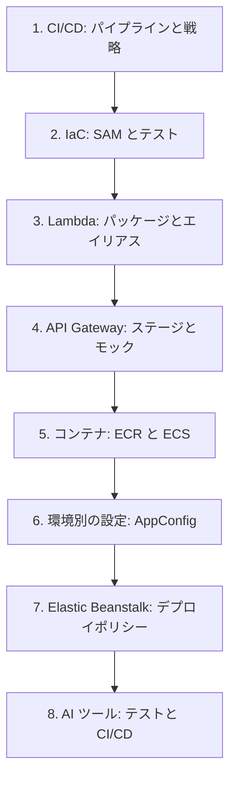

# 分野3: サービス別の学習

C03 の配点は **22%** です。成果物の準備、テスト、CI/CD によるデプロイを、サービスごとに必要な範囲だけ学びます。

| 順番 | サービス | 問われること | 重要度 |
|---|---|---|---|
| 1 | [CI/CD](cicd.md) | CodePipeline、CodeDeploy、デプロイ戦略、ロールバック | 高 |
| 2 | [IaC](iac.md) | テンプレート、SAM、変更セット、テストの方法 | 高 |
| 3 | [Lambda](lambda.md) | パッケージの選択、バージョンとエイリアス、テストイベント | 高 |
| 4 | [API Gateway](api-gateway.md) | ステージ、ステージ変数、Mock 統合、テスト方法 | 中 |
| 5 | [コンテナ](containers.md) | イメージのタグと削除、タスク定義、ECS のデプロイ | 高 |
| 6 | [Secrets Manager、Parameter Store、AppConfig](secrets.md) | 環境ごとの設定、AppConfig の段階配布 | 中 |
| 7 | [EC2 と Elastic Beanstalk](ec2-beanstalk.md) | デプロイポリシーの選択と環境の切り替え | 中 |
| 8 | [AI サービスと AI 開発ツール](ai.md) | AI によるテストの生成と CI/CD の支援 | 中 |

重要度は、公式スキルの数と内容をもとにしたこの wiki の判断で、公式の数値ではありません。

CI/CD を最初に置くのは、カナリアやロールバックの考え方が他のサービスのページでも使われるためです。

## 他のサービスにまたがる問題 {#other-questions}

<!-- questions:start -->

| 問題 | スキル | 内容 |
|---|---|---|
| [networking 問6](../../exercises/networking.md#q6) | 3.1.5 | example.com と www.example.com を、ALB へ向けます。ALB の IP… |

<!-- questions:end -->
