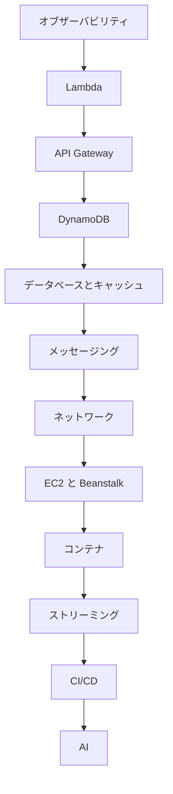

# 分野4: サービス別の学習

分野4はトラブルシューティングと最適化を扱い、C03 の配点は 22% です。まず調査と監視の道具であるオブザーバビリティを固め、次に各サービスの症状と調整方法を学ぶと、ほかのページの内容が読みやすくなります。

| 順番 | サービス | 問われること | 重要度 |
|---|---|---|---|
| 1 | [オブザーバビリティ](observability.md) | メトリクス、ログ、トレースの実装と読み方、通知、ボトルネックの検出 | 高 |
| 2 | [Lambda](lambda.md) | 同時実行、メモリの調整、スロットリングと障害の調査 | 高 |
| 3 | [API Gateway](api-gateway.md) | エラーコードの切り分け、キャッシュ、遅延のメトリクス | 高 |
| 4 | [DynamoDB](dynamodb.md) | スロットリングの診断、DAX の動き | 中 |
| 5 | [データベースとキャッシュ](databases.md) | 接続プーリング、RDS Proxy、キャッシュ戦略の選択 | 高 |
| 6 | [メッセージング](messaging.md) | SQS と SNS の最適化、連携の不具合の調査 | 中 |
| 7 | [ネットワーク](networking.md) | CloudFront のキャッシュ、ALB のヘルスチェックとエラーコード | 高 |
| 8 | [EC2 と Beanstalk](ec2-beanstalk.md) | Auto Scaling、インスタンスのサイズ、ヘルスチェック | 中 |
| 9 | [コンテナ](containers.md) | プローブ、ECS のヘルスチェック、タスクの障害調査 | 中 |
| 10 | [ストリーミング](streaming.md) | Kinesis のスループットエラー、Athena によるログ検索 | 中 |
| 11 | [CI/CD](cicd.md) | デプロイ失敗のログの読み方、デプロイの通知 | 中 |
| 12 | [AI](ai.md) | AI ツールによるエラー分析と最適化 | 低 |

重要度は公式のスキル一覧をもとにしたこのサイトの判断で、公式の数値ではありません。

## 他のサービスにまたがる問題 {#other-questions}

<!-- questions:start -->

| 問題 | スキル | 内容 |
|---|---|---|
| [certificates 問5](../../exercises/certificates.md#q5) | 4.2.3 | インポートした証明書の期限切れを 45 日前から毎日通知したいと考えています。最も運用負荷が低い方法… |
| [iac 問10](../../exercises/iac.md#q10) | 4.1.4 | Lambda を使うカスタムリソースが、例外で応答を送らずに終わりました。ServiceTimeou… |
| [iac 問12](../../exercises/iac.md#q12) | 4.1.4 | RoleName を指定した IAM ロールを含むテンプレートを --capabilities CA… |
| [iac 問14](../../exercises/iac.md#q14) | 4.1.4 | 新しいスタックの作成に失敗したときに、原因を調べるためリソースを残したいと考えています。aws cl… |
| [s3 問14](../../exercises/s3.md#q14) | 4.1.1 | ブラウザの JavaScript から署名付き URL でマルチパートアップロードをしています。各パ… |
| [s3 問19](../../exercises/s3.md#q19) | 4.3.5 | 1 つのプレフィックスに対して毎秒 20,000 件の GET を実行すると、HTTP 503 Sl… |
| [sdk-resilience 問7](../../exercises/sdk-resilience.md#q7) | 4.3.1 | Python の Lambda 関数がハンドラーの中で毎回 boto3.client("dynamo… |
| [sdk-resilience 問8](../../exercises/sdk-resilience.md#q8) | 4.3.1 | boto3 のアプリケーションが 50 スレッドで同じクライアントを共有しています。ログに Conn… |
| [step-functions 問12](../../exercises/step-functions.md#q12) | 4.3.1 | 配列の各要素で外部 API を呼ぶ Map があります。API は同時に多くのリクエストを受けられな… |
| [storage 問1](../../exercises/storage.md#q1) | 4.3.2 | 100 GiB の gp2 ボリュームの DB で、常に 6,000 IOPS が必要になりました。… |
| [storage 問2](../../exercises/storage.md#q2) | 4.3.2 | 開発者が gp3 で 80,000 IOPS と 2,000 MiB/s を指定してボリュームを作ろ… |
| [storage 問5](../../exercises/storage.md#q5) | 4.3.2 | EFS のファイルシステムの負荷は、通常はごくわずかですが、月に数回だけ大きく増えます。増加の時期や… |
| [storage 問6](../../exercises/storage.md#q6) | 4.1.1 | EFS アクセスポイントを、ルートディレクトリ /app-a で作成しました。/app-a はまだあ… |

<!-- questions:end -->
