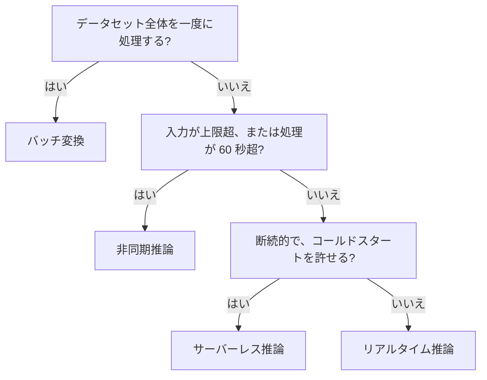
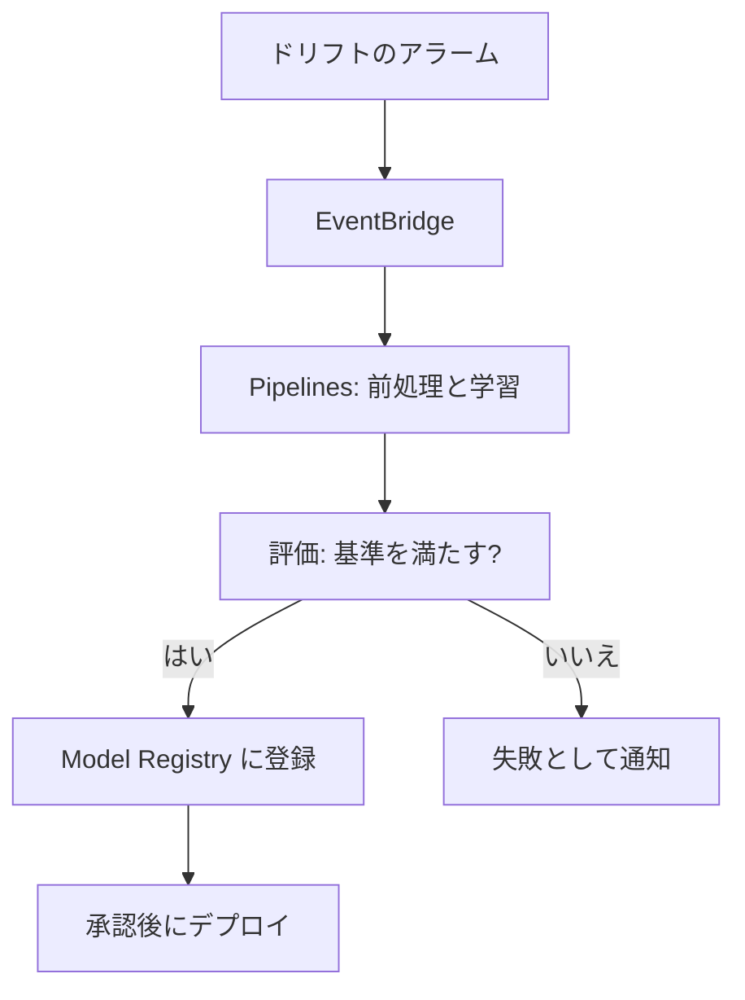

# 分野3: ML と AI のワークフローのデプロイとオーケストレーション

MLA-C02 の配点は **24%** です。デプロイ先の選択、リソースの設定、自動化の3つのタスクがあります。FM のホスティング、RAG の設定、エージェントのデプロイも範囲です。

この分野に限らず、コース全体で使うサービスは[サービス一覧](services.md)から確認できます。

## タスク 3.1: デプロイの基盤を管理する {#task-3-1}

### 3.1.1 コンピューティング環境とデプロイ先の選択 {#skill-3-1-1}

| 要件 | 選択 |
|---|---|
| ML に特化した管理機能を使う | SageMaker AI のエンドポイント |
| 既存の Kubernetes に載せる | EKS |
| 既存の ECS に載せる | ECS |
| サーバーを細かく制御する | EC2 |
| 小さなモデル、短い処理、断続的 | Lambda |
| コンテナのバッチジョブを順に実行する | AWS Batch |
| FM を API で使う | Bedrock |
| 大規模な FM の学習や推論のクラスター | SageMaker HyperPod（Slurm または EKS） |

手間を減らす要件なら、マネージドのサービスを選びます。App Runner、Elastic Beanstalk、Outposts は試験の対象外です。

詳細: [エンドポイントと推論](../../services/sagemaker.md#endpoints)、[デプロイ戦略](../../services/genai-apps.md#deployment)、[AWS Batch](../../services/other-services.md#batch)、[コンテナ](../../services/containers.md#ecs)、[その他の開発向け機能](../../services/sagemaker.md#other-dev)

### 3.1.2 オーケストレーターとマルチモデルの戦略 {#skill-3-1-2}

**オーケストレーター:**

| ツール | 向いている場面 |
|---|---|
| SageMaker Pipelines | ML の専用機能が中心 |
| Step Functions | 多様な AWS サービスを含む業務の流れ |
| MWAA | Airflow の既存資産 |

**1 つのエンドポイントに複数のモデルを載せる方式:**

| 方式 | 使いどころ | 呼び出し |
|---|---|---|
| マルチモデル | 顧客ごとの似たモデルが数千ある | `TargetModel` |
| マルチコンテナ | 別のフレームワークを同居させる | `TargetContainerHostname` か順番 |
| 推論パイプライン | 前処理 → 推論 → 後処理を順に。2〜15 コンテナ | 通常の呼び出し |
| 推論コンポーネント | モデルごとに CPU、GPU、メモリを割り当てる | `InferenceComponentName` |

マルチモデルは初回の呼び出しで S3 から読み込むので遅延が出ます。特定のモデルの TPS が高いときや、サイズが大きく異なるときは専用のエンドポイントにします。

詳細: [SageMaker Pipelines と使い分け](../../services/sagemaker.md#pipelines)、[マルチモデル](../../services/sagemaker.md#multi-model)、[MWAA](../../services/data-engineering.md#mwaa)、[Step Functions](../../services/step-functions.md#orchestration-choreography)

### 3.1.3 推論の戦略の選択 {#skill-3-1-3}

| 種類 | 入力の上限 | 処理時間の上限 | スケーリング |
|---|---|---|---|
| リアルタイム | 6 MB（API リファレンス。FAQ は 25 MB） | 60 秒 | 自動スケーリング |
| サーバーレス | ― | ― | 自動。GPU と VPC の設定は不可 |
| 非同期 | 1 GB | 1 時間 | 0 まで縮小可 |
| バッチ変換 | `MaxPayloadInMB` 最大 100 MB | ― | ジョブの間だけ |

入力 500 MB、処理 20 分なら非同期です。サーバーレスで GPU か VPC が必要になったら、リアルタイムを選びます。

詳細: [エンドポイントと推論](../../services/sagemaker.md#endpoints)、[サーバーレス](../../services/sagemaker.md#serverless)、[非同期](../../services/sagemaker.md#async)、[バッチ変換](../../services/sagemaker.md#batch-transform)

### 3.1.4 FM のデプロイ方式の評価と選択 {#skill-3-1-4}

| 方式 | 課金 | 向いている場面 |
|---|---|---|
| Bedrock オンデマンド | トークン | 変動する負荷、小さく始める |
| Bedrock Provisioned Throughput | モデルユニットの時間課金 | 固定の大きな処理量、カスタムモデル |
| Bedrock バッチ | トークン（対象モデルは割引） | 大量で急がない処理 |
| SageMaker JumpStart | インスタンス | モデルと GPU を細かく制御する |

利用者が増減する一般的なアプリなら、まず Bedrock のオンデマンドです。自前でホストすると、起動の遅さ、GPU メモリ、高価なアイドルへの対応が必要になります。

詳細: [デプロイ戦略](../../services/genai-apps.md#deployment)、[推論の容量](../../services/genai-apps.md#inference-profiles)、[JumpStart](../../services/sagemaker.md#jumpstart)

### 3.1.5 AWS の外で作ったモデルのデプロイ {#skill-3-1-5}

| 方法 | 使いどころ |
|---|---|
| `model.tar.gz` を S3 に置き、推論コンテナで `CreateModel` | SageMaker AI で動かす |
| 独自のコンテナを ECR に置く | 独自の依存関係がある |
| Bedrock Custom Model Import | Bedrock の API で使いたい |

Custom Model Import は Hugging Face の重みの形式を S3 から読み込みます。対応するアーキテクチャは Mistral、Llama、Flan、Qwen などです。呼び出しは `InvokeModel` のオンデマンドで、バッチ推論には対応しません。

詳細: [JumpStart と持ち込み](../../services/sagemaker.md#jumpstart)、[Custom Model Import](../../services/genai-apps.md#custom-model-import)

### 3.1.6 エージェントのデプロイと設定 {#skill-3-1-6}

!!! note "Bedrock Agents の提供状況"
    Bedrock Agents は Agents Classic に改称され、2026-07-30 から新規受付を終了しました。新規は AgentCore で作ります。

| 要件 | 選択 |
|---|---|
| モデル、プロンプト、ツールを指定するだけ | AgentCore Harness |
| 独自のフレームワークやコード | AgentCore Runtime |
| 既存の API や Lambda をツールにする | AgentCore Gateway |
| ツールの呼び出しを決定的に認可する | AgentCore Policy |

通信プロトコルは 2 つを区別します。**MCP** はエージェントとツールやデータの接続、**A2A** はエージェント同士の通信です。Runtime のポートは HTTP が 8080、MCP が 8000、A2A が 9000 です。

詳細: [AgentCore](../../services/genai-apps.md#agentcore)、[Runtime の選び方](../../services/genai-apps.md#agentcore-runtime)、[MCP](../../services/genai-apps.md#mcp)、[マルチエージェント](../../services/genai-apps.md#multi-agent)、[Agents Classic](../../services/genai-apps.md#agents-classic)

### 3.1.7 FM のデプロイ、ホスティング、リソースの設定 {#skill-3-1-7}

| 課題 | 設定 |
|---|---|
| 複数の FM で GPU を共有する | 推論コンポーネントで、モデルごとに資源を割り当てる |
| 用途別の小さな調整 | LoRA のアダプター推論コンポーネント |
| GPU メモリが足りない | 量子化、大きなインスタンス |
| 生成を速くしたい | スペキュレイティブデコーディング、コンパイル |
| 起動が遅い | 事前に読み込む、早めのスケールアウト |
| 高価なアイドル | 推論コンポーネントで共有、0 まで縮小 |

コンパイルは精度が落ちません。量子化は精度が少し落ちることがあります。Bedrock では、モデルユニットの数を `InputTokenCount` と `OutputTokenCount` のピークから見積もります。

詳細: [マルチモデルと推論コンポーネント](../../services/sagemaker.md#multi-model)、[推論の最適化](../../services/sagemaker.md#inference-optimization)、[SageMaker AI での FM](../../services/genai-apps.md#sagemaker-fm)、[推論の容量](../../services/genai-apps.md#inference-profiles)

### 3.1.8 RAG システムの設定 {#skill-3-1-8}

| 設定 | 範囲、値 | 内容 |
|---|---|---|
| `numberOfResults` | 1〜100、既定 5 | 取得するチャンクの最大数 |
| `overrideSearchType` | `HYBRID`、`SEMANTIC` | 省略時は Bedrock が選ぶ |
| `filter` | | メタデータの条件 |
| `implicitFilterConfiguration` | | 質問からフィルターを自動生成 |
| `rerankingConfiguration` | Amazon Rerank 1.0、Cohere Rerank 3.5 | 関連度で並べ替える |

S3 Vectors ではハイブリッド検索を使えません。階層チャンクでは、返る件数が `numberOfResults` より少なくなることがあります。

詳細: [Knowledge Bases のパラメータ](../../services/ai.md#kb-params)、[検索の改善](../../services/genai-apps.md#retrieval-optimization)

## タスク 3.2: リソースをプロビジョニングして設定する {#task-3-2}

### 3.2.1 オンデマンドとプロビジョンドの最適化 {#skill-3-2-1}

| 負荷 | Bedrock | SageMaker AI |
|---|---|---|
| 変動する | オンデマンド | 自動スケーリング、サーバーレス |
| 一定で大きい | Provisioned Throughput、Reserved | 常時のインスタンスと Savings Plans |
| 急がない | バッチ、Flex | 非同期、バッチ変換 |
| 応答速度を優先する | Priority | 常時のインスタンスで余裕を持たせる |
| 予測できるバースト | ― | サーバーレスの Provisioned Concurrency |

Provisioned Throughput は削除するまで時間課金で、コミットメントの期間中は削除できません。使用率が低いと無駄になります。

詳細: [スループットの選択肢](../../services/ai.md#throughput-options)、[サーバーレス](../../services/sagemaker.md#serverless)、[インスタンスの選び方](../../services/sagemaker.md#instance-selection)

### 3.2.2 プロビジョニングの自動化とスタック間の連携 {#skill-3-2-2}

| 手段 | 使いどころ |
|---|---|
| CloudFormation の `Export` と `ImportValue` | 別のチームが管理する VPC の ID などを渡す |
| ネストされたスタック | 再利用する部品。親と一緒に更新する |
| CDK | コードで定義する。スタック間で値を参照できる |
| Service Catalog | 承認された構成をセルフサービスで作る |
| Step Functions、Pipelines | スタックの作成後の処理を順に実行する |

参照されている `Export` は、値の変更もスタックの削除もできません。先に参照側を変えます。別アカウントや別リージョンの出力は `Fn::GetStackOutput` で参照します。

詳細: [出力とエクスポート](../../services/iac.md#outputs-exports)、[ネストとエクスポートの比較](../../services/iac.md#nested-vs-exports)、[CDK](../../services/iac.md#cdk)、[Service Catalog](../../services/governance.md#service-catalog)

### 3.2.3 ML と AI のコンテナの作成と維持 {#skill-3-2-3}

SageMaker AI では、次の順に検討します。手間が小さい順です。

| 状況 | 方法 |
|---|---|
| 必要なパッケージがそろっている | ビルド済みのイメージをそのまま使う |
| パッケージを少し足す | スクリプトモードの `requirements.txt` |
| OS のライブラリなどを足す | ビルド済みイメージを拡張する |
| 対応しないフレームワーク | 独自のコンテナを作る |

ビルド済みのイメージは Deep Learning Containers（DLC）として提供されています。

推論コンテナは `/ping` に応答する必要があります。イメージは ECR に置き、参照にはコミットタグかダイジェストを使います。不要なイメージはライフサイクルポリシーで消し、スキャンで脆弱性を確認します。

ビルド済みのイメージは SageMaker AI のサービス側の認証情報で取得します。ECR を拒否する IAM ポリシーがあっても、その利用は止まりません。

詳細: [Dockerfile](../../services/containers.md#dockerfile)、[ECR](../../services/containers.md#ecr)、[ライフサイクル](../../services/containers.md#ecr-lifecycle)、[スキャン](../../services/containers.md#ecr-scanning)、[リアルタイム](../../services/sagemaker.md#realtime)

### 3.2.4 VPC 内の SageMaker AI エンドポイント {#skill-3-2-4}

| 設定 | 動作 |
|---|---|
| `VpcConfig` | モデルの `CreateModel` にサブネットと SG を指定する |
| S3 ゲートウェイエンドポイント | モデルの取得に使う |
| インターフェイスエンドポイント | SageMaker API と Runtime を VPC 内から呼ぶ |
| `EnableNetworkIsolation` | コンテナからの外向き通信を一切禁止する |

エンドポイントの作成が失敗したら、ECR と S3 に到達できるか、実行ロールの権限があるかを確認します。可用性のためにインスタンスを 2 台以上にすると、複数の AZ に分散します。

詳細: [VPC とネットワーク分離](../../services/sagemaker.md#vpc-isolation)、[VPC エンドポイント](../../services/networking.md#vpc-endpoints)、[リアルタイム](../../services/sagemaker.md#realtime)

### 3.2.5 プログラムによるデプロイとホスティング {#skill-3-2-5}

Boto3 と AWS CLI の順序は `CreateModel` → `CreateEndpointConfig` → `CreateEndpoint` です。呼び出しは `sagemaker-runtime` の `InvokeEndpoint` で、学習やデプロイの `sagemaker` とはクライアントが別です。

SageMaker Python SDK は、これらをまとめて行えます。クラス名は SDK のバージョンで異なります。

モデルを更新するには、新しいエンドポイント設定を作り、`UpdateEndpoint` で切り替えます。呼び出し側の名前は変わりません。

60 秒を超える処理は失敗します。50〜60 秒かかるなら、SDK のソケットタイムアウトを 70 秒にします。

詳細: [エンドポイントと推論](../../services/sagemaker.md#endpoints)、[リアルタイム](../../services/sagemaker.md#realtime)

### 3.2.6 自動スケーリングの指標の選択 {#skill-3-2-6}

Application Auto Scaling を使い、ターゲット追跡が基本です。

| 指標 | 使いどころ |
|---|---|
| `SageMakerVariantInvocationsPerInstance` | 標準。1 件の処理時間が安定している |
| `SageMakerVariantConcurrentRequestsPerModelHighResolution` | 急増に 10 秒で反応する。LLM のストリーミング |
| `ConcurrentRequestsPerCopy` | 推論コンポーネント |
| CPU、GPU の使用率（カスタム） | CPU や GPU が先に飽和するモデル |
| `ApproximateBacklogSizePerInstance`（カスタム） | 非同期 |

`ScaleInCooldown` が短すぎると増減を繰り返します。非同期で 0 台から起動するには、`HasBacklogWithoutCapacity` に基づくステップスケーリングを追加します。

詳細: [自動スケーリング](../../services/sagemaker.md#autoscaling)、[非同期](../../services/sagemaker.md#async)

### 3.2.7 Knowledge Bases の作成と管理 {#skill-3-2-7}

| 手順 | 決めること |
|---|---|
| 種類 | Managed か Customer-managed |
| データソース | Managed は S3、SharePoint、Confluence など。Customer-managed は新規なら S3、Custom |
| 解析 | 既定、BDA、FM |
| チャンク | 既定、固定、階層、セマンティック、なし |
| 埋め込み | モデルと次元。変更すると全データの再埋め込み |
| ベクトルストア | Customer-managed で選ぶ |
| 同期 | `StartIngestionJob`。差分だけを処理する |

データソースを消したときのベクトルの扱いは `dataDeletionPolicy`（`RETAIN` か `DELETE`）で決めます。

詳細: [Managed と Customer-managed](../../services/genai-apps.md#managed-kb)、[取り込みの流れ](../../services/genai-apps.md#kb-ingestion)、[同期と鮮度](../../services/genai-apps.md#kb-sync)

### 3.2.8 検索パイプラインの実装 {#skill-3-2-8}

典型の流れは、質問の変換、検索、絞り込み、リランク、生成です。

| 業務の要件 | 実装 |
|---|---|
| 部署ごとに見える文書を分ける | メタデータフィルター |
| 検索と生成を別に制御する | `Retrieve` のあとにアプリから `Converse` |
| 手軽に回答と引用を得る | `RetrieveAndGenerate`（Customer-managed） |
| 言い換えの質問でモデルを呼ばない | セマンティックキャッシュ |
| 検索の前に入力を検査する | `ApplyGuardrail` |

詳細: [Knowledge Bases を呼ぶ](../../services/ai.md#knowledge-bases)、[検索の改善](../../services/genai-apps.md#retrieval-optimization)、[キャッシュの種類](../../services/genai-apps.md#caching)、[ApplyGuardrail](../../services/ai.md#apply-guardrail)

### 3.2.9 エージェントの状態管理 {#skill-3-2-9}

| 種類 | 実装 | 例 |
|---|---|---|
| 短期 | AgentCore Memory の `CreateEvent` | 今の会話 |
| 長期 | ストラテジーで短期から抽出する | 好み、過去の事実 |
| 自前 | 会話履歴は DynamoDB、長期の知識はベクトルストア | 既存の基盤を使う |

`actorId` を利用者ごとに分けないと、別の利用者の記憶が混ざります。

Runtime のアイドルの既定は 900 秒です。問い合わせが 30 分おきなら、毎回新しい microVM になり、メモリ上の文脈が消えます。`idleRuntimeSessionTimeout` を延ばすか、Memory に残します。

詳細: [Memory の設計](../../services/genai-apps.md#agentcore-memory)、[AgentCore の構成要素と設定](../../services/ai.md#agentcore-components)

### 3.2.10 GPU ワークロードのスケーリング {#skill-3-2-10}

GPU は起動に時間がかかります。モデルの読み込みを含めて、早めに増やします。

| 場面 | 方法 |
|---|---|
| LLM のエンドポイント | 同時リクエスト数の高解像度の指標 |
| その他の GPU 推論 | GPU の使用率のカスタム指標 |
| 複数の FM で共有 | 推論コンポーネントを `ConcurrentRequestsPerCopy` で増減する |
| HyperPod の EKS クラスター | Karpenter によるマネージドのノード自動スケーリング。0 ノードまで縮小できる |
| GPU の容量を計画的に確保する | トレーニングプラン |

処理の負荷を反映しない指標を選ぶと、GPU が飽和してもスケールしません。ゼロまで縮小すると、起動の数分間のリクエストは失敗します。

詳細: [自動スケーリング](../../services/sagemaker.md#autoscaling)、[デプロイ戦略](../../services/genai-apps.md#deployment)、[分散学習と時間短縮](../../services/sagemaker.md#distributed-training)

### 3.2.11 エージェントのワークフローの基盤 {#skill-3-2-11}

| 構成要素 | 置き場所の例 |
|---|---|
| エージェント | AgentCore Runtime（microVM は最大 8 時間、Instances は最大 14 日） |
| 軽いステートレスのツール | Lambda |
| 複雑なツール、長い処理 | ECS / Fargate |
| 既存の API をまとめる | AgentCore Gateway |
| 決まった手順と人の承認 | Step Functions |

配信は、コンテナイメージを ECR に置くか、コードを直接デプロイします。Docker イメージは 2 GB までです。Runtime は VPC に接続できますが、パブリックサブネットに置いてもインターネットには出られません。

無限ループ、コストの暴走、権限の乱用には、繰り返しの上限、トークンの予算、最小権限で備えます。

詳細: [Runtime の選び方](../../services/genai-apps.md#agentcore-runtime)、[AgentCore の構成要素と設定](../../services/ai.md#agentcore-components)、[安全な自律動作](../../services/genai-apps.md#agent-safeguards)、[構造のパターン](../../services/genai-apps.md#workflow-patterns)

## タスク 3.3: 自動化されたオーケストレーションと CI/CD を実装する {#task-3-3}

### 3.3.1 自動デプロイとロールバック {#skill-3-3-1}

SageMaker AI のデプロイガードレールは、ブルー/グリーンが既定です。

| 方式 | 動作 | 制約 |
|---|---|---|
| All at once | 全トラフィックを一度にグリーンへ移す | 最も速い |
| Canary | 一部を移して様子を見る | グリーンの 50% 以下 |
| Linear | 段階的に移す | 各段階はグリーンの 10〜50% |
| Rolling | バッチごとに更新する | 追加の容量を抑えられる |

ベイク期間に CloudWatch アラームが発報すると、自動で元に戻ります。Model Registry では、`Approved` を `Rejected` に変えて、最新の `Approved` を再デプロイする形でも戻せます。

詳細: [デプロイとテストの戦略](../../services/sagemaker.md#deployment-strategies)、[Model Registry](../../services/sagemaker.md#model-registry)

### 3.3.2 Code シリーズの設定とトラブルシューティング {#skill-3-3-2}

| サービス | 役割 | よくある問題 |
|---|---|---|
| CodeCommit | Git リポジトリ | 大きなファイルやデータの置き場にしない |
| CodeConnections | GitHub、GitLab、Bitbucket との接続 | 接続の承認が済んでいない |
| CodeBuild | `buildspec.yml` でビルド、テスト | ロールに ECR の権限がない。Docker のビルドには特権モードが必要 |
| CodeDeploy | EC2、Lambda、ECS へのデプロイ | ライフサイクルフックの失敗 |
| CodePipeline | ステージをつなぐ | アーティファクトの権限、手動承認の待ち |

CodeCommit は 2024 年に新規受付を止めましたが、2025 年 11 月に一般提供へ戻りました。「新規に使えない」という古い説明に注意します。

詳細: [CodeCommit の現状](../../services/cicd.md#codecommit-status)、[ソース管理](../../services/cicd.md#source-control)、[CodeBuild](../../services/cicd.md#codebuild)、[CodeDeploy](../../services/cicd.md#codedeploy)、[CodePipeline](../../services/cicd.md#codepipeline)、[デプロイの問題の解決](../../services/cicd.md#troubleshooting-deployments)

### 3.3.3 学習ジョブと推論ジョブの設定 {#skill-3-3-3}

| 学習の項目 | 誤ったときの症状 |
|---|---|
| `InputDataConfig` | チャネル名の誤りで実行時エラー |
| `OutputDataConfig` | 権限不足で最後に失敗 |
| `ResourceConfig` | 容量不足で `No space left` |
| `StoppingCondition` | `MaxRuntimeInSeconds` で停止 |
| `RoleArn` | S3 の `AccessDenied` |

| バッチ変換の項目 | 内容 |
|---|---|
| `MaxPayloadInMB` | 既定 6、最大 100 |
| `MaxConcurrentTransforms` | `MaxConcurrentTransforms × MaxPayloadInMB` は 100 以下 |
| `SplitType` | `None` だと 1 ファイルを 1 リクエストで送る |
| `InputFilter`、`JoinSource`、`OutputFilter` | ID を除いて推論し、結果と結合する |

1 ファイルを複数のインスタンスで処理すると、1 台しか働きません。入力を複数のファイルに分割します。`SplitType` はファイルをミニバッチに分ける設定で、台数への分散にはなりません。

詳細: [学習ジョブの設定](../../services/sagemaker.md#training-job)、[バッチ変換](../../services/sagemaker.md#batch-transform)

### 3.3.4 CI/CD の自動テスト {#skill-3-3-4}

| 段階 | テスト | 実装 |
|---|---|---|
| コード | 単体テスト | CodeBuild |
| データ | スキーマと品質 | Glue Data Quality、Processing |
| モデル | 指標のしきい値 | Pipelines の Condition ステップ |
| FM | ゴールデンデータセットの回帰テスト | CodeBuild でしきい値を判定 |
| 本番前 | シャドウテスト | SageMaker AI |
| 本番 | 段階的なデプロイ | デプロイガードレール |

Condition ステップで AUC が 0.85 以上のときだけモデルを登録し、下回れば Fail ステップで止める、という形が典型です。

詳細: [CI/CD と再学習](../../services/sagemaker.md#cicd-retraining)、[SageMaker Pipelines](../../services/sagemaker.md#pipelines)、[テスト](../../services/genai-apps.md#testing)

### 3.3.5 再学習の仕組み {#skill-3-3-5}

| きっかけ | 実装 |
|---|---|
| 定期 | EventBridge のスケジュールで Pipelines を開始する |
| 新しいデータ | S3 のイベントで開始する |
| ドリフト | CloudWatch アラーム → EventBridge → Pipelines |

ステップキャッシュを使うと、属性が同じステップは前回の結果を再利用できます。

詳細: [CI/CD と再学習](../../services/sagemaker.md#cicd-retraining)、[SageMaker Pipelines](../../services/sagemaker.md#pipelines)

### 3.3.6 モデルのバージョン管理 {#skill-3-3-6}

| 要素 | 内容 |
|---|---|
| モデルパッケージグループ | 同じモデルのバージョンの集まり |
| モデルパッケージ | 1 つのバージョン |
| `ModelApprovalStatus` | `PendingManualApproval`、`Approved`、`Rejected` |
| MLflow | 実験とモデルを記録する。Model Registry と連携できる |
| Model Cards | 用途とリスクの記録。監査に使う |

状態の変更を EventBridge で検知して、CodePipeline や Lambda を起動します。「誰がいつ承認したか」は CloudTrail と `ApprovalDescription` に残します。

詳細: [Model Registry](../../services/sagemaker.md#model-registry)、[MLflow](../../services/sagemaker.md#mlflow)、[Model Cards](../../services/sagemaker.md#model-cards)

### 3.3.7 プロンプトの管理 {#skill-3-3-7}

| 機能 | 内容 |
|---|---|
| プロンプト | モデル、推論設定、`{{変数}}` を含むテンプレート |
| バリアント | 別案を作って出力を比べる |
| バージョン | 変更できない版を作る |
| 呼び出し | `Converse` の `modelId` にプロンプトの ARN、`promptVariables` に値 |

コードから分離すれば、デプロイなしでプロンプトを更新できます。CI/CD でレビューと評価の通過を条件に、バージョンを昇格させます。

詳細: [プロンプトの管理](../../services/genai-apps.md#prompt-management)

### 3.3.8 エージェントのデプロイパイプラインとバージョン管理 {#skill-3-3-8}

AgentCore Runtime は、作成時にバージョン 1 を作り、更新のたびに変更できない新しいバージョンを作ります。

| エンドポイント | 動作 |
|---|---|
| `DEFAULT` | 常に最新のバージョンを指す |
| 独自（例: 本番用） | 明示的に更新するまで同じバージョンを指す |

本番を安全に更新するには、独自のエンドポイントを作り、評価に通ったバージョンへ `UpdateAgentRuntimeEndpoint` で切り替えます。戻すときも向きを変えるだけです。

パイプラインは、イメージのビルド、ECR へのプッシュ、Runtime の更新、評価、エンドポイントの切り替えの順です。Bedrock Flows も、バージョンとエイリアスで同じように切り替えます。

詳細: [Runtime の選び方](../../services/genai-apps.md#agentcore-runtime)、[Bedrock Flows](../../services/genai-apps.md#flows)、[Evaluations と Optimization](../../services/genai-apps.md#agentcore-evaluations)

### 3.3.9 AI モデルのテストの枠組み {#skill-3-3-9}

| テスト | 内容 |
|---|---|
| ゴールデンデータセット | 質問と正解の固定の集合で定期的に評価する |
| 回帰テスト | プロンプトやモデルの変更で悪化しないか調べる |
| 出力の差分 | 同じ入力で応答を意味的類似度で比べる |
| 敵対的テスト | 攻撃プロンプトで検査し、遮断率を記録する |
| 取得のテスト | 関連性と遅延を調べる |

品質ゲートの例は、「新しいプロンプトで `Faithfulness` が 0.8 未満なら昇格しない」です。

詳細: [テスト](../../services/genai-apps.md#testing)、[多層防御](../../services/genai-apps.md#defense-in-depth)

### 3.3.10 ファインチューニングしたモデルの自動化 {#skill-3-3-10}

| 段階 | 実装 |
|---|---|
| 調整 | データを検証して、カスタマイズのジョブを開始する |
| 記録 | ジョブ名とモデルの ARN を記録する |
| 評価 | Bedrock Evaluations で基準と比べる |
| 配置 | Provisioned Throughput かカスタムモデルのデプロイ |
| 切り替え | 使うモデルの設定を AppConfig に置く |

Step Functions でジョブの完了を待ち、順に実行できます。Legacy になった基盤モデルでは、新しいファインチューニングと Provisioned Throughput を作れません。

詳細: [カスタムモデルの実行](../../services/genai-apps.md#custom-model-deploy)、[動的なモデル切り替え](../../services/genai-apps.md#dynamic-model-selection)、[モデルのライフサイクル](../../services/genai-apps.md#model-lifecycle)

### 3.3.11 RAG の更新とナレッジベースの更新サイクル {#skill-3-3-11}

ファイルを変えても、同期は自動では動きません。

| 方法 | 実装 | 鮮度 |
|---|---|---|
| 定期 | EventBridge のスケジュールで Lambda から `StartIngestionJob` | 1 日など |
| 変更の検知 | S3 イベント → EventBridge → Lambda | 数分 |
| 品質の確認つき | Step Functions で同期、評価、切り替え | 確認してから反映 |

同期は差分だけを処理します。既存のナレッジベースの埋め込みモデルは変更できません。変えるなら新しいベクトルインデックスとナレッジベースを作り、全データを同期してから切り替えます。

詳細: [同期と鮮度](../../services/genai-apps.md#kb-sync)、[埋め込みの選び方](../../services/genai-apps.md#embedding-selection)

## 確認問題 {#self-check}

??? question "問1: 1 件の推論に 15 分かかり、入力の動画は数百 MB です。利用者は結果を後で確認できます。リクエストがない夜間はコストをゼロに近づけたいです。どの推論方式とスケーリングにしますか？"
    非同期推論です。入力は 1 GB まで、処理は 1 時間まで扱えます。`MinCapacity=0` にし、`ApproximateBacklogSizePerInstance` でスケーリングします。0 台から起動するために `HasBacklogWithoutCapacity` のステップスケーリングも追加します。

??? question "問2: 顧客ごとに学習した XGBoost のモデルが 3,000 個あります。各モデルの利用は少なく、エンドポイントの費用を抑えたいです。何を選び、どんな注意点がありますか？"
    マルチモデルエンドポイントです。`TargetModel` でモデルを指定し、S3 から動的に読み込みます。初回の呼び出しに遅延が出ます。特定の顧客だけ TPS が高いなら、そのモデルは専用のエンドポイントに分けます。

??? question "問3: Hugging Face で調整した Llama 系のモデルを、サーバーを管理せず Bedrock の API で呼びたいです。何を使いますか？"
    Bedrock Custom Model Import です。重みを S3 から読み込み、`InvokeModel` のオンデマンドで呼びます。リージョンとアーキテクチャが対応しているかは確認します。

??? question "問4: 新しいモデルを本番のエンドポイントへ段階的に出し、エラー率が上がったら自動で戻したいです。データサイエンティストの承認も必要です。どう組みますか？"
    Pipelines から Model Registry に `PendingManualApproval` で登録します。`Approved` への変更を EventBridge で検知し、CodePipeline でデプロイします。デプロイはガードレールのカナリアにして、CloudWatch アラームで自動ロールバックします。

??? question "問5: AgentCore Runtime のエージェントを更新すると、本番が検証前のコードに切り替わってしまいます。呼び出しに `DEFAULT` エンドポイントを使っています。どう直しますか？"
    本番用の独自のエンドポイントを作り、特定のバージョンを指します。`DEFAULT` は更新のたびに最新を指します。独自のエンドポイントは明示的に更新するまで変わらないので、評価に通ってから切り替えます。

??? question "問6: S3 の社内文書を更新してから、回答に反映されるまで最大でも 30 分にしたいです。古い内容が返っています。何が欠けていて、どう直しますか？"
    同期です。Knowledge Bases はファイルの変更で自動同期しません。S3 イベントを EventBridge で受け、Lambda から `StartIngestionJob` を呼びます。同期は差分だけを処理するので、頻繁に実行しやすくなります。
