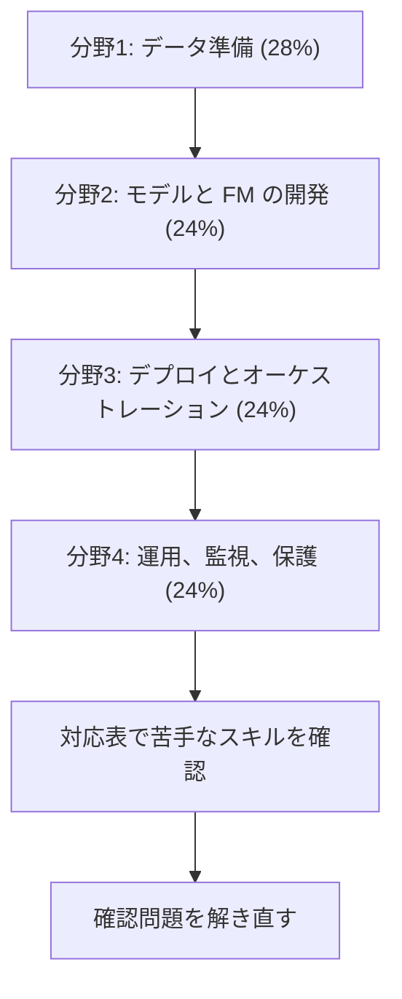

# Machine Learning Engineer - Associate（MLA）

AWS 上で ML と生成 AI のソリューションを構築、運用、監視、保護する力を問う試験です。このコースは **MLA-C02** の範囲に沿っています。

!!! warning "受ける版は言語と受験日で決まります（2026年10月31日時点）"
    | 受験日 | 英語で受ける | 日本語、韓国語、簡体字中国語で受ける |
    |---|---|---|
    | 2026年9月28日まで | MLA-C01 | MLA-C01 |
    | 2026年9月29日から一般提供の前まで | MLA-C02 ベータ（C01 は終了） | **MLA-C01** |
    | 2027年1月14日から | MLA-C02（一般提供） | MLA-C02（一般提供） |

    - **いま日本語で受けるなら MLA-C01 です。** C02 のベータは英語のみです。日本語の話者でも、英語で受けるならベータを選べます。
    - **2027年1月14日に MLA-C01 はすべての言語で終了し**、MLA-C02 が全言語で一般提供されます。この日付は [2026年9月の AWS ブログ](https://aws.amazon.com/blogs/training-and-certification/september-2026-new-offerings/)によるものです。[公式ページ](https://aws.amazon.com/certification/certified-machine-learning-engineer-associate/)の主要な日程では、一般提供の日付はまだ「TBD」です。予約の前に公式ページを確認してください。
    - ベータの終了日は公表されていません。

    C01 で受ける人は[C01 で受ける場合](#c01)を先に読んでください。

## 試験の概要 {#overview}

| 項目 | MLA-C02 ベータ | MLA-C01 |
|---|---|---|
| 試験コード | 公式ページの表では ME1-C02。試験ガイドとブログでは MLA-C02 | MLA-C01 |
| 問題数 | 85問 | 65問 |
| 試験時間 | 170分 | 130分 |
| 受験料 | 75 USD（ベータ価格） | 150 USD |
| 形式 | 択一、複数選択 | 択一、複数選択 |
| 言語 | 英語のみ | 日本語、韓国語、簡体字中国語（英語は 2026年9月28日で終了） |
| 受験方法 | Pearson VUE のテストセンターまたはオンライン | Pearson VUE のテストセンターまたはオンライン |
| 有効期間 | 3年 | 3年 |

上の表は公式ページとブログで確認した値です。

次は [MLA-C02 の試験ガイド](https://docs.aws.amazon.com/aws-certification/latest/machine-learning-engineer-associate-02/machine-learning-engineer-associate-02.html)の内容です。

| 項目 | 内容 |
|---|---|
| 採点 | 採点対象50問 + 採点対象外15問。対象外の問題は見分けられません |
| 合格点 | 720点（100〜1,000点） |
| 採点方式 | 全体の得点で合否を判定します。分野ごとの合格点はありません |
| 複数選択 | 正解をすべて選んだときだけ得点になります |
| 減点 | 誤答による減点はありません。未回答は不正解になるので、すべて回答します |

ベータは問題数と時間が多くなっています。統計的な評価のための問題が追加されているためで、その問題は得点に影響しません（公式ページ）。ベータの結果は通常、受験後 5 営業日以内に届きます。合否の表示に関するガイドの記述は、ベータには当てはまらないと注記されています。

一般提供後の試験時間と受験料は、公式ページとブログのどちらにも書かれていません。

## 学習の順番 {#study-path}

分野の順に進めます。分野1の配点が最も大きく、後の分野の前提にもなります。各分野のページでスキルごとの要点を確認し、足りないところはサービス解説で補います。

| 分野 | C02 の配点 | C01 の配点 | 主なサービス |
|---|---|---|---|
| [分野1: ML と AI のためのデータ準備](domain1.md) | 28% | 28% | S3、Glue、Kinesis、Feature Store、ベクトルストア |
| [分野2: ML モデルと FM の開発](domain2.md) | 24% | 26% | SageMaker AI、Bedrock、MLflow |
| [分野3: デプロイとオーケストレーション](domain3.md) | 24% | 22% | エンドポイント、Pipelines、Knowledge Bases、AgentCore |
| [分野4: 運用、監視、保護](domain4.md) | 24% | 24% | CloudWatch、IAM、Guardrails、Budgets |

全スキルの一覧は[スキル対応表](coverage.md)にあります。

## C01 で受ける場合 {#c01}

日本語で 2027年1月14日より前に受けるなら、C01 です。

**C01 の試験ガイドの本文は、このコースでは扱っていません。** ガイドの URL（公式ページのリンク先）は 2026年10月31日の確認時に取得できませんでした。そのため、C01 の細かい出題範囲はここに書きません。確認できたのは、C02 の[比較ページ](https://docs.aws.amazon.com/aws-certification/latest/machine-learning-engineer-associate-02/mla-02-comparison.html)にある次の内容です。

| 確認できたこと | 内容 |
|---|---|
| 分野 | 4分野です。データ準備、ML モデルの開発、ML ワークフローのデプロイとオーケストレーション、ML ソリューションの監視、保守、セキュリティです。配点は上の表のとおりです |
| タスク | C01 のタスク 1.1〜4.3 は、C02 の同じ番号のタスクに対応します |
| C02 で追加 | 45スキル。Bedrock、RAG、エージェント、埋め込み、FM のコストなど。[対応表](coverage.md)に印を付けています |
| C02 で削除 | 下の表の内容 |

**学習の進め方:** 対応表で「追加」の印がないスキルを優先します。さらに、C02 で削除された次の内容も確認します。

| C02 で削除された内容 | 参照先 |
|---|---|
| 学習リソースへのデータの読み込みの設定（EFS、FSx など） | [入力モード](../../services/sagemaker.md#input-modes)、[Lustre と S3](../../services/storage-advanced.md#fsx-lustre-s3) |
| 独自のデータセットによる事前学習済みモデルの調整（Bedrock、JumpStart） | [モデルカスタマイズ](../../services/genai-apps.md#customization)、[JumpStart](../../services/sagemaker.md#jumpstart) |
| モデルサイズの削減（データ型の変更、枝刈り、特徴量選択の更新、圧縮） | [推論の最適化](../../services/sagemaker.md#inference-optimization) |
| エッジデバイス向けのモデルの最適化（SageMaker Neo） | [Neo](../../services/sagemaker.md#neo) |
| SageMaker での独自コンテナ（BYOC） | [独自コンテナ](domain3.md#skill-3-2-3) |
| インフラの監視（EventBridge のイベントなど） | [EventBridge](../../services/messaging.md#eventbridge) |
| コストと性能に関わる容量の問題の解決（Provisioned Concurrency、サービスクォータ、自動スケーリング） | [自動スケーリング](../../services/sagemaker.md#autoscaling)、[サーバーレス](../../services/sagemaker.md#serverless) |

!!! note "C01 の受験後の認定"
    公式ページによると、認定はいつ取得しても、有効期間の間は有効です。C01 で取得しても、C02 の一般提供で失効することはありません。

## C02 で変わること {#c01-vs-c02}

分野の構成は同じで、新しい分野はありません。公式ページとブログは、主な追加を次のように説明しています。

- 生成 AI の実装（Bedrock、RAG）
- エージェント型 AI（エージェントと複雑なワークフローのオーケストレーション）
- FM と LLM（選択、ファインチューニング、運用）
- 従来の ML と生成 AI にまたがる責任ある AI

公式ページの受験者の役割の例には、LLMOps エンジニアが加わりました。推奨される経験にも、SageMaker AI に加えて Bedrock が入りました。

## 受験者像と範囲外のもの {#out-of-scope}

**想定する受験者:** SageMaker AI、Bedrock などを使った ML エンジニアリングの経験が 1 年以上あり、バックエンド開発、DevOps、データエンジニア、データサイエンティストなどの関連する役割の経験も 1 年以上ある人です。従来の ML と生成 AI の両方の経験を想定しています。

次の作業は受験者に求められていません。

- エンドツーエンドの AI と ML のソリューションの設計
- ベストプラクティスの策定と ML 戦略の指導
- 多様なサービスや新しいツールとの統合
- 2 つ以上の ML の領域を深く扱う作業

範囲外のサービスの例は、Cognito、GuardDuty、Security Hub、WAF、Shield、Route 53、Global Accelerator、Control Tower、Managed Grafana、Elastic Beanstalk、App Runner、Outposts、AWS IoT の各サービス、HealthImaging、HealthOmics です。

## 対象サービスとページ {#services}

試験ガイドの対象サービスと、このwikiのページの対応です。一覧は網羅的ではないとガイドに書かれています。

| 区分 | サービスとページ |
|---|---|
| 分析 | [Athena](../../services/streaming.md#athena)、[Data Firehose](../../services/streaming.md#firehose)、[EMR](../../services/data-engineering.md#emr)、[Glue](../../services/data-engineering.md#glue)、[DataBrew](../../services/data-engineering.md#databrew)、[Glue Data Quality](../../services/data-engineering.md#glue-data-quality)、[Kinesis](../../services/streaming.md#kinesis-data-streams)、[Lake Formation](../../services/data-engineering.md#lake-formation)、[Managed Service for Apache Flink](../../services/data-engineering.md#flink)、[OpenSearch Service](../../services/streaming.md#opensearch)、[Quick](../../services/ai.md#quick)、[Redshift](../../services/data-engineering.md#redshift) |
| アプリケーション統合 | [EventBridge](../../services/messaging.md#eventbridge)、[MWAA](../../services/data-engineering.md#mwaa)、[SNS](../../services/messaging.md#sns)、[SQS](../../services/messaging.md#sqs)、[Step Functions](../../services/step-functions.md) |
| コスト管理 | [Billing and Cost Management](../../services/cost-management.md#billing)、[Budgets](../../services/cost-management.md#budgets)、[Cost Explorer](../../services/cost-management.md#cost-explorer) |
| コンピューティング | [Batch](../../services/other-services.md#batch)、[EC2](../../services/ec2-beanstalk.md)、[Lambda](../../services/lambda.md) |
| コンテナ | [ECR](../../services/containers.md#ecr)、[ECS](../../services/containers.md#ecs)、[EKS](../../services/containers.md#eks) |
| データベース | [DocumentDB](../../services/databases-specialized.md#documentdb)、[DynamoDB](../../services/dynamodb.md)、[ElastiCache](../../services/databases.md#elasticache)、[Neptune](../../services/databases-specialized.md#neptune)、[RDS](../../services/databases.md#rds) |
| 開発者ツール | [CDK](../../services/iac.md#cdk)、[CodeArtifact](../../services/cicd.md#codeartifact)、[CodeBuild](../../services/cicd.md#codebuild)、[CodeCommit](../../services/cicd.md#codecommit-status)、[CodeConnections](../../services/cicd.md#source-control)、[CodeDeploy](../../services/cicd.md#codedeploy)、[CodePipeline](../../services/cicd.md#codepipeline)、[X-Ray](../../services/observability.md#xray) |
| ML と AI | [Bedrock](../../services/genai-apps.md)、[AgentCore](../../services/genai-apps.md#agentcore)、[CodeGuru](../../services/other-services.md#codeguru)、[Comprehend](../../services/ai-managed-services.md#comprehend)、[Comprehend Medical](../../services/ai-managed-services.md#comprehend-medical)、[DevOps Guru](../../services/operations.md#devops-guru)、[HealthLake](../../services/ai-managed-services.md#healthlake)、[Lex](../../services/ai-managed-services.md#lex)、[Personalize](../../services/ai-managed-services.md#personalize)、[Polly](../../services/ai-managed-services.md#polly)、[Rekognition](../../services/ai-managed-services.md#rekognition)、[SageMaker AI](../../services/sagemaker.md)、[Textract](../../services/ai-managed-services.md#textract)、[Transcribe](../../services/ai-managed-services.md#transcribe)、[Translate](../../services/ai-managed-services.md#translate) |
| 管理とガバナンス | [Auto Scaling](../../services/operations.md#auto-scaling)、[CloudFormation](../../services/iac.md#cloudformation-template)、[CloudTrail](../../services/observability.md#cloudtrail)、[CloudWatch](../../services/observability.md#cloudwatch-metrics)、[Compute Optimizer](../../services/cost-management.md#compute-optimizer)、[Config](../../services/governance.md#config)、[Organizations](../../services/governance.md#organizations)、[Service Catalog](../../services/governance.md#service-catalog)、[Systems Manager](../../services/operations.md#systems-manager)、[Trusted Advisor](../../services/cloud-foundations.md#trusted-advisor) |
| メディア | [Kinesis Video Streams](../../services/other-services.md#kinesis-video) |
| 移行と転送 | [DataSync](../../services/migration.md#datasync) |
| ネットワークとコンテンツ配信 | [API Gateway](../../services/api-gateway.md)、[CloudFront](../../services/networking.md#cloudfront)、[Direct Connect](../../services/network-connectivity.md#direct-connect)、[VPC](../../services/networking.md#vpc) |
| セキュリティ | [IAM](../../services/iam.md)、[Inspector](../../services/threat-detection.md#inspector)、[KMS](../../services/kms.md)、[Macie](../../services/threat-detection.md#macie)、[Secrets Manager](../../services/secrets.md#secrets-manager) |
| ストレージ | [EBS](../../services/storage.md#ebs-volume-types)、[EFS](../../services/storage.md#efs)、[FSx](../../services/storage-advanced.md#fsx-selection)、[S3](../../services/s3.md)、[S3 Glacier](../../services/s3.md#glacier-retrieval)、[Storage Gateway](../../services/migration.md#storage-gateway) |

## 参考 {#references}

- [MLA-C02 試験ガイド](https://docs.aws.amazon.com/aws-certification/latest/machine-learning-engineer-associate-02/machine-learning-engineer-associate-02.html)
- [MLA-C01 と MLA-C02 の比較](https://docs.aws.amazon.com/aws-certification/latest/machine-learning-engineer-associate-02/mla-02-comparison.html)
- [認定の公式ページ](https://aws.amazon.com/certification/certified-machine-learning-engineer-associate/)
- [2026年9月の AWS ブログ（試験の更新）](https://aws.amazon.com/blogs/training-and-certification/september-2026-new-offerings/)
