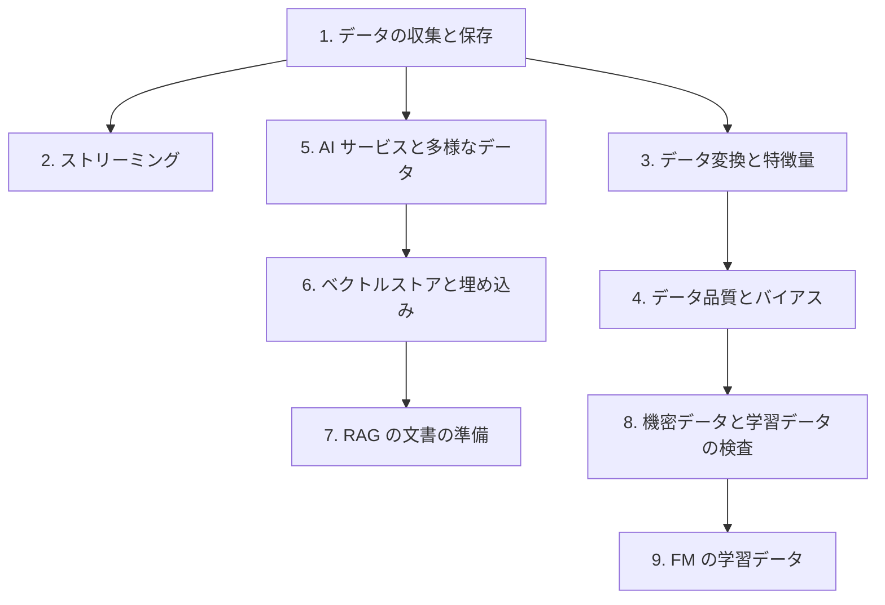

# 分野1: サービス別の学習

分野1（データ準備）は C02 の配点の 28% で、4 分野の中で最大です。収集と保存、変換と特徴量、品質とバイアスの 3 つを扱います。データの置き場所から順に進めると、後のページの話が読みやすくなります。

| 順番 | 話題 | 問われること | 重要度 |
|---|---|---|---|
| 1 | [データの収集と保存](data-ingestion.md) | 抽出の方法、ストレージの選択、形式、結合、取り込みの問題の解決 | 高 |
| 2 | [ストリーミング](streaming.md) | サービスの選択、Kinesis の症状、ストリームの変換 | 高 |
| 3 | [データ変換と特徴量](data-prep.md) | 変換ツールの選択、Feature Store、特徴量エンジニアリング、クリーニング | 高 |
| 4 | [データ品質とバイアス](data-quality.md) | DQDL、ラベル付け、CI と DPL、不均衡の解消 | 高 |
| 5 | [AI サービスと多様なデータ](ai-services.md) | 文書、音声、画像の取り込みと変換 | 中 |
| 6 | [ベクトルストアと埋め込み](vector-embeddings.md) | ストアの選択、次元、埋め込みのコスト、テキストの前処理 | 高 |
| 7 | [Knowledge Bases](knowledge-bases.md) | 解析、チャンク化、メタデータ | 高 |
| 8 | [機密データと安全策](guardrails.md) | マスクの手段の選択、学習データの完全性 | 中 |
| 9 | [FM のカスタマイズ](fm-customization.md) | 教師あり、強化、蒸留のデータ形式 | 中 |

重要度は公式のスキル一覧を見たこの wiki の判断で、公式の数字ではありません。

## 他のサービスにまたがる問題 {#other-questions}

<!-- questions:start -->

この分野の問題は、すべてサービス別のページに載っています。

<!-- questions:end -->
