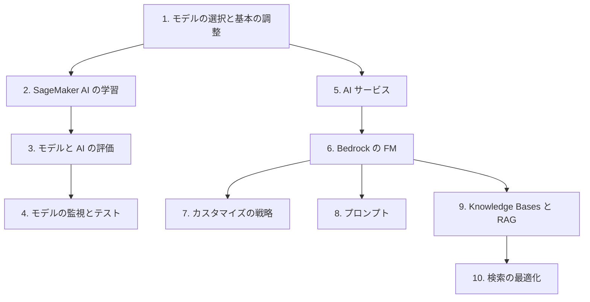

# 分野2: サービス別の学習

分野2（ML モデルと FM の開発）は C02 の配点の 24% です。手法の選択、学習と調整、評価の 3 つを扱います。従来の ML を先に固めると、FM の評価の話も読みやすくなります。

| 順番 | 話題 | 問われること | 重要度 |
|---|---|---|---|
| 1 | [モデルの選択と基本の調整](ml-modeling.md) | アルゴリズムの選択、過学習、アンサンブル、学習率とバッチサイズ | 高 |
| 2 | [SageMaker AI の学習](sagemaker-training.md) | スクリプトモード、AMT、分散学習、スポット、収束の問題 | 高 |
| 3 | [モデルと AI の評価](evaluation.md) | 実験の記録、説明、指標の計算、NLP の指標、LLM の採点 | 高 |
| 4 | [モデルの監視とテスト](model-monitoring.md) | ベースラインとドリフト、シャドウテスト | 中 |
| 5 | [AI サービス](ai-services.md) | 業務に合うサービス、FM との使い分け | 中 |
| 6 | [Bedrock の FM](bedrock-fm.md) | モデルの選択とライフサイクル、遅延とコスト | 高 |
| 7 | [FM のカスタマイズ](fm-customization.md) | プロンプト、RAG、ファインチューニング、蒸留の選択 | 中 |
| 8 | [プロンプト](prompts.md) | フューショット、構造化出力、temperature | 中 |
| 9 | [Knowledge Bases と RAG](knowledge-bases.md) | RAG のパターン、検索精度の評価 | 高 |
| 10 | [ベクトルストアと埋め込み](vector-embeddings.md) | ハイブリッド検索、リランク、クエリ分解 | 中 |

重要度は公式のスキル一覧を見たこの wiki の判断で、公式の数字ではありません。

## 他のサービスにまたがる問題 {#other-questions}

<!-- questions:start -->

この分野の問題は、すべてサービス別のページに載っています。

<!-- questions:end -->
