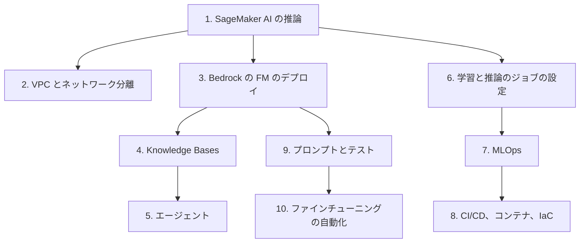

# 分野3: サービス別の学習

分野3（デプロイとオーケストレーション）は C02 の配点の 24% です。デプロイ先の選択、リソースの設定、自動化の 3 つを扱います。SageMaker AI の推論から始めると、FM とエージェントのデプロイの違いが分かりやすくなります。

| 順番 | 話題 | 問われること | 重要度 |
|---|---|---|---|
| 1 | [SageMaker AI の推論](sagemaker-inference.md) | 推論の方式、マルチモデル、API の順序、自動スケーリング | 高 |
| 2 | [VPC とネットワーク分離](security.md) | `VpcConfig`、S3 のエンドポイント、`EnableNetworkIsolation` | 中 |
| 3 | [Bedrock の FM のデプロイ](bedrock-fm.md) | オンデマンドと Provisioned Throughput、推論コンポーネント | 高 |
| 4 | [Knowledge Bases](knowledge-bases.md) | 作成と同期、検索の設定、検索パイプライン | 高 |
| 5 | [エージェント](agents.md) | AgentCore の選択、状態管理、バージョン管理 | 高 |
| 6 | [学習と推論のジョブの設定](sagemaker-training.md) | 学習ジョブの項目、バッチ変換の項目 | 中 |
| 7 | [MLOps](mlops.md) | デプロイガードレール、Condition ステップ、再学習、Model Registry | 高 |
| 8 | [CI/CD、コンテナ、IaC](cicd-iac.md) | スタック間の連携、コンテナの維持、Code シリーズ | 中 |
| 9 | [プロンプトとテスト](prompts.md) | Prompt Management、ゴールデンデータセット、品質ゲート | 中 |
| 10 | [ファインチューニングの自動化](fm-customization.md) | Step Functions、AppConfig、Legacy の制約 | 低 |

重要度は公式のスキル一覧を見たこの wiki の判断で、公式の数字ではありません。

## 他のサービスにまたがる問題 {#other-questions}

<!-- questions:start -->

この分野の問題は、すべてサービス別のページに載っています。

<!-- questions:end -->
