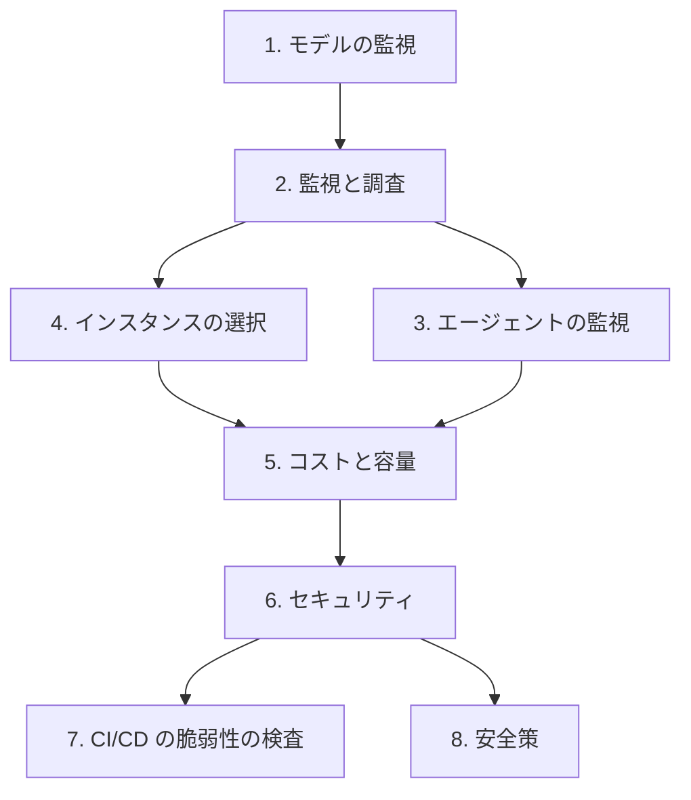

# 分野4: サービス別の学習

分野4（運用、監視、保護）は C02 の配点の 24% です。監視、コストと性能の最適化、セキュリティの 3 つを扱います。監視から始めると、コストと障害の調査の話がつながります。

| 順番 | 話題 | 問われること | 重要度 |
|---|---|---|---|
| 1 | [モデルの監視](model-monitoring.md) | 本番の性能、データキャプチャ、A/B テスト | 高 |
| 2 | [監視と調査](observability.md) | 遅延の切り分け、Bedrock の指標、ダッシュボード | 高 |
| 3 | [エージェントの監視](agents.md) | `stopReason`、ストリームの失敗、依頼あたりの消費 | 中 |
| 4 | [インスタンスの選択](sagemaker-inference.md) | CPU、GPU、Inferentia、Inference Recommender | 中 |
| 5 | [コストと容量](cost-capacity.md) | Budgets、購入オプション、トークンの計算、キャッシュ | 高 |
| 6 | [セキュリティ](security.md) | 最小権限、`iam:PassRole`、ログ、VPC、API キー | 高 |
| 7 | [CI/CD の脆弱性の検査](cicd-iac.md) | Inspector、CodeGuru の現状 | 中 |
| 8 | [安全策](guardrails.md) | インジェクションの対策、Guardrails の機能と層 | 高 |

重要度は公式のスキル一覧を見たこの wiki の判断で、公式の数字ではありません。

## 他のサービスにまたがる問題 {#other-questions}

<!-- questions:start -->

この分野の問題は、すべてサービス別のページに載っています。

<!-- questions:end -->
