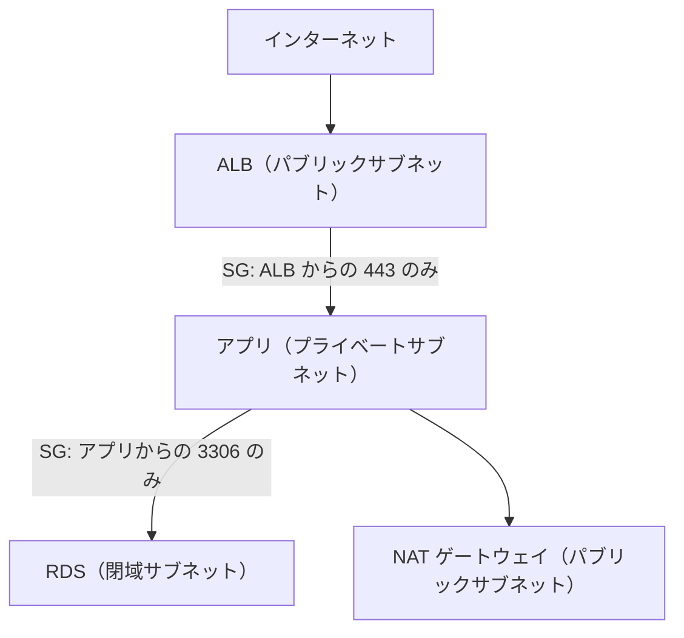

# 分野1: セキュアなアーキテクチャの設計

配点は **30%** で、4分野の中で最大です。誰に何を許すか（ID と権限）、通信をどこで止めるか（ネットワークと防御）、データをどう守るか（暗号化とバックアップ）の3つを問います。

SAA では、サービスの名前を知っているだけでは足りません。要件に合うものを選び、どう設定するかまで問われます。問題文の「最小の運用負荷で」「長期の認証情報を使わずに」「組織全体で」といった条件が、選択肢を絞る手がかりです。

各見出しの「ガイドの項目」は、試験ガイドの Knowledge of（知識）と Skills in（スキル）を、ガイドに載っている順の番号で示したものです。

この分野に限らず、コース全体で使うサービスは[サービス一覧](services.md)から確認できます。

## タスク 1.1: AWS リソースへの安全なアクセスを設計する {#task-1-1}

### 認可モデルと最小権限 {#t1-1-authz-model}

**ガイドの項目:** 知識4 セキュリティのベストプラクティス（最小権限など） / スキル2 ユーザー、グループ、ロール、ポリシーによる柔軟な認可モデル

IAM の部品を、誰が使うかで選びます。

| 部品 | 使う場面 | 注意点 |
|---|---|---|
| IAM ユーザー | どうしても長期の認証情報が必要な場合だけ | 人の利用は Identity Center に寄せます |
| グループ | ユーザーへの権限をまとめて付ける | プリンシパルにはなれません。ポリシーの `Principal` に指定できません |
| ロール | EC2、Lambda、他のアカウント、外部の ID | 一時的な認証情報なので、キーの管理が要りません |
| 管理ポリシー | 複数のプリンシパルで再利用する | 既定はこちらを選びます |
| インラインポリシー | 1 つのプリンシパルと厳密に 1 対 1 にする | 再利用できません |
| 権限境界 | 開発者が作るロールの上限を決める | 権限を与えるものではありません |

最小権限では、`Action` と `Resource` を具体的に書きます。評価の原則は「明示的な Deny が最優先、次に Allow、どちらもなければ暗黙の拒否」です。

**例**: EC2 上のアプリが S3 の 1 つのバケットだけを読むなら、そのバケットの `s3:GetObject` だけを許可したロールをインスタンスプロファイルで渡します。アクセスキーをコードや設定ファイルに置く選択肢は誤りです。

詳細: [プリンシパル](../../services/iam.md#principals)、[ポリシー評価](../../services/iam.md#policy-evaluation)、[管理ポリシーとインラインポリシー](../../services/iam.md#managed-vs-inline)、[最小権限](../../services/iam.md#least-privilege)、[権限境界](../../services/iam.md#permissions-boundary)

### ルートユーザーと IAM ユーザーの保護 {#t1-1-root-mfa}

**ガイドの項目:** スキル1 IAM ユーザーとルートユーザーへのベストプラクティスの適用（MFA など）

ルートユーザーは日常の作業に使いません。MFA を設定し、アクセスキーを作らないようにします。

| 対象 | 行うこと |
|---|---|
| ルートユーザー | MFA を有効にする。アクセスキーを作らない。日常の作業は別の ID で行う |
| 人の利用 | Identity Center の一時的な認証情報を使い、MFA を必須にする |
| やむを得ない IAM ユーザー | MFA を設定し、アクセスキーを定期的に入れ替える。キーは 1 ユーザーにつき最大 2 つなので、新旧を重ねて切り替えられる |
| 重要な操作 | ポリシーの条件 `aws:MultiFactorAuthPresent` で MFA を要求する |

詳細: [プリンシパル](../../services/iam.md#principals)、[アクセスキーとプロファイル](../../services/iam.md#access-keys-profiles)、[GetSessionToken と MFA](../../services/iam.md#mfa)、[Identity Center の MFA](../../services/identity-directory.md#idc-mfa)

### ロールベースのアクセス制御 {#t1-1-rbac}

**ガイドの項目:** スキル3 ロールベースのアクセス制御戦略（STS、ロールの切り替え、クロスアカウントアクセス）

ロールには、誰が引き受けられるかを書く信頼ポリシーと、何ができるかを書く権限ポリシーの 2 つがあります。STS の `AssumeRole` で一時的な認証情報を受け取ります。

| 要件 | 設計 |
|---|---|
| 開発アカウントのユーザーが本番を操作する | 本番にロールを作り、開発アカウントを信頼する。ユーザー側には `sts:AssumeRole` を許可する |
| 第三者の SaaS に自社アカウントを操作させる | ロールの信頼ポリシーで `sts:ExternalId` を条件にする（混乱した代理問題の対策） |
| アプリに一時的な権限を与える | サービスロール。EC2 はインスタンスプロファイル、Lambda は実行ロール |

**例**: 監査チームのアカウントから 30 のアカウントを読み取りたいとき、IAM ユーザーを 30 個作るのは誤りです。各アカウントに読み取り専用のロールを置き、監査アカウントから引き受けます。

詳細: [ロールの引き受け](../../services/iam.md#assume-role)、[信頼ポリシー](../../services/iam.md#trust-policy)、[ExternalId](../../services/iam.md#external-id)、[クロスアカウントアクセス](../../services/iam.md#cross-account)、[STS の API の比較](../../services/iam.md#sts-api-compare)

### フェデレーションとディレクトリ連携 {#t1-1-federation}

**ガイドの項目:** 知識2 フェデレーションと ID サービス（IAM、IAM Identity Center） / スキル6 ディレクトリサービスと IAM ロールを連携すべき場面の判断

既存の ID 基盤があるなら、AWS に同じユーザーを作り直さずに連携します。

| 要件 | 選択 |
|---|---|
| 従業員が複数アカウントへシングルサインオン | IAM Identity Center（権限セットを割り当てる） |
| 1 つのアカウントへ SAML 2.0 で連携 | IAM の SAML プロバイダーとロール（`AssumeRoleWithSAML`） |
| CI/CD などから OIDC で連携 | IAM の OIDC プロバイダーとロール（`AssumeRoleWithWebIdentity`） |
| Web やモバイルの一般利用者 | Cognito（従業員向けではありません） |
| オンプレミスの AD の認証を転送するだけ | AD Connector |
| AWS 上に AD が必要 | AWS Managed Microsoft AD（オンプレミスと信頼関係を結べます） |
| 小規模で AD の基本機能だけ | Simple AD |

**例**: 社内の Active Directory のユーザーに、複数アカウントのコンソールを使わせます。答えは Identity Center の ID ソースを AD にする構成です。グループごとに権限セットを割り当てれば、人事異動は AD 側のグループ変更で済みます。

詳細: [フェデレーション](../../services/iam.md#federation)、[IAM Identity Center](../../services/identity-directory.md#identity-center)、[ID ソース](../../services/identity-directory.md#idc-identity-sources)、[権限セット](../../services/identity-directory.md#idc-permission-sets)、[Directory Service](../../services/identity-directory.md#directory-service)、[選び方](../../services/identity-directory.md#choosing)

### 複数アカウントのセキュリティ戦略 {#t1-1-multi-account}

**ガイドの項目:** 知識1 複数アカウントにまたがるアクセス制御と管理 / スキル4 複数アカウントのセキュリティ戦略（Control Tower、SCP）

アカウントを分けると、影響範囲、権限、費用、クォータを分離できます。統制は次の組み合わせで考えます。

| サービス | 役割 | 選ぶ手がかり |
|---|---|---|
| Organizations | アカウントを OU にまとめ、ポリシーと請求を一元化する | 複数アカウントの土台 |
| SCP | メンバーアカウントの IAM プリンシパルが使える権限の上限 | 「管理者でも特定の操作をさせない」「特定リージョン以外を禁止」 |
| RCP | 組織のリソースへのアクセスの上限 | 「外部からのアクセスを組織のリソース側で制限」 |
| Control Tower | ランディングゾーンとコントロールで環境を組み立てる | 「ベストプラクティスの環境をすばやく」「新しいアカウントを承認済みの設定で」 |
| Service Catalog | 承認済みの製品だけをセルフサービスで配布 | 「利用者が承認済みの構成だけ作れるように」 |
| RAM | サブネットや Transit Gateway などをアカウント間で共有 | 「VPC を集約して他のアカウントに使わせる」 |

SCP は権限を与えません。上限を決めるだけなので、IAM ポリシーでの許可も必要です。また、管理アカウントとサービスリンクロールには効きません。

**例**: 全メンバーアカウントで CloudTrail の停止を禁止したいなら、`cloudtrail:StopLogging` を拒否する SCP をルートか OU に付けます。IAM ポリシーを各アカウントに配る方法は、管理者が外せるので不十分です。

詳細: [Organizations](../../services/governance.md#organizations)、[SCP](../../services/governance.md#scp)、[RCP](../../services/governance.md#rcp)、[Control Tower](../../services/governance.md#control-tower)、[マルチアカウントのパターン](../../services/governance.md#multi-account-patterns)、[Service Catalog](../../services/governance.md#service-catalog)、[RAM](../../services/governance.md#ram)、[SCP と RCP の例外](../../services/identity-directory.md#guardrail-exceptions)

### リソースポリシーの使いどころ {#t1-1-resource-policy}

**ガイドの項目:** スキル5 AWS サービスのリソースポリシーの適切な利用の判断

リソースポリシーは、リソース側に「誰に許すか」を書きます。`Principal` を書ける点が、アイデンティティベースのポリシーとの違いです。

| 場面 | 使うもの |
|---|---|
| 別アカウントに S3 バケットを読ませる | バケットポリシー |
| 別アカウントに KMS キーを使わせる | キーポリシー（IAM ポリシーと合わせて許可） |
| S3 から Lambda を呼ばせる | Lambda のリソースベースポリシー |
| 特定の VPC からだけ API を呼ばせる | API Gateway のリソースポリシー |
| SNS や SQS へ他のサービスから送らせる | トピックやキューのアクセスポリシー |
| 別アカウントにシークレットを読ませる | シークレットのリソースポリシーとカスタマー管理キー |

同じアカウントなら、IAM かリソースポリシーのどちらかの許可で足ります。別アカウントなら、原則として両方で許可が必要です。

詳細: [アイデンティティベースとリソースベース](../../services/iam.md#identity-vs-resource)、[バケットポリシー](../../services/s3.md#bucket-policies)、[キーポリシー](../../services/kms.md#key-policy-details)、[Lambda のリソースベースポリシー](../../services/lambda.md#resource-policy)、[API Gateway のリソースポリシー](../../services/api-gateway.md#resource-policy)、[SNS のアクセスポリシー](../../services/messaging.md#sns-access)、[シークレットのリソースポリシー](../../services/secrets.md#secret-resource-policy)

### グローバルインフラストラクチャとセキュリティ {#t1-1-global-infra}

**ガイドの項目:** 知識3 グローバルインフラストラクチャ（AZ、リージョン）

リージョンの選択は、セキュリティの判断でもあります。データの所在の規制があれば、まずリージョンを絞ります。SCP でリージョンを制限すれば、規制外の場所にデータを置く操作を止められます。

| 単位 | 判断 |
|---|---|
| リージョン | データの所在、利用者との距離、使えるサービス、料金 |
| AZ | 単一障害点を共有しない区画。複数の AZ に分けて障害の影響を抑える |
| グローバルなサービス | IAM、Route 53、CloudFront など。リージョンの制限を書くときは除外を考える |

詳細: [リージョン](../../services/cloud-foundations.md#regions)、[アベイラビリティーゾーン](../../services/cloud-foundations.md#availability-zones)、[エッジロケーション](../../services/cloud-foundations.md#edge-locations)

### 責任共有モデル {#t1-1-shared-responsibility}

**ガイドの項目:** 知識5 責任共有モデル

AWS は「クラウドのセキュリティ」、利用者は「クラウドの中のセキュリティ」を担当します。抽象度が高いサービスほど、利用者の範囲は狭くなります。

| サービス | OS のパッチ | 利用者に残るもの |
|---|---|---|
| EC2 | 利用者 | OS、ミドルウェア、SG、データ、IAM |
| RDS | AWS（適用の時間帯は利用者が決める） | DB のユーザー、SG、暗号化の設定、データ |
| Lambda | AWS | コード、実行ロール、データ |
| S3 | AWS | バケットポリシー、暗号化の設定、データ |

詳細: [責任共有モデル](../../services/cloud-foundations.md#shared-responsibility)、[サービスごとの違い](../../services/cloud-foundations.md#responsibility-by-service)

## タスク 1.2: 安全なワークロードとアプリケーションを設計する {#task-1-2}

### VPC のセキュリティ部品と通信の制御 {#t1-2-vpc-security}

**ガイドの項目:** 知識3 ポート、プロトコル、ネットワークトラフィックの制御 / スキル1 セキュリティ部品を含む VPC の設計（SG、ルートテーブル、NACL、NAT ゲートウェイ）

通信を制御する部品は、効く場所が違います。

| | セキュリティグループ | ネットワーク ACL |
|---|---|---|
| 適用先 | ENI 単位 | サブネット単位 |
| ルール | 許可のみ | 許可と拒否 |
| 評価 | すべてのルール | 番号の小さい順に最初の一致 |
| 戻り通信 | 自動で許可（ステートフル） | 明示的な許可が必要（ステートレス） |
| 使いどころ | 主な通信制御 | 特定の IP の拒否 |

- SG の送信元には、別の SG を指定できます。「ALB からの 443 だけをアプリで受ける」は IP ではなくこの方法で書きます。
- 特定の攻撃元 IP を止めるなら NACL か WAF です。SG には拒否ルールがありません。
- NACL を自作するときは、戻り通信のエフェメラルポート（NAT ゲートウェイなら 1024〜65535）を開けます。
- NAT ゲートウェイは外向きの通信だけを通します。外からの接続は受けず、SG も付けられません。

詳細: [SG と NACL](../../services/networking.md#security-groups-nacls)、[SG のルール](../../services/networking.md#security-group-rules)、[NACL のルール](../../services/networking.md#nacl-rules)、[NAT ゲートウェイ](../../services/network-connectivity.md#nat-gateway)、[接続できないときの切り分け](../../services/networking.md#vpc-troubleshooting)

### ネットワークの分割 {#t1-2-segmentation}

**ガイドの項目:** スキル2 ネットワーク分割の戦略（パブリックサブネットとプライベートサブネット）

サブネットの種類を決めるのは、名前ではなくルートテーブルです。

| サブネット | `0.0.0.0/0` の転送先 | 置くもの |
|---|---|---|
| パブリック | インターネットゲートウェイ | ALB、NAT ゲートウェイ |
| プライベート | NAT ゲートウェイ | アプリケーション |
| 閉域 | なし | データベース |

各層を複数の AZ に作ります。サーバーへの管理接続は、踏み台を公開せず Session Manager を使えば、インバウンドのポートを開けずに済みます。

詳細: [サブネットとルートテーブル](../../services/networking.md#subnets-route-tables)、[Session Manager](../../services/operations.md#session-manager)

### サービスエンドポイント {#t1-2-endpoints}

**ガイドの項目:** 知識2 AWS サービスのエンドポイント

プライベートサブネットから AWS サービスを呼ぶときは、VPC エンドポイントでインターネットを経由せずに接続できます。

| | ゲートウェイ | インターフェイス（PrivateLink） |
|---|---|---|
| 対象 | S3、DynamoDB | 多くのサービス、PrivateLink 対応サービス |
| 仕組み | ルートテーブルに経路を追加 | サブネットに ENI を作る |
| 料金 | 追加料金なし | 時間とデータ量 |
| オンプレミスから | 使えない | 使える |
| 制御 | エンドポイントポリシー | エンドポイントポリシーと SG |

**例**: オンプレミスから VPN 経由で S3 へプライベートに接続するなら、ゲートウェイでは届かないので S3 のインターフェイスエンドポイントです。

バケットポリシーで `aws:SourceVpce` を条件にすれば、特定のエンドポイント以外からのアクセスを拒否できます。

詳細: [VPC エンドポイントと PrivateLink](../../services/networking.md#vpc-endpoints)、[選び方と制約](../../services/networking.md#endpoint-settings)、[エンドポイントポリシー](../../services/networking.md#endpoint-policies)

### 設定と認証情報の保護 {#t1-2-credentials}

**ガイドの項目:** 知識1 アプリケーションの設定と認証情報のセキュリティ

| 要件 | 選択 |
|---|---|
| DB のパスワードを自動でローテーションする | Secrets Manager |
| 設定値や低リスクの秘密情報を安価に保管する | Parameter Store（`SecureString`） |
| EC2 から AWS を呼ぶ | インスタンスプロファイル |
| インスタンスメタデータを守る | IMDSv2 を必須にする |
| RDS にパスワードなしで接続する | IAM データベース認証（MariaDB、MySQL、PostgreSQL） |

ソースコード、環境変数の平文、AMI に認証情報を埋め込む選択肢は誤りです。

詳細: [3 つのサービスの比較](../../services/secrets.md#comparison)、[Secrets Manager のローテーション](../../services/secrets.md#rotation)、[Parameter Store](../../services/secrets.md#parameter-store)、[インスタンスプロファイル](../../services/iam.md#instance-profile)、[IMDS](../../services/ec2-beanstalk.md#imds)、[IAM データベース認証](../../services/databases.md#rds-iam-auth)

### アプリケーションへの安全なアクセス {#t1-2-app-access}

**ガイドの項目:** 知識4 アプリケーションへの安全なアクセス

| 要件 | 選択 |
|---|---|
| 利用者のサインアップとサインイン | Cognito ユーザープール |
| 利用者に AWS の一時的な認証情報を渡す | Cognito ID プール |
| API の認可 | API Gateway の Cognito オーソライザー、Lambda オーソライザー、IAM 認証 |
| 有料コンテンツの限定配信 | CloudFront の署名付き URL か署名付き Cookie |
| 非公開オブジェクトの一時的な共有 | S3 の署名付き URL |
| S3 を CloudFront 経由だけで公開 | OAC とブロックパブリックアクセス |
| 従業員向けの内部アプリを VPN なしで | Verified Access |

詳細: [ユーザープールと ID プール](../../services/cognito.md#user-vs-identity-pools)、[API Gateway の認可](../../services/api-gateway.md#authorizers)、[署名付き URL と Cookie](../../services/networking.md#signed-urls-cookies)、[S3 の署名付き URL](../../services/s3.md#presigned-urls)、[OAC](../../services/networking.md#oac)、[Verified Access](../../services/identity-directory.md#verified-access)

### セキュリティサービスの使い分け {#t1-2-security-services}

**ガイドの項目:** 知識5 セキュリティサービスの適切な用途（Cognito、GuardDuty、Macie）

名前が似ていて混同しやすいので、「何を見るサービスか」で覚えます。

| サービス | 見るもの | 選ぶ手がかり |
|---|---|---|
| GuardDuty | ログなどから脅威を検出 | 不審な API 呼び出し、侵害されたインスタンス |
| Inspector | EC2、ECR、Lambda の脆弱性 | CVE、パッチの漏れ |
| Macie | S3 の中の機密データ | 個人情報がどのバケットにあるか |
| Detective | 検出結果の原因を調査 | 発見の後の根本原因 |
| Security Hub | 検出結果の集約と優先度付け、基準への準拠 | 組織全体を 1 か所で |
| Firewall Manager | WAF や SG などのルールを組織に展開 | 複数アカウントへの一括適用 |
| Cognito | アプリの利用者の認証 | 顧客のサインイン |

詳細: [選び方の比較](../../services/threat-detection.md#choosing)、[GuardDuty](../../services/threat-detection.md#guardduty)、[Inspector](../../services/threat-detection.md#inspector)、[Macie](../../services/threat-detection.md#macie)、[Detective](../../services/threat-detection.md#detective)、[Security Hub](../../services/threat-detection.md#security-hub)、[Firewall Manager](../../services/threat-detection.md#firewall-manager)

### 外部の脅威への対策 {#t1-2-threats}

**ガイドの項目:** 知識6 AWS の外部からの脅威（DDoS、SQL インジェクション） / スキル3 アプリケーションを保護するサービスの統合（Shield、WAF、IAM Identity Center、Secrets Manager）

攻撃の種類と守る場所を対応させます。

| 脅威 | 対策 | 置く場所 |
|---|---|---|
| L3、L4 の DDoS | Shield Standard（追加料金なしで自動適用） | 全ユーザー |
| 大規模な DDoS、専門チームの支援、費用の保護 | Shield Advanced | CloudFront、Route 53、Global Accelerator、ALB、Elastic IP（EC2、NLB はこの関連付け） |
| SQL インジェクション、XSS | WAF のマネージドルール | CloudFront、ALB、API Gateway、AppSync、Cognito ユーザープールなど |
| 特定の IP からの大量リクエスト | WAF のレートベースルール | 同上 |
| VPC の全通信の検査、侵入防止 | Network Firewall | VPC の専用サブネット |
| 悪意のあるドメインへの DNS クエリ | Route 53 の DNS Firewall | VPC |

アプリの中の守りも統合します。人の入口は Identity Center に、認証情報は Secrets Manager にまとめると、コードと運用から秘密情報を外せます。

Shield は量の攻撃、WAF はリクエストの中身を扱います。L7 の DDoS には両方を組み合わせます。

詳細: [Shield](../../services/threat-detection.md#shield)、[AWS WAF](../../services/certificates.md#waf)、[アタッチできる場所](../../services/certificates.md#waf-resources)、[レートベースルール](../../services/certificates.md#rate-based-rules)、[Network Firewall](../../services/threat-detection.md#network-firewall)、[DNS Firewall](../../services/network-connectivity.md#dns-firewall)

### 外部ネットワークとの安全な接続 {#t1-2-external}

**ガイドの項目:** スキル4 AWS との外部接続の保護（VPN、Direct Connect）

| 要件 | 選択 | 補足 |
|---|---|---|
| 暗号化された拠点間接続をすぐに | Site-to-Site VPN | IPsec。トンネルは 2 本あり、両方設定します |
| 安定した帯域の専用線 | Direct Connect | **既定では暗号化されません** |
| 専用線で暗号化も必須（ルーターまで） | Direct Connect と MACsec | 専用接続の 10、100、400 Gbps |
| 専用線で暗号化も必須（VPC まで） | Direct Connect の上のプライベート IP VPN | Transit Gateway と組み合わせます |
| 従業員の端末から | Client VPN | OpenVPN ベースのクライアントで接続 |

「Direct Connect だから暗号化されている」という選択肢は誤りです。

詳細: [オンプレミスとの接続の選び方](../../services/network-connectivity.md#choosing-hybrid)、[Site-to-Site VPN](../../services/network-connectivity.md#site-to-site-vpn)、[Direct Connect](../../services/network-connectivity.md#direct-connect)、[MACsec](../../services/network-connectivity.md#dx-macsec)、[プライベート IP VPN](../../services/network-connectivity.md#vpn-private-ip)、[Client VPN](../../services/network-connectivity.md#client-vpn)

## タスク 1.3: 適切なデータセキュリティ統制を決定する {#task-1-3}

### データアクセスとガバナンス {#t1-3-governance}

**ガイドの項目:** 知識1 データアクセスとガバナンス / スキル6 データのアクセス、ライフサイクル、保護のポリシーの実装

| 要件 | 使うもの |
|---|---|
| S3 の公開を組織やアカウントの単位で防ぐ | S3 ブロックパブリックアクセス |
| データレイクの表、列、行で権限を分ける | Lake Formation |
| 誰がデータを操作したかを記録する | CloudTrail（S3 オブジェクトの操作はデータイベントの有効化が必要） |
| 設定が基準に合っているかを継続して確認する | Config ルール |
| 誤った削除や上書きから守る | S3 のバージョニング、Object Lock |
| 古いデータを自動で移す、消す | S3 ライフサイクル |

CloudTrail のデータイベントは既定で記録されません。「S3 のオブジェクトを誰が読んだか分からない」という問題の答えは、データイベントの有効化です。

詳細: [ブロックパブリックアクセス](../../services/s3.md#block-public-access)、[Lake Formation](../../services/data-engineering.md#lake-formation)、[CloudTrail のイベントの種類](../../services/observability.md#cloudtrail-events)、[Config](../../services/governance.md#config)、[バージョニング](../../services/s3.md#versioning)、[Object Lock](../../services/s3.md#object-lock)、[ライフサイクル](../../services/s3.md#lifecycle)

### データの保持と分類 {#t1-3-classification}

**ガイドの項目:** 知識3 データの保持と分類

分類してから、保持と保護を決めます。

| 目的 | 使うもの |
|---|---|
| S3 の機密データを見つける | Macie |
| 分類をリソースに示す | タグ（タグでアクセスを制御する ABAC にも使えます） |
| 7 年間、誰にも消させない | S3 Object Lock のコンプライアンスモード |
| 管理者だけは例外を残す | S3 Object Lock のガバナンスモード |
| バックアップを誰にも消させない | AWS Backup の Vault Lock |
| ログの保持期間を決める | CloudWatch Logs の保持期間 |

コンプライアンスモードは、ルートユーザーを含めて誰も削除できず、期間の短縮もできません。

詳細: [データ分類](../../services/secrets.md#data-classification)、[Macie](../../services/threat-detection.md#macie)、[タグ戦略](../../services/governance.md#tagging-strategy)、[Object Lock](../../services/s3.md#object-lock)、[Vault Lock](../../services/resilience.md#vault-lock)、[ログの保持期間](../../services/observability.md#log-retention)

### コンプライアンス要件への対応 {#t1-3-compliance}

**ガイドの項目:** スキル1 コンプライアンス要件に合わせた AWS 技術の選択

| 要件 | 選択 |
|---|---|
| AWS の第三者監査レポート（SOC、ISO など）を入手する | AWS Artifact |
| 自社の設定が基準に合うかを評価する | Config の適合パック、Security Hub CSPM |
| 単一テナントの HSM で鍵を管理する | CloudHSM |
| 変更の記録を長期に残す | CloudTrail の証跡を S3 に、Object Lock と組み合わせる |
| データを特定の国に留める | SCP でリージョンを制限する |

Artifact は AWS 自身の報告書を入手する場所で、自社の環境を評価するものではありません。

詳細: [AWS Artifact](../../services/threat-detection.md#artifact)、[適合パック](../../services/governance.md#config-conformance-packs)、[Security Hub CSPM](../../services/threat-detection.md#security-hub-cspm)、[CloudHSM と KMS](../../services/identity-directory.md#cloudhsm-vs-kms)、[CloudTrail の証跡](../../services/observability.md#cloudtrail-trails)

### 保存時の暗号化と鍵の管理 {#t1-3-at-rest}

**ガイドの項目:** 知識4 暗号化と適切な鍵の管理 / スキル2 保存時の暗号化（KMS）

| 要件 | 選択 |
|---|---|
| 鍵の管理を任せたい、最も簡単に | SSE-S3（新しいオブジェクトは既定でこれ） |
| 鍵の利用を監査したい、権限を分けたい | SSE-KMS とカスタマー管理キー |
| 自分の鍵を AWS に保存したくない | SSE-C か、クライアント側の暗号化 |
| SSE-KMS の KMS 呼び出しを減らす | S3 バケットキー |
| 単一テナントの HSM | CloudHSM（AWS サービスで使うなら KMS のキーストア） |

| KMS キー | キーポリシー | 別アカウントとの共有 |
|---|---|---|
| カスタマー管理キー | 自分で管理 | 可 |
| AWS 管理キー | サービスが管理 | 不可 |
| AWS 所有キー | 見えない | サービスによる |

**別アカウントと共有する暗号化スナップショット**の問題では、AWS 管理キーでは共有できないので、カスタマー管理キーが答えになります。

既存の暗号化されていない RDS は、そのまま暗号化できません。スナップショットを暗号化してコピーし、そこから復元します。ブルー/グリーンデプロイで、暗号化したグリーン環境を作る方法もあります。

詳細: [KMS キーの種類](../../services/kms.md#key-types)、[S3 の暗号化](../../services/s3.md#encryption)、[S3 バケットキー](../../services/s3.md#bucket-key)、[EBS の暗号化](../../services/storage.md#ebs-encryption)、[CloudHSM のキーストア](../../services/identity-directory.md#cloudhsm-key-store)

### 転送時の暗号化 {#t1-3-in-transit}

**ガイドの項目:** スキル3 転送時の暗号化（ACM と TLS）

ACM で公開証明書を発行し、ALB、CloudFront、API Gateway などに付けます。統合サービスで使う証明書に追加料金はかかりません。

| 使う場所 | 証明書を置くリージョン |
|---|---|
| CloudFront | `us-east-1` のみ |
| API Gateway のエッジ最適化 | `us-east-1` |
| API Gateway のリージョナル | API と同じリージョン |
| ALB、NLB | ロードバランサーと同じリージョン |

- HTTP を拒否するには、S3 のバケットポリシーで `aws:SecureTransport` が `false` のリクエストを Deny します。
- ACM の証明書はリージョン間でコピーできないので、必要なリージョンごとに作ります。
- TLS はロードバランサーで終端するのが基本です。EC2 のサーバーに直接置くなら、エクスポート可能な公開証明書か ACME を使います。

詳細: [ACM](../../services/certificates.md#acm)、[リージョンのルール](../../services/certificates.md#region-rules)、[統合サービス](../../services/certificates.md#integrated-services)、[転送時の TLS](../../services/certificates.md#tls-in-transit)、[保存時と転送時の暗号化](../../services/kms.md#at-rest-in-transit)

### 暗号鍵のアクセスポリシー {#t1-3-key-policies}

**ガイドの項目:** スキル4 暗号鍵のアクセスポリシーの実装

KMS では、キーポリシーが必須で、アクセス制御の中心です。IAM ポリシーを効かせるには、キーポリシーでアカウントへの委任が必要です（既定のキーポリシーにはあります）。

| 要件 | 設定 |
|---|---|
| 管理する人と使う人を分ける | キーポリシーで管理操作と暗号操作の主体を分ける |
| 別アカウントに使わせる | キーポリシーで許可し、相手の IAM ポリシーでも許可する |
| 特定のサービス経由でだけ使わせる | 条件キー `kms:ViaService` |
| 一時的に権限を渡す | グラント |

詳細: [キーポリシー、IAM、グラント](../../services/kms.md#access-control)、[既定のキーポリシー](../../services/kms.md#default-key-policy-details)、[kms:ViaService](../../services/kms.md#via-service)、[アカウントをまたぐ暗号化](../../services/kms.md#cross-account)

### 鍵のローテーションと証明書の更新 {#t1-3-rotation}

**ガイドの項目:** スキル7 暗号鍵のローテーションと証明書の更新

| 対象 | 動作 |
|---|---|
| カスタマー管理キー | 自動ローテーションは任意。90〜2,560 日（既定 365 日）。オンデマンドも可 |
| AWS 管理キー | 約 1 年ごとに必須 |
| 鍵素材をインポートしたキー | 自動ローテーションは不可。新しい鍵素材をインポートしてオンデマンドでローテーションする |
| ACM の公開証明書（DNS 検証） | 自動で更新 |
| ACM の公開証明書（メール検証） | 更新の案内がメールで届く |
| ACM にインポートした証明書 | **自動更新されない**。期限の監視と入れ替えが必要 |

ローテーションしても、キーの ID と ARN は変わりません。古い鍵素材も保持されるので、既存の暗号文を復号でき、コードの変更も要りません。

詳細: [キーのローテーション](../../services/kms.md#key-rotation)、[ローテーションの設定](../../services/kms.md#rotation-settings)、[鍵素材のインポート](../../services/kms.md#imported-key-material)、[ACM の自動更新](../../services/certificates.md#auto-renewal)、[更新の監視](../../services/certificates.md#renewal-monitoring)

### データの復旧、バックアップ、レプリケーション {#t1-3-backup}

**ガイドの項目:** 知識2 データの復旧 / スキル5 データのバックアップとレプリケーションの実装

レプリケーションだけでは、破損や誤削除を防げません。破損も複製されるからです。時点復旧のバックアップも持ちます。

| サービス | バックアップと復旧 | レプリケーション |
|---|---|---|
| S3 | バージョニング | CRR、SRR。両方のバケットでバージョニングが必須 |
| EBS | スナップショット、Data Lifecycle Manager | スナップショットのコピー |
| RDS | 自動バックアップ（保持は 0〜35 日）、手動スナップショット | リードレプリカ |
| DynamoDB | PITR（1〜35 日）、オンデマンドバックアップ | グローバルテーブル |
| 全体をまとめる | AWS Backup のプラン、Vault Lock | リージョン間、アカウント間のコピー |

複数のサービスのバックアップを一元管理し、別アカウントにも保管したいなら AWS Backup です。ランサムウェア対策の問題では、Vault Lock や論理的にエアギャップされたボールトが手がかりになります。

詳細: [S3 レプリケーション](../../services/s3.md#replication)、[EBS スナップショット](../../services/storage.md#ebs-snapshots)、[DynamoDB のバックアップ](../../services/dynamodb.md#backup)、[AWS Backup](../../services/resilience.md#backup)、[アカウント間コピー](../../services/resilience.md#backup-cross-account)、[ランサムウェアと誤削除の防止](../../services/resilience.md#immutable-compare)

## 確認問題 {#self-check}

??? question "問1: ある会社には本番と開発の2つのアカウントがあります。開発アカウントのエンジニアに本番の DynamoDB を一時的に読ませたいです。IAM ユーザーやアクセスキーは増やしたくありません。どう設計しますか？"
    本番アカウントに読み取りだけを許可したロールを作り、信頼ポリシーで開発アカウントを指定します。開発側では、そのロールへの `sts:AssumeRole` を許可します。一時的な認証情報なので、キーの管理が不要で、最小権限も守れます。

??? question "問2: 組織の全アカウントで、東京と大阪以外のリージョンの利用を止めたいです。各アカウントの管理者でも回避できないようにするには、何を使いますか？"
    Organizations の SCP です。`aws:RequestedRegion` を条件に、2 つのリージョン以外を Deny します。グローバルなサービスは除外します。SCP は管理アカウントには適用されません。IAM ポリシーはアカウントの管理者が変更できるので、この要件を満たしません。

??? question "問3: ALB の後ろの EC2 で動く Web アプリに SQL インジェクションの試行が続いています。アプリの改修を待たずに、最も少ない手間で防ぐには？"
    ALB に WAF のウェブ ACL を関連付け、SQL インジェクション用のマネージドルールを有効にします。Shield は量の攻撃への対策で、リクエストの中身は検査しません。SG や NACL も中身を見られません。

??? question "問4: プライベートサブネットの EC2 が S3 と大量にやり取りしています。通信をインターネットに出さず、費用も下げたいです。何を追加しますか？"
    S3 のゲートウェイエンドポイントです。ルートテーブルに経路を追加するだけで、追加料金はかかりません。NAT ゲートウェイの処理料金も減ります。インターフェイスエンドポイントも使えますが、時間とデータ量の料金がかかります。

??? question "問5: 監査の要件で、S3 のログを 7 年間、ルートユーザーを含めて誰にも削除させないようにしたいです。設定は？"
    バケットでバージョニングと Object Lock を有効にし、コンプライアンスモードで 7 年の保持期間を設定します。ガバナンスモードは権限があれば迂回できるので、要件を満たしません。

??? question "問6: RDS for MySQL の暗号化されていないインスタンスがあります。暗号化し、別アカウントの DR 環境にもスナップショットを共有するよう求められました。どう進めますか？"
    スナップショットを取り、カスタマー管理キーを指定して暗号化コピーを作り、そこから新しいインスタンスを復元します。既存のインスタンスをそのまま暗号化することはできません。AWS 管理キーで暗号化したスナップショットは共有できないので、カスタマー管理キーを使い、キーポリシーで相手のアカウントにも許可します。
