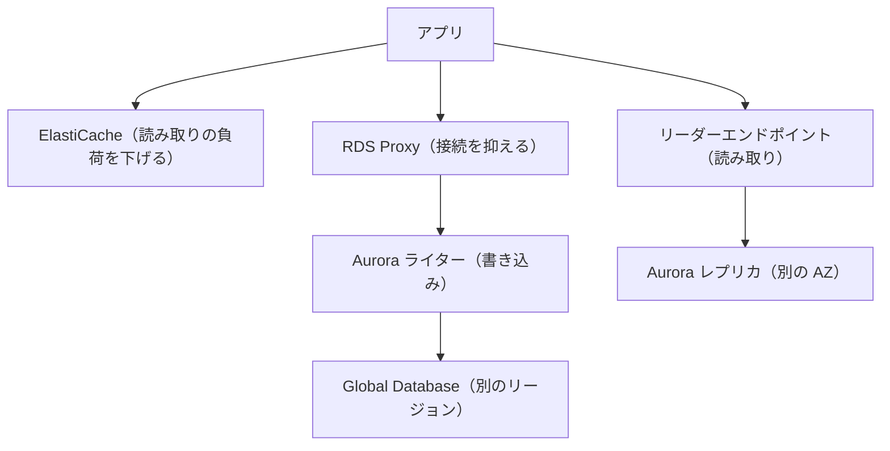
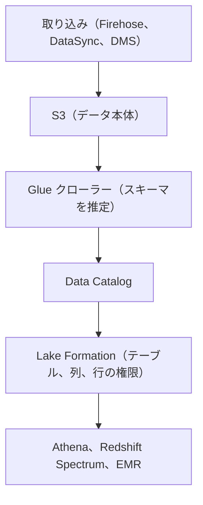

# 分野3: 高性能なアーキテクチャの設計

配点は **24%** です。ストレージ、コンピューティング、データベース、ネットワーク、データの取り込みの 5 つのタスクがあり、4 分野で最も範囲が広くなっています。

問題文の「低遅延」「数百万リクエスト」「IOPS」「世界中の利用者」といった条件と、サービスや設定を結び付けられるようにします。数値の上限も選択の根拠になります。

各見出しの「ガイドの項目」は、試験ガイドの Knowledge of（知識）と Skills in（スキル）を、ガイドに載っている順の番号で示したものです。

この分野に限らず、コース全体で使うサービスは[サービス一覧](services.md)から確認できます。

## タスク 3.1: 高性能でスケーラブルなストレージを決定する {#task-3-1}

### ストレージの種類とサービス {#t3-1-types}

**ガイドの項目:** 知識2 ストレージサービスの適切な用途（S3、EFS、EBS） / 知識3 ストレージの種類と特徴（オブジェクト、ファイル、ブロック）

| 要件 | 選択 |
|---|---|
| EC2 1 台の永続ディスク | EBS |
| Linux の複数台で共有、容量管理をしたくない | EFS |
| Windows の共有フォルダと NTFS の ACL | FSx for Windows File Server |
| S3 のデータを高速に並列処理 | FSx for Lustre |
| iSCSI や複数プロトコル、NetApp の機能 | FSx for NetApp ONTAP |
| ZFS の機能、低遅延の NFS | FSx for OpenZFS |
| 大量のファイル、配信、データレイク | S3 |
| 最小の遅延のディスク、データは消えてよい | インスタンスストア |

詳細: [EBS、EFS、S3 の比較](../../services/storage.md#comparison)、[EBS、EFS、S3、FSx の比較](../../services/storage-advanced.md#storage-comparison)、[FSx の選び方](../../services/storage-advanced.md#fsx-selection)、[インスタンスストア](../../services/storage-advanced.md#instance-store)

### 性能の要求に合う設定 {#t3-1-performance}

**ガイドの項目:** スキル1 性能の要求を満たすストレージサービスと設定の判断

EBS のタイプは、IOPS とスループットのどちらが必要かで選びます。

| タイプ | 最大 IOPS | 最大スループット | 向く場面 |
|---|---|---|---|
| `gp3` | 80,000 | 2,000 MiB/s | ほとんどの用途。性能をサイズと独立に設定できる |
| `io2` Block Express | 256,000 | 4,000 MiB/s | 重要な DB、低遅延、Multi-Attach |
| `st1` | 500 | 500 MiB/s | 大きなファイルの順次読み書き。ブート不可 |
| `sc1` | 250 | 250 MiB/s | アクセスの少ないデータ。ブート不可 |

- `gp3` はサイズによらず 3,000 IOPS と 125 MiB/s が基準です。追加分は別途設定します。
- 100 GiB の DB に 6,000 IOPS が必要なら、`gp2` では 2,000 GiB 確保することになります。`gp3` なら 100 GiB のまま指定できます。

他のサービスでは次の設定が手がかりです。

| サービス | 性能を上げる方法 |
|---|---|
| S3 | プレフィックスを分ける（プレフィックスごとに書き込み毎秒 3,500 以上、読み取り毎秒 5,500 以上）。大きなファイルはマルチパート |
| S3 の遠距離アップロード | Transfer Acceleration |
| S3 で 1 桁ミリ秒 | S3 Express One Zone |
| EFS | スループットモードは Elastic が既定で推奨 |
| FSx for Lustre | HPC や機械学習で最大の並列性能 |

詳細: [EBS のボリュームタイプ](../../services/storage.md#ebs-volume-types)、[IOPS とスループットの設定](../../services/storage.md#ebs-performance-settings)、[S3 のリクエストレート](../../services/s3.md#request-rate)、[マルチパートアップロード](../../services/s3.md#multipart-upload)、[Transfer Acceleration](../../services/s3.md#transfer-acceleration)、[EFS のスループットモード](../../services/storage.md#efs-throughput-mode)、[FSx for Lustre](../../services/storage-advanced.md#fsx-lustre)

### 将来の増加に対応できるストレージ {#t3-1-scale}

**ガイドの項目:** スキル2 将来の需要に対応してスケールできるストレージサービスの判断

| サービス | 容量の増やし方 |
|---|---|
| S3、EFS | 自動で増減します。事前の確保は要りません |
| EBS | Elastic Volumes で稼働中に拡張します。増やすだけで減らせません。OS 側でファイルシステムの拡張も必要です |
| FSx | タイプごとの範囲で確保します |
| RDS | ストレージの自動スケーリング（[分野4](domain4.md#t4-1-autoscale)） |
| Aurora | クラスターボリュームが自動で拡張します |
| DynamoDB | 自動で増えます |

「容量の予測が難しい」「管理を減らしたい」なら、確保が要らない S3 と EFS が有利です。

詳細: [ボリュームの変更](../../services/storage.md#ebs-modify)、[EFS の設定](../../services/storage.md#efs-settings)、[S3 の基本](../../services/s3.md#basics)

### ハイブリッドストレージ {#t3-1-hybrid}

**ガイドの項目:** 知識1 業務要件を満たすハイブリッドストレージ

オンプレミスのアプリが AWS のストレージを使い続けるなら Storage Gateway です。

| タイプ | プロトコル | 向く場面 |
|---|---|---|
| S3 File Gateway | NFS、SMB | ファイルとして書き、クラウド側では S3 として使う |
| Volume Gateway キャッシュ型 | iSCSI | オンプレミスの容量を増やしたくない。頻繁に使う部分だけローカルに |
| Volume Gateway 保管型 | iSCSI | 全データに低遅延でアクセスし、AWS にはスナップショットを送る |
| Tape Gateway | iSCSI の仮想テープ | 既存のバックアップソフトを変えずにテープをやめる |

FSx File Gateway は新規受付を終了しました。FSx for Windows File Server へ直接接続します。

1 回の移行や定期の同期なら、Storage Gateway ではなく DataSync です。

詳細: [Storage Gateway](../../services/migration.md#storage-gateway)、[DataSync](../../services/migration.md#datasync)、[サービスの比較](../../services/migration.md#transfer-comparison)

## タスク 3.2: 高性能で弾力性のあるコンピューティングを設計する {#task-3-2}

### コンピューティングサービスの選択 {#t3-2-compute-services}

**ガイドの項目:** 知識1 コンピューティングサービスの適切な用途（Batch、EMR、Fargate） / 知識5 サーバーレスの技術とパターン（Lambda、Fargate） / 知識6 コンテナのオーケストレーション（ECS、EKS）

| 要件 | 選択 |
|---|---|
| 15 分以内のイベント処理 | Lambda |
| コンテナをサーバー管理なしで | Fargate（ECS または EKS） |
| Kubernetes の資産を使う | EKS |
| AWS に統合された簡単なコンテナ | ECS |
| 15 分を超えるジョブ、数千のジョブを並べる | Batch |
| Spark や Hadoop の大規模なデータ処理 | EMR |
| アプリをコードから簡単に動かす | Elastic Beanstalk |
| OS まで制御する | EC2 |

Batch はスケジューラーとインフラの管理を任せられます。配列ジョブは 2〜10,000 の子ジョブに分割でき、マルチノード並列ジョブは HPC に使えます。

詳細: [AWS Batch](../../services/other-services.md#batch)、[EMR](../../services/data-engineering.md#emr)、[Fargate と EC2](../../services/containers.md#fargate-vs-ec2)、[ECS](../../services/containers.md#ecs)、[EKS](../../services/containers.md#eks)、[Lambda の実行モデル](../../services/lambda.md#execution-model)、[Beanstalk の環境](../../services/ec2-beanstalk.md#beanstalk-environments)

### グローバルインフラとエッジでの分散処理 {#t3-2-edge}

**ガイドの項目:** 知識2 グローバルインフラとエッジサービスを使う分散コンピューティングの概念

処理を利用者の近くで実行すると、遅延を減らせます。

| 場所 | サービス | 向く場面 |
|---|---|---|
| CloudFront のエッジ | CloudFront Functions | ヘッダーの書き換えなど 1 ミリ秒未満の軽い処理 |
| CloudFront のエッジ | Lambda@Edge | ネットワーク接続が要る処理、オリジン側のイベント |
| 大都市の近く | Local Zones | 特定の都市の利用者への低遅延 |
| 通信事業者のエッジ | Wavelength | 5G 端末向けの低遅延 |
| 自社の施設 | Outposts | データをオンプレミスに置き、同じ API を使う |

詳細: [Lambda@Edge と CloudFront Functions](../../services/networking.md#edge-functions)、[Local Zones](../../services/cloud-foundations.md#local-zones)、[Wavelength](../../services/cloud-foundations.md#wavelength)、[Outposts](../../services/cloud-foundations.md#outposts)

### ワークロードの分離 {#t3-2-decoupling}

**ガイドの項目:** 知識3 キューとメッセージングの概念（パブリッシュ/サブスクライブ） / スキル1 部品が別々にスケールできるようにワークロードを分離する

間に SQS や Kinesis を置くと、前段と後段のスケールを独立させられます。

**例**: 動画のアップロードと変換が同じサーバーにあると、変換の CPU で受付まで遅くなります。受付は小さなインスタンス、変換は C 系の Spot に分け、SQS でつなぎます。

| 構成 | 利点 |
|---|---|
| SQS と Auto Scaling のワーカー | 前段の急増を吸収し、後段はキューの深さで増やす |
| SNS と複数の SQS | 処理の追加が簡単で、各処理を別々にスケールできる |
| Kinesis と複数のコンシューマー | 順序付きで複数のアプリが独立して読む |

詳細: [疎結合](../../services/messaging.md#coupling)、[ファンアウト](../../services/messaging.md#fanout)、[Kinesis Data Streams](../../services/streaming.md#kinesis-data-streams)

### スケーリングの機能 {#t3-2-auto-scaling}

**ガイドの項目:** 知識4 スケーラビリティの機能の適切な用途（EC2 Auto Scaling、AWS Auto Scaling）

| ポリシー | 動作 | 使いどころ |
|---|---|---|
| ターゲット追跡 | メトリクスを目標値に保つ | 第一候補 |
| ステップ | アラームの超過量に応じて段階的に増減 | 細かい制御 |
| スケジュール | 決まった時刻に変更 | 毎朝 9 時の負荷など予定された変動 |
| 予測 | 過去のパターンから先回りする | 周期的な負荷、起動に時間がかかる |

EC2 Auto Scaling と AWS Auto Scaling は別のものです。

| | EC2 Auto Scaling | AWS Auto Scaling |
|---|---|---|
| 対象 | Auto Scaling グループの EC2 | Aurora のレプリカ、ASG、ECS のタスク、DynamoDB の容量、Spot Fleet |
| 使い方 | グループごとにポリシーを設定 | スケーリングプランで関連するリソースをまとめて設定 |
| 手がかり | EC2 の台数 | 複数サービスのスケーリングを 1 か所で |

AWS Auto Scaling のスケーリングプランは、タグや CloudFormation スタックでリソースを探し、性能重視や費用重視などの戦略の推奨を出します。予測スケーリングだけが目的なら、公式はプランではなく Auto Scaling グループなどに直接ポリシーを設定するよう強く勧めています。

詳細: [EC2 Auto Scaling](../../services/ec2-beanstalk.md#auto-scaling)、[予測スケーリング](../../services/operations.md#predictive-scaling)、[ウォームプール](../../services/operations.md#warm-pools)、[AWS Auto Scaling のスケーリングプラン（公式）](https://docs.aws.amazon.com/autoscaling/plans/userguide/what-is-a-scaling-plan.html)

### スケーリングの指標と条件 {#t3-2-metrics}

**ガイドの項目:** スキル2 スケーリングのアクションを行う指標と条件の特定

良い指標は、台数を 2 倍にすると半分になるものです。

| ワークロード | 指標 |
|---|---|
| Web の EC2 | 平均 CPU 使用率、ターゲットあたりのリクエスト数 |
| SQS のワーカー | インスタンスあたりのバックログ（カスタムメトリクス） |
| ECS | サービスの CPU とメモリ、ターゲットあたりのリクエスト数 |
| メモリが制約になるアプリ | CloudWatch エージェントで収集したメモリ使用率 |

メモリ使用率は EC2 の標準メトリクスにないので、エージェントが必要です。

スケーリングの条件として、次の設定も確認します。

| 症状 | 確認 |
|---|---|
| 増えすぎる | ウォームアップの時間が起動の所要時間より短い |
| 最小と最大が同じ | ポリシーがあっても台数は変わらない |
| 複数のポリシー | 容量が最も大きくなるものが選ばれる |

詳細: [EC2 Auto Scaling](../../services/ec2-beanstalk.md#auto-scaling)、[ウォームアップ](../../services/ec2-beanstalk.md#instance-warmup)、[EC2 の既定メトリクスとエージェント](../../services/observability.md#ec2-metrics)、[スケーリングの失敗の調査](../../services/operations.md#asg-troubleshooting)

### インスタンスタイプと機能の選択 {#t3-2-instance}

**ガイドの項目:** スキル3 業務要件を満たすコンピューティングの選択肢と機能の選択（EC2 インスタンスタイプ）

| ファミリー | 特徴 | 向く処理 |
|---|---|---|
| T | バースト可能 | 負荷の低い Web、開発環境 |
| M | バランス型 | 一般的なアプリ |
| C | CPU 重視 | バッチ、エンコード |
| R、X | メモリ重視 | インメモリキャッシュ、大きなヒープ |
| I、D | ストレージ重視 | 高 IOPS のローカルストレージ |
| P、G | GPU | 機械学習、グラフィックス |

ネットワークと配置の機能も、性能の問題の答えになります。

| 要件 | 機能 |
|---|---|
| ノード間の低遅延（HPC） | クラスタープレイスメントグループ（1 AZ 内） |
| 少数の重要なインスタンスを分離 | スプレッド（AZ ごとに 7 台まで） |
| HDFS、Cassandra などの分散処理 | パーティション（AZ ごとに 7 パーティション） |
| 通常の IP 通信の高性能化 | ENA（拡張ネットワーキング。Nitro のタイプで対応） |
| HPC、機械学習のノード間通信 | EFA（OS をバイパスし、低遅延、高スループット。MPI や NCCL に対応） |

EFA のトラフィックは AZ や VPC をまたげず、ルーティングもできません。通常の IP 通信には、EFA に含まれる ENA のデバイスを使います。追加料金はかかりません。

詳細: [インスタンスタイプ](../../services/ec2-beanstalk.md#instance-types)、[プレイスメントグループ](../../services/operations.md#placement-groups)、[EFA（公式）](https://docs.aws.amazon.com/AWSEC2/latest/UserGuide/efa.html)

### リソースのタイプとサイズ {#t3-2-sizing}

**ガイドの項目:** スキル4 業務要件を満たすリソースのタイプとサイズの選択（Lambda のメモリ量）

| リソース | 調整の方法 |
|---|---|
| Lambda | メモリを 128〜10,240 MB で設定します。CPU も比例して増え、1,769 MB で 1 vCPU 相当です。CPU だけを増やす設定はありません |
| Fargate | タスクの CPU とメモリを有効な組み合わせから選びます（1 vCPU なら 2〜8 GB） |
| EC2 | 負荷テストで計測し、ピーク時でも足りるサイズを選びます |
| 見直し | Compute Optimizer の推奨を使います |

**例**: CPU を多く使う Lambda が遅いなら、メモリを増やします。実行時間が縮めば、料金が下がることもあります。

T 系で `CPUCreditBalance` が尽きると CPU が制限されます。常に高負荷なら M や C に変えます。

詳細: [Lambda のメモリ](../../services/lambda.md#memory)、[メモリと CPU の最適化](../../services/lambda.md#memory-tuning)、[サイズの決め方](../../services/ec2-beanstalk.md#sizing)、[Compute Optimizer](../../services/cost-management.md#compute-optimizer)

## タスク 3.3: 高性能なデータベースを決定する {#task-3-3}

### データベースの種類とアクセスパターン {#t3-3-types}

**ガイドの項目:** 知識3 データアクセスパターン（読み取り中心と書き込み中心） / 知識8 データベースの種類とサービス（サーバーレス、リレーショナルと非リレーショナル、インメモリ） / スキル4 適切なデータベースの種類の判断（Aurora、DynamoDB）

| アクセスパターン | 選択 |
|---|---|
| 結合、複雑なクエリ、トランザクション | RDS、Aurora |
| 読み取りが多い SQL を高可用で | Aurora（最大 15 のレプリカ） |
| 変動の大きな SQL、サーバーレス | Aurora Serverless v2 |
| キーで引く、規模で遅延を一定に | DynamoDB |
| MongoDB の移行、ドキュメント | DocumentDB |
| Cassandra の移行 | Keyspaces |
| 多段の関係をたどる（不正検知など） | Neptune |
| インメモリのキャッシュ | ElastiCache |
| BI、大規模な集計 | Redshift |
| 全文検索 | OpenSearch Service |

読み取り中心なら、キャッシュとレプリカが効きます。書き込み中心なら、シャーディングや水平スケールできる DynamoDB を考えます。リードレプリカでは書き込みは増えません。

詳細: [データストアの選び方](../../services/databases.md#choosing-data-store)、[全エンジンの比較表](../../services/databases-specialized.md#decision-table)、[Aurora Serverless v2](../../services/databases.md#aurora-serverless-v2)、[DocumentDB](../../services/databases-specialized.md#documentdb)、[Keyspaces](../../services/databases-specialized.md#keyspaces)、[Neptune](../../services/databases-specialized.md#neptune)、[OpenSearch Service](../../services/databases.md#opensearch)

### キャパシティの計画 {#t3-3-capacity}

**ガイドの項目:** 知識4 データベースの容量計画（キャパシティユニット、インスタンスタイプ、Provisioned IOPS）

DynamoDB は RCU と WCU で考えます。

| ユニット | 意味 |
|---|---|
| 1 RCU | 4 KB までの強い整合性の読み取り 1 回/秒（結果整合性なら 2 回） |
| 1 WCU | 1 KB までの書き込み 1 回/秒 |

| モード | 向く負荷 |
|---|---|
| オンデマンド | 予測しにくい、増減が大きい（既定で推奨） |
| プロビジョンドと Auto Scaling | 安定して予測できる |

**例**: 6 KB の項目を強い整合性で毎秒 100 回読むなら、1 回あたり 2 RCU（6 KB ÷ 4 KB の切り上げ）なので、200 RCU です。

RDS ではインスタンスタイプでメモリと CPU を、ストレージのタイプで IOPS を決めます。I/O が多い DB には Provisioned IOPS の `io2` を選びます。

詳細: [キャパシティモード](../../services/dynamodb.md#capacity)、[計算方法](../../services/dynamodb.md#capacity-calculation)、[スロットリング](../../services/dynamodb.md#throttling)、[高カーディナリティのパーティションキー](../../services/dynamodb.md#high-cardinality)、[EBS のボリュームタイプ](../../services/storage.md#ebs-volume-types)

### レプリケーションとグローバルな配置 {#t3-3-replicas}

**ガイドの項目:** 知識1 グローバルインフラストラクチャ（AZ、リージョン） / 知識7 データベースのレプリケーション（リードレプリカ） / スキル1 業務要件を満たすリードレプリカの設定

| 要件 | 設定 |
|---|---|
| 同じリージョンの読み取りを分散 | RDS のリードレプリカ（1 つのインスタンスから同一リージョンに最大 15 個） |
| 他のリージョンの利用者に低遅延で読ませる | クロスリージョンリードレプリカ、Aurora Global Database |
| 複数リージョンで書き込む（キー値） | DynamoDB グローバルテーブル |
| 用途でレプリカを分ける | Aurora のカスタムエンドポイント |
| DR のときにレプリカを主にする | レプリカの昇格 |

- レプリカの作成には、自動バックアップの有効化が必要です。保持期間が 0 だと作れません。
- 遅延は `ReplicaLag` で監視します。
- RDS のリードレプリカに自動スケールはありません。Aurora のレプリカなら Auto Scaling を使えます。

詳細: [リードレプリカと Multi-AZ](../../services/databases.md#read-replicas)、[Aurora のエンドポイント](../../services/databases.md#aurora-endpoints)、[Aurora グローバルデータベース](../../services/databases.md#aurora-global-database)、[グローバルテーブル](../../services/dynamodb.md#global-tables)

### エンジンの選択 {#t3-3-engine}

**ガイドの項目:** 知識6 データベースエンジンの適切な用途（異種間移行、同種間移行） / スキル3 適切なデータベースエンジンの判断（MySQL と PostgreSQL の比較）

| 判断 | 選択 |
|---|---|
| 既存のライセンスや機能に依存（Oracle、SQL Server、Db2） | RDS の同じエンジン |
| ライセンス費用を下げたい | Aurora（MySQL、PostgreSQL 互換）へ移行 |
| シンプルな Web アプリ、既存の MySQL 資産 | MySQL か Aurora MySQL |
| 高度な SQL、拡張機能（ベクトルや地理空間など） | PostgreSQL か Aurora PostgreSQL |

| 移行 | 手順 |
|---|---|
| 同種間（MySQL から Aurora MySQL） | DMS でデータを移す。エンジンのネイティブツールも使える |
| 異種間（Oracle から Aurora PostgreSQL） | SCT または DMS Schema Conversion でスキーマを変換し、DMS でデータを移す |

詳細: [RDS](../../services/databases.md#rds)、[Aurora](../../services/databases.md#aurora)、[AWS DMS](../../services/migration.md#dms)、[SCT と DMS Schema Conversion](../../services/migration.md#sct)

### キャッシュの統合 {#t3-3-caching}

**ガイドの項目:** 知識2 キャッシュの戦略とサービス（ElastiCache） / スキル5 業務要件に合うキャッシュの統合

| データストア | 合うキャッシュ |
|---|---|
| DynamoDB | DAX（コード変更が少ない） |
| RDS、Aurora | ElastiCache（アプリのコードを変更する） |
| 静的コンテンツ | CloudFront |

| エンジン | 選ぶ手がかり |
|---|---|
| Valkey、Redis OSS | ランキング、Pub/Sub、レプリケーション、自動フェイルオーバー、バックアップ |
| Memcached | シンプルなキャッシュ、マルチスレッド |

| 書き込みパターン | 使いどころ |
|---|---|
| 遅延読み込み | 読まれるものだけ入れたい。TTL と組み合わせる |
| ライトスルー | 常に新しくしたい。読まれないデータも入る |

**例**: 同じ商品情報を繰り返し読む RDS の負荷を下げるなら ElastiCache です。リードレプリカでも分散できますが、ミリ秒未満の応答はキャッシュです。

詳細: [ElastiCache](../../services/databases.md#elasticache)、[エンジンの比較](../../services/databases.md#engines)、[キャッシュ戦略](../../services/databases.md#caching-strategies)、[キャッシュの使い分け](../../services/databases.md#cache-comparison)、[DAX](../../services/dynamodb.md#dax)

### 接続とプロキシ {#t3-3-proxy}

**ガイドの項目:** 知識5 データベースの接続とプロキシ

| 問題 | 対策 |
|---|---|
| 接続数の上限に当たる | RDS Proxy |
| Lambda で接続が増える | RDS Proxy、ハンドラーの外で接続を作って再利用 |
| 読み取りを分散したい | Aurora のリーダーエンドポイント（接続の単位で分散） |
| レポートだけ別のインスタンスへ | Aurora のカスタムエンドポイント |

詳細: [接続プーリングと RDS Proxy](../../services/databases.md#connection-pooling)、[RDS Proxy](../../services/databases.md#rds-proxy)、[Aurora](../../services/databases.md#aurora)、[Lambda のコネクションプール](../../services/lambda.md#connection-pooling)

### データベースアーキテクチャの設計 {#t3-3-design}

**ガイドの項目:** スキル2 データベースアーキテクチャの設計

要件を組み合わせて全体を考えます。

| 要件 | 部品 |
|---|---|
| 可用性 | Aurora のレプリカ、または RDS の Multi-AZ |
| 読み取り性能 | レプリカ、ElastiCache |
| 接続の急増 | RDS Proxy |
| リージョンの障害 | Global Database |
| 検索 | DynamoDB や RDS から OpenSearch Service に同期する |

詳細: [Aurora](../../services/databases.md#aurora)、[昇格の優先度](../../services/databases.md#aurora-failover-priority)、[OpenSearch Service](../../services/databases.md#opensearch)、[DynamoDB のキーの設計](../../services/dynamodb.md#keys)、[LSI と GSI](../../services/dynamodb.md#indexes)

## タスク 3.4: 高性能でスケーラブルなネットワークを決定する {#task-3-4}

### エッジネットワーキング {#t3-4-edge}

**ガイドの項目:** 知識1 エッジネットワークサービスの適切な用途（CloudFront、Global Accelerator）

| | CloudFront | Global Accelerator |
|---|---|---|
| 対象 | HTTP、HTTPS のコンテンツ | TCP、UDP |
| キャッシュ | する | しない |
| IP | 既定では固定ではない（Anycast 静的 IP のリストを申請できる） | 固定の IPv4 が 2 個 |
| 切り替え | オリジンフェイルオーバー | DNS キャッシュの影響を受けない |
| 選ぶ手がかり | 静的コンテンツ、動画、API の高速化 | 固定 IP、ゲームや VoIP、すばやいフェイルオーバー |

詳細: [CloudFront](../../services/networking.md#cloudfront)、[キャッシュキーとポリシー](../../services/networking.md#cache-keys)、[Global Accelerator](../../services/network-connectivity.md#global-accelerator)

### ネットワークの設計とスケール {#t3-4-design}

**ガイドの項目:** 知識2 ネットワークアーキテクチャの設計方法（サブネットの階層、ルーティング、IP アドレス） / スキル2 将来の需要に対応できるネットワーク設定の判断

| 判断 | 内容 |
|---|---|
| VPC の CIDR | 将来の接続を考え、オンプレミスや他の VPC と重複しない範囲を選ぶ。ピアリングは一部でも重複すると作れない |
| サブネットのサイズ | 各サブネットで 5 個の IP は予約される。Lambda、ALB、EKS の増加分も見込む |
| 階層 | パブリック、プライベート、閉域を各 AZ に |
| IP の不足 | VPC にセカンダリ CIDR を追加する |
| 組織の IP 管理 | VPC IPAM |
| IPv6 の外向き通信 | Egress-only インターネットゲートウェイ |

**例**: `10.0.0.0/24` のサブネットで使える IP は 251 個です。`.0`、`.1`、`.2`、`.3`、`.255` は使えません。

VPC が増えると、ピアリングの網目は管理できなくなります。増える見込みなら、最初から Transit Gateway を考えます。

詳細: [VPC の基本](../../services/networking.md#vpc)、[VPC の CIDR](../../services/network-connectivity.md#vpc-cidr)、[IPAM](../../services/network-connectivity.md#ipam)、[IPv6](../../services/network-connectivity.md#ipv6)、[VPC 同士の接続の選び方](../../services/network-connectivity.md#choosing-multi-vpc)

### ネットワークトポロジー {#t3-4-topology}

**ガイドの項目:** スキル1 さまざまなアーキテクチャのネットワークトポロジーの作成（グローバル、ハイブリッド、多層）

| 種類 | 代表的な形 |
|---|---|
| 多層 | ALB（パブリック）、アプリ（プライベート）、DB（閉域）を複数 AZ に |
| ハイブリッド | Direct Connect か VPN を Transit Gateway につなぐ |
| 複数 VPC | Transit Gateway のハブアンドスポーク |
| 複数リージョン | Transit Gateway のピアリング、または Cloud WAN |
| グローバル | Route 53 か Global Accelerator で各リージョンの ALB へ、前に CloudFront |
| ハイブリッド DNS | Route 53 Resolver のインバウンド、アウトバウンドエンドポイント |

詳細: [Transit Gateway](../../services/network-connectivity.md#transit-gateway)、[Transit Gateway のピアリング](../../services/network-connectivity.md#tgw-peering)、[Cloud WAN](../../services/network-connectivity.md#cloud-wan)、[ハイブリッド DNS](../../services/network-connectivity.md#hybrid-dns)、[Resolver のエンドポイント](../../services/network-connectivity.md#resolver-endpoints)

### ネットワーク接続の選択肢 {#t3-4-connections}

**ガイドの項目:** 知識4 ネットワーク接続の選択肢（VPN、Direct Connect、PrivateLink）

| 接続 | 速度の目安 | 用途 |
|---|---|---|
| Site-to-Site VPN | トンネルあたり 1.25 Gbps（Large Bandwidth Tunnel は 5 Gbps） | すぐに使える暗号化接続 |
| Direct Connect 専用接続 | 1、10、100、400 Gbps | 安定した帯域。開通に時間がかかる |
| Direct Connect ホスト接続 | 50 Mbps〜25 Gbps | パートナー経由 |
| PrivateLink | - | 1 つのサービスだけを VPC へ公開。CIDR が重複してもよい |

詳細: [オンプレミスとの接続の選び方](../../services/network-connectivity.md#choosing-hybrid)、[Direct Connect の接続の種類](../../services/network-connectivity.md#dx-connections)、[VPN のトンネル](../../services/network-connectivity.md#vpn-tunnels)、[VPC エンドポイントと PrivateLink](../../services/networking.md#vpc-endpoints)

### リソースの配置 {#t3-4-placement}

**ガイドの項目:** スキル3 業務要件を満たすリソースの配置の判断

| 要件 | 配置 |
|---|---|
| インターネットから受ける | ALB をパブリックサブネットに、アプリはプライベートに |
| 利用者の近く | 利用者に近いリージョン、Local Zones |
| データを国内に | 該当リージョンのみ |
| データをオンプレミスに | Outposts |
| 低遅延のノード間通信 | 同じ AZ のクラスタープレイスメントグループ |
| 可用性 | 複数の AZ。遅延と転送料とのトレードオフ |

**DB はパブリックサブネットに置きません。** 管理の接続は Session Manager などで行います。

詳細: [サブネットとルートテーブル](../../services/networking.md#subnets-route-tables)、[Outposts、Local Zones、Wavelength のネットワーク](../../services/network-connectivity.md#edge-infrastructure)、[プレイスメントグループ](../../services/operations.md#placement-groups)、[リージョン](../../services/cloud-foundations.md#regions)

### 負荷分散の戦略 {#t3-4-lb}

**ガイドの項目:** 知識3 負荷分散の概念（ALB） / スキル4 適切な負荷分散の戦略の選択

| 要件 | 選択 |
|---|---|
| パス、ホストで振り分け、HTTP、gRPC、Lambda をターゲット | ALB |
| 認証の連携 | ALB |
| 固定 IP、TCP、UDP、非常に高い負荷 | NLB |
| PrivateLink でサービスを公開 | NLB |
| 第三者のファイアウォールを透過的に挟む | GWLB |
| 世界中の複数リージョンに固定 IP で | Global Accelerator と ALB、NLB |

- クロスゾーン負荷分散は、ALB ではロードバランサーのレベルで常に有効です。NLB では既定で無効です。
- 送信元の IP は、ALB では `X-Forwarded-For` で確認します。NLB では保持される構成にできます。

詳細: [ALB と NLB の違い](../../services/networking.md#alb-vs-nlb)、[GWLB](../../services/networking.md#gwlb)、[クロスゾーン負荷分散](../../services/networking.md#cross-zone)、[ターゲットタイプ](../../services/networking.md#target-types)、[NLB の設定](../../services/networking.md#nlb-settings)

## タスク 3.5: 高性能なデータ取り込みと変換を決定する {#task-3-5}

### ストリーミング {#t3-5-streaming}

**ガイドの項目:** 知識7 ストリーミングデータサービスの適切な用途（Kinesis） / スキル2 データストリーミングアーキテクチャの設計

| 要件 | 選択 |
|---|---|
| 順序付きのストリームを複数のアプリが独自のコードで読む、読み直す | Kinesis Data Streams |
| S3、Redshift、OpenSearch へ届けるだけ、コードなしで | Amazon Data Firehose |
| 既存の Kafka のコードを使う | Amazon MSK |
| 状態を持つストリーム処理 | Managed Service for Apache Flink |
| カメラの動画 | Kinesis Video Streams |
| タスクのキュー、個別の再試行 | SQS |

Kinesis のシャード 1 つは、書き込み 1 MB/秒、1,000 レコード/秒です。読み取りは共有で 2 MB/秒です。拡張ファンアウトなら、コンシューマーごとに 2 MB/秒を使えます。

Firehose はバッファの分だけ遅れるので「ほぼリアルタイム」です。

**例**: 毎秒 5,000 件、1 件 1 KB のイベントなら、書き込みは 5 MB/秒です。少なくとも 5 シャード必要で、キャパシティが読めなければオンデマンドを選びます。

詳細: [Kinesis Data Streams](../../services/streaming.md#kinesis-data-streams)、[シャードの容量](../../services/streaming.md#shards)、[拡張ファンアウト](../../services/streaming.md#enhanced-fan-out)、[Firehose](../../services/streaming.md#firehose)、[選び方](../../services/streaming.md#choosing)、[MSK](../../services/data-engineering.md#msk)、[Flink](../../services/data-engineering.md#flink)、[Kinesis Video Streams](../../services/other-services.md#kinesis-video)

### 取り込みのパターンと設定 {#t3-5-ingestion}

**ガイドの項目:** 知識2 データ取り込みのパターン（頻度） / 知識6 業務要件に必要なサイズと速度 / スキル6 取り込みの適切な設定の選択

| 頻度 | パターン | サービス |
|---|---|---|
| 連続、秒単位 | ストリーム | Kinesis、MSK |
| ほぼリアルタイム、分単位 | バッファして配信 | Firehose |
| 定期のバッチ | スケジュールで転送 | DataSync、AppFlow、Glue のトリガー |
| 1 回 | 一括の移行 | DataSync、DMS |

サイズと速度は、計算して選びます。

| 確認すること | 設定 |
|---|---|
| 書き込みの総量 | シャード数、またはオンデマンド |
| 偏り | パーティションキーの値の種類を増やす |
| 配信の遅れと費用 | Firehose のバッファのサイズと時間 |
| 大きなファイル | S3 のマルチパート |
| 転送にかかる日数 | 帯域と利用率から計算（[分野4](domain4.md#t4-1-transfer)） |

詳細: [シャード数の計算](../../services/streaming.md#shard-calculation)、[パーティションキー](../../services/streaming.md#partition-key)、[キャパシティモード](../../services/streaming.md#capacity-modes)、[Firehose のバッファ](../../services/streaming.md#firehose-buffering)、[計算式](../../services/migration.md#transfer-formula)

### データ転送 {#t3-5-transfer}

**ガイドの項目:** 知識3 データ転送サービスの適切な用途（DataSync、Storage Gateway） / スキル3 データ転送ソリューションの設計

| 問い | 答え |
|---|---|
| NFS、SMB、HDFS から AWS へ移す、定期に同期する | DataSync |
| オンプレミスのアプリが AWS のデータを使い続ける | Storage Gateway |
| 取引先が SFTP で送ってくる | Transfer Family |
| 世界中の拠点から S3 へアップロード | S3 Transfer Acceleration |
| SaaS からデータを取る | AppFlow |
| 第三者のデータセットを購読する | AWS Data Exchange |

詳細: [DataSync](../../services/migration.md#datasync)、[Storage Gateway](../../services/migration.md#storage-gateway)、[Transfer Family](../../services/migration.md#transfer-family)、[サービスの比較](../../services/migration.md#transfer-comparison)、[AppFlow](../../services/data-engineering.md#appflow)、[Data Exchange](../../services/data-engineering.md#data-exchange)

### 取り込みポイントの保護 {#t3-5-secure}

**ガイドの項目:** 知識5 取り込みのアクセスポイントのセキュリティ

| 対象 | 保護の方法 |
|---|---|
| Kinesis、Firehose | IAM、KMS による暗号化、インターフェイスエンドポイント |
| S3 へのアップロード | 署名付き URL、バケットポリシー、VPC エンドポイント |
| API の受け口 | API Gateway の認可、WAF |
| SFTP の受け口 | Transfer Family の VPC エンドポイント、利用者ごとの IAM ロール |
| DataSync | TLS で転送、VPC エンドポイントでの接続 |
| SQS、SNS | キューやトピックのポリシー、KMS |

詳細: [Kinesis の暗号化](../../services/streaming.md#kinesis-encryption)、[S3 の署名付き URL](../../services/s3.md#presigned-urls)、[VPC エンドポイント](../../services/networking.md#vpc-endpoints)、[Transfer Family](../../services/migration.md#transfer-family)、[SQS の暗号化](../../services/messaging.md#sqs-encryption)、[API Gateway の認可](../../services/api-gateway.md#authorizers)

### データレイクの構築と保護 {#t3-5-lake}

**ガイドの項目:** スキル1 データレイクの構築と保護

| 要件 | 使うもの |
|---|---|
| 列や行の単位の権限 | Lake Formation（LF タグも使える） |
| 別アカウントとの共有 | Lake Formation のクロスアカウント共有 |
| 暗号化 | S3 の SSE-KMS |
| 機密データの発見 | Macie |
| 列の絞り込みとパーティション | Parquet とパーティション |

詳細: [Lake Formation](../../services/data-engineering.md#lake-formation)、[権限](../../services/data-engineering.md#lake-formation-permissions)、[LF タグ](../../services/data-engineering.md#lake-formation-lf-tags)、[Data Catalog](../../services/data-engineering.md#glue-data-catalog)、[クローラー](../../services/data-engineering.md#glue-crawlers)、[パーティション](../../services/data-engineering.md#partitioning)

### 変換と形式 {#t3-5-transform}

**ガイドの項目:** 知識4 データ変換サービスの適切な用途（Glue） / スキル7 形式間のデータ変換（CSV から Parquet へ）

CSV を Parquet に変えると、必要な列だけ読めるので、Athena のスキャン量と料金が減ります。

| 方法 | 向く場面 |
|---|---|
| Glue の ETL ジョブ | サーバーレスの Spark、定期の変換 |
| Athena の CTAS | S3 上で単発の SQL 変換 |
| Firehose の形式変換 | 配信のときに変換 |
| Lambda | 15 分以内の小さな変換 |
| DataBrew | 画面操作で整形 |

!!! note "AWS Data Pipeline の状況"
    ガイドの範囲リストに残っていますが、新規のお客様は利用できません。既存のお客様はメンテナンスモードで使い続けられます。新しいデータ移動やオーケストレーションの要件には、Glue や Step Functions を選びます。

詳細: [Glue](../../services/data-engineering.md#glue)、[ETL ジョブ](../../services/data-engineering.md#glue-jobs)、[データ形式](../../services/data-engineering.md#data-formats)、[変換エンジンの選び方](../../services/data-engineering.md#choosing-transform)、[Firehose のその他の機能](../../services/streaming.md#firehose-features)、[DataBrew](../../services/data-engineering.md#databrew)、[Data Pipeline](../../services/data-engineering.md#data-pipeline)

### データ処理のコンピューティング {#t3-5-compute}

**ガイドの項目:** スキル5 データ処理に適したコンピューティングの選択（EMR）

| 要件 | 選択 |
|---|---|
| 既存の Spark、Hive を移行、細かな調整 | EMR |
| クラスターを持たない EMR | EMR Serverless |
| EKS に集約したい | EMR on EKS |
| サーバーレスの Spark、カタログと連携 | Glue |
| 15 分以内の小さな変換 | Lambda |

EMR の費用と性能は、ノードで調整します。タスクノードは HDFS を持たないので Spot に向きます。データを S3 に置けば、クラスターを止めても失いません。

詳細: [EMR](../../services/data-engineering.md#emr)、[クラスターのノード](../../services/data-engineering.md#emr-nodes)、[HDFS と S3](../../services/data-engineering.md#emr-hdfs-vs-s3)、[EMR Serverless](../../services/data-engineering.md#emr-serverless)、[変換エンジンの選び方](../../services/data-engineering.md#choosing-transform)

### 分析と可視化 {#t3-5-analytics}

**ガイドの項目:** 知識1 データ分析と可視化サービスの適切な用途（Athena、Lake Formation、Amazon Quick） / スキル4 可視化の戦略の実装

| 要件 | 選択 |
|---|---|
| S3 のログへ単発の SQL | Athena |
| 定常的な BI、複雑な結合 | Redshift |
| DWH と S3 を結合 | Redshift Spectrum |
| 全文検索、ログ分析のダッシュボード | OpenSearch Service |
| 業務向けのダッシュボード | Amazon Quick Sight |
| 運用のメトリクスの可視化 | Managed Grafana |

可視化では、SPICE と直接クエリを選びます。

| 読み方 | 向く場面 |
|---|---|
| SPICE（インメモリに取り込む） | 速いダッシュボード、Athena の費用を抑える |
| 直接クエリ | 最新のデータが必須 |

ユーザーごとに見える行を制限するなら、行レベルセキュリティを使います。

!!! note "Amazon Quick の名称"
    ガイドの Amazon Quick は、Amazon QuickSight が発展した製品です。BI の機能は Amazon Quick Sight という名前になりました。

詳細: [Athena](../../services/streaming.md#athena)、[Athena の形式と料金](../../services/streaming.md#athena-formats-cost)、[Redshift](../../services/data-engineering.md#redshift)、[Spectrum](../../services/data-engineering.md#redshift-spectrum)、[Quick Sight](../../services/data-engineering.md#quick-sight)、[SQL エンジンの選び方](../../services/data-engineering.md#choosing-query)、[Lake Formation](../../services/data-engineering.md#lake-formation)、[Managed Grafana](../../services/operations.md#managed-grafana)

## 確認問題 {#self-check}

??? question "問1: 3 TB の共有データを 100 台の Linux サーバーで同時に読み書きする HPC ジョブがあります。元データは S3 にあり、サブミリ秒の遅延と数百 GB/秒の性能が求められます。何を選びますか？"
    S3 と連携した FSx for Lustre です。S3 のデータをファイルとして見せ、高い並列性能を出せます。EFS は共有できますが、最大の並列性能という要件では FSx for Lustre が上です。EBS は通常 1 台にしか付けられません。

??? question "問2: EC2 の DB が 100 GiB の gp2 ボリュームで動いており、IOPS が足りません。容量はこれ以上要りません。費用を抑えつつ 6,000 IOPS にするには？"
    `gp3` に変更し、6,000 IOPS を指定します。Elastic Volumes で稼働中に変更できます。`gp2` は容量に比例するので、2,000 GiB まで増やす必要があります。`io2` は要件に対して過剰です。

??? question "問3: 毎朝 9 時に負荷が急増する業務アプリで、起動に 10 分かかるため、ターゲット追跡では間に合いません。どう改善しますか？"
    9 時の前に容量を増やすスケジュールアクションか、予測スケーリングを追加します。ウォームプールで起動の時間を縮める方法も合わせられます。ターゲット追跡は負荷の変化を見てから動くので、起動が遅いアプリの急増には間に合いません。

??? question "問4: 世界中の利用者が UDP を使うゲームのサーバーに接続します。顧客のファイアウォールで IP を固定する必要があり、リージョン障害でもすばやく切り替えたいです。何を選びますか？"
    Global Accelerator です。固定の IP を 2 個提供し、UDP に対応し、DNS キャッシュの影響を受けずに別のリージョンへ切り替えられます。CloudFront は HTTP と HTTPS が対象なので、UDP のゲームの通信には使えません。

??? question "問5: RDS for PostgreSQL の読み取りが急増し、同じ商品情報を何度も読んでいます。また、夜間の集計も本番に影響しています。それぞれ、どう対応しますか？"
    同じデータの繰り返しの読み取りには ElastiCache を置きます。夜間の集計はリードレプリカに向けます。Multi-AZ のスタンバイは読めないので、どちらの解決にもなりません。

??? question "問6: クリックストリームを S3 に保存し、Athena で分析しています。JSON のままで、スキャンの費用が高く、遅いです。追加のサーバーを増やさずに改善するには？"
    Firehose の形式変換か Glue のジョブで Parquet に変換し、日付などでパーティションします。列指向なので必要な列だけ読み、スキャン量と費用が減ります。可視化を増やすだけ、Athena のワークグループを変えるだけでは、スキャン量は減りません。
