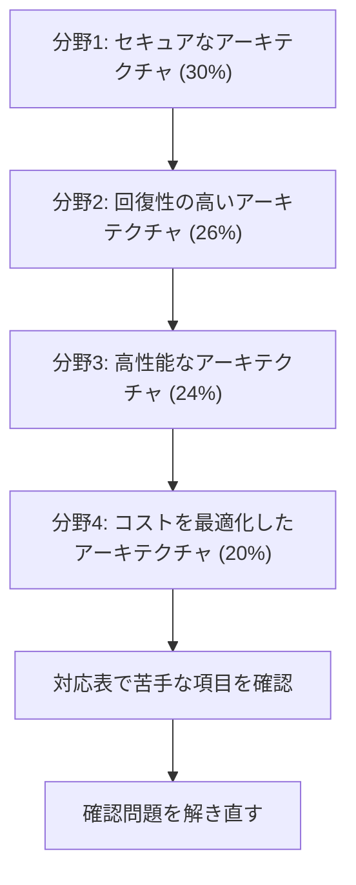

# Solutions Architect - Associate（SAA）

AWS Well-Architected Framework に基づいて、ソリューションを設計する力を問う試験です。このコースは **SAA-C03** を基準にしています。試験ガイドの全項目は[対応表](coverage.md)で確認できます。

試験では次のことも問われます。

- 現在の業務要件と将来の需要を満たす設計
- セキュリティ、回復性、性能、コストに優れたアーキテクチャの設計
- 既存のソリューションの見直しと改善の判断

!!! warning "試験ガイドの更新とイタリア語の試験の終了"
    **2026年10月29日**に試験ガイドのバージョン 1.1 が公開されました（1.0 は 2026年8月28日）。AWS は、ガイドの更新は試験に反映される約 1 か月前に公開するとしています。範囲リストから Amazon Elastic Transcoder が外れ、範囲外のリストから DeepComposer、DevOps Guru、Elastic Inference、Managed Blockchain、Sumerian が外れました。

    **イタリア語の試験は 2026年12月31日を最後に終了します。** 公式ページに、SAA-C03 に代わる新しい版の案内は確認できませんでした。受験前に公式ページを確認してください。

[:material-format-list-bulleted: このコースのサービス一覧](services.md){ .md-button }
[:material-help-circle-outline: 問題集](exercises/index.md){ .md-button }

## 試験の概要 {#overview}

| 項目 | 内容 |
|---|---|
| 問題数 | 65問（採点対象50問 + 採点対象外15問。採点対象外の問題は見分けられません） |
| 試験時間 | 130分 |
| 合格点 | 720点（100〜1,000点） |
| 受験料 | 150 USD（為替により追加の費用がかかることがあります） |
| 形式 | 択一（正解 1 つ、誤答 3 つ）、複数選択（5 つ以上の選択肢から正解 2 つ以上） |
| 採点方式 | 全体の得点で合否を判定します（補償型）。分野ごとの合格点はありません |
| 言語 | 英語、日本語、韓国語、フランス語（フランス）、イタリア語、ポルトガル語（ブラジル）、スペイン語（中南米）、スペイン語（スペイン）、簡体字中国語、繁体字中国語 |
| 受験方法 | Pearson VUE のテストセンター、またはオンライン監視 |
| 減点 | 誤答による減点はありません。未回答は不正解になるので、すべて回答します |
| 認定の有効期間 | 3 年 |

問題数の内訳、合格点、形式、採点方式は試験ガイド、試験時間、受験料、言語、受験方法、有効期間は公式ページで確認しました。問題文では、サービスの短い公式名が使われます。一覧は試験中のヘルプで確認できます。

## 学習の順番 {#study-path}

配点の大きい分野から順に進めます。各分野のページで項目ごとの要点を確認し、足りないところはサービス解説で補います。話題ごとの[問題集](exercises/index.md)で理解を確かめます。

| 分野 | 配点 | タスク | 主なサービス |
|---|---|---|---|
| [分野1: セキュアなアーキテクチャの設計](domain1.md) | 30% | 3 | IAM、Organizations、VPC、WAF、Shield、KMS、ACM |
| [分野2: 回復性の高いアーキテクチャの設計](domain2.md) | 26% | 2 | SQS、SNS、Lambda、ECS、Route 53、Auto Scaling、AWS Backup |
| [分野3: 高性能なアーキテクチャの設計](domain3.md) | 24% | 5 | EBS、S3、EC2、Aurora、ElastiCache、CloudFront、Kinesis、Glue |
| [分野4: コストを最適化したアーキテクチャの設計](domain4.md) | 20% | 4 | Cost Explorer、Budgets、Savings Plans、S3 のストレージクラス、NAT ゲートウェイ、Direct Connect |

各分野のページと、サービス別の学習ページは次のとおりです。

| 分野 | 要点 | サービス別の学習 |
|---|---|---|
| 分野1 | [開く](domain1.md) | [開く](study/domain1/index.md) |
| 分野2 | [開く](domain2.md) | [開く](study/domain2/index.md) |
| 分野3 | [開く](domain3.md) | [開く](study/domain3/index.md) |
| 分野4 | [開く](domain4.md) | [開く](study/domain4/index.md) |

試験ガイドに載っている技術と概念の分類は、コンピューティング、コスト管理、データベース、災害復旧、高性能、管理とガバナンス、マイクロサービス、移行とデータ転送、ネットワーク、回復性、セキュリティ、サーバーレスとイベント駆動、ストレージです。

## 対象者と範囲外 {#target-candidate}

対象者は、ソリューションアーキテクトの役割を担い、AWS のサービスを使ったクラウドソリューションの設計に **1 年以上の実務経験**がある人です。

このガイドには、対象者に求めない作業の一覧はありません。範囲外は、サービスの一覧で示されています。リストは網羅的ではなく、変更されることがあります。

| 分類 | 範囲外のサービス |
|---|---|
| アプリケーション統合 | Amazon MWAA |
| コンピューティング | Amazon Lightsail |
| データベース | Amazon RDS on VMware |
| 開発者ツール | AWS CDK、CloudShell、CodeArtifact、CodeBuild、CodeCommit、CodeDeploy、Corretto、Fault Injection Simulator、AWS のツールと SDK |
| フロントエンド | Amazon Location Service |
| ゲーム | Amazon GameLift |
| IoT | すべてのサービス |
| 機械学習 | Apache MXNet on AWS、Deep Learning AMI、Deep Learning Containers、HealthLake、Inferentia、Personalize、PyTorch on AWS、TensorFlow on AWS |
| 管理とガバナンス | Console Mobile Application、Distro for OpenTelemetry |
| メディア | AWS Elemental の各サービス、Amazon IVS |
| 移行と転送 | Migration Evaluator |
| ネットワーク | AWS Cloud Map |
| 量子、衛星 | Amazon Braket、AWS Ground Station |

## 範囲内のサービス {#in-scope-services}

ガイドの範囲リストと、このwikiの解説ページの対応です。リストは網羅的ではありません。提供状況が変わったサービスは、分野ページの注記で説明しています。

| 分類 | サービスと解説 |
|---|---|
| 分析 | [Athena](../../services/streaming.md#athena)、[Data Exchange](../../services/data-engineering.md#data-exchange)、[Data Pipeline](../../services/data-engineering.md#data-pipeline)、[EMR](../../services/data-engineering.md#emr)、[Glue](../../services/data-engineering.md#glue)、[Kinesis](../../services/streaming.md#kinesis-data-streams)、[Lake Formation](../../services/data-engineering.md#lake-formation)、[MSK](../../services/data-engineering.md#msk)、[OpenSearch Service](../../services/streaming.md#opensearch)、[Amazon Quick](../../services/data-engineering.md#quick-sight)、[Redshift](../../services/data-engineering.md#redshift) |
| アプリケーション統合 | [AppFlow](../../services/data-engineering.md#appflow)、[EventBridge](../../services/messaging.md#eventbridge)、[Amazon MQ](../../services/other-services.md#mq)、[SNS](../../services/messaging.md#sns)、[SQS](../../services/messaging.md#sqs)、[Step Functions](../../services/step-functions.md#standard-express) |
| コスト管理 | [Budgets](../../services/cost-management.md#budgets)、[Cost and Usage Report](../../services/cost-management.md#data-exports)、[Cost Explorer](../../services/cost-management.md#cost-explorer)、[Savings Plans](../../services/cost-management.md#savings-plans) |
| コンピューティング | [Batch](../../services/other-services.md#batch)、[EC2](../../services/ec2-beanstalk.md#instance-types)、[EC2 Auto Scaling](../../services/ec2-beanstalk.md#auto-scaling)、[Elastic Beanstalk](../../services/ec2-beanstalk.md#beanstalk-environments)、[Outposts](../../services/cloud-foundations.md#outposts)、[Serverless Application Repository](domain2.md#t2-1-serverless)、[VMware Cloud on AWS](../../services/migration.md#vmware)、[Wavelength](../../services/cloud-foundations.md#wavelength) |
| コンテナ | [ECR](../../services/containers.md#ecr)、[ECS](../../services/containers.md#ecs)、[ECS Anywhere](../../services/operations.md#ecs-anywhere)、[EKS](../../services/containers.md#eks)、[EKS Anywhere](../../services/operations.md#eks-anywhere)、[EKS Distro](../../services/operations.md#eks-distro) |
| データベース | [Aurora](../../services/databases.md#aurora)、[Aurora Serverless](../../services/databases.md#aurora-serverless-v2)、[DocumentDB](../../services/databases-specialized.md#documentdb)、[DynamoDB](../../services/dynamodb.md#keys)、[ElastiCache](../../services/databases.md#elasticache)、[Keyspaces](../../services/databases-specialized.md#keyspaces)、[Neptune](../../services/databases-specialized.md#neptune)、[RDS](../../services/databases.md#rds)、[Redshift](../../services/data-engineering.md#redshift) |
| 開発者ツール | [X-Ray](../../services/observability.md#xray) |
| フロントエンド | [Amplify](../../services/cicd.md#amplify)、[API Gateway](../../services/api-gateway.md#api-types)、[Device Farm](../../services/operations.md#device-farm) |
| 機械学習 | [Comprehend](../../services/ai-managed-services.md#comprehend)、[Lex](../../services/ai-managed-services.md#lex)、[Polly](../../services/ai-managed-services.md#polly)、[Rekognition](../../services/ai-managed-services.md#rekognition)、[SageMaker AI](../../services/sagemaker.md)、[Textract](../../services/ai-managed-services.md#textract)、[Transcribe](../../services/ai-managed-services.md#transcribe)、[Translate](../../services/ai-managed-services.md#translate) |
| 管理とガバナンス | [AWS Auto Scaling](domain3.md#t3-2-auto-scaling)、[CLI](../../services/iac.md#aws-cli)、[CloudFormation](../../services/iac.md#cloudformation-template)、[CloudTrail](../../services/observability.md#cloudtrail)、[CloudWatch](../../services/observability.md#cloudwatch-metrics)、[Compute Optimizer](../../services/cost-management.md#compute-optimizer)、[Config](../../services/governance.md#config)、[Control Tower](../../services/governance.md#control-tower)、[Health Dashboard](../../services/cloud-foundations.md#health)、[License Manager](../../services/governance.md#license-manager)、[Managed Grafana](../../services/operations.md#managed-grafana)、[Managed Service for Prometheus](../../services/operations.md#managed-prometheus)、[Management Console](../../services/cloud-foundations.md#access-methods)、[Organizations](../../services/governance.md#organizations)、[Proton](../../services/governance.md#proton)、[Service Catalog](../../services/governance.md#service-catalog)、[Systems Manager](../../services/operations.md#systems-manager)、[Well-Architected Tool](../../services/cloud-foundations.md#wa-tool) |
| メディア | [Kinesis Video Streams](../../services/other-services.md#kinesis-video) |
| 移行と転送 | [Application Discovery Service](../../services/migration.md#application-discovery)、[Application Migration Service](../../services/migration.md#mgn)、[DataSync](../../services/migration.md#datasync)、[DMS](../../services/migration.md#dms)、[Snow Family](../../services/migration.md#snow-family)、[Transfer Family](../../services/migration.md#transfer-family) |
| ネットワーク | [Client VPN](../../services/network-connectivity.md#client-vpn)、[CloudFront](../../services/networking.md#cloudfront)、[Direct Connect](../../services/network-connectivity.md#direct-connect)、[Elastic Load Balancing](../../services/networking.md#elb)、[Global Accelerator](../../services/network-connectivity.md#global-accelerator)、[PrivateLink](../../services/networking.md#vpc-endpoints)、[Route 53](../../services/networking.md#route53)、[Site-to-Site VPN](../../services/network-connectivity.md#site-to-site-vpn)、[Transit Gateway](../../services/network-connectivity.md#transit-gateway)、[VPC](../../services/networking.md#vpc) |
| セキュリティ | [Artifact](../../services/threat-detection.md#artifact)、[ACM](../../services/certificates.md#acm)、[CloudHSM](../../services/identity-directory.md#cloudhsm)、[Cognito](../../services/cognito.md#user-vs-identity-pools)、[Detective](../../services/threat-detection.md#detective)、[Directory Service](../../services/identity-directory.md#directory-service)、[Firewall Manager](../../services/threat-detection.md#firewall-manager)、[GuardDuty](../../services/threat-detection.md#guardduty)、[IAM Identity Center](../../services/identity-directory.md#identity-center)、[Inspector](../../services/threat-detection.md#inspector)、[KMS](../../services/kms.md#key-types)、[Macie](../../services/threat-detection.md#macie)、[Network Firewall](../../services/threat-detection.md#network-firewall)、[RAM](../../services/governance.md#ram)、[Secrets Manager](../../services/secrets.md#secrets-manager)、[Security Hub](../../services/threat-detection.md#security-hub)、[Shield](../../services/threat-detection.md#shield)、[WAF](../../services/certificates.md#waf)、[IAM](../../services/iam.md#principals) |
| サーバーレス | [Fargate](../../services/containers.md#fargate-vs-ec2)、[Lambda](../../services/lambda.md#execution-model) |
| ストレージ | [AWS Backup](../../services/resilience.md#backup)、[EBS](../../services/storage.md#ebs-volume-types)、[EFS](../../services/storage.md#efs-settings)、[FSx](../../services/storage-advanced.md#fsx-selection)、[S3](../../services/s3.md#basics)、[S3 Glacier](../../services/s3.md#glacier-retrieval)、[Storage Gateway](../../services/migration.md#storage-gateway) |

## 参考 {#references}

- [SAA-C03 試験ガイド](https://docs.aws.amazon.com/aws-certification/latest/solutions-architect-associate-03/solutions-architect-associate-03.html)
- [範囲内のサービス](https://docs.aws.amazon.com/aws-certification/latest/solutions-architect-associate-03/saa-03-in-scope-services.html)
- [範囲外のサービス](https://docs.aws.amazon.com/aws-certification/latest/solutions-architect-associate-03/saa-03-out-of-scope-services.html)
- [ガイドの改訂履歴](https://docs.aws.amazon.com/aws-certification/latest/solutions-architect-associate-03/saa-03-revisions.html)
- [認定の公式ページ](https://aws.amazon.com/certification/certified-solutions-architect-associate/)
