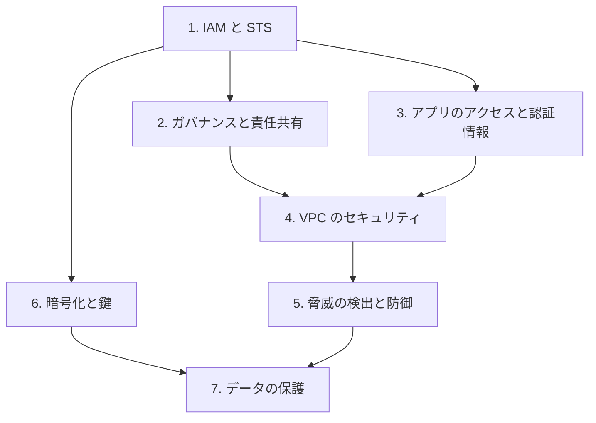

# 分野1: サービス別の学習

分野1（セキュアなアーキテクチャの設計）は SAA-C03 の配点の 30% を占め、4 分野で最大です。IAM から順に進めると、後のページの権限の話が読みやすくなります。

| 順番 | サービス | 問われること | 重要度 |
|---|---|---|---|
| 1 | [IAM と STS](iam.md) | 最小権限、ロール、フェデレーション、リソースポリシー | 高 |
| 2 | [ガバナンスと責任共有](governance.md) | SCP、Control Tower、リージョン、責任共有モデル、コンプライアンス | 高 |
| 3 | [アプリのアクセスと認証情報](app-security.md) | Secrets Manager、Cognito、署名付き URL、OAC | 中 |
| 4 | [VPC のセキュリティ](vpc-security.md) | SG、NACL、サブネット、エンドポイント、VPN | 高 |
| 5 | [脅威の検出と防御](threat-protection.md) | GuardDuty、Macie、WAF、Shield の使い分け | 高 |
| 6 | [暗号化と鍵](encryption.md) | SSE-KMS、キーポリシー、ACM、ローテーション | 高 |
| 7 | [データの保護](data-protection.md) | Object Lock、AWS Backup、データの分類 | 中 |

重要度は公式のスキル一覧を見たこの wiki の判断で、公式の数字ではありません。

## 他のサービスにまたがる問題 {#other-questions}

<!-- questions:start -->

この分野の問題は、すべてサービス別のページに載っています。

<!-- questions:end -->
