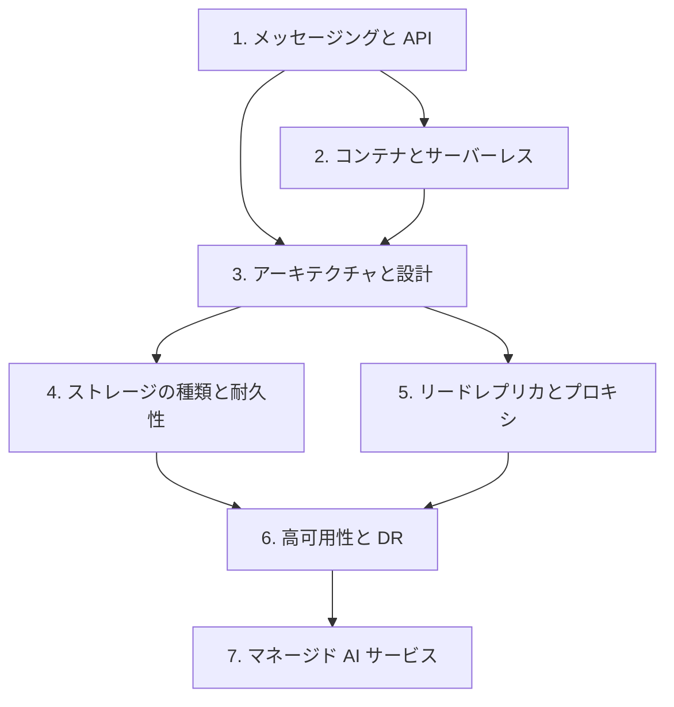

# 分野2: サービス別の学習

分野2（回復性の高いアーキテクチャの設計）は SAA-C03 の配点の 26% です。疎結合の部品から入り、最後に DR までつなげます。

| 順番 | サービス | 問われること | 重要度 |
|---|---|---|---|
| 1 | [メッセージングと API](messaging.md) | SQS、SNS、EventBridge、Step Functions、API の種類 | 高 |
| 2 | [コンテナとサーバーレス](containers-serverless.md) | ECS と EKS、Fargate、Lambda の上限 | 高 |
| 3 | [アーキテクチャと設計](architecture.md) | ステートレス、スケーリング、キャッシュ、分散設計 | 高 |
| 4 | [ストレージの種類と耐久性](storage.md) | オブジェクト、ファイル、ブロック、耐久性 | 中 |
| 5 | [リードレプリカとプロキシ](databases.md) | レプリカと Multi-AZ、RDS Proxy | 中 |
| 6 | [高可用性と DR](resilience.md) | Route 53、単一障害点、DR 戦略、クォータ | 高 |
| 7 | [マネージド AI サービス](ai-services.md) | 機能ごとの専用サービスの選択 | 低 |

重要度は公式のスキル一覧を見たこの wiki の判断で、公式の数字ではありません。

## 他のサービスにまたがる問題 {#other-questions}

<!-- questions:start -->

この分野の問題は、すべてサービス別のページに載っています。

<!-- questions:end -->
