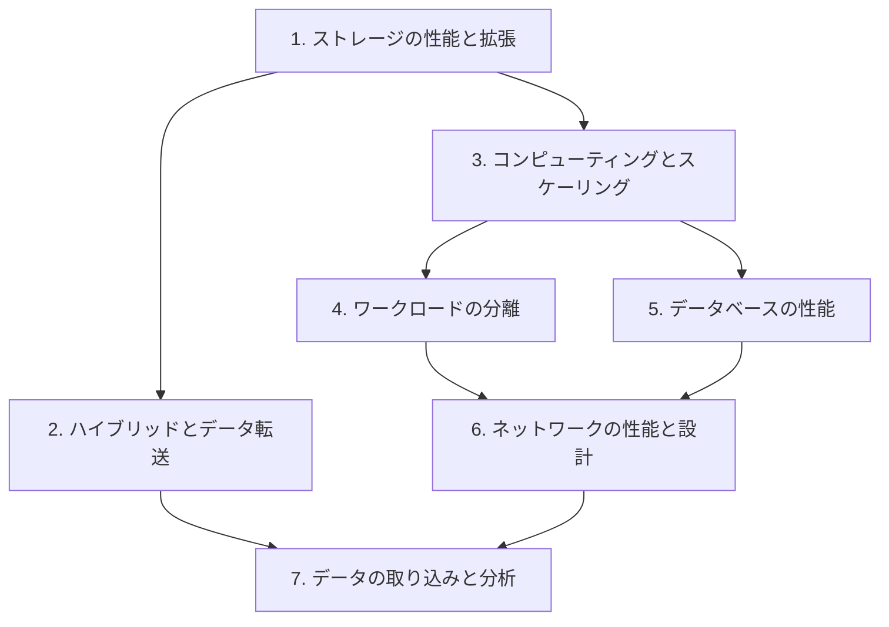

# 分野3: サービス別の学習

分野3（高性能なアーキテクチャの設計）は SAA-C03 の配点の 24% で、5 つのタスクがあります。ストレージから順に、データの取り込みまで進めます。

| 順番 | サービス | 問われること | 重要度 |
|---|---|---|---|
| 1 | [ストレージの性能と拡張](storage.md) | EBS のタイプ、S3 の性能、FSx の選択 | 高 |
| 2 | [ハイブリッドとデータ転送](migration.md) | Storage Gateway、DataSync、Transfer Family | 中 |
| 3 | [コンピューティングとスケーリング](compute.md) | Batch、Auto Scaling の指標、インスタンスタイプ | 高 |
| 4 | [ワークロードの分離](messaging.md) | SQS、SNS、Kinesis による分離 | 中 |
| 5 | [データベースの性能](databases.md) | 種類の選択、RCU の計算、レプリカ、キャッシュ | 高 |
| 6 | [ネットワークの性能と設計](networking.md) | CloudFront、Global Accelerator、CIDR、負荷分散 | 高 |
| 7 | [データの取り込みと分析](data-analytics.md) | Kinesis、Glue、Lake Formation、Athena | 高 |

重要度は公式のスキル一覧を見たこの wiki の判断で、公式の数字ではありません。

## 他のサービスにまたがる問題 {#other-questions}

<!-- questions:start -->

この分野の問題は、すべてサービス別のページに載っています。

<!-- questions:end -->
