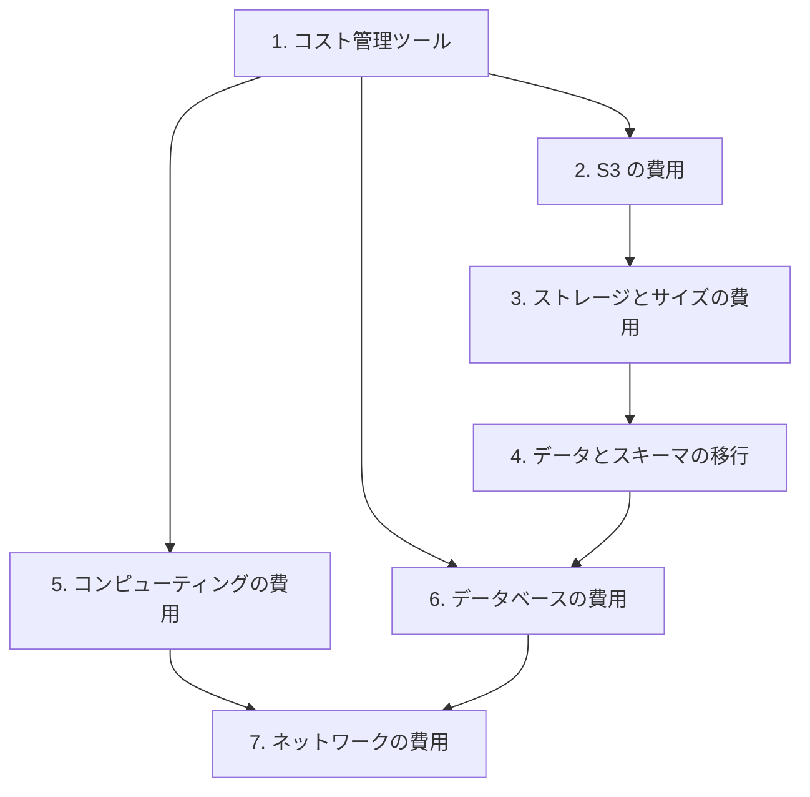

# 分野4: サービス別の学習

分野4（コストを最適化したアーキテクチャの設計）は SAA-C03 の配点の 20% です。ツールを先に確認し、ストレージ、コンピューティング、データベース、ネットワークの順に進めます。

| 順番 | サービス | 問われること | 重要度 |
|---|---|---|---|
| 1 | [コスト管理ツール](cost-management.md) | Cost Explorer、Budgets、CUR、コスト配分タグ | 中 |
| 2 | [S3 の費用](s3.md) | ストレージクラス、ライフサイクル、リクエスタ支払い | 高 |
| 3 | [ストレージとサイズの費用](storage.md) | EFS のライフサイクル、EBS のサイズ、自動スケーリング | 中 |
| 4 | [データとスキーマの移行](migration.md) | 転送の日数の計算、DataSync、DMS、SCT | 中 |
| 5 | [コンピューティングの費用](compute-cost.md) | Savings Plans、スポット、ファミリー、休止 | 高 |
| 6 | [データベースの費用](database-cost.md) | Aurora Serverless v2、DynamoDB のクラス、保持 | 高 |
| 7 | [ネットワークの費用](network-cost.md) | NAT、Direct Connect、転送料、CDN、スロットリング | 高 |

重要度は公式のスキル一覧を見たこの wiki の判断で、公式の数字ではありません。

## 他のサービスにまたがる問題 {#other-questions}

<!-- questions:start -->

この分野の問題は、すべてサービス別のページに載っています。

<!-- questions:end -->
