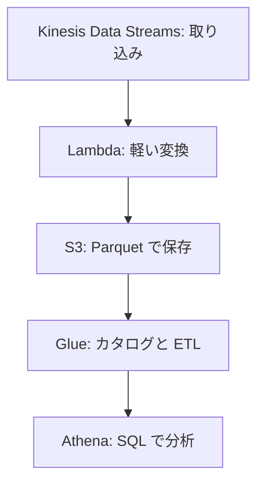
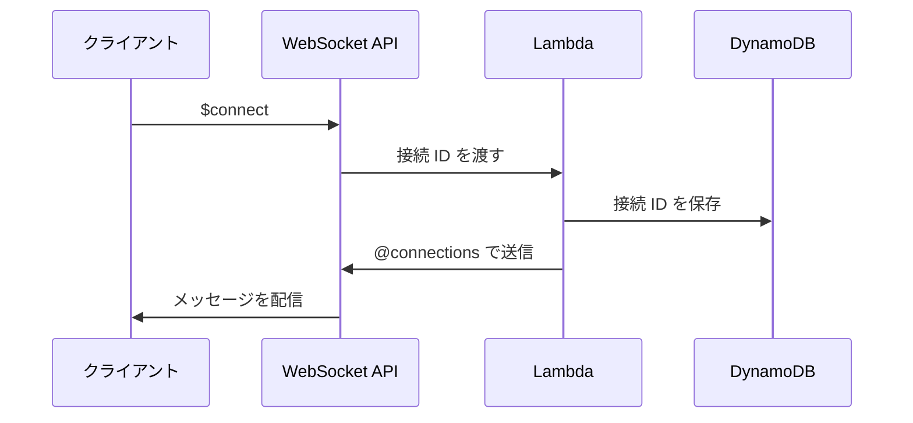

# 分野1: クラウド向けのアーキテクチャの設計と実装

SAP-C03 の配点は **25%** です。イベント駆動、コンテナ、AI の組み込み、ハイブリッド、ネットワーク、データ基盤と、範囲が最も広い分野です。

Professional の問題は「どのサービスか」だけでは解けません。複数のアカウントやリージョン、コスト、運用の手間といった制約を読み取り、候補の中で最も合うものを選びます。問題文の「運用の負荷を最小に」「既存のコードを変えずに」のような一文が決め手になります。

## タスク 1.1: クラウド向けのアーキテクチャを設計する {#task-1-1}

### 1.1.1 イベント駆動とメッセージングのパターン {#skill-1-1-1}

冪等性、順序、配信の保証を要件から読み取り、サービスを選びます。

| サービス | 配信の保証 | 順序 | 選ぶ理由 |
|---|---|---|---|
| SQS 標準 | 少なくとも 1 回 | ベストエフォート | スループット優先、処理側が自分のペースで取り出す |
| SQS FIFO | 重複排除あり | メッセージグループ内で保証 | 注文の処理のように順序が重要 |
| SNS | 少なくとも 1 回 | 標準はなし | 複数の宛先へのファンアウト |
| EventBridge | 少なくとも 1 回 | なし | 内容に応じた振り分け、SaaS や AWS サービスのイベント |
| Kinesis Data Streams | 少なくとも 1 回 | シャード内で保証 | 複数のコンシューマーが読み直せる、保持期間内の再生 |

順序が要るときは、順序を保つ単位をキーにします。Kinesis のパーティションキーや FIFO のメッセージグループ ID を顧客 ID にすれば、顧客ごとの順序を保ちつつ並列に処理できます。全件で同じ値にすると、並列度が 1 になります。

標準キューや EventBridge では重複が起こりえます。処理側を冪等にします。冪等キーを DynamoDB に条件付きで書き込み、既に存在すれば処理を飛ばすのが定番です。

詳細: [選び方](../../services/messaging.md#how-to-choose)、[標準と FIFO](../../services/messaging.md#standard-fifo)、[ファンアウト](../../services/messaging.md#fanout)、[パーティションキー](../../services/streaming.md#partition-key)、[冪等性](../../services/sdk-resilience.md#idempotency)

### 1.1.2 ステートレスな設計と状態の外部化 {#skill-1-1-2}

インスタンスやコンテナに状態を持つと、スケールインや障害で失われ、Auto Scaling も効きにくくなります。状態はサービスの外に出します。

| 状態 | 置き場所 | 判断の理由 |
|---|---|---|
| セッション（消えても再ログインで済む） | ElastiCache | 低遅延。TTL で自動で消える |
| セッション（耐久性も必要） | DynamoDB、MemoryDB | 複数 AZ で耐久性がある |
| アップロードされたファイル | S3 | 容量の管理が不要 |
| ワークフローの進行状況 | Step Functions | 状態の管理を任せられる |

ALB のスティッキーセッションは移行の途中の手段です。インスタンスの障害でセッションが失われ、負荷も偏ります。設問が「可用性を高めたい」なら、外部化を選びます。

詳細: [ステートフルとステートレス](../../services/sdk-resilience.md#stateful-stateless)、[スティッキーセッション](../../services/networking.md#stickiness)、[ElastiCache](../../services/databases.md#elasticache)、[MemoryDB](../../services/databases-specialized.md#memorydb)

### 1.1.3 サーバーレスのデータ処理と分析 {#skill-1-1-3}

代表的な流れは次のとおりです。

| 判断 | 選択 |
|---|---|
| 短い変換、イベント単位 | Lambda（最大 15 分） |
| 大きなデータの ETL、Spark | Glue |
| S3 への単純な配信、独自のコンシューマー不要 | Amazon Data Firehose |
| アドホックな SQL、サーバー管理なし | Athena |

Athena はスキャンした量で課金されます。列形式の Parquet にしてパーティションで絞ると、費用も時間も減ります。

Firehose は C02 の対象一覧にありますが、C03 の一覧には載っていません。ただし一覧はすべてを網羅するものではありません。

詳細: [Kinesis Data Streams](../../services/streaming.md#kinesis-data-streams)、[Lambda とストリーム](../../services/streaming.md#lambda-streams)、[Glue の ETL ジョブ](../../services/data-engineering.md#glue-jobs)、[Athena](../../services/streaming.md#athena)、[Firehose](../../services/streaming.md#firehose)

### 1.1.4 永続的な実行パターンのワークフロー {#skill-1-1-4}

処理の途中で失敗しても、続きから再開できるワークフローを選びます。

| | Step Functions Standard | Step Functions Express | Lambda durable functions |
|---|---|---|---|
| 最大実行時間 | 1 年 | 5 分 | 1 年 |
| 定義の方法 | ASL、ビジュアル | ASL、ビジュアル | 通常のプログラミング言語 |
| 実行の保証 | 正確に 1 回 | 非同期は少なくとも 1 回 | チェックポイントと再生 |
| 課金の中心 | 状態遷移 | 実行回数、時間、メモリ | Lambda の実行。待機中のコンピューティング料金はかからない |
| 向く場面 | 多数の AWS サービスの統合、監査、人の承認 | 大量で短いイベント処理 | ビジネスロジックと密接なワークフロー |

**Lambda durable functions** はチェックポイントと再生で動きます。再開時はコードを最初から実行しますが、完了した手順は保存済みの結果を使って飛ばします。Durable Execution SDK は JavaScript、TypeScript、Python、Java、Go、C# で使えます。

公式の見分け方は、Lambda の中でコードとして書くなら durable functions、AWS サービスの統合を図で管理するなら Step Functions です。

複数のサービスにまたがるトランザクションには、失敗時に取り消し処理を順に実行するサーガパターンを使います。

詳細: [Standard と Express](../../services/step-functions.md#standard-express)、[エラー処理](../../services/step-functions.md#error-handling)、[サービス統合パターン](../../services/step-functions.md#integration-patterns)

### 1.1.5 アカウントとリージョンをまたぐイベントルーティング {#skill-1-1-5}

EventBridge のイベントバスを別のアカウントやリージョンのターゲットにします。

| 手順 | 場所 | 内容 |
|---|---|---|
| 1 | 受信側 | バスのリソースポリシーで `events:PutEvents` を許可。組織 ID でまとめて許可できる |
| 2 | 送信側 | 受信側のバスをターゲットにしたルールと IAM ロール（2023 年 3 月 2 日以降の新しいターゲットでは必須） |
| 3 | 受信側 | 受け取ったイベントに一致するルール |

押さえる制約が 2 つあります。

- **転送は 1 段だけです。** 受信側のルールで第 3 のアカウントへ送っても届きません。同じアカウント内で 3 つのバスを順に渡すこともできません。複数の宛先へ配るなら、各送信元のルールに宛先をすべて設定します。
- **受信側のルールに注意します。** `account` を指定しないルールは、許可した他のアカウントのイベントにも一致します。

料金は送信側のアカウントにカスタムイベントとして課金されます。

**グローバルエンドポイント**はリージョン障害への備えです。Route 53 のヘルスチェックが異常になると、カスタムイベントを別のリージョンのバスへ送ります。公式の推奨どおりにアラームを設定すると、RTO と RPO は 360 秒、最大 420 秒です。カスタムバスを使うなら、同じ名前で同じアカウントに、各リージョンのバスを用意します。

詳細: [イベントバス](../../services/messaging.md#event-buses)、[ルールとイベントパターン](../../services/messaging.md#eventbridge-rules)、[ターゲットの再試行と DLQ](../../services/messaging.md#target-retry-dlq)

### 1.1.6 マネージドサービスによるコンテナオーケストレーション {#skill-1-1-6}

| 判断の軸 | ECS | EKS |
|---|---|---|
| 学習と運用の負荷 | 小さい | 大きい |
| Kubernetes の API やツール | 使えない | そのまま使える |
| 他の環境への持ち運び | 難しい | しやすい |
| 選ぶ理由 | AWS に絞って運用を簡単に | 既存の Kubernetes 資産、マルチクラウド |

データプレーンも選びます。

| 選択 | 向く場面 | 選ばない理由 |
|---|---|---|
| Fargate | サーバー管理をなくしたい、負荷が変動する | ホストレベルの制御が必要、常に高負荷で EC2 より割高 |
| EC2 | GPU、特殊なインスタンス、スポットで大幅に安く | パッチ適用とスケーリングの手間 |
| EKS Auto Mode | ノード管理も EKS に任せたい | ノードの細かい制御が必要 |

詳細: [ECS](../../services/containers.md#ecs)、[Fargate と EC2](../../services/containers.md#fargate-vs-ec2)、[キャパシティプロバイダー](../../services/containers.md#capacity-providers)、[EKS](../../services/containers.md#eks)

### 1.1.7 サービスメッシュとマイクロサービス間の通信 {#skill-1-1-7}

!!! note "App Mesh の状況"
    AWS App Mesh は 2026 年 9 月 30 日でサポートを終了しました。古い教材の答えが App Mesh でも、新しい構成では次の 2 つから選びます。

| | ECS Service Connect | VPC Lattice |
|---|---|---|
| 範囲 | 同じ名前空間の ECS サービス | VPC、アカウントをまたぐ多様なサービス |
| 仕組み | タスク内のプロキシコンテナ。ECS の設定で管理 | サービスネットワーク。サイドカーなし |
| ターゲット | ECS タスク | EC2、IP、Lambda、ALB、ECS、Pod |
| 通信の保護と認可 | TLS（Private CA。証明書は自動で更新） | IAM の認証ポリシー |
| 監視 | 標準のメトリクスとログ | アクセスログ |

**Service Connect の要点:**

- 名前空間は AWS Cloud Map のもので、ECS サービスと同じリージョンにあります。クラスターをまたげます。RAM で共有すれば、アカウントもまたげます。
- 短い名前で接続でき、VPC の DNS 設定に依存しません。プロキシはラウンドロビンで接続先を選び、過去の失敗の情報から異常なタスクを避けます。
- 追加料金はありません。プロキシが使う vCPU とメモリはタスクの費用です。
- 接続は ECS サービス間だけです。名前空間の外や ECS の外からは、名前を解決できません。別の接続方法を用意します。

**見分け方:** ECS だけで完結するなら Service Connect。EC2 や Lambda も含み、アカウントをまたいで IAM で認可するなら VPC Lattice です。

詳細: [VPC Lattice](../../services/network-connectivity.md#vpc-lattice)、[App Mesh の状況](../../services/network-connectivity.md#app-mesh)、[ECS](../../services/containers.md#ecs)

### 1.1.8 コンテナイメージの管理 {#skill-1-1-8}

| 要件 | 設定 |
|---|---|
| OS の脆弱性を調べる | 基本スキャン（プッシュ時か手動） |
| 言語のパッケージも継続的に調べる | 拡張スキャン（Amazon Inspector と連携。料金は Inspector に発生） |
| 古いイメージの費用を減らす | ライフサイクルポリシー。適用前にプレビューで確認 |
| 本番のタグの上書きを防ぐ | タグの不変性 |
| 別リージョンの DR、遅延の削減 | レプリケーション |

スキャン設定はレジストリのレベルで行うと、リポジトリごとの設定漏れを防げます。結果は EventBridge に送られるので、重大な検出結果で通知や配布の停止を自動化できます。

ライフサイクルポリシーで本番が使うイメージを消さないように、環境ごとのタグの接頭辞でルールを分けます。

詳細: [イメージスキャン](../../services/containers.md#ecr-scanning)、[ライフサイクルポリシー](../../services/containers.md#ecr-lifecycle)、[タグと不変タグ](../../services/containers.md#image-tags)、[レプリケーション](../../services/containers.md#ecr-replication)

### 1.1.9 サーバーレスとコンテナのスケーリング {#skill-1-1-9}

| 対象 | 仕組み | 押さえる点 |
|---|---|---|
| Lambda | 同時実行数 | 既定はリージョンで 1,000。関数ごとに 10 秒あたり 1,000 実行環境まで増える |
| Lambda の遅延対策 | Provisioned Concurrency | コールドスタートを避ける。待機中も課金 |
| Lambda の保護 | 予約済み同時実行 | 他の関数に枠を奪われない。上限にもなる |
| ECS タスク | サービスの Auto Scaling | Application Auto Scaling の仕組み。ターゲット追跡、ステップ、スケジュール |
| ECS のノード | キャパシティプロバイダー | タスクに合わせて EC2 を増やす |
| EKS の Pod | Horizontal Pod Autoscaler（HPA） | Pod の数を変える。Metrics Server などのメトリクスソースが必要 |
| EKS のノード | Cluster Autoscaler | Auto Scaling グループを使ってノード数を調整 |
| EKS のノード | Karpenter | 要件に合う容量を短時間で起動。自分で導入、運用する OSS |
| EKS のノード | EKS Auto Mode | Karpenter をもとに AWS がノードを管理 |

Pod とノードの 2 段で考えます。HPA が Pod を増やしても、ノードに空きがなければ Pod は Pending のままです。

**具体例:** 多様なインスタンスタイプで安く、速くノードを増やすなら Karpenter、運用も任せたいなら EKS Auto Mode、既存の Auto Scaling グループを使うなら Cluster Autoscaler です。

Karpenter には AWS の SLA がなく、コントローラーの可用性は利用者が保ちます。

詳細: [Lambda のクォータ](../../services/lambda.md#concurrency-quota)、[予約済みと Provisioned の違い](../../services/lambda.md#reserved-provisioned)、[ECS サービスの Auto Scaling](../../services/containers.md#service-auto-scaling)

### 1.1.10 入口のパターンとリソースの最適化 {#skill-1-1-10}

| 入口 | 向く場面 | 判断のポイント |
|---|---|---|
| ALB | HTTP のルーティング、パスやホストで振り分け | WAF を付けられる。Lambda もターゲットにできる |
| NLB | TCP、UDP、固定 IP、超低遅延 | PrivateLink でのサービス公開に必要 |
| API Gateway | 認可、使用量プラン、キャッシュ、変換 | API の管理機能が要るとき。高負荷ではリクエスト課金を確認 |
| AWS Load Balancer Controller | EKS で ALB、NLB を自動作成 | Kubernetes の定義から作る |

**AWS Load Balancer Controller** は EKS で動くコントローラーです。

| Kubernetes のリソース | 作られるもの |
|---|---|
| `Ingress` | ALB |
| `Service`（`type: LoadBalancer`） | NLB |
| `Gateway`（v2.14.0 以降） | ALB |

設定はアノテーションで指定します。入れないと、古いクラウドプロバイダーが Classic Load Balancer を作ります。

**コストの観点:** Ingress ごとに ALB を作ると費用が増えます。共有の入口にまとめるかを検討します。Controller の `IngressGroup` はこのための機能です。

詳細: [ALB と NLB の違い](../../services/networking.md#alb-vs-nlb)、[API の種類](../../services/api-gateway.md#api-types)、[ターゲットタイプ](../../services/networking.md#target-types)、[EKS](../../services/containers.md#eks)

### 1.1.11 エッジのアーキテクチャ {#skill-1-1-11}

| | CloudFront Functions | Lambda@Edge |
|---|---|---|
| イベント | ビューワーのリクエスト、レスポンス | それに加えてオリジンのリクエスト、レスポンス |
| 実行時間 | 1 ミリ秒未満 | 最大 30 秒 |
| 外部通信、本文へのアクセス | 不可 | 可 |
| 規模 | 毎秒数百万リクエスト | リージョンあたり毎秒 10,000 リクエスト |
| 向く処理 | ヘッダーの変更、URL の書き換え、トークンの簡単な検証 | 外部の参照、本文の処理、オリジンの動的な選択 |

「最小の遅延とコストで」はまず CloudFront Functions です。外部を呼ぶ必要があれば Lambda@Edge にします。

キャッシュできない処理の遅延を減らすなら、エッジで処理するより Global Accelerator が合うこともあります。

詳細: [Lambda@Edge と CloudFront Functions](../../services/networking.md#edge-functions)、[エッジ関数の制限](../../services/networking.md#edge-function-limits)

### 1.1.12 WebSocket と発行購読によるリアルタイム処理 {#skill-1-1-12}

API Gateway の WebSocket API の典型です。

| 制約 | 値 | 設計への影響 |
|---|---|---|
| 接続時間の上限 | 2 時間 | クライアントで再接続する |
| アイドルタイムアウト | 10 分 | 定期的にメッセージを送る |
| フレーム、メッセージ | 32 KB、128 KB | 大きなデータは S3 に置いて URL を送る |
| 認可 | `$connect` だけ | 接続後は判定されない |

複数のサーバーや Lambda から配信するので、接続 ID は DynamoDB などの外部に置きます。発生元と配信を分けるなら、SNS や EventBridge を挟みます。

全接続へ配るには、接続 ID ごとに `@connections` を呼びます。規模が大きいときは呼び出しの量を見積もります。

詳細: [WebSocket API](../../services/api-gateway.md#websocket)、[ファンアウト](../../services/messaging.md#fanout)

### 1.1.13 マルチテナントのアーキテクチャ {#skill-1-1-13}

| モデル | 分離 | コスト | 向く場面 |
|---|---|---|---|
| サイロ | テナントごとにリソースやアカウント | 高い | 規制が厳しい、大口の顧客 |
| プール | 共有し、ID やキーで分離 | 低い | 多数の小規模なテナント |
| ブリッジ | 層ごとに使い分ける | 中間 | 上位プランだけ DB を分ける |

テナントの文脈は認証から伝えます。Cognito のカスタム属性やグループに `tenant_id` を持たせて JWT に含め、そこから分離を強制します。アプリのコードの `WHERE` 句だけに頼りません。

| 層 | 分離の手段 |
|---|---|
| DynamoDB | パーティションキーをテナントで分け、`dynamodb:LeadingKeys` で制限 |
| S3 | `${aws:PrincipalTag/TenantId}` でプレフィックスを制限 |
| RDB | PostgreSQL の行レベルセキュリティ |
| 暗号化 | テナントごとの KMS キー。失効と監査がテナント単位になる |
| 実行時の権限 | テナントのタグを付けた STS セッション |

騒がしい隣人への対策として、API Gateway の使用量プランでテナントごとに制限します。

詳細: [マルチテナントのデータアクセス](../../services/secrets.md#multi-tenant)、[パターンの比較](../../services/secrets.md#tenant-patterns)、[動的なセッション](../../services/secrets.md#tenant-sessions)、[グループとカスタム属性](../../services/cognito.md#groups-attributes)、[使用量プラン](../../services/api-gateway.md#usage-plans)

## タスク 1.2: AI と ML のサービスをアーキテクチャに組み込む {#task-1-2}

モデルの学習やファインチューニングは範囲外です。アーキテクトとして、組み込み方を判断します。

### 1.2.1 生成 AI の統合とマルチアカウント {#skill-1-2-1}

複数のアカウントで Bedrock を使うときは、統制をどこに置くかが論点です。

| パターン | 仕組み | 向く場面 | 注意 |
|---|---|---|---|
| 各アカウントで直接呼ぶ | 各アカウントの IAM ロール | 少数のチーム、自律性が重要 | クォータと統制がばらばらになる |
| 中央のプラットフォーム | GenAI ゲートウェイ。API Gateway や Lambda を前に置く | 利用の制限、コスト配分、ログを集約 | ゲートウェイが単一障害点になりうる |
| 組織で強制 | Organizations の Bedrock ポリシー、SCP | ガードレールの強制、モデルの制限 | 呼び出し側の変更は不要 |

**追跡:** アプリケーション推論プロファイルを作ってタグを付けると、アプリごとに使用量とコストを追えます。

**ネットワーク:** VPC から PrivateLink で接続します。**耐障害:** クロスリージョン推論とモデルのフォールバックを用意します。

詳細: [GenAI ゲートウェイ](../../services/genai-apps.md#genai-gateway)、[組織での強制](../../services/genai-apps.md#guardrail-org-enforcement)、[推論の容量とプロファイル](../../services/genai-apps.md#inference-profiles)、[VPC エンドポイントでの接続](../../services/ai.md#privatelink)、[耐障害の設計](../../services/genai-apps.md#fm-resilience)

### 1.2.2 ツールと連携する AI エージェント {#skill-1-2-2}

!!! note "Bedrock Agents の状況"
    Amazon Bedrock Agents は Agents Classic に改称され、2026 年 7 月 30 日から新規顧客を受け付けていません。新しい構成は AgentCore で考えます。

| 要件 | AgentCore のサービス |
|---|---|
| エージェントのデプロイと実行 | Runtime（セッションごとの分離） |
| 会話や学習した内容の保持 | Memory（短期と長期） |
| API や Lambda を MCP ツールとして公開 | Gateway |
| 外部 API の OAuth トークンの管理 | Identity |
| ツール呼び出しの決定的な制限 | Policy |
| 動作の追跡 | Observability |
| 社内文書を根拠に回答 | Bedrock Knowledge Bases |

Policy の判定はモデルの判断に頼りません。「返金ツールは 10,000 円以下のときだけ」のような制限は、プロンプトではなく Policy に書きます。

詳細: [AgentCore のアーキテクチャ](../../services/genai-apps.md#agentcore)、[AgentCore の構成要素](../../services/ai.md#agentcore-components)、[エージェントのパターンと MCP](../../services/genai-apps.md#agent-patterns)、[Policy](../../services/genai-apps.md#agentcore-policy)

### 1.2.3 ML の推論アーキテクチャ {#skill-1-2-3}

| 種類 | 入力の上限 | 処理時間の上限 | 選ぶ理由 |
|---|---|---|---|
| リアルタイム | 6 MB | 60 秒 | 常に低遅延 |
| サーバーレス | | | 断続的、コールドスタートを許容 |
| 非同期 | 1 GB | 1 時間 | 大きな入力。0 台まで縮小できる |
| バッチ変換 | `MaxPayloadInMB` 最大 100 MB | | データセット全体をまとめて |

**複数のモデルを効率よく:** 顧客ごとのモデルが数千あるなら、マルチモデルエンドポイントで 1 つのコンテナを共有します。前処理、推論、後処理を順に実行するなら推論パイプラインです。

**Bedrock との使い分け:** 基盤モデルを API で使うなら Bedrock、自社モデルを動かすなら SageMaker AI です。

詳細: [エンドポイントと推論](../../services/sagemaker.md#endpoints)、[マルチモデル](../../services/sagemaker.md#multi-model)、[自動スケーリング](../../services/sagemaker.md#autoscaling)、[デプロイとテストの戦略](../../services/sagemaker.md#deployment-strategies)

### 1.2.4 RAG のアーキテクチャ {#skill-1-2-4}

取り込みと検索のそれぞれに、選択肢があります。

| 段階 | 判断 | 選択肢 |
|---|---|---|
| チャンク化 | 文書の形 | 既定（約 300 トークン）、固定サイズ、階層、セマンティック |
| 同期 | データの鮮度 | データソースの同期を定期またはイベントで実行 |
| 埋め込み | 精度、次元、費用 | 変更すると全件の再取り込みが必要 |
| 検索 | 精度 | ハイブリッド検索、リランキング、メタデータフィルター |

ベクトルストアは要件で選びます。

| 要件 | ストア |
|---|---|
| 既定、ハイブリッド検索、容量管理なし | OpenSearch Serverless |
| 既に PostgreSQL を使っている、SQL と結合 | Aurora、RDS の pgvector |
| 大量でアクセスが少ない、低コスト | S3 Vectors |
| グラフの関係を使う | Neptune Analytics |

テナントで文書を分けるなら、メタデータフィルターや、テナントごとのナレッジベースで分離します。

詳細: [Knowledge Bases](../../services/genai-apps.md#knowledge-bases)、[チャンク化の戦略](../../services/genai-apps.md#chunking)、[検索の改善](../../services/genai-apps.md#retrieval-optimization)、[ベクトルストア](../../services/genai-apps.md#vector-stores)、[同期と鮮度](../../services/genai-apps.md#kb-sync)

## タスク 1.3: ハイブリッドクラウドの統合パターンを設計する {#task-1-3}

### 1.3.1 冗長性とフェイルオーバーを備えたハイブリッド接続 {#skill-1-3-1}

| 回復性モデル | 構成 | SLA | 耐えられる障害 |
|---|---|---|---|
| Maximum resiliency | 2 ロケーション × 各 2 デバイス | 99.99% | デバイス、回線、ロケーション |
| High resiliency | 2 ロケーションに 1 接続ずつ | 99.9% | 回線、デバイス、ロケーション |
| Development and test | 1 ロケーションの別デバイスに 2 接続 | 公式の記載なし | デバイスのみ |

**コストを抑えたバックアップ:** Direct Connect を主、Site-to-Site VPN を従にします。経路は BGP で制御します。

**多数の VPC:** トランジット VIF と Direct Connect ゲートウェイを Transit Gateway につなぎます。VPN は Transit Gateway に接続すれば ECMP で帯域を束ねられます。

**暗号化の要件:** Direct Connect は既定で暗号化されません。ルーターまでなら MACsec、VPC までならプライベート IP VPN です。

詳細: [Direct Connect](../../services/network-connectivity.md#direct-connect)、[回復性のモデル](../../services/network-connectivity.md#dx-resiliency)、[DX を主、VPN を従にする](../../services/network-connectivity.md#bgp-dx-vpn)、[オンプレミスとの接続](../../services/network-connectivity.md#choosing-hybrid)、[Transit Gateway](../../services/network-connectivity.md#transit-gateway)

### 1.3.2 ハイブリッドのデータ同期 {#skill-1-3-2}

| 要件 | 選択 | 選ばない理由 |
|---|---|---|
| ファイル共有を移行、定期的に同期 | DataSync | オンプレミスのアプリから継続利用はしない |
| オンプレミスのアプリが継続して使う | Storage Gateway | 1 回限りの移行には過剰 |
| 取引先が SFTP、FTPS、AS2 で送ってくる | Transfer Family | 大量の一括移行には向かない |

**Storage Gateway の種類:** S3 File Gateway は NFS、SMB で S3 へ、Volume Gateway はブロックで、Tape Gateway は既存のバックアップソフトの置き換えです。

!!! note "FSx File Gateway の状況"
    Amazon FSx File Gateway は新規受付を終了しました。FSx for Windows File Server へ直接接続します。

詳細: [DataSync](../../services/migration.md#datasync)、[Storage Gateway](../../services/migration.md#storage-gateway)、[Transfer Family](../../services/migration.md#transfer-family)、[サービスの比較](../../services/migration.md#transfer-comparison)

### 1.3.3 レガシーシステムの統合 {#skill-1-3-3}

既存のシステムを変えずに、前段で形式を変換します。

| 状況 | 選択 |
|---|---|
| SOAP や独自形式を REST で公開 | API Gateway のマッピングテンプレート、Lambda で変換 |
| JMS、AMQP、MQTT の既存アプリをコード変更なしで移行 | Amazon MQ |
| 書き換えてよい、スケール優先 | SQS、SNS |
| SaaS とのデータ連携 | AppFlow |
| 機能を少しずつ置き換える | 前段のルーティングで新旧へ振り分ける（ストラングラーフィグ） |

**Amazon MQ と SQS の見分け方:** 「既存のプロトコルをそのまま」なら MQ、「マネージドで無限にスケール、書き換え可」なら SQS です。

詳細: [リクエストとレスポンスの変換](../../services/api-gateway.md#transformations)、[Amazon MQ](../../services/other-services.md#mq)、[プライベート統合](../../services/api-gateway.md#private-integration)、[AppFlow](../../services/data-engineering.md#appflow)

### 1.3.4 ハイブリッド環境の DNS {#skill-1-3-4}

!!! note "名称の変更"
    Route 53 Resolver は Route 53 VPC Resolver に改称されました。試験ガイドは Route 53 Resolver の名前で書いています。

| 方向 | 仕組み |
|---|---|
| オンプレミス → VPC の名前解決 | インバウンドエンドポイントへ条件付き転送 |
| VPC → オンプレミスの名前解決 | アウトバウンドエンドポイントと転送ルール |

**多アカウント:** DNS の VPC を中央に置き、転送ルールを RAM で他のアカウントに共有します。

**スプリットホライズン DNS:** 同じ名前の公開ホストゾーンとプライベートホストゾーンを作り、VPC の内と外で異なる回答を返します。

落とし穴が 2 つあります。

- プライベートホストゾーンに一致するレコードがないと NXDOMAIN になり、公開 DNS には流れません。内部で公開レコードも引くなら、プライベート側にも登録します。
- Resolver の転送ルールはプライベートホストゾーンより優先されます。

詳細: [VPC Resolver と DNS](../../services/network-connectivity.md#route53-resolver)、[エンドポイント](../../services/network-connectivity.md#resolver-endpoints)、[転送ルール](../../services/network-connectivity.md#resolver-rules)、[プライベートホストゾーン](../../services/network-connectivity.md#private-hosted-zones)、[ハイブリッド DNS](../../services/network-connectivity.md#hybrid-dns)

### 1.3.5 ハイブリッドのコンピューティング {#skill-1-3-5}

| 選択 | 場所 | コントロールプレーン | 向く場面 |
|---|---|---|---|
| ECS Anywhere | 自社のサーバー | AWS のリージョン | 既存のハードウェアで ECS を統一 |
| EKS Anywhere | 自社のデータセンター | 利用者が管理 | Kubernetes を手元で。接続の制約がある環境 |
| Outposts | 自社の施設に AWS の機器 | AWS。サービスリンクが常時接続の前提 | AWS と同じ API、ローカルのデータ処理と低遅延 |
| Local Zones | AWS が運用する都市の近くの拠点 | 親リージョン | 利用者の近くで 1 桁ミリ秒の遅延 |

**判断の軸:** データや機器を自社に置く必要があれば Outposts か Anywhere、都市の近くの遅延だけなら Local Zones です。AWS の機器を置けず、既存のサーバーを使うなら Anywhere です。

詳細: [ECS Anywhere](../../services/operations.md#ecs-anywhere)、[EKS Anywhere](../../services/operations.md#eks-anywhere)、[Outposts](../../services/cloud-foundations.md#outposts)、[Local Zones](../../services/cloud-foundations.md#local-zones)、[エッジのネットワーク](../../services/network-connectivity.md#edge-infrastructure)

## タスク 1.4: ネットワークアーキテクチャを設計する {#task-1-4}

### 1.4.1 マルチ VPC とハイブリッド、マルチアカウントの接続 {#skill-1-4-1}

| 要件 | 選択 | 制約 |
|---|---|---|
| 2、3 個の VPC、最小コスト | VPC ピアリング | 推移的ルーティング不可、CIDR 重複不可 |
| 多数の VPC、1 リージョン | Transit Gateway | データ処理料金がかかる |
| 多数の VPC と多数のリージョン、統一ポリシー | Cloud WAN | 中央のポリシーで管理 |
| 1 つのサービスだけ公開、CIDR 重複あり | PrivateLink | 一方向 |
| 多数のサービス、IAM で認可 | VPC Lattice | VPC あたりサービスネットワーク 1 つ |
| 他のアカウントとサブネットを共有 | VPC 共有（RAM） | 同じ組織で統制しやすい |

詳細: [VPC 同士の接続](../../services/network-connectivity.md#choosing-multi-vpc)、[VPC ピアリング](../../services/network-connectivity.md#vpc-peering)、[Cloud WAN](../../services/network-connectivity.md#cloud-wan)、[VPC エンドポイントと PrivateLink](../../services/networking.md#vpc-endpoints)、[VPC サブネットの共有](../../services/governance.md#ram-vpc-sharing)

### 1.4.2 サブネット戦略、IP アドレス管理、セグメンテーション {#skill-1-4-2}

- **CIDR の計画:** 将来の接続を考えて、組織全体で重複しない範囲を割り当てます。IPAM のプールをリージョンや OU に分けて管理します。
- **サブネットの階層:** 公開、アプリ、データを分け、各層を複数の AZ に置きます。
- **セグメンテーション:** 本番と開発を分けるなら、VPC を分け、Transit Gateway のルートテーブルで分離します。

重複を解消できないときは、Transit Gateway の 1:1 NAT や PrivateLink で回避します。IP 枯渇には VPC へのセカンダリ CIDR の追加を検討します。

詳細: [IP アドレス設計と IPAM](../../services/network-connectivity.md#ip-addressing)、[VPC の CIDR](../../services/network-connectivity.md#vpc-cidr)、[サブネットとルートテーブル](../../services/networking.md#subnets-route-tables)、[Transit Gateway のルートテーブル](../../services/network-connectivity.md#tgw-route-tables)

### 1.4.3 ネットワークセキュリティ {#skill-1-4-3}

| 層 | 手段 | 守るもの |
|---|---|---|
| L7 | AWS WAF | SQL インジェクション、レート制限 |
| L3 から L7 の VPC 境界 | Network Firewall | ドメインのフィルタリング、IPS |
| 第三者の製品 | Gateway Load Balancer | 既存のファイアウォールをそのまま使う |
| インスタンス | セキュリティグループ | ステートフルの許可 |
| サブネット | ネットワーク ACL | ステートレス。拒否を書ける |
| DNS | DNS Firewall | 悪性ドメインへの問い合わせ |
| DDoS | AWS Shield | L3、L4 の攻撃。Advanced は対応チームも |

**集中型の検査:** Transit Gateway に検査用の VPC をつなぎ、すべての通信を通します。経路が AZ で非対称にならないよう、**アプライアンスモード**を有効にします。

**VPC フローログは記録です。** 通信を止める機能はありません。「ブロックしたい」という設問の答えにはなりません。

詳細: [検査の配置](../../services/network-connectivity.md#choosing-inspection)、[Network Firewall](../../services/network-connectivity.md#network-firewall)、[GWLB による検査](../../services/network-connectivity.md#gwlb-inspection)、[アプライアンスモード](../../services/network-connectivity.md#tgw-appliance-mode)、[セキュリティグループとネットワーク ACL](../../services/networking.md#security-groups-nacls)、[フローログ](../../services/networking.md#flow-logs)、[Shield](../../services/threat-detection.md#shield)

### 1.4.4 IPv6 とデュアルスタックへの移行 {#skill-1-4-4}

パブリック IPv4 は 1 個 0.005 USD/時かかります。アドレスの枯渇と費用が、IPv6 を採用する理由になります。

**デュアルスタックの手順:**

1. VPC に IPv6 CIDR を関連付け、サブネットにも割り当てます。
2. ルートテーブルに `::/0` を追加します。公開は IGW、内から外だけなら Egress-only インターネットゲートウェイです。
3. セキュリティグループと NACL に IPv6 のルールを追加します。IPv4 とは別に評価されます。
4. ALB などをデュアルスタックにし、DNS に AAAA レコードを追加します。

| 落とし穴 | 対応 |
|---|---|
| IPv6 のアドレスは公開。IGW への `::/0` があると外から接続できる | 内向きに隠すなら EIGW へ向ける |
| VGW は IPv6 非対応 | Transit Gateway や Cloud WAN を使う |
| IPv6 のみの環境から IPv4 のサービスへ | DNS64 と NAT64 |
| GWLB と EIGW の組み合わせ | IPv6 の通信が破棄される |

外側から順に進めるのが安全です。先に入口をデュアルスタックにすれば、内部を変えずに IPv6 の利用者を受けられます。

詳細: [IPv6 と EIGW](../../services/network-connectivity.md#ipv6)、[データ転送の費用](../../services/cost-management.md#data-transfer)

### 1.4.5 グローバルなトラフィックルーティング {#skill-1-4-5}

| 要件 | 選択 |
|---|---|
| 最も遅延の少ないリージョンへ | Route 53 レイテンシー |
| 国や地域で出し分け（法令、言語） | Route 53 位置情報 |
| 重みで割合を分ける、段階的な移行 | Route 53 加重 |
| 主系と待機系 | Route 53 フェイルオーバー |
| 固定 IP、TCP や UDP、DNS キャッシュの影響なしで切り替え | Global Accelerator |
| キャッシュできる HTTP | CloudFront |

**Route 53 と Global Accelerator:** Route 53 はクライアントの DNS キャッシュが切れるまで切り替わりません。Global Accelerator はエニーキャストの固定 IP の裏側で切り替えるので、クライアントの DNS に左右されません。

許可リストに固定 IP を載せる必要がある取引先がいるなら、Global Accelerator が決め手です。

詳細: [ルーティングポリシー](../../services/networking.md#routing-policies)、[Global Accelerator](../../services/network-connectivity.md#global-accelerator)、[Global Accelerator との比較](../../services/resilience.md#global-accelerator)

## タスク 1.5: データ、ストレージ、データベースを設計する {#task-1-5}

### 1.5.1 データレイクとレイクハウス {#skill-1-5-1}

| 部品 | 役割 |
|---|---|
| S3 | 保存。生データ、加工済み、公開用の層に分ける |
| Glue Data Catalog | テーブルの定義 |
| Lake Formation | 列、行、タグでのアクセス制御。S3 と IAM だけより細かい |
| Redshift Spectrum | DWH から S3 のデータを SQL で参照 |
| Apache Iceberg | ACID、スキーマとパーティションの進化、タイムトラベル |
| S3 Tables | Iceberg を S3 のマネージドなテーブルとして扱う |

**Iceberg を選ぶ理由:** データレイクで `UPDATE` や `DELETE`、同時の読み書きが必要なときです。従来の Hive 形式ではファイルの差し替え中に不整合が起きることがあります。

詳細: [Lake Formation](../../services/data-engineering.md#lake-formation)、[権限](../../services/data-engineering.md#lake-formation-permissions)、[Spectrum](../../services/data-engineering.md#redshift-spectrum)、[Apache Iceberg](../../services/data-engineering.md#iceberg)、[S3 Tables](../../services/data-engineering.md#s3-tables)

### 1.5.2 リアルタイムとバッチの分析パイプライン {#skill-1-5-2}

| 要件 | 選択 | 理由 |
|---|---|---|
| 既存の Kafka のコードやエコシステム | MSK | Kafka の API のまま |
| AWS との統合を簡単に | Kinesis Data Streams | サーバーレス |
| Spark や Hadoop の大規模処理 | EMR | クラスターを制御できる。Serverless もある |
| 定型の DWH、複雑な結合 | Redshift | 列指向、分散処理 |
| SaaS のデータの取り込み | AppFlow | コード不要 |

**費用の判断:** 断続的なジョブは EMR Serverless や Redshift Serverless、常時の負荷はプロビジョンドです。EMR のタスクノードをスポットにすると費用を下げられます。

詳細: [MSK](../../services/data-engineering.md#msk)、[Kinesis Data Streams と MSK の違い](../../services/data-engineering.md#msk-vs-kinesis)、[EMR](../../services/data-engineering.md#emr)、[Redshift](../../services/data-engineering.md#redshift)、[AppFlow](../../services/data-engineering.md#appflow)、[変換エンジン](../../services/data-engineering.md#choosing-transform)

### 1.5.3 ワークロードに合うデータベース {#skill-1-5-3}

| 要件 | 選択 |
|---|---|
| 結合、トランザクション、既存の SQL | RDS、Aurora |
| MySQL、PostgreSQL の可用性と性能 | Aurora |
| キーで高速、大規模、サーバーレス | DynamoDB |
| 分析、集計の DWH | Redshift |
| MongoDB 互換 | DocumentDB |
| Cassandra 互換 | Keyspaces |
| 関係のグラフ | Neptune |
| 時系列 | Timestream |
| インメモリの主データベース | MemoryDB |

!!! note "Timestream の状況"
    Timestream for LiveAnalytics は 2025 年 6 月 20 日に新規顧客の受付を終了しました。新規の時系列は Timestream for InfluxDB を検討します。

整合性も見ます。DynamoDB の GSI は結果整合性のみです。Aurora のリードレプリカにはわずかな遅延があります。

詳細: [データベースの選び方](../../services/databases-specialized.md#choosing)、[全エンジンの比較表](../../services/databases-specialized.md#decision-table)、[紛らわしい組み合わせ](../../services/databases-specialized.md#confusable)、[データストアの選び方](../../services/databases.md#choosing-data-store)

### 1.5.4 データベースのスケーリングと高可用性 {#skill-1-5-4}

| 手段 | 目的 | 押さえる点 |
|---|---|---|
| RDS Multi-AZ | 可用性 | スタンバイは読み取りに使えない（DB クラスター形式は読める） |
| リードレプリカ | 読み取りの拡張 | 非同期。昇格は手動 |
| Aurora レプリカ | 読み取りと切り替え | 昇格の優先度を設定できる |
| Aurora グローバルデータベース | リージョン間の読み取りと DR | 1 つのプライマリと最大 10 のセカンダリ。書き込みはプライマリのみ |
| DynamoDB グローバルテーブル（MREC） | マルチリージョンで書き込み | 結果整合性。最後の書き込みが優先 |
| DynamoDB グローバルテーブル（MRSC） | 強い整合性のマルチリージョン | ちょうど 3 リージョン（3 レプリカか、2 レプリカと witness）。同一アカウントのみ。作成時に決まる |
| RDS Proxy | 接続数の管理 | Lambda からの大量の接続に |

**具体例:** 「両リージョンで書き込み、数秒の不整合は許容」なら MREC です。「両リージョンで最新を読む」なら MRSC です。「RPO を小さく、書き込みは 1 リージョン」なら Aurora グローバルデータベースです。

詳細: [リードレプリカと Multi-AZ](../../services/databases.md#read-replicas)、[Aurora グローバルデータベース](../../services/databases.md#aurora-global-database)、[切り替え](../../services/databases-specialized.md#aurora-global-switchover)、[グローバルテーブル](../../services/dynamodb.md#global-tables)、[RDS Proxy](../../services/databases.md#rds-proxy)

### 1.5.5 アクセスパターンと性能に応じたストレージ {#skill-1-5-5}

| 要件 | 選択 |
|---|---|
| 1 台の EC2 からのブロック、汎用 | EBS `gp3` |
| データベースの高い IOPS | EBS `io2` Block Express |
| 多数の Linux から NFS で共有 | EFS |
| Windows のファイル共有、AD 連携 | FSx for Windows File Server |
| HPC、機械学習の並列処理、S3 連携 | FSx for Lustre |
| NetApp からの移行、マルチプロトコル | FSx for NetApp ONTAP |
| ZFS や Linux のファイルサーバーの移行 | FSx for OpenZFS |
| 大量のオブジェクト、分析やバックアップ | S3 |

EBS は 1 つの AZ に閉じます。別の AZ で使うにはスナップショットを経由します。

詳細: [EBS、EFS、S3、FSx の比較](../../services/storage-advanced.md#storage-comparison)、[FSx の選び方](../../services/storage-advanced.md#fsx-selection)、[EBS のボリュームタイプ](../../services/storage.md#ebs-volume-types)、[EFS の設定](../../services/storage.md#efs-settings)

### 1.5.6 データのキャッシュ戦略 {#skill-1-5-6}

| 選択 | 対象 | 注意 |
|---|---|---|
| DAX | DynamoDB の読み取り | マイクロ秒。コードの変更が少ない。強い整合性の読み取りには効かない |
| ElastiCache | RDS、計算結果、セッション | アプリに実装が必要 |
| CloudFront | 静的コンテンツ、API の応答 | エッジでキャッシュ |
| API Gateway のキャッシュ | API の応答 | REST API の機能 |

**書き方の戦略:**

| 戦略 | 特徴 | 欠点 |
|---|---|---|
| 遅延読み込み | 使うデータだけキャッシュ | 初回が遅い。古いデータが残る |
| 書き込みスルー | 常に最新 | 使わないデータも載る。書き込みが増える |
| TTL | 古さの上限を決める | 期限切れで一斉にミスすることがある |

詳細: [キャッシュ戦略](../../services/databases.md#caching-strategies)、[DAX、ElastiCache、CloudFront の使い分け](../../services/databases.md#cache-comparison)、[DAX](../../services/dynamodb.md#dax)

### 1.5.7 データカタログとアカウント間のデータ共有 {#skill-1-5-7}

| 要件 | 選択 |
|---|---|
| メタデータを中央で管理 | Glue Data Catalog |
| S3 のデータレイクを別のアカウントへ、コピーなしで | Lake Formation のクロスアカウント共有 |
| タグで権限を拡張 | LF タグ（LF-TBAC） |
| Redshift のライブデータを別のクラスターへ | Redshift データ共有 |
| 他社と生データを見せずに共同で分析 | Clean Rooms |

Lake Formation の共有は内部で RAM を使います。共有先ではリソースリンクを作り、自分のカタログのように参照します。

Clean Rooms はデータをコピーしません。分析ルールで許す集計や結合を制限します。

詳細: [Data Catalog](../../services/data-engineering.md#glue-data-catalog)、[クロスアカウント共有](../../services/data-engineering.md#lake-formation-cross-account)、[LF タグ](../../services/data-engineering.md#lake-formation-lf-tags)、[Clean Rooms](../../services/data-engineering.md#clean-rooms)、[データの共有](../../services/data-engineering.md#choosing-sharing)

## 確認問題 {#self-check}

??? question "問1: 50 の AWS アカウントの注文イベントを、監査アカウントの EventBridge バスに集め、そこから分析アカウントのバスへ転送しようとしました。分析アカウントにイベントが届きません。原因と対策は？"
    転送は 1 段までなので、受信側のルールで第 3 のアカウントへ送っても届きません。各アカウントのルールに、監査と分析の両方のバスをターゲットとして設定します。

??? question "問2: EKS で Pod の負荷に応じて HPA を設定しました。急な負荷で Pod が Pending のままです。多様なインスタンスタイプで費用を抑えつつ、短時間でノードを増やしたいです。ノードの運用も減らしたいなら、何を選びますか？"
    EKS Auto Mode です。Karpenter をもとに AWS がノードを管理します。Karpenter でも要件を満たしますが、コントローラーの導入と可用性は利用者の責任です。Cluster Autoscaler は Auto Scaling グループの単位なので、多様なタイプへの対応が劣ります。

??? question "問3: SaaS の B2B 製品で、Lambda と DynamoDB を共有するプールモデルを採用します。開発者のミスでも他のテナントのデータにアクセスできないようにしたいです。どう設計しますか？"
    JWT のテナント ID から、テナントのタグを付けた STS セッションを作り、`dynamodb:LeadingKeys` でパーティションキーを制限します。アプリのコードの条件だけでは、ミスを防げません。

??? question "問4: 工場の既存アプリが JMS でメッセージブローカーと通信しています。AWS に移しますが、コードは変更できません。運用の負荷も下げたいです。何を選びますか？"
    Amazon MQ です。既存のプロトコルをそのまま使えます。SQS はスケールしますが、コードの書き換えが必要です。EC2 上の自前のブローカーは運用の負荷が下がりません。

??? question "問5: 取引先の許可リストに固定 IP を登録する必要がある TCP のサービスを、2 つのリージョンで提供します。障害時はクライアントの DNS キャッシュに関係なく切り替えたいです。何を選びますか？"
    Global Accelerator です。固定のエニーキャスト IP を提供し、裏側でエンドポイントを切り替えます。Route 53 はクライアントの DNS キャッシュに左右されます。CloudFront は HTTP 向けで、TCP のサービスには合いません。

??? question "問6: DynamoDB を 2 つのリージョンで使い、どちらでも書き込み、読み取りは常に最新である必要があります。ただし、書き込みの遅延は多少増えてもかまいません。既存の MREC のグローバルテーブルをどうしますか？"
    MRSC の新しいグローバルテーブルを作って移行します。モードは作成時に決まり、後から変更できません。MRSC は必ず 3 リージョンの構成なので、2 つのリージョンで使うなら、残りの 1 つに witness を置きます。空のテーブルから作るので、データは後から移します。同一アカウントのみという制約も確認します。競合時の `ReplicatedWriteConflictException` は再試行します。
