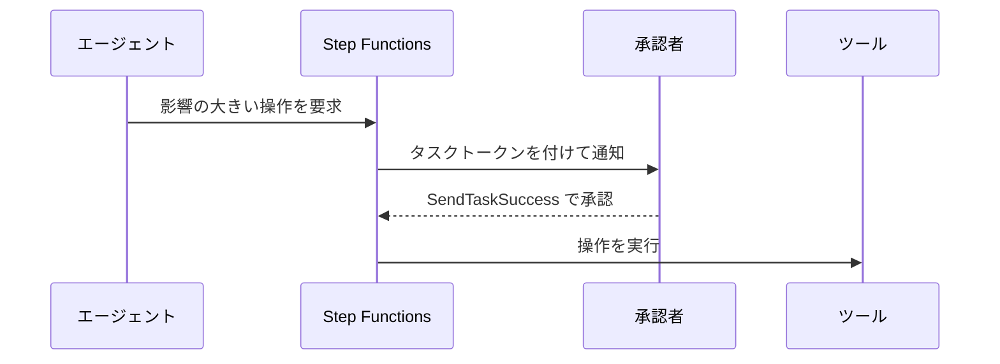

# 分野2: セキュリティ、コンプライアンス、ガバナンス

SAP-C03 の配点は **25%** です。組織全体の ID、暗号化、ガードレール、規制への対応、生成 AI の統制を扱います。

Professional では「1 つのアカウントを安全にする」より、「数百のアカウントに同じ統制を効かせる」「例外をどう扱う」が問われます。予防、検出、修復のどの段階の答えが求められているかを読み取ります。

セキュリティインシデントのフォレンジックや、詳細な脅威の調査は範囲外です。

## タスク 2.1: ID のセキュリティを設計する {#task-2-1}

### 2.1.1 標準プロトコルによる ID フェデレーション {#skill-2-1-1}

従業員の AWS へのアクセスは、IAM ユーザーを作らず、IAM Identity Center に集約します。

| プロトコル | 役割 | 例 |
|---|---|---|
| SAML 2.0 | サインインの連携 | 外部 IdP と Identity Center |
| SCIM | ユーザーとグループの自動同期 | 退職者の無効化を自動で反映 |
| OpenID Connect | ウェブ ID の連携 | CI/CD サービスから `AssumeRoleWithWebIdentity` |

**ID ソースの選択:**

| 状況 | 選択 |
|---|---|
| 新規、小規模 | Identity Center のディレクトリ |
| Entra ID、Okta などがある | 外部 IdP（SAML と SCIM） |
| オンプレミスの AD を残す | Managed Microsoft AD と信頼関係、または AD Connector |

**AD の接続方法:** AD Connector は問い合わせをオンプレミスへ中継するプロキシで、AD はオンプレミスのままです。Managed Microsoft AD は AWS に AD を置くので、回線の障害に強く、FSx や RDS とも連携できます。

権限は権限セットで定義し、アカウントとグループに割り当てます。

詳細: [IAM Identity Center](../../services/identity-directory.md#identity-center)、[ID ソース](../../services/identity-directory.md#idc-identity-sources)、[権限セット](../../services/identity-directory.md#idc-permission-sets)、[Directory Service](../../services/identity-directory.md#directory-service)、[フェデレーション](../../services/iam.md#federation)

### 2.1.2 アプリケーションの認証と認可 {#skill-2-1-2}

| 要件 | 選択 |
|---|---|
| アプリの利用者のサインアップとログイン | Cognito ユーザープール |
| 利用者に AWS の一時認証情報を渡す（S3 へ直接アップロードなど） | Cognito ID プール |
| ユーザーがサインインするウェブアプリ | OAuth 2.0 の認可コードフロー |
| サーバー同士の通信 | OAuth 2.0 のクライアントクレデンシャル |
| アプリの細かい認可を外に出す | Verified Permissions（Cedar） |
| API の入口でトークンを検証 | API Gateway の JWT や Cognito のオーソライザー |
| EKS の Pod に IAM 権限 | EKS Pod Identity |

ユーザープールは「誰か」を確認し、ID プールは AWS の権限を渡します。名前が似ていますが、役割が違います。

**Pod Identity:** Pod ごとに IAM ロールを割り当てます。ノードのロールに権限を付けると、そのノードの全 Pod に権限が及ぶので避けます。

詳細: [ユーザープールと ID プール](../../services/cognito.md#user-vs-identity-pools)、[OAuth フロー](../../services/cognito.md#oauth-flows)、[アプリケーションレベルの認可](../../services/cognito.md#app-authorization)、[Verified Permissions](../../services/identity-directory.md#verified-permissions)、[Pod に IAM 権限を与える](../../services/containers.md#pod-identity)

### 2.1.3 最小権限と一時認証情報 {#skill-2-1-3}

| 仕組み | 効果 | 使う場面 |
|---|---|---|
| IAM ロール | 一時認証情報。長期のキーをなくす | すべての基本 |
| 権限境界 | 付与できる権限の上限 | 開発者にロール作成を任せる |
| 外部 ID | 混乱した代理問題の防止 | 第三者の SaaS にロールを引き受けさせる |
| セッションポリシー | セッションごとに権限を狭める | 1 つのロールで処理ごとに権限を変える |
| ABAC | タグで権限を決める | ロールを増やさずに多数のチームへ |
| SCP | 組織の上限 | アカウント全体の禁止 |

**クロスアカウント:** 同じアカウントなら IAM かリソースポリシーの片方の許可で足りることがありますが、アカウントをまたぐと両方の許可が必要です。

**具体例:** プロジェクトごとにロールを作ると数が増え続けます。`aws:PrincipalTag/Project` と `aws:ResourceTag/Project` を比べる ABAC なら、ポリシーは 1 つで済みます。

詳細: [ポリシー評価](../../services/iam.md#policy-evaluation)、[権限境界の設定](../../services/iam.md#permissions-boundary)、[ExternalId と混乱した代理問題](../../services/iam.md#external-id)、[セッションポリシー](../../services/iam.md#session-policies)、[セッションタグ](../../services/iam.md#session-tags)、[クロスアカウントの評価](../../services/identity-directory.md#cross-account-evaluation)

### 2.1.4 データ境界と外部アクセスの検証 {#skill-2-1-4}

データ境界は「信頼できる ID が、信頼できるリソースに、想定されたネットワークからアクセスする」場合だけ許可する考え方です。

| 境界 | 仕組み | 条件キー |
|---|---|---|
| 信頼できる ID | RCP、VPC エンドポイントポリシー | `aws:PrincipalOrgID` |
| 信頼できるリソース | SCP、VPC エンドポイントポリシー | `aws:ResourceOrgID` |
| 想定されたネットワーク | SCP、RCP | `aws:SourceVpc`、`aws:SourceIp` |

**検証の道具:**

| 道具 | 見つけるもの |
|---|---|
| Access Analyzer の外部アクセス | 組織の外と共有されたリソース |
| Access Analyzer の内部アクセス | 組織の中の誰が重要なリソースへ届くか |
| Access Analyzer の未使用アクセス | 使っていないロールや権限 |
| ポリシーの検証 | 配布前のポリシーの問題 |

**Verified Access** は、VPN なしで社内アプリへアクセスさせます。リクエストごとにユーザーと端末の信頼データを評価します。

詳細: [データ境界](../../services/identity-directory.md#data-perimeter)、[IAM Access Analyzer](../../services/identity-directory.md#access-analyzer)、[エンドポイントポリシー](../../services/networking.md#endpoint-policies)、[Verified Access](../../services/identity-directory.md#verified-access)

### 2.1.5 ハイブリッドとマルチクラウドのワークロード ID {#skill-2-1-5}

AWS の外のワークロードに、長期のアクセスキーを持たせない設計です。

**IAM Roles Anywhere** は、X.509 証明書と引き換えに一時認証情報を発行します。

| 要素 | 内容 |
|---|---|
| トラストアンカー | Private CA か外部の CA 証明書への参照 |
| ロール | IAM Roles Anywhere のサービスプリンシパルを信頼する。`aws:SourceArn` でアンカーを限定する |
| プロファイル | 引き受けるロールと、権限を狭めるセッションポリシーを指定 |

| 状況 | 選択 |
|---|---|
| 自社の PKI で証明書を発行している | IAM Roles Anywhere |
| ワークロードが OIDC トークンを持っている | `AssumeRoleWithWebIdentity` |
| サーバーを Systems Manager で管理したい | ハイブリッドのマネージドノード |
| どれも使えない | アクセスキーとローテーション（最後の手段） |

落とし穴があります。信頼の境界はアカウントです。条件を書かないと、アカウント内のどのアンカーの証明書でも、そのロールを引き受けられます。リソースはリージョン単位で、同じアカウントとリージョンに作ります。

詳細: [プログラムからのアクセス](../../services/iam.md#programmatic-access)、[オンプレミスと他クラウド](../../services/operations.md#hybrid-nodes)、[AWS Private CA](../../services/certificates.md#private-ca)、[STS の API の比較](../../services/iam.md#sts-api-compare)

## タスク 2.2: 暗号化と鍵管理の戦略を設計する {#task-2-2}

### 2.2.1 カスタマー管理キーと自動ローテーション {#skill-2-2-1}

| キー | ポリシーの管理 | ローテーション | 使う場面 |
|---|---|---|---|
| AWS 管理キー | 不可 | 約 1 年ごとに自動 | 手間を最小に。監査の要件が弱い |
| カスタマー管理キー | 可 | 既定 365 日。90〜2560 日で指定 | アカウントをまたぐ、権限の分離、監査 |

**ローテーションの方式:**

- 自動は、KMS が生成した鍵素材の対称キーが対象です。
- オンデマンドは、対称キーで最大 25 回です。
- 非対称、HMAC、カスタムキーストアのキーは、新しいキーを作って別名を切り替えます。

ローテーションしてもキーの ID や ARN は変わらず、古い暗号文も復号できます。

**アカウントをまたぐ:** キーポリシーと、使う側の IAM の両方で許可します。AWS 管理キーは共有できません。

**費用:** S3 の SSE-KMS で KMS の費用が高いなら、S3 バケットキーで呼び出しを減らします。

詳細: [KMS キーの種類](../../services/kms.md#key-types)、[キーのローテーション](../../services/kms.md#key-rotation)、[マルチリージョンキー](../../services/kms.md#multi-region-keys)、[アカウントをまたぐ暗号化](../../services/kms.md#cross-account)、[S3 Bucket Key](../../services/s3.md#bucket-key)

### 2.2.2 証明書管理と転送時の暗号化 {#skill-2-2-2}

| 要件 | 選択 |
|---|---|
| 公開サイトの証明書を自動更新 | ACM（DNS 検証） |
| 社内サービスの証明書、mTLS | AWS Private CA |
| 新しい暗号スイートに限定 | ALB、NLB、CloudFront のセキュリティポリシーで TLS 1.3 を指定 |
| 利用者の証明書で認証 | mTLS |

**リージョンのルール:** CloudFront の証明書は `us-east-1` に作ります。ALB は同じリージョンです。

**自動更新の例外:** インポートした証明書は自動で更新されません。期限切れを監視します。

**エンドツーエンド:** ALB で TLS を終端すると、ALB とターゲットの間は別の暗号化が必要です。ターゲットまで届けるなら、NLB の TCP リスナーで通過させる方法もあります。

詳細: [ACM](../../services/certificates.md#acm)、[リージョンのルール](../../services/certificates.md#region-rules)、[AWS Private CA](../../services/certificates.md#private-ca)、[転送時の TLS](../../services/certificates.md#tls-in-transit)、[mTLS](../../services/certificates.md#mtls)

### 2.2.3 専用のハードウェアセキュリティモジュール {#skill-2-2-3}

| 観点 | KMS | CloudHSM |
|---|---|---|
| テナント | 共有 | 単一テナント |
| 認証、認可 | IAM とキーポリシー | HSM のユーザー |
| API | AWS API | PKCS#11、JCE、CNG、KSP |
| AWS サービスとの統合 | 多数 | KMS の CloudHSM キーストア経由 |
| 可用性 | AWS が管理 | 利用者が台数と AZ を設計 |

**選ぶ理由:** 「単一テナントの HSM」「鍵を完全に自社で管理」「PKCS#11 などの標準 API」と書かれていれば CloudHSM です。

**両方の要件を満たす:** AWS サービスと統合しつつ鍵を HSM に置くなら、KMS の CloudHSM キーストアを使います。

可用性は利用者の責任です。少なくとも 2 つの AZ に HSM を置きます。

!!! note "hsm1.medium の状況"
    CloudHSM の `hsm1.medium` は 2026 年 3 月 31 日でサポートが終了しました。`hsm2m.medium` を使います。

詳細: [CloudHSM](../../services/identity-directory.md#cloudhsm)、[KMS との比較](../../services/identity-directory.md#cloudhsm-vs-kms)、[クラスター](../../services/identity-directory.md#cloudhsm-clusters)、[KMS の CloudHSM キーストア](../../services/identity-directory.md#cloudhsm-key-store)

### 2.2.4 耐量子暗号の戦略 {#skill-2-2-4}

大規模な量子計算機で危険になるのは、主に公開鍵暗号です。

| 対象 | 量子計算機の影響 | 対応 |
|---|---|---|
| 対称暗号（AES-256-GCM、KMS の既定） | 実効の強度は 128 ビットに下がるが、総当たりは現実的でない | 公式は耐量子と位置づけており、変更は不要 |
| 鍵交換 | 今の通信を保存して将来解読される | ML-KEM |
| デジタル署名 | 将来の偽造。長期間使う署名が問題 | ML-DSA |

**KMS のキー仕様:**

| 方式 | 規格 | キー仕様 | 操作 |
|---|---|---|---|
| ML-DSA | FIPS 204 | `ML_DSA_44`、`ML_DSA_65`、`ML_DSA_87` | 署名と検証（`ML_DSA_SHAKE_256`） |
| ML-KEM | FIPS 203 | `ML_KEM_512`、`ML_KEM_768`、`ML_KEM_1024` | カプセル化と非カプセル化 |

キー仕様は作成後に変更できません。`kms:KeySpec` 条件キーで、作成できる仕様を制限できます。

**戦略の順序:**

1. 公開鍵暗号を使っている場所を棚卸しします。
2. データの保存期間から優先度を決めます。10 年守る必要があるデータは早めに対応します。
3. アルゴリズムを切り替えられるよう、アプリに直接書き込まないようにします。
4. 長期間使う署名（ファームウェア、コード署名）を ML-DSA へ移します。

詳細: [キーの仕様](../../services/kms.md#key-specs)、[対称と非対称の違い](../../services/kms.md#symmetric-vs-asymmetric)、[主な条件キー](../../services/kms.md#kms-condition-keys)、[KMS の鍵仕様（公式）](https://docs.aws.amazon.com/kms/latest/developerguide/symm-asymm-choose-key-spec.html)

## タスク 2.3: マルチアカウントのガバナンスとコンプライアンスを設計する {#task-2-3}

### 2.3.1 組織構造、ガードレール、ランディングゾーン {#skill-2-3-1}

| 部品 | 役割 |
|---|---|
| Organizations、OU | アカウントの階層。ポリシーをまとめて適用 |
| Control Tower | ランディングゾーンを構築し、コントロールを管理 |
| Account Factory | 基準を満たすアカウントの自動発行 |

**標準の構造:** Security OU に Log Archive と Audit のアカウントを置きます。ワークロードは本番と開発で OU を分けます。OU は組織図ではなく、適用するポリシーの違いで分けます。

**コントロールの種類:**

| 動作 | 働き | 実装 |
|---|---|---|
| 予防的 | 操作を止める | SCP、RCP |
| 検出的 | 違反を見つける | Config ルール |
| プロアクティブ | 作成前に確認 | CloudFormation Hooks |

Control Tower の管理下のリソースを手で変えるとドリフトになります。

詳細: [Organizations](../../services/governance.md#organizations)、[OU の設計](../../services/governance.md#org-ous)、[Control Tower](../../services/governance.md#control-tower)、[ランディングゾーンの構造](../../services/governance.md#ct-landing-zone)、[コントロール](../../services/governance.md#ct-controls)、[マルチアカウントのパターン](../../services/governance.md#multi-account-patterns)

### 2.3.2 ログと設定の一元管理 {#skill-2-3-2}

| 目的 | 手段 | 集約の方法 |
|---|---|---|
| API の監査 | CloudTrail | 組織の証跡を Log Archive の S3 へ |
| 設定の履歴と準拠 | Config | アグリゲーター |
| 脅威の検出 | GuardDuty | 委任管理者と組織の自動有効化 |
| 検出結果の集約 | Security Hub | 委任管理者とリージョンの集約 |
| ログの長期保管と分析 | Security Lake | OCSF、Parquet で S3 へ。ロールアップリージョン |
| アプリのログ | CloudWatch Logs | サブスクリプションで中央へ |
| AI の呼び出し | Bedrock のモデル呼び出しログ | 下記 |

!!! note "Security Hub の名称"
    2025 年 12 月に新しい統合製品の Security Hub が一般提供になり、従来のものは Security Hub CSPM になりました。設定の準拠をチェックするのは CSPM です。

**AI のログ:** モデル呼び出しログは既定で無効です。アカウントのリージョン単位で有効にします。送信先は同じアカウント、同じリージョンの CloudWatch Logs か S3 なので、組織で集めるには各アカウントに設定し、そこから中央へ送ります。本文に機密情報が入るので、アクセスを絞ります。

ログのアカウントでは S3 Object Lock を使い、ログの削除を防ぎます。

詳細: [証跡とイベント履歴](../../services/observability.md#cloudtrail-trails)、[アグリゲーター](../../services/governance.md#config-aggregators)、[GuardDuty の複数アカウント](../../services/threat-detection.md#guardduty-multi-account)、[Security Hub の組織と集約](../../services/threat-detection.md#security-hub-org)、[Security Lake](../../services/threat-detection.md#security-lake)、[モデル呼び出しログ](../../services/ai.md#invocation-logging)

### 2.3.3 アカウント間のリソース共有 {#skill-2-3-3}

| リソース | 共有の方法 | 効果 |
|---|---|---|
| VPC サブネット | RAM | ネットワークは中央、ワークロードは各アカウント |
| Transit Gateway | RAM | 各アカウントの VPC が同じ TGW を使う |
| Resolver の転送ルール | RAM | DNS の設定を一元化 |
| IPAM のプール | RAM | IP の割り当てを統制 |

**VPC 共有とピアリング:** 共有ならピアリングも TGW も不要で、接続の費用がかかりません。参加者は共有されたサブネットにリソースを作れますが、VPC やルートテーブルは変更できません。

Organizations との共有を有効にすれば、招待の受諾は不要です。

詳細: [AWS Resource Access Manager](../../services/governance.md#ram)、[VPC サブネットの共有](../../services/governance.md#ram-vpc-sharing)、[Transit Gateway のアタッチメント](../../services/network-connectivity.md#tgw-attachments)

### 2.3.4 SCP と RCP によるポリシーの強制 {#skill-2-3-4}

| 観点 | SCP | RCP |
|---|---|---|
| 制限の対象 | メンバーアカウントの IAM ユーザーとロール | メンバーアカウントのリソース |
| 主な用途 | 自社の人に禁止したいこと | 外部からのアクセスを防ぐ |
| 効かないもの | 管理アカウント、サービスリンクロール | 管理アカウントのリソース、サービスリンクロール、AWS 管理の KMS キー |
| Effect | Allow、Deny | Deny のみ（Allow は `RCPFullAWSAccess` のみ） |

**どちらも権限は与えません。** 上限を決めるだけで、実際の許可は IAM ポリシーなどで行います。

**使い分け:** 「社内の人が CloudTrail を止められないように」は SCP。「バケットポリシーを誤って公開しても、組織の外から読めないように」は RCP です。

**ワークロードを管理アカウントに置かない:** どちらも管理アカウントには効かないからです。

詳細: [SCP](../../services/governance.md#scp)、[RCP](../../services/governance.md#rcp)、[SCP と権限境界の組み合わせ](../../services/identity-directory.md#multi-account-access)、[SCP と RCP の例外](../../services/identity-directory.md#guardrail-exceptions)

### 2.3.5 コンプライアンスの自動監視 {#skill-2-3-5}

| 仕組み | 役割 |
|---|---|
| Config ルール | リソースの設定を評価 |
| 適合パック | ルールと修復をまとめて組織へ配布 |
| Security Hub CSPM | 基準（CIS、PCI DSS など）に対するコントロールの結果とスコア |
| Config の修復 | Systems Manager Automation で自動修正 |
| EventBridge | 検出結果を起点に通知や修復 |

**流れ:** 検出（Config）→ 集約（CSPM）→ 修復（Automation）です。影響の大きい修復には、人の承認を挟みます。

!!! note "Audit Manager の状況"
    AWS Audit Manager は 2026 年 4 月 30 日で新規受付を終了し、保守モードです。C03 の対象一覧にはありません。

詳細: [Config ルール](../../services/governance.md#config-rules)、[修復](../../services/governance.md#config-remediation)、[適合パック](../../services/governance.md#config-conformance-packs)、[Security Hub CSPM の標準](../../services/threat-detection.md#security-hub-cspm)、[自動化](../../services/threat-detection.md#security-hub-automation)

### 2.3.6 脆弱性スキャンとパッチ管理の自動化 {#skill-2-3-6}

| 役割 | サービス | 内容 |
|---|---|---|
| 見つける | Amazon Inspector | EC2、ECR、Lambda のスキャン |
| 直す | Systems Manager Patch Manager | ベースラインに沿ってパッチを適用 |
| 組織で配布 | Quick Setup のパッチポリシー | 複数アカウント、複数リージョンの推奨の方法 |
| 時間帯を制御 | Maintenance Windows | 業務時間外に実行 |

Inspector は組織で有効にし、委任管理者で管理します。検出結果を Security Hub に集め、重大なものから EventBridge で自動修復につなげます。

**具体例:** 開発は毎週、本番は 1 週間遅れで適用します。パッチベースラインの自動承認の遅延で、同じパッチを段階的に展開できます。

詳細: [Inspector](../../services/threat-detection.md#inspector)、[Patch Manager](../../services/operations.md#patch-manager)、[実行の設定方法](../../services/operations.md#patch-methods)、[パッチベースライン](../../services/operations.md#patch-baselines)、[Maintenance Windows](../../services/operations.md#maintenance-windows)

## タスク 2.4: コンプライアンス要件を満たすアーキテクチャを設計する {#task-2-4}

### 2.4.1 データ保護の要件 {#skill-2-4-1}

要件を暗号化、アクセス制御、監査ログの 3 つに分けて設計します。

| 要件 | 手段 |
|---|---|
| 保存時の暗号化を強制 | バケットの既定の暗号化、SCP や Config で未暗号化を拒否、検出 |
| 転送時の暗号化を強制 | バケットポリシーの `aws:SecureTransport` |
| 機密情報の発見 | Amazon Macie（C02 の対象、C03 の一覧にはなし） |
| ログの機密情報をマスク | CloudWatch Logs のデータ保護ポリシー |
| 誰がデータを読んだか | CloudTrail のデータイベント |
| 書き換えを防ぐ | S3 Object Lock のコンプライアンスモード |

CloudTrail のデータイベントは、既定では記録されず追加の料金がかかります。「オブジェクトの読み取りを監査」と書かれていれば、有効化が必要です。

詳細: [バケットのデフォルト暗号化とポリシーによる強制](../../services/s3.md#enforcing-encryption)、[Macie](../../services/threat-detection.md#macie)、[データ保護ポリシー](../../services/observability.md#logs-data-protection)、[イベントの種類](../../services/observability.md#cloudtrail-events)、[Object Lock](../../services/s3.md#object-lock)

### 2.4.2 規制要件とデータ主権 {#skill-2-4-2}

データ主権は「データがどの国の法律に従うか」の問題です。保管場所だけでなく、誰が鍵を持ち、誰がアクセスできるかも問われます。

| 要求 | 手段 |
|---|---|
| 特定の国に保管 | そのリージョンだけを使う（[2.4.4](#skill-2-4-4)） |
| リージョンのない場所に置く | Outposts、Local Zones |
| 鍵を自社で管理 | カスタマー管理キー、鍵素材のインポート、CloudHSM |
| 運用者のアクセスも制御 | キーポリシーと CloudTrail で鍵の利用を監査 |
| 準拠を示す | Artifact の報告書と、自社の Config のルール |

責任共有モデルでは、AWS が基盤の準拠を担い、利用者が設定とデータの準拠を担います。Artifact の報告書があっても、自社のワークロードが準拠するわけではありません。

詳細: [責任共有モデル](../../services/cloud-foundations.md#shared-responsibility)、[リージョン](../../services/cloud-foundations.md#regions)、[鍵素材のインポート](../../services/kms.md#imported-key-material)、[Outposts](../../services/cloud-foundations.md#outposts)

### 2.4.3 規制対象のワークロードの監査証跡 {#skill-2-4-3}

| 要件 | 設定 |
|---|---|
| 全アカウントの API を記録 | 組織の証跡 |
| 改ざんの検出 | ログファイルの検証（SHA-256 のハッシュと署名） |
| 書き換えの防止 | S3 Object Lock、別アカウントへの保管 |
| 長期保管の費用削減 | ライフサイクルで Glacier へ |
| 長期ログの検索 | Athena |
| AI の入出力の記録 | Bedrock のモデル呼び出しログ |
| AI の処理リージョンの確認 | CloudTrail の `additionalEventData.inferenceRegion` |

!!! note "CloudTrail Lake の状況"
    CloudTrail Lake は 2026 年 5 月 31 日で新規顧客の受付を終了しました。長期の検索は、S3 に保存して Athena で問い合わせる形で考えます。

詳細: [CloudTrail の設定](../../services/observability.md#cloudtrail)、[証跡とイベント履歴](../../services/observability.md#cloudtrail-trails)、[CloudTrail の調査](../../services/threat-detection.md#investigate-cloudtrail)、[モデル呼び出しログ](../../services/ai.md#invocation-logging)

### 2.4.4 データレジデンシーの制御 {#skill-2-4-4}

使うリージョンを組織で制限します。

| 手段 | 内容 | 注意 |
|---|---|---|
| SCP の `aws:RequestedRegion` | 許可したリージョン以外の操作を拒否 | IAM などのグローバルサービスを例外にする |
| Control Tower のリージョン拒否 | 同じ制限をコントロールとして管理 | ランディングゾーンの設定 |
| レプリケーションの制限 | S3、バックアップのコピー先を確認 | 他のリージョンへの複製を止める |

見落としやすいのは、データが自動で別のリージョンへ動く機能です。

| 機能 | 確認すること |
|---|---|
| Bedrock のクロスリージョン推論 | 処理は別のリージョンで行われる。地理的プロファイルは US、EU などの範囲内、グローバルプロファイルは世界の商用リージョン |
| DynamoDB グローバルテーブル、Aurora グローバルデータベース | レプリカのリージョン |
| AWS Backup のコピー | コピー先のリージョン |
| CloudFront | エッジのキャッシュ。地理的制限で配信先を限定 |

**Bedrock と SCP:** クロスリージョン推論では、プロファイルの送信先リージョンを SCP で許可します。グローバルプロファイルは `"aws:RequestedRegion": "unspecified"` の許可が必要です。レジデンシーの要件があるなら、地理的プロファイルを選びます。

詳細: [SCP](../../services/governance.md#scp)、[コントロール](../../services/governance.md#ct-controls)、[レプリケーション](../../services/s3.md#replication)、[モデル ID と推論プロファイル](../../services/ai.md#model-identifiers)、[クロスリージョン推論（公式）](https://docs.aws.amazon.com/bedrock/latest/userguide/cross-region-inference.html)

### 2.4.5 コンプライアンスの証拠の収集と報告 {#skill-2-4-5}

| 証拠 | 取得先 |
|---|---|
| AWS の準拠の報告書（SOC、PCI など） | AWS Artifact |
| AWS との契約（BAA など） | AWS Artifact |
| 自社の設定の準拠の履歴 | Config |
| 基準に対する結果 | Security Hub CSPM |
| 誰が何をしたか | CloudTrail |

監査人に「AWS 自身の準拠の証拠」を出すなら Artifact です。「自社の設定」の証拠は Config と CSPM から集めます。

Artifact は C03 の対象一覧には載っていませんが、このスキルの例に名前があります。

詳細: [AWS Artifact](../../services/threat-detection.md#artifact)、[Config と CloudTrail の違い](../../services/governance.md#config-vs-cloudtrail)、[Audit Manager](../../services/threat-detection.md#audit-manager)

### 2.4.6 リスク評価と脅威モデリング {#skill-2-4-6}

脅威モデリングは設計の早い段階で行います。後から直すより、費用が小さく済むからです。Well-Architected でも、脅威と対策を一覧で保ち、更新し続けることを勧めています。

**4 つの問い:**

| 問い | 行うこと |
|---|---|
| 何を作っているか | データフロー図で範囲と前提を合意 |
| 何が問題になりうるか | STRIDE で脅威を洗い出す |
| どう対処するか | 対策と優先度を決める。AWS との責任分担も確認 |
| うまくできたか | 振り返り、次に活かす |

**STRIDE:** なりすまし、改ざん、否認、情報漏えい、サービス拒否、権限昇格の 6 分類です。

**道具:** Threat Composer は脅威の記述を支援し、機械で読める形でも出力します。

| 脅威の例 | 対策の例 |
|---|---|
| なりすまし | MFA、Cognito、mTLS |
| 改ざん | ログファイルの検証、Object Lock |
| 情報漏えい | KMS、Macie、データ境界 |
| サービス拒否 | Shield、WAF のレート制限 |
| 権限昇格 | 権限境界、SCP、Access Analyzer |

大きな変更や新しいサービスの採用のときに、見直します。

詳細: [責任共有モデル](../../services/cloud-foundations.md#shared-responsibility)、[Well-Architected Framework](../../services/cloud-foundations.md#well-architected)、[Security Hub の機能](../../services/threat-detection.md#security-hub-unified)、[SEC01-BP07（公式）](https://docs.aws.amazon.com/wellarchitected/latest/framework/sec_securely_operate_threat_model.html)

## タスク 2.5: セキュリティと責任ある AI の統制を設計する {#task-2-5}

C02 では、この範囲は採点されない試行問題として出ることがあります。C03 では正式なタスクです。

### 2.5.1 生成 AI のコンテンツフィルタリング {#skill-2-5-1}

| 脅威 | Guardrails の機能 |
|---|---|
| 有害な内容、プロンプト攻撃 | コンテンツフィルター |
| 業務に無関係な話題 | 拒否トピック |
| 個人情報の漏えい | 機密情報フィルター（マスクまたはブロック） |
| 根拠のない回答 | コンテキストグラウンディング |
| 規定の条件との矛盾 | Automated Reasoning |

**強制の方法:**

| 範囲 | 方法 | 特徴 |
|---|---|---|
| 呼び出しごと | `Converse` などで指定 | アプリが指定を忘れると効かない |
| IAM | `bedrock:GuardrailIdentifier` 条件キー | 指定のないリクエストを拒否 |
| 組織、OU、アカウント | Organizations の Bedrock ポリシー | 呼び出し側の指定は不要 |

Guardrails だけに頼らず、入力の検証、IAM、ログと組み合わせる多層防御にします。

詳細: [Guardrails](../../services/ai.md#guardrails)、[適用の強制と限界](../../services/ai.md#guardrail-enforcement)、[組織での強制](../../services/genai-apps.md#guardrail-org-enforcement)、[コンテキストグラウンディング](../../services/genai-apps.md#contextual-grounding)、[多層防御](../../services/genai-apps.md#defense-in-depth)

### 2.5.2 生成 AI とエージェントのアクセス制御 {#skill-2-5-2}

エージェントは利用者の代わりに動くので、「誰の権限で動くか」が論点です。

| 要件 | 手段 |
|---|---|
| エージェントのワークロード ID | AgentCore Identity |
| 外部 API の OAuth トークンの安全な保管 | AgentCore Identity のトークン保管庫（KMS で暗号化） |
| サービス間の呼び出し | OAuth クライアントクレデンシャル（2LO） |
| 利用者の同意を得た呼び出し | OAuth 認可コード（3LO） |
| ツール呼び出しを条件で制限 | Policy in AgentCore（Cedar など） |
| モデルの利用を限定 | IAM のリソースと条件、SCP |

**モデルの判断を信用しません。** モデルはツールの実行を要求するだけです。実行前に、コードの外で認可します。プロンプトインジェクションでモデルが騙されても、権限の外の操作はできません。

詳細: [AgentCore の構成要素と設定](../../services/ai.md#agentcore-components)、[ツール利用の認可](../../services/ai.md#tool-authorization)、[セッションの分離](../../services/ai.md#session-isolation)、[Policy](../../services/genai-apps.md#agentcore-policy)、[IAM のスコープ](../../services/ai.md#iam-scope)

### 2.5.3 人による監督と承認のワークフロー {#skill-2-5-3}

影響の大きい操作（返金、本番の変更、外部への送信）の前に、人の承認を挟みます。

| 設計の点 | 内容 |
|---|---|
| ワークフローの種類 | Standard。`waitForTaskToken` は Express で使えない |
| 待ち時間 | Standard は最大 1 年 |
| タイムアウト | 例: 3 日なら `TimeoutSeconds` を 259,200。期限で却下へ進める |
| 監査 | 誰がいつ承認したかを記録 |

自動で進める範囲は、金額やリスクの基準で決めます。すべてに承認を求めると、形だけの承認になります。

Lambda durable functions の待機も、コードで書く承認に使えます。待機中のコンピューティング料金はかかりません。

!!! note "A2I の状況"
    SageMaker A2I は新規顧客を受け付けていません。

詳細: [人の承認](../../services/step-functions.md#human-approval)、[コールバック](../../services/step-functions.md#wait-for-callback)、[人による確認](../../services/genai-apps.md#human-in-the-loop)、[人による監督](../../services/ai-fundamentals.md#human-oversight)、[A2I](../../services/ai-managed-services.md#a2i)

## 確認問題 {#self-check}

??? question "問1: オンプレミスの Linux サーバーのバッチが、S3 への書き込みに IAM ユーザーのアクセスキーを使っています。社内の PKI で証明書を発行済みです。長期の認証情報をなくすにはどうしますか？"
    IAM Roles Anywhere です。社内の CA をトラストアンカーに登録し、ロールとプロファイルを作ります。ロールの信頼ポリシーで `aws:SourceArn` を指定し、アンカーを限定します。条件がないと、同じアカウントの他のアンカーの証明書でも引き受けられます。

??? question "問2: あるバケットのポリシーで、誤って全世界に公開されても、組織の外から読めないようにしたいです。全アカウントのバケットに適用します。SCP と RCP のどちらを使いますか？"
    RCP です。リソースへのアクセスの上限を決め、組織の外の主体も対象にできます。SCP は自組織のユーザーとロールだけを制限します。管理アカウントのリソースには効かないので、そこにワークロードを置きません。

??? question "問3: 規制により、データを 15 年保護する必要がある署名付き文書の基盤を設計します。量子計算機への備えも求められています。S3 の SSE-KMS とコード署名はどう判断しますか？"
    AES-256-GCM の SSE-KMS は公式が耐量子と位置づけており、変更の優先度は低いです。署名は長期間の検証が必要なので優先します。ML-DSA のキー仕様の KMS キーで署名します。あわせて、アルゴリズムを切り替えられる設計にします。

??? question "問4: EU のリージョンだけを使う規定の会社が、Bedrock のクロスリージョン推論で容量を確保したいです。どのプロファイルを選び、何を確認しますか？"
    EU の地理的プロファイルです。処理は EU の範囲内のリージョンに限られます。SCP でリージョンを制限しているなら、プロファイルの送信先リージョンをすべて許可する必要があります。グローバルプロファイルは世界の商用リージョンへ送られるので、この要件に合いません。

??? question "問5: 開発者が各自で Bedrock を呼ぶ 30 のアカウントで、必ず同じガードレールを適用したいです。アプリの変更は最小にします。どうしますか？"
    Organizations の Bedrock ポリシーで組織に適用します。呼び出し側の指定がなくても効きます。`bedrock:GuardrailIdentifier` 条件キーでも強制できますが、指定のないリクエストが拒否されるので、各アプリの変更が必要です。

??? question "問6: 第三者の SaaS が顧客のアカウントのロールを引き受ける仕組みを作ります。別の顧客がこの SaaS を悪用して、他の顧客のロールを使うことを防ぐには？"
    信頼ポリシーの条件に、顧客ごとに異なる外部 ID を指定します。混乱した代理問題の対策です。外部 ID は SaaS 側で発行し、顧客が設定します。SaaS のアカウント ID だけを信頼すると、この問題を防げません。
