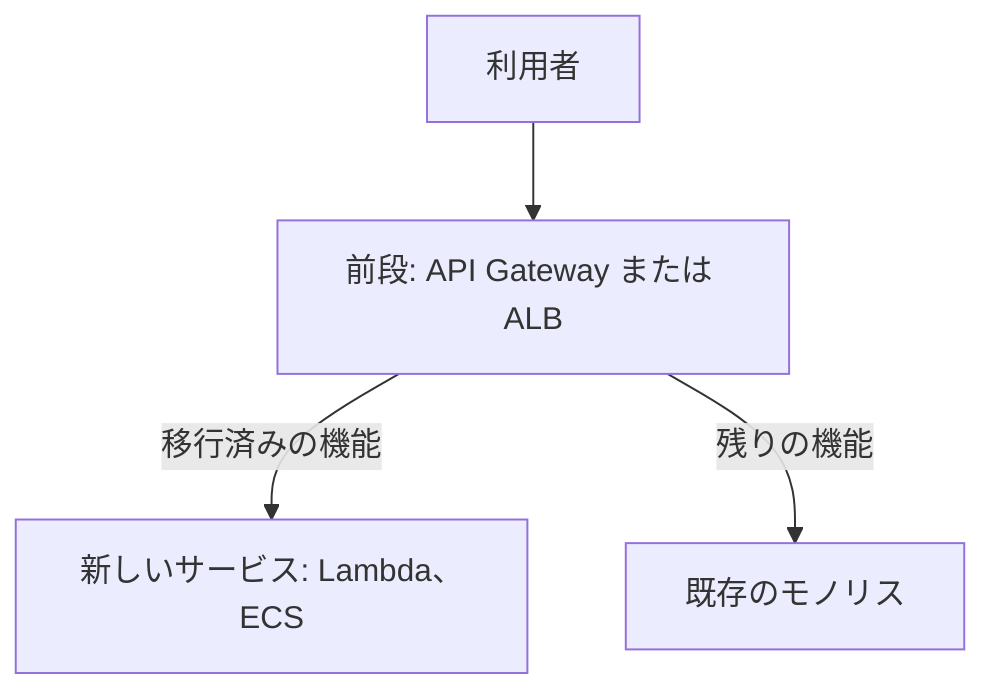
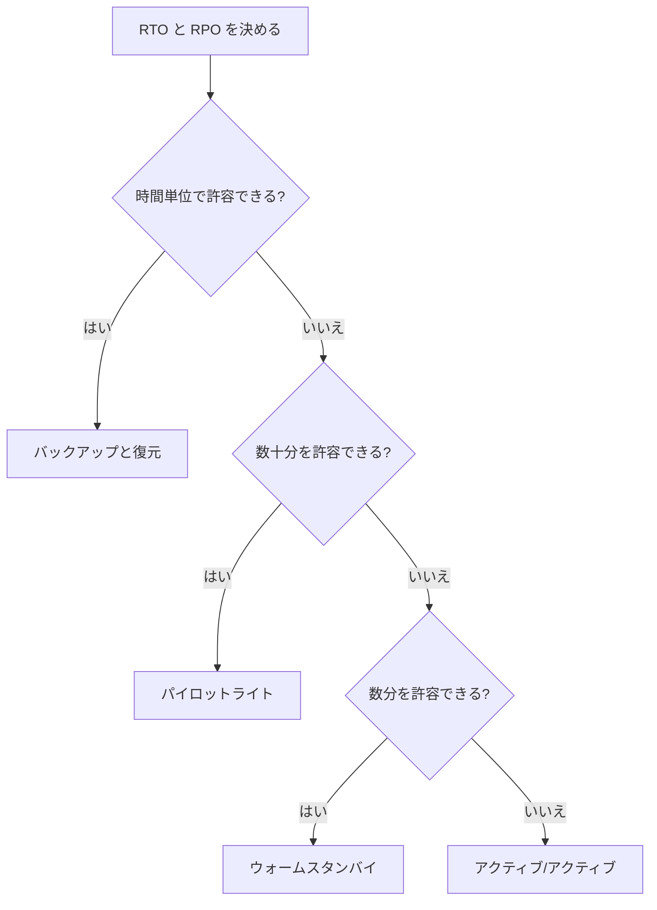

# 分野4: 回復性、移行、事業継続

SAP-C03 の配点は **15%** です。移行の戦略、DR、回復性のテストを扱います。

設問の多くは、RTO、RPO、費用、期限の数字から答えを絞ります。数字を先に拾ってから、選択肢を読みます。

この分野に限らず、コース全体で使うサービスは[サービス一覧](services.md)から確認できます。

## タスク 4.1: AWS のフレームワークを使って移行戦略を設計する {#task-4-1}

!!! note "移行サービスの状況"
    Migration Hub、Refactor Spaces、Application Discovery Service、App2Container は新規受付を終了し、後継は AWS Transform です。Mainframe Modernization も新規受付を終了しました。Snow Family は新規の注文を受け付けていません。C03 の対象一覧は AWS Transform と AWS Transform MGN（旧 Application Migration Service）に変わっています。

### 4.1.1 発見、ポートフォリオ評価、移行ウェーブ {#skill-4-1-1}

| 目的 | 手段 |
|---|---|
| サーバー一覧と依存関係の把握 | AWS Transform の発見、既存のお客様は Application Discovery Service |
| 費用対効果の試算 | Migration Evaluator |
| アプリごとの方針 | 7 つの R で分類 |
| 移行の順序 | 移行ウェーブ |

**ウェーブの決め方:** 依存関係の強いアプリは同じウェーブにまとめます。最初のウェーブは、影響が小さく、学びの多いアプリにします。

**7 つの R:**

| 戦略 | 内容 | 向く場面の例 |
|---|---|---|
| Retire | 止めて、アーカイブする | 90 日間接続がない |
| Retain | 今は移さない | 規制、更新したばかり |
| Rehost | 変えずに EC2 へ | 多数のサーバーを短期間で |
| Relocate | ハイパーバイザーごと移す | VMware をそのまま AWS 上へ |
| Repurchase | SaaS などへ買い替える | 自社開発の CRM を SaaS へ |
| Replatform | 少し手を入れる | 自前の DB を RDS へ |
| Refactor | 作り直す | モノリスをマイクロサービスへ |

データセンターの契約期限が迫っているなら Rehost を優先し、モダナイズは移行後に進めるのが基本です。

詳細: [移行の 7 つの R](../../services/migration.md#seven-rs)、[AWS Transform](../../services/migration.md#transform)、[Application Discovery Service](../../services/migration.md#application-discovery)、[Migration Evaluator](../../services/migration.md#migration-evaluator)、[Migration Hub](../../services/migration.md#migration-hub)

### 4.1.2 リホスト戦略 {#skill-4-1-2}

**AWS Transform MGN** は、ソースのサーバーをブロック単位で継続的に複製し、短い切り替え時間で EC2 へ移します。

| 手順 | 内容 |
|---|---|
| エージェントの導入 | ソースのサーバーへ |
| 複製 | ステージング領域へ継続的に |
| テスト | テストインスタンスを起動して確認 |
| 切り替え | カットオーバーの時間だけ止める |

**AWS Transform** は AI エージェントが、発見、計画、リホストを案内します。追加料金はかかりません。重要な操作には、人の承認を挟めます。

**見分け方:** サーバーを丸ごとなら MGN、データベースのエンジンを変えるなら DMS です。移して終わりなら MGN、備え続けるなら DRS です。

MGN のエージェントレス複製は、新規のデプロイでは使えません。VMware をそのまま使い続けるなら Relocate で、Amazon EVS を検討します。

詳細: [AWS Transform MGN](../../services/migration.md#mgn)、[通信の要件](../../services/migration.md#mgn-network)、[ライフサイクル](../../services/migration.md#mgn-lifecycle)、[VMware の移行](../../services/migration.md#vmware)、[選び方の比較](../../services/migration.md#choosing)

### 4.1.3 データベースとデータの移行 {#skill-4-1-3}

| 要件 | 選択 |
|---|---|
| 異なるエンジンのスキーマとコードの変換 | SCT、DMS Schema Conversion |
| データの移行、停止時間を最小に | DMS のフルロードと CDC |
| ファイル共有を S3、EFS、FSx へ | DataSync |
| 回線に乗らない量 | Data Transfer Terminal、パートナー製品 |

**DMS の手順:** 同じエンジンならそのまま、異なるエンジンなら先にスキーマを変換します。CDC にはソースのログの設定が必要です。

**転送時間を計算します。** 100 TB を 1 Gbps の回線で送ると、効率 100% でも約 9 日かかります。期限に間に合うかで手段が決まります。

データが変わり続けるなら、最後の差分の同期も含めて計画します。

詳細: [AWS DMS](../../services/migration.md#dms)、[移行タイプ](../../services/migration.md#dms-migration-types)、[CDC の前提](../../services/migration.md#dms-cdc)、[SCT](../../services/migration.md#sct)、[DataSync](../../services/migration.md#datasync)、[転送方法の選び方](../../services/migration.md#choosing-transfer)、[Data Transfer Terminal](../../services/migration.md#data-transfer-terminal)

### 4.1.4 リプラットフォーム戦略 {#skill-4-1-4}

コードの大きな変更なしに、運用の負荷を減らします。

| 移行元 | 移行先 | 減る作業 |
|---|---|---|
| EC2 上の MySQL、PostgreSQL | RDS、Aurora | パッチ、バックアップ、フェイルオーバー |
| EC2 上のコンテナ | ECS、Fargate | ホストの管理 |
| 定期実行の小さなスクリプト | Lambda、EventBridge Scheduler | サーバーの維持 |

設問に「運用の負荷を最小に」とあれば、自前の EC2 よりマネージドが正解になります。ただし OS へのアクセスや、特殊な拡張が必要なら合いません。

詳細: [RDS](../../services/databases.md#rds)、[Aurora](../../services/databases.md#aurora)、[ECS](../../services/containers.md#ecs)、[Replatform を含む 7 つの R](../../services/migration.md#seven-rs)

### 4.1.5 リファクタ戦略 {#skill-4-1-5}

全部を一度に作り直すのは危険です。少しずつ置き換えます。

**ストラングラーフィグパターン:**

| 手順 | 内容 |
|---|---|
| 1 | 前段にルーティング層を置く |
| 2 | 境界の明確な機能を 1 つ切り出す |
| 3 | トラフィックを徐々に新しいサービスへ |
| 4 | 古い機能を止める。繰り返す |

**データの分離:** サービスごとにデータストアを持つのが理想ですが、これが最も難しい部分です。移行中は DMS などで同期することもあります。

**分割の基準:** 変更の多い機能、スケールが異なる機能から切り出します。サーバーレスは、負荷が断続的な機能に向きます。

詳細: [移行の 7 つの R](../../services/migration.md#seven-rs)、[アーキテクチャパターン](../../services/sdk-resilience.md#architectural-patterns)、[密結合と疎結合](../../services/messaging.md#coupling)、[オーケストレーションとコレオグラフィー](../../services/step-functions.md#orchestration-choreography)

### 4.1.6 レガシーワークロードのモダナイズ {#skill-4-1-6}

| 対象 | 手段 |
|---|---|
| メインフレーム（IBM z/OS、富士通 GS21） | AWS Transform のモダナイズ |
| .NET Framework | AWS Transform で Linux で動く .NET へ |
| アプリのコンテナ化 | AWS Transform のコンテナ化で ECS、EKS へ |
| 商用データベース | DMS と SCT でオープンソース系へ |
| 古いメッセージング | Amazon MQ（プロトコルを保つ）、SQS、SNS（書き換える） |

商用データベースからの移行は、ライセンス費用を減らす代表的な動機です。ストアドプロシージャが多いほど、変換に手間がかかります。SCT の評価レポートで見積もります。

詳細: [AWS Transform](../../services/migration.md#transform)、[SCT](../../services/migration.md#sct)、[App2Container](../../services/migration.md#app2container)、[Amazon MQ](../../services/other-services.md#mq)

## タスク 4.2: DR のアーキテクチャを設計する {#task-4-2}

### 4.2.1 ビジネス要件に合う DR {#skill-4-2-1}

| 戦略 | RTO、RPO の目安 | 平常時の費用 | 平常時の DR 側 |
|---|---|---|---|
| バックアップと復元 | 時間単位 | 最小 | データのコピーだけ |
| パイロットライト | 数十分 | 小 | データは同期、サーバーは停止 |
| ウォームスタンバイ | 分単位 | 中 | 縮小した構成で稼働中 |
| マルチサイトアクティブ/アクティブ | ほぼゼロ | 大 | 全容量で稼働 |

**見分け方:** すぐに処理できないのがパイロットライト、縮小した規模でも処理できるのがウォームスタンバイです。

要件を満たす中で最も安いものが正解です。

レプリケーションだけでは破損や誤削除を防げません。破損も複製されるからです。時点復旧のバックアップも持ちます。

詳細: [RTO と RPO](../../services/resilience.md#rto-rpo)、[達成できるかの計算](../../services/resilience.md#rto-rpo-budget)、[4 つの DR 戦略](../../services/resilience.md#dr-strategies)、[書き込みの戦略](../../services/resilience.md#write-patterns)

### 4.2.2 継続的なレプリケーション {#skill-4-2-2}

**AWS Elastic Disaster Recovery（DRS）** は、サーバーをブロック単位で継続的に AWS へ複製します。

| 項目 | 内容 |
|---|---|
| 対象 | オンプレミス、他のクラウド、別リージョンの EC2 |
| RPO | 秒単位 |
| RTO | 通常 5〜20 分 |
| 平常時の費用 | 低コストのステージング領域のみ |

**DRS と AWS Backup:** サーバー全体を分単位で起動するなら DRS、データの時点コピーなら Backup です。

**DRS と MGN:** 似た複製の仕組みですが、備え続けるなら DRS、移して終わりなら MGN です。

マネージドサービスのデータには、それぞれの機能を使います。Aurora グローバルデータベース、DynamoDB グローバルテーブル、S3 CRR などです。

詳細: [AWS Elastic Disaster Recovery](../../services/resilience.md#drs)、[サービスごとの Multi-AZ と Multi-Region](../../services/resilience.md#patterns-by-service)、[選び方の比較](../../services/resilience.md#choosing)

### 4.2.3 DR の評価と復旧手順 {#skill-4-2-3}

| 手段 | 役割 |
|---|---|
| AWS Resilience Hub | 構成を調べ、推定の RTO、RPO と目標を比べ、改善を提案 |
| 回復性ポリシー | 目標の RTO、RPO。障害の種類ごとに指定 |
| Systems Manager Automation のランブック | 復旧手順をコードにする |

**使い方:** アプリを CloudFormation スタック、リソースグループ、Terraform の状態ファイル、EKS クラスターから定義します。評価の結果は Policy met や Policy breached で示されます。

**手順の原則:** 人が画面を操作する手順は、緊急時に間違えます。ランブックで自動化し、定期的に実行して確かめます。

詳細: [AWS Resilience Hub](../../services/resilience.md#resilience-hub)、[Automation](../../services/operations.md#automation)、[複数アカウント、複数リージョンの実行](../../services/operations.md#automation-multi-account)

### 4.2.4 マルチリージョンの DR {#skill-4-2-4}

| 手段 | 切り替えの動き | 向く場面 |
|---|---|---|
| Route 53 のヘルスチェックとフェイルオーバー | 異常を検出して自動で DNS の回答を変える | 単純な自動の切り替え |
| Global Accelerator | 固定 IP の裏側で切り替える | DNS キャッシュの影響を避ける |
| ARC のルーティングコントロール | 人の判断で確実に切り替える | 誤検知を避けたい |
| ARC の Region switch | 複数のアカウントにまたがる手順を計画として実行 | 複雑な復旧の順序 |

**データプレーンで切り替えます。** 障害のときはコントロールプレーンが使えないことがあります。Route 53 のレコードの編集はコントロールプレーンの操作なので、復旧の手順に含めません。ヘルスチェックや ARC のルーティングコントロールの状態変更を使います。

**静的安定性:** 障害時に新しいリソースを作る設計は、API の不調や容量不足の影響を受けます。あらかじめ容量を確保します。

詳細: [フェイルオーバーはデータプレーンで](../../services/resilience.md#failover-data-plane)、[Route 53 のフェイルオーバー設計](../../services/resilience.md#route53-failover)、[Amazon Application Recovery Controller](../../services/resilience.md#arc)、[Region switch](../../services/resilience.md#arc-region-switch)、[静的安定性](../../services/resilience.md#static-stability)

### 4.2.5 DR のテストと検証 {#skill-4-2-5}

計画は、実行するまで機能するか分かりません。

| 検証 | 手段 |
|---|---|
| 構成が目標を満たすか | Resilience Hub の評価。継続的に実行 |
| 実際に切り替わるか | ゲームデイ、FIS |
| バックアップから復元できるか | AWS Backup の復元テスト |
| Direct Connect の切り替え | フェイルオーバーテスト |

本番の変更のたびに Resilience Hub の評価を CI/CD で実行すると、回復性の低下を早く見つけられます。

**DRS のドリル:** 複製を止めずに、復旧インスタンスを起動して確かめられます。

詳細: [AWS Resilience Hub](../../services/resilience.md#resilience-hub)、[復元テストと監査](../../services/resilience.md#backup-testing)、[AWS Elastic Disaster Recovery](../../services/resilience.md#drs)

### 4.2.6 マルチクラスターのコンテナ戦略 {#skill-4-2-6}

ECS と EKS のクラスターはリージョン単位です。リージョンの障害に備えるには、各リージョンにクラスターを用意します。

| 層 | 設計 |
|---|---|
| タスク、Pod | 複数の AZ に分散。異常なら置き換える |
| クラスター | 同じ構成を IaC と CI/CD で複数のリージョンにデプロイ |
| イメージ | ECR のレプリケーション |
| トラフィック | Route 53 か Global Accelerator |
| データ | Aurora グローバルデータベース、DynamoDB グローバルテーブル |
| 永続ストレージ | AWS Backup、EFS のレプリケーション |

**容量:** 障害時に Karpenter や Auto Scaling で増やす設計なら、DR リージョンのクォータと容量を事前に確認します。静的安定性を重視するなら、スタンバイのクラスターにも容量を確保します。

**同じリージョンの複数クラスター:** アップグレードや設定の誤りの影響を小さくします。Kubernetes のバージョンアップを、新しいクラスターへの切り替えで行う方法もあります。

詳細: [コンテナのマルチクラスター戦略](../../services/resilience.md#multi-cluster)、[レプリケーション](../../services/containers.md#ecr-replication)、[静的安定性](../../services/resilience.md#static-stability)

## タスク 4.3: 事業継続と回復性の要件を満たす {#task-4-3}

### 4.3.1 バックアップの統制と組織のポリシー {#skill-4-3-1}

| 機能 | 内容 |
|---|---|
| バックアップポリシー | 組織で定義して OU やアカウントに適用。子のポリシーは親と統合される |
| 別アカウントへのコピー | 同じ組織が前提。送信先のボールトのポリシーで許可 |
| クロスアカウントモニタリング | ジョブをまとめて確認 |
| 委任管理者 | 管理アカウント以外に管理を任せる |
| Audit Manager（AWS Backup の機能） | 準拠のレポート |

**具体例:** 組織全体に「毎日、7 日保持」を適用し、Finance の OU に「毎月、1 年保持」を足します。Finance には両方が統合されて適用されます。

**落とし穴:** カスタム IAM ロールでコピーするなら、`backup:CopyIntoBackupVault` がロールのポリシーと送信先のボールトポリシーの両方に必要です。

ランサムウェアに備え、コピー先は別のアカウントにします。

詳細: [AWS Backup](../../services/resilience.md#backup)、[アカウント間コピーと組織での管理](../../services/resilience.md#backup-cross-account)、[リソースの割り当て](../../services/resilience.md#backup-assignment)

### 4.3.2 フェイルオーバーテストと復旧時間の計測 {#skill-4-3-2}

RTO の目標を、実測で確かめます。

| 計測の点 | 手段 |
|---|---|
| 障害の検出 | Route 53 ヘルスチェック、CloudWatch アラーム |
| 切り替え | Route 53 のフェイルオーバー、FIS の実験中の動作 |
| 復旧までの時間 | アラームの開始から正常に戻るまで。Synthetics でも測れる |

**RTO の内訳:** 検出、判断、切り替え、DNS の TTL の合計です。ヘルスチェックの間隔としきい値と、TTL が 300 秒なら、それだけで分単位になります。

**FIS の例:** 1 つの AZ の接続を止め、Multi-AZ の RDS の切り替えと、ALB の振り分けの時間を計測します。

VPC 内のプライベートな IP にはヘルスチェックが届きません。CloudWatch アラーム型のヘルスチェックを使います。

詳細: [Route 53 ヘルスチェック](../../services/networking.md#route53-health-checks)、[設計のポイント](../../services/resilience.md#route53-design)、[AWS Fault Injection Service](../../services/resilience.md#fis)、[Synthetics](../../services/operations.md#synthetics)

### 4.3.3 冗長性、耐障害性、自己修復 {#skill-4-3-3}

| 特性 | 手段 |
|---|---|
| 冗長性 | 複数の AZ、Multi-AZ の RDS、複数の NAT |
| 耐障害性 | キューで疎結合、再試行、サーキットブレーカー |
| 自己修復 | Auto Scaling のヘルスチェック、ECS のタスクの置き換え |
| 依存先の影響を限定 | タイムアウト、機能の縮退 |

**単一障害点の探し方:** 1 つの AZ の NAT、1 台の DB、1 本の回線、1 つの Lambda の予約枠を確認します。

**AZ の障害への備え:** 2 つの AZ で 50% ずつなら、1 つの AZ の障害で容量が半分になります。3 つの AZ に分け、残りで処理できる容量を常に確保します。

詳細: [高可用性のための Auto Scaling](../../services/resilience.md#auto-scaling-ha)、[疎結合と耐障害性](../../services/resilience.md#loose-coupling)、[機能の縮退](../../services/sdk-resilience.md#graceful-degradation)、[静的安定性](../../services/resilience.md#static-stability)、[ゾーンシフトとオートシフト](../../services/resilience.md#arc-zonal)

### 4.3.4 ランサムウェアと誤削除からの保護 {#skill-4-3-4}

| 対象 | 機能 | 保護の内容 |
|---|---|---|
| S3 | Object Lock | オブジェクトの WORM |
| EBS スナップショット | スナップショットロック | ガバナンス、コンプライアンスのモード |
| バックアップ全般 | Vault Lock | ボールト内の復旧ポイントの WORM |
| 組織全体 | 論理的にエアギャップされたボールト | 別アカウントからの復元 |
| スナップショットの誤削除 | Recycle Bin | 一定期間内なら復元 |

**モードの違い:** ガバナンスは権限があれば解除でき、コンプライアンスは誰も解除できません。Vault Lock のコンプライアンスは、猶予期間（3 日以上）の後に変更できなくなります。

**管理者の権限が奪われても守るには:** コンプライアンスモードと、別のアカウントへのコピーを組み合わせます。MFA 削除やバージョニングも併用します。

**鍵も忘れずに:** 攻撃者が KMS キーを削除すると、データは復号できません。キーの削除の待機期間と、SCP での禁止を検討します。

詳細: [ランサムウェアと誤削除の防止](../../services/resilience.md#immutable-compare)、[Vault Lock](../../services/resilience.md#vault-lock)、[論理的にエアギャップされたボールト](../../services/resilience.md#logically-air-gapped)、[Object Lock](../../services/s3.md#object-lock)、[バージョニング](../../services/s3.md#versioning)

### 4.3.5 カオスエンジニアリング {#skill-4-3-5}

**手順:** 定常状態を定義し、仮説を立て、実験します。結果から設計を改善します。

**FIS の実験テンプレート:**

| 要素 | 内容 | 誤ったときの症状 |
|---|---|---|
| アクション | 何を起こすか | |
| ターゲット | タグなどで選ぶ。`selectionMode` で数や割合を決める | `ALL` にすると全台が止まる |
| 停止条件 | CloudWatch アラーム | ないと影響が広がっても止まらない |
| 実験ロール | FIS が使う IAM ロール | 権限がないとアクションが失敗する |

**定常状態の仮説の例:** 「1 つの AZ を止めても、エラー率は 1% 未満、p99 の遅延は 500 ms 未満を保つ」のように、測れる形で書きます。

**安全に進める:** 検証環境で小さく始め、影響範囲を絞ります。本番では停止条件を必ず設定します。

**Resilience Hub と FIS:** 構成の評価は Resilience Hub、実際に壊して確かめるのは FIS です。

詳細: [AWS Fault Injection Service](../../services/resilience.md#fis)、[実験テンプレート](../../services/resilience.md#fis-template)、[選び方の比較](../../services/resilience.md#choosing)

## 確認問題 {#self-check}

??? question "問1: 基幹システムの要件は RTO 30 分、RPO 5 分です。データベースは Aurora です。費用は最小にしたいです。どの DR 戦略を選びますか？"
    パイロットライトです。Aurora グローバルデータベースでデータを同期し、アプリのサーバーは停止か最小にしておき、障害時に起動します。バックアップと復元は RPO と RTO を満たせません。ウォームスタンバイは満たしますが、費用が余計にかかります。

??? question "問2: 500 台のサーバーを、データセンターの契約が切れる 4 か月後までに AWS へ移します。コードの変更はしません。何を中心に進めますか？"
    AWS Transform と AWS Transform MGN でのリホストです。期限があるときは、まず変えずに移し、モダナイズは移行後に進めます。Migration Hub は新規受付を終了しているので、新しいお客様は Transform を使います。

??? question "問3: マルチリージョンの DR の手順で、Route 53 のレコードを編集して切り替えることになっています。この手順の問題は？"
    レコードの編集はコントロールプレーンの操作で、障害のときに使えないことがあります。ヘルスチェックに基づくフェイルオーバーか、ARC のルーティングコントロールのようなデータプレーンの操作に変えます。

??? question "問4: バックアップ用アカウントの管理者の認証情報が漏れても、バックアップを削除されないようにしたいです。規制で 7 年の保持が必要です。どうしますか？"
    AWS Backup Vault Lock のコンプライアンスモードです。猶予期間の後は、誰も設定を変更や削除できません。ガバナンスモードは権限があれば解除できるので、この要件に合いません。あわせて別のアカウントへコピーします。

??? question "問5: FIS で本番のタスクを止める実験を計画しています。影響が想定より広がったときに、自動で止めるにはどうしますか？"
    実験テンプレートの停止条件に、エラー率などの CloudWatch アラームを設定します。ターゲットの `selectionMode` で割合を絞り、全台を対象にしないようにします。

??? question "問6: 300 TB のファイルを 2 か月で AWS へ移します。専用線は 1 Gbps で、平日の日中は他の業務が 80% を使います。今後も毎日、少しの差分があります。どう計画しますか？"
    効率 100% でも 1 Gbps で 300 TB には約 28 日かかり、日中に帯域が限られるので余裕は小さくなります。まず計算し、DataSync の帯域制限とスケジュールで夜間と週末を中心に転送し、差分も同期します。間に合わなければ回線の増強か、Data Transfer Terminal などを検討します。
