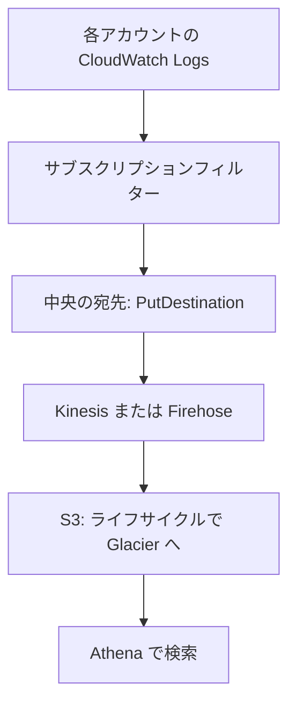

# 分野5: 運用の優秀性と自動化

SAP-C03 の配点は **20%** です。IaC、CI/CD、オブザーバビリティ、運用の自動化を扱います。

Professional では、1 つのスタックの書き方より、「数百のアカウントへ安全に展開する」「失敗をどう止める、どう戻す」が問われます。

この分野に限らず、コース全体で使うサービスは[サービス一覧](services.md)から確認できます。

## タスク 5.1: IaC を設計する {#task-5-1}

### 5.1.1 宣言型と命令型の IaC {#skill-5-1-1}

| | CloudFormation | CDK |
|---|---|---|
| 書き方 | 宣言型（YAML、JSON） | 命令型の言語で書き、テンプレートを生成 |
| 向く場面 | テンプレートで標準化、シンプルな定義 | 繰り返しや条件が多い、再利用できる部品 |
| 再利用 | ネストされたスタック、モジュール | コンストラクト |
| テスト | 変更セット、リンター | 通常のテストと assertions |

**CDK の動き:** デプロイの実体は CloudFormation です。`cdk synth` でテンプレートを作るので、ドリフト検出なども同じように使えます。最初にブートストラップが必要です。

**安全な更新:**

| 要件 | 手段 |
|---|---|
| 変更の内容を事前に確認 | 変更セット |
| データベースを消さない | `DeletionPolicy: Retain` や `Snapshot`、`UpdateReplacePolicy` |
| 特定のリソースの更新を防ぐ | スタックポリシー |
| 失敗時に戻す | ロールバックトリガー |

詳細: [どれを使うか](../../services/iac.md#choosing)、[CloudFormation テンプレート](../../services/iac.md#cloudformation-template)、[CDK](../../services/iac.md#cdk)、[変更セット](../../services/iac.md#change-sets)、[DeletionPolicy](../../services/iac.md#deletion-policy)、[スタックポリシー](../../services/iac.md#stack-policy)

### 5.1.2 ポリシーアズコード {#skill-5-1-2}

| 段階 | 手段 | 動き |
|---|---|---|
| 開発時 | CDK Aspects | スコープ内の全コンストラクトを巡回して検証や変更 |
| デプロイ前 | CloudFormation Hooks | プロビジョニングの前に検査。失敗させるか警告 |
| API の時点 | SCP | 違反の操作を拒否 |
| デプロイ後 | Config ルール | 違反を検出し、修復 |
| ずれの検出 | ドリフト検出 | テンプレートとの差分を見つける |

**CDK Aspects:** スコープ内のコンストラクトに対してビジターパターンで処理を実行します。タグの追加や、バケットのバージョニングの確認に使います。`Annotations` でエラーを付けると `cdk synth` が失敗し、デプロイされません。`Stage` の境界を越えては伝わらないので、`Stage` か配下に適用します。

**CloudFormation Hooks の実装方法:**

| 方法 | 特徴 |
|---|---|
| Control Tower のプロアクティブコントロール | コード不要で標準のルール |
| Guard ルール | 宣言型の言語で書く |
| Lambda | 任意のロジック |
| カスタム Hook | CloudFormation CLI で開発 |

**組み合わせます。** CDK Aspects は CDK を通らない変更を止められません。Hooks は CloudFormation を通らない変更を止められません。SCP と Config が最後の守りです。

詳細: [コントロール](../../services/governance.md#ct-controls)、[ドリフト検出](../../services/iac.md#drift)、[ドリフトの運用](../../services/operations.md#drift-operations)、[Config の修復](../../services/governance.md#config-remediation)、[CDK Aspects（公式）](https://docs.aws.amazon.com/cdk/v2/guide/aspects.html)、[CloudFormation Hooks（公式）](https://docs.aws.amazon.com/cloudformation-cli/latest/hooks-userguide/what-is-cloudformation-hooks.html)

### 5.1.3 IaC のシークレット管理 {#skill-5-1-3}

テンプレートとリポジトリに平文で書きません。

| 手段 | 内容 |
|---|---|
| 動的参照 | `{{resolve:secretsmanager:...}}`、`{{resolve:ssm-secure:...}}` |
| `NoEcho` | パラメータの表示を隠す。テンプレートへの平文の記述は防げない |
| 自動生成 | Secrets Manager で作り、RDS と連携 |

**Secrets Manager と Parameter Store:**

| 要件 | 選択 |
|---|---|
| 自動ローテーション、DB との統合 | Secrets Manager |
| 他リージョンへの複製 | Secrets Manager |
| 設定値、シークレット少数で低コスト | Parameter Store の SecureString |

詳細: [3 つのサービスの比較](../../services/secrets.md#comparison)、[CloudFormation の動的参照](../../services/secrets.md#dynamic-references)、[ローテーション](../../services/secrets.md#rotation)、[他リージョンへの複製](../../services/secrets.md#secret-replication)、[パラメータ](../../services/iac.md#parameters)

### 5.1.4 マルチアカウント、マルチリージョンのデプロイ {#skill-5-1-4}

**CloudFormation StackSets:**

| 設定 | 内容 |
|---|---|
| サービスマネージド権限 | Organizations と連携。ロールは自動。新しいアカウントへの自動デプロイが可能 |
| セルフマネージド権限 | 管理ロールと実行ロールを自分で作る。組織の外にも使える |
| `MaxConcurrentCount`、`MaxConcurrentPercentage` | 同時に処理するアカウント数 |
| `FailureToleranceCount`、`FailureTolerancePercentage` | 許容する失敗の数 |
| `RegionConcurrencyType` | リージョンを順に、または並列に処理 |

**具体例:** 組織の全アカウントに Config のルールを配るなら、サービスマネージドで OU を指定し、自動デプロイを有効にします。新しいアカウントにも自動で展開されます。

**安全な展開:** 同時実行を小さく、失敗の許容を 0 にして始めると、問題があれば早く止まります。速度とのトレードオフです。

詳細: [ネストされたスタックと StackSets](../../services/iac.md#nested-stacks-stacksets)、[StackSets の設定](../../services/iac.md#stacksets-settings)、[StackSets の運用](../../services/operations.md#stacksets-operations)、[委任管理者](../../services/governance.md#delegated-admin)

## タスク 5.2: CI/CD と DevSecOps のパイプラインを設計する {#task-5-2}

### 5.2.1 自動のビルドとデプロイのパイプライン {#skill-5-2-1}

| サービス | 役割 |
|---|---|
| CodeCommit | Git リポジトリ |
| CodeBuild | ビルドとテスト |
| CodeDeploy | EC2、オンプレミス、Lambda、ECS へのデプロイ |
| CodePipeline | 全体の流れを管理 |

!!! note "CodeCommit の状況"
    CodeCommit は 2024 年に新規受付を止めましたが、2025 年 11 月に一般提供へ戻りました。「新規では使えない」という古い教材の記述は当てはまりません。C03 の対象一覧にも入っています。

同じ成果物を環境ごとのステージへ順に進めます。ステージごとにビルドし直すと、テストしたものと本番のものが変わるおそれがあります。

CodePipeline の V2 タイプにはステージ条件やトリガーのフィルターがあります。

詳細: [サービスの役割](../../services/cicd.md#overview)、[CodeCommit の現状](../../services/cicd.md#codecommit-status)、[CodeBuild](../../services/cicd.md#codebuild)、[CodeDeploy](../../services/cicd.md#codedeploy)、[CodePipeline](../../services/cicd.md#codepipeline)、[複数環境への展開](../../services/cicd.md#multi-environment)

### 5.2.2 パイプラインのセキュリティスキャンと署名 {#skill-5-2-2}

| 段階 | 手段 | 止め方 |
|---|---|---|
| ソースコード | Amazon Inspector のコードスキャン | 重大な検出でステージを失敗させる |
| イメージ | ECR の拡張スキャン（Inspector） | 結果を確認するアクション、EventBridge |
| 関数 | Inspector の Lambda のスキャン | 検出結果で通知 |
| 署名 | ECR マネージド署名、Lambda のコード署名 | 検証に失敗したら実行させない |

**ECR マネージド署名:** プッシュ時に AWS Signer で自動的にイメージへ署名します。クライアント側のツールは要りません。レジストリの署名ルールで、Signer の署名プロファイルとリポジトリのフィルターを指定します。プロファイルは同じリージョンに置く必要があり、別のアカウントのプロファイルは使えます。

**スキャンと署名の違い:** スキャンは「既知の脆弱性がないか」、署名は「信頼できる発行元のもので、改ざんされていないか」を確かめます。両方を組み合わせます。

!!! note "CodeGuru の状況"
    CodeGuru Security は 2025 年 11 月 20 日でサポートを終了し、後継は Inspector の Code Security です。

詳細: [Inspector のスキャンの種類](../../services/threat-detection.md#inspector-scan-types)、[ECR のスキャン](../../services/threat-detection.md#inspector-ecr)、[イメージスキャン](../../services/containers.md#ecr-scanning)、[コード署名](../../services/lambda.md#code-signing)、[ECR マネージド署名（公式）](https://docs.aws.amazon.com/AmazonECR/latest/userguide/managed-signing.html)

### 5.2.3 マルチアカウント、マルチリージョンのパイプライン {#skill-5-2-3}

**典型の構成:** ツール用のアカウントにパイプラインを置き、各環境のアカウントのロールを引き受けてデプロイします。

| 必要なもの | 場所 |
|---|---|
| パイプラインとアーティファクトのバケット | ツールアカウント |
| カスタマー管理の KMS キー | ツールアカウント。対象のアカウントに復号を許可 |
| バケットポリシー | 対象のアカウントの読み取りを許可 |
| クロスアカウントのロール | 対象のアカウント。ツールアカウントを信頼 |

**AWS 管理キーでは動きません。** 既定の S3 の AWS 管理キーは他のアカウントと共有できないので、カスタマー管理キーが必要です。これがよく問われる落とし穴です。

**成果物の昇格:** 同じアーティファクトを dev → staging → prod へ進めます。プロモーションの間に、手動承認やアラームの確認を入れます。

**リージョン:** リージョンごとのアクションには、そのリージョンのアーティファクトのバケットが必要です。

詳細: [CodePipeline](../../services/cicd.md#codepipeline)、[複数環境への展開](../../services/cicd.md#multi-environment)、[手動承認](../../services/cicd.md#manual-approval)、[アカウントをまたぐ手順](../../services/kms.md#cross-account-steps)、[ロールの引き受け](../../services/iam.md#assume-role)

### 5.2.4 AI と ML のアプリの評価と出力の検証 {#skill-5-2-4}

**Bedrock Evaluations:**

| ジョブ | 方法 | 向く場面 |
|---|---|---|
| プログラム | 自動の指標、組み込みまたは自前のデータ | モデルのタスク別の比較 |
| 人 | 従業員や専門家が評価 | 主観的な品質 |
| 判定モデル | 別の LLM が採点と説明 | 品質全般を大量に |
| RAG | 取得のみ、または取得と生成 | ナレッジベースや外部の RAG |

**パイプラインでの使い方:**

1. プロンプトやモデルを変えたら、基準のデータセットで評価を実行します。
2. スコアが基準を下回れば、デプロイのステージを失敗させます。
3. 本番では一部のトラフィックで確かめ、ログをもとに評価データを増やします。

エージェントは AgentCore Evaluations で評価します。

出力は決定的ではないので、完全一致のテストは使えません。スコアの基準で判定します。

詳細: [評価](../../services/genai-apps.md#evaluation)、[Bedrock Evaluations](../../services/genai-apps.md#bedrock-evaluations)、[エージェントの評価](../../services/genai-apps.md#agent-evaluation)、[テスト](../../services/genai-apps.md#testing)、[デプロイ戦略](../../services/genai-apps.md#deployment)

### 5.2.5 ロールバックできるデプロイ戦略 {#skill-5-2-5}

| 戦略 | ダウンタイム | 戻しやすさ | 追加コスト |
|---|---|---|---|
| 一括 | ありうる | 再デプロイで遅い | なし |
| ローリング | なし（容量は一時的に減る） | 再度ローリング | なし、または少し |
| Blue/Green | ほぼなし | 切り戻すだけで速い | 2 環境分の期間がある |
| カナリア | なし | トラフィックを戻すだけ | 新旧の同時稼働 |
| 線形 | なし | トラフィックを戻すだけ | 新旧の同時稼働 |

**自動のロールバック:** CodeDeploy は CloudWatch アラームを見て、デプロイを戻せます。Lambda はエイリアスのトラフィック分割、ECS はデプロイサーキットブレーカーや Blue/Green を使います。

**データベースは簡単に戻せません。** スキーマの変更は、新旧のコードの両方で動く形で進めます。先に列を追加し、古い列は全コードの切り替えの後に消します。

詳細: [デプロイ戦略の比較](../../services/cicd.md#deployment-strategies)、[ロールバックの方法](../../services/cicd.md#rollback)、[デプロイ設定](../../services/cicd.md#deployment-configs)、[デプロイサーキットブレーカー](../../services/containers.md#circuit-breaker)、[トラフィックの分割](../../services/lambda.md#alias-routing)

## タスク 5.3: オブザーバビリティと監視を設計する {#task-5-3}

### 5.3.1 メトリクス、ログ、分散トレースの標準化 {#skill-5-3-1}

| シグナル | 手段 | 分かること |
|---|---|---|
| メトリクス | CloudWatch | 何が起きているか |
| ログ | CloudWatch Logs | なぜ起きたか |
| トレース | X-Ray | どこで起きたか |

**標準の計装:** AWS Distro for OpenTelemetry（ADOT）で計装します。ベンダーに依存しない形で、メトリクスとトレースを送れます。

!!! note "X-Ray SDK の状況"
    X-Ray SDK とデーモンは 2026 年 2 月 25 日にメンテナンスモードに入り、セキュリティ修正のみになりました。新規の計装には OpenTelemetry が推奨されています。

**複数アカウント:** CloudWatch のクロスアカウントオブザーバビリティで、監視アカウントから複数のアカウントのメトリクス、ログ、トレースを確認します。

**Prometheus と Grafana:** 既存の資産があれば、Amazon Managed Service for Prometheus と Amazon Managed Grafana も候補です。C02 の対象ですが、C03 の一覧には載っていません。

詳細: [ロギング、モニタリング、オブザーバビリティの違い](../../services/observability.md#logging-monitoring-observability)、[SDK と OpenTelemetry](../../services/observability.md#xray-opentelemetry)、[CloudWatch メトリクス](../../services/observability.md#cloudwatch-metrics)、[構造化ログ](../../services/observability.md#structured-logging)、[X-Ray によるトレース](../../services/observability.md#xray)

### 5.3.2 コンテナの監視 {#skill-5-3-2}

| 手段 | 分かること |
|---|---|
| Container Insights | クラスター、サービス、タスク、Pod のメトリクス |
| ADOT | アプリのメトリクスとトレース |
| ログドライバー | `awslogs` や FireLens でコンテナのログを送る |
| Application Signals | アプリの標準メトリクスと SLO |

**ECS と EKS の見方:** タスクや Pod は短命です。インスタンス単位ではなく、サービスや名前空間の単位で見ます。

**具体例:** Pod の再起動が増えているなら、Container Insights で再起動の数とメモリの使用率を見て、リソースの制限を確認します。

詳細: [logConfiguration](../../services/containers.md#log-configuration)、[Application Signals](../../services/observability.md#application-signals)、[CloudWatch エージェント](../../services/operations.md#cloudwatch-agent)、[ヘルスチェックとプローブ](../../services/containers.md#probes)

### 5.3.3 マルチアカウントのログ集約 {#skill-5-3-3}

| 設定 | 内容 |
|---|---|
| 宛先 | Kinesis Data Streams、Lambda、Firehose、または別アカウント向けの論理的な宛先 |
| 宛先のポリシー | 送信元のアカウントや組織を許可 |
| フィルター | 空文字ならすべて。必要なものに絞ると費用が下がる |
| 再試行 | 配信がスロットリングされると最大 24 時間再試行し、その後は破棄 |

**落とし穴:** Essentials クラスのロググループではサブスクリプションフィルターが使えません。受け取る側は Base64 をデコードしてから gzip を展開します。

**使い分け:** 準リアルタイムの分析には OpenSearch を宛先にします。保管と監査が目的なら S3 です。

詳細: [サブスクリプションフィルター](../../services/observability.md#subscription-filters)、[サブスクリプションフィルターの設定](../../services/observability.md#subscription-settings)、[ライフサイクル](../../services/s3.md#lifecycle)、[Firehose](../../services/streaming.md#firehose)

### 5.3.4 アラートの設計 {#skill-5-3-4}

| 要件 | 手段 |
|---|---|
| しきい値を超えたら通知 | CloudWatch アラームと SNS |
| 誤報を減らす | M out of N、複合アラーム |
| 季節性がある | 異常検知のアラーム |
| 自動で修復 | アラームの状態変化を EventBridge で受けて Systems Manager Automation を実行する。アラームのアクションには直接指定できない |
| 自動で調査 | アラームのアクションで CloudWatch の調査（investigations）を開始する |
| 運用の作業項目を作る | OpsCenter の OpsItem |

**欠落データの扱い:** `treatMissingData` を誤ると、データがないときにアラームが動かない、または誤報になります。

**アラート疲れ:** 複合アラームで、複数の症状が同時に出たときだけ通知します。利用者の影響（エラー率、遅延）を基準にし、CPU のような原因の指標だけで人を呼ばないようにします。

!!! note "Incident Manager の状況"
    Systems Manager Incident Manager と Change Manager は 2025 年 11 月 7 日で新規受付を終了しました。

詳細: [アラーム](../../services/observability.md#alarms)、[評価の仕組みと M out of N](../../services/observability.md#alarm-evaluation)、[欠落データの扱い](../../services/observability.md#treat-missing-data)、[複合アラーム](../../services/observability.md#composite-alarms)、[異常検知](../../services/observability.md#anomaly-detection)、[OpsCenter](../../services/operations.md#opscenter)

### 5.3.5 AI と ML のワークロードの監視 {#skill-5-3-5}

| 区分 | 指標 | 手段 |
|---|---|---|
| モデルの運用 | 遅延、エラー、スロットリング | `AWS/Bedrock` メトリクス |
| トークン | 入出力、キャッシュの利用率 | `InputTokenCount`、`OutputTokenCount` |
| 品質 | ハルシネーション率 | 評価のカスタムメトリクス |
| エージェント | タスク完了率、繰り返し回数、ツールの失敗率 | AgentCore Observability、トレース |
| 推論 | エンドポイントの遅延 | SageMaker の `ModelLatency` など |
| ドリフト | 入力や予測の分布の変化 | 下記 |

**ドリフトの種類:**

| 種類 | 意味 | 検出 |
|---|---|---|
| データドリフト | 入力の分布が変わる | 分布の距離 |
| コンセプトドリフト | 入力と正解の関係が変わる | 正解ラベルとの比較 |
| 予測ドリフト | 出力の分布が変わる | 出力の統計 |

!!! note "SageMaker の監視機能の状況"
    Model Monitor と Clarify は新規顧客を受け付けていません。Model Monitor の公式の移行先は、公開の監視ソリューション（MLflow Apps、Evidently AI）、QuickSight、CloudWatch です。試験では役割を問われる可能性があります。

詳細: [監視](../../services/sagemaker.md#monitoring)、[ドリフトの種類](../../services/sagemaker.md#drift)、[Model Monitor](../../services/sagemaker.md#model-monitor)、[見るべき指標](../../services/genai-apps.md#genai-metrics)、[CloudWatch の生成 AI オブザーバビリティ](../../services/genai-apps.md#genai-observability)

### 5.3.6 利用者の体験の監視 {#skill-5-3-6}

| | CloudWatch Synthetics | CloudWatch RUM |
|---|---|---|
| データの元 | スケジュールで動くスクリプト | 実際の利用者のブラウザやアプリ |
| 利用者がいない時間 | 検出できる | データがない |
| 分かること | 重要な経路が動くか | 実際の読み込み時間、エラー、地域や端末の差 |
| 導入 | カナリアを作る（Lambda として動く） | アプリにスニペットを追加 |

**組み合わせます。** Synthetics は夜間でも障害を見つけ、RUM は実際の利用者の差を見つけます。

**具体例:** 「特定の国の利用者だけ遅い」は RUM で分かります。「深夜のデプロイで購入の手順が壊れた」は Synthetics で分かります。

詳細: [CloudWatch Synthetics](../../services/operations.md#synthetics)、[CloudWatch RUM](../../services/operations.md#rum)

### 5.3.7 サービスレベル目標 {#skill-5-3-7}

| 用語 | 意味 | 例 |
|---|---|---|
| SLI | 測る指標 | 成功したリクエストの割合 |
| SLO | 目標 | 30 日間で 99.9% |
| エラーバジェット | 許される失敗の量 | 30 日間で約 43 分 |
| SLA | 顧客との契約 | 下回れば返金 |

**ビジネス要件を指標にします。** 「速く」は測れません。「購入 API の p99 が 500 ms 未満」にします。

**CloudWatch Application Signals** は、アプリの可用性と遅延から SLO を作成して監視します。

**運用への使い方:** エラーバジェットの消費が速いときにアラートを出し、残りが少なければリリースを抑えて信頼性の作業を優先します。

平均ではなくパーセンタイルで見ます。平均では一部の遅い利用者が隠れます。

詳細: [Application Signals](../../services/observability.md#application-signals)、[統計とパーセンタイル](../../services/observability.md#statistics)、[高解像度とパーセンタイルのアラーム](../../services/observability.md#percentile-alarms)

## タスク 5.4: 運用の自動化と回復力のあるシステムを設計する {#task-5-4}

### 5.4.1 ヘルス監視、容量計画、運用の対応 {#skill-5-4-1}

| 目的 | 手段 |
|---|---|
| クォータに近づいたら通知 | Service Quotas と CloudWatch アラーム |
| AWS 側の予定や障害に対応 | AWS Health のイベントと EventBridge |
| 異常で自動処理 | EventBridge のルールと Automation |
| 容量の予測 | CloudWatch の傾向、Auto Scaling の予測スケーリング |

**具体例:** リージョンの障害に備えて DR に切り替えたとき、DR のリージョンのクォータが足りずに起動できないことがあります。主系と同じ値へ事前に引き上げます。

**EventBridge の修復の例:** セキュリティグループの変更を検出して、許可しないルールを自動で消します。

詳細: [クォータの上限に近づいたとき](../../services/observability.md#quota-alerts)、[AWS Health イベントの自動化](../../services/operations.md#health-events)、[EventBridge による修復パターン](../../services/operations.md#eventbridge-remediation)、[予測スケーリング](../../services/operations.md#predictive-scaling)

### 5.4.2 安全制約を備えた修復 {#skill-5-4-2}

自動の修復は、誤ると障害を広げます。制約を組み込みます。

| パターン | 働き | AWS での実現 |
|---|---|---|
| サーキットブレーカー | 失敗が続く呼び出しを止める | アプリの実装、ECS のデプロイサーキットブレーカー |
| レート制限 | 一度に動かす量を制限 | Automation の同時実行数とエラーしきい値、API Gateway のスロットリング |
| バルクヘッド | 障害の範囲を区切る | 予約済み同時実行、セルベースのアーキテクチャ |
| 指数バックオフとジッター | 再試行の集中を防ぐ | SDK の再試行モード |

**バルクヘッド（セルベース）:** ワークロードを独立したセルに分けます。セルは状態を共有せず、顧客 ID などのパーティションキーでルーターが振り分けます。10 セルで 100 リクエストを処理していれば、1 セルの障害で 90% は影響を受けません。

| 設計の原則 | 理由 |
|---|---|
| セルの最大サイズを決める | 検証した範囲を超えない |
| ルーターは単純に | 共有の部品なので障害の影響が大きい |
| デプロイはセルごとに段階的に | 悪い変更を全体に広げない |
| セル間の通信を最小に | 依存が増えると分離の効果が下がる |

**具体例:** Automation で 500 台を修復するときは、`MaxConcurrency` を 10、`MaxErrors` を 3 のように指定します。指定した数を超えて失敗すると止まるので、全台を壊しません。

詳細: [サーキットブレーカー](../../services/sdk-resilience.md#circuit-breaker)、[指数バックオフとジッター](../../services/sdk-resilience.md#backoff-jitter)、[レート制御](../../services/operations.md#automation-rate-control)、[予約済み同時実行](../../services/lambda.md#reserved-concurrency)、[スロットリングの階層](../../services/api-gateway.md#throttling)、[REL10-BP03（公式）](https://docs.aws.amazon.com/wellarchitected/latest/reliability-pillar/rel_fault_isolation_use_bulkhead.html)

### 5.4.3 メトリクスとスケジュールのスケーリング {#skill-5-4-3}

| ポリシー | 動き | 向く場面 |
|---|---|---|
| ターゲット追跡 | メトリクスを目標値に保つ | 最初の選択肢 |
| ステップ | 超えた量に応じて段階的に | 大きく増減を変えたい |
| スケジュール | 決めた時刻に変更 | 営業時間、既知のイベント |
| 予測 | 過去の傾向から先に増やす | 繰り返す周期のある負荷 |

**具体例:** 毎朝 9 時に負荷が急増するなら、予測スケーリングかスケジュールで先に増やします。ターゲット追跡だけでは、増えるまでの間に遅くなります。

**SQS の処理:** CPU ではなく、インスタンスあたりのバックログをカスタムメトリクスにして、ターゲット追跡します。

**起動の遅さ:** 起動に時間がかかるならウォームプールを使います。

詳細: [EC2 Auto Scaling](../../services/ec2-beanstalk.md#auto-scaling)、[予測スケーリング](../../services/operations.md#predictive-scaling)、[ウォームプール](../../services/operations.md#warm-pools)、[インスタンスのウォームアップ](../../services/ec2-beanstalk.md#instance-warmup)

### 5.4.4 ヘルスチェックと置き換えによる自動復旧 {#skill-5-4-4}

| 対象 | 検出 | 復旧 |
|---|---|---|
| EC2（Auto Scaling） | EC2 のステータス、ELB のヘルスチェック | 異常なインスタンスを置き換え |
| ECS | コンテナのヘルスチェック、ロードバランサー | タスクを置き換え |
| EKS | Liveness、Readiness プローブ | 再起動、ルーティングから外す |
| Lambda の非同期 | 関数のエラー | 再試行（既定で 2 回）、送信先や DLQ |
| Lambda のストリーム | バッチのエラー | 再試行の回数、分割、失敗の送信先 |

**ELB ヘルスチェックの有効化:** Auto Scaling の既定は EC2 のステータスだけです。アプリが落ちてもインスタンスが動いていれば置き換わりません。ELB のヘルスチェックを有効にします。

**ヘルスチェックの深さ:** 依存先まで調べる深いチェックは、依存先の障害で全台を異常と判定し、全部を置き換えることがあります。依存先の問題は別に扱います。

詳細: [ヘルスチェック](../../services/ec2-beanstalk.md#asg-health-checks)、[ECS の healthCheck](../../services/containers.md#ecs-healthcheck)、[ヘルスチェックとプローブ](../../services/containers.md#probes)、[再試行の動き](../../services/lambda.md#retries)、[ストリームのエラー処理の設定](../../services/lambda.md#esm-stream-errors)

### 5.4.5 自動のランブックとインシデント対応 {#skill-5-4-5}

| 作業 | 手段 |
|---|---|
| パッチ適用 | Patch Manager、Maintenance Windows |
| 修復 | Automation のランブック、Config の修復 |
| スケーリングの調整 | Automation、Auto Scaling |
| 望ましい状態の維持 | State Manager |
| コマンドの一括実行 | Run Command |
| 調査の補助 | OpsCenter、AWS DevOps Agent |

**State Manager と Maintenance Windows:** 望ましい状態を保つなら State Manager、決まった時間帯に作業するなら Maintenance Windows です。

**複数アカウント:** Automation は複数アカウント、複数リージョンで実行できます。

**インシデント対応の流れ:** 検出（アラーム）→ 通知と記録（OpsItem）→ ランブックの実行 → 振り返りと改善です。影響の大きい手順には、Automation の承認のステップを入れます。

!!! note "DevOps Guru の状況"
    Amazon DevOps Guru は 2026 年 10 月 29 日で新規受付を終了し、2027 年 9 月 30 日にサポートを終了します。AWS は CloudWatch と AWS DevOps Agent への移行を案内しています。

詳細: [Automation](../../services/operations.md#automation)、[複数アカウント、複数リージョンの実行](../../services/operations.md#automation-multi-account)、[State Manager と Maintenance Windows の違い](../../services/operations.md#state-vs-maintenance)、[Run Command](../../services/operations.md#run-command)、[OpsCenter](../../services/operations.md#opscenter)、[AWS DevOps Agent](../../services/operations.md#devops-agent)

## 確認問題 {#self-check}

??? question "問1: CodePipeline がツールアカウントにあり、本番アカウントへのデプロイでアーティファクトの読み取りに失敗します。S3 のバケットは既定の AWS 管理キーで暗号化されています。どう直しますか？"
    カスタマー管理の KMS キーでアーティファクトを暗号化します。キーポリシーとバケットポリシーで本番アカウントのロールに許可します。AWS 管理キーのポリシーは編集できず、他のアカウントと共有できません。

??? question "問2: 全社の CloudFormation のデプロイで、公開の S3 バケットの作成を事前に止めたいです。コードは書きたくありません。何を使いますか？"
    Control Tower のプロアクティブコントロールを Hook として使います。プロビジョニングの前に検査して失敗させます。Config ルールは作成後の検出なので、事前に止められません。SCP は API の時点で止められますが、公開設定の細かい条件を書くのは大変です。

??? question "問3: Automation で 2,000 台のインスタンスに修復を実行します。ランブックに誤りがあった場合に全台を壊さないようにするには？"
    同時実行数とエラーしきい値を指定します。少ない台数から進め、指定した数を超えて失敗すると止まります。本番の前に検証環境で実行し、影響の大きい手順には承認のステップを入れます。

??? question "問4: 深夜に利用者がいない時間でも、購入の手順の障害に気づきたいです。また、特定の国の利用者だけが遅い問題も調べたいです。何を使いますか？"
    購入の手順は CloudWatch Synthetics のカナリアで定期的に確かめます。国ごとの遅さは CloudWatch RUM で実際の利用者のデータを見ます。両方が必要です。RUM だけでは利用者がいない時間の障害に気づけません。

??? question "問5: 共有の API で、1 社の大量のリクエストが原因の障害が全顧客へ広がりました。影響の範囲を限定する設計は？"
    顧客 ID をパーティションキーにしたセルベースのアーキテクチャです。セルは状態を共有せず、障害は 1 つのセルにとどまります。ルーターは単純に保ち、デプロイはセルごとに段階的に行います。使用量プランでの制限も組み合わせます。

??? question "問6: ALB の裏の Auto Scaling グループで、アプリが停止してもインスタンスが置き換わりません。原因は？ また、ヘルスチェックで DB への接続も確かめると、DB の障害時に何が起きますか？"
    Auto Scaling の既定は EC2 のステータスチェックだけです。ELB のヘルスチェックを有効にします。DB まで調べる深いチェックは、DB の障害で全台を異常と判定し、置き換えを繰り返します。ロードバランサーのチェックはインスタンス自身の状態にとどめます。
