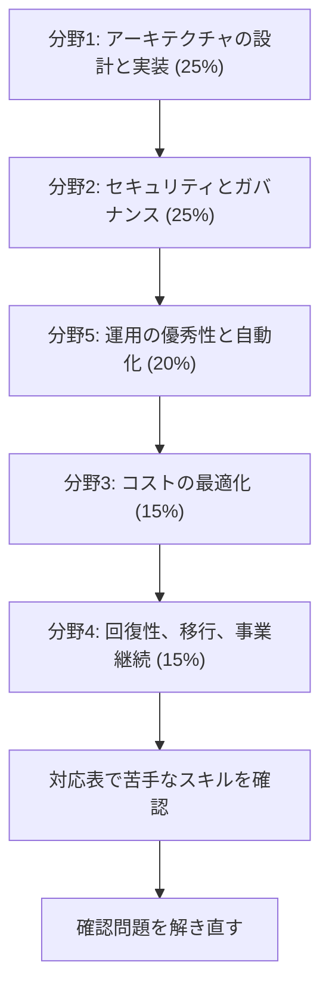

# Solutions Architect - Professional（SAP）

複雑な組織にまたがる AWS のアーキテクチャを設計する力を問う試験です。このコースは **SAP-C03** を基準にしています。SAP-C02 を受ける人も、[対応表](coverage.md#c02)で範囲を確認できます。

!!! warning "2026年11月に試験が切り替わります"
    **SAP-C02 の最終受験日は 2026年11月16日**で、**2026年11月17日からは SAP-C03** が実施されます。C03 の登録は 2026年10月27日に始まっています。

    すでに準備が進んでいるなら、11月16日までに C02 を受ける選択肢もあります。C02 で取得した認定は、元の有効期限まで有効です。受験日に合わせて範囲を確認してください（[AWS のお知らせ](https://aws.amazon.com/blogs/training-and-certification/september-2026-new-offerings/)）。

[:material-format-list-bulleted: このコースのサービス一覧](services.md){ .md-button }

## 試験の概要 {#overview}

| 項目 | 内容 |
|---|---|
| 問題数 | 75問（採点対象65問 + 採点対象外10問） |
| 試験時間 | 180分 |
| 合格点 | 720点（100〜1,000点）。C03 の試験ガイドによる |
| 受験料 | 300 USD（国や地域により追加の費用あり） |
| 形式 | 択一、複数選択。複数選択は正解をすべて選んだときだけ得点になります |
| 採点方式 | 全体の得点で合否を判定します。分野ごとの合格点はありません |
| 受験方法 | Pearson VUE のテストセンターまたはオンライン |
| 言語 | 英語、日本語、韓国語、ポルトガル語（ブラジル）、簡体字中国語、スペイン語（ラテンアメリカ） |
| 減点 | 誤答による減点はありません。未回答は不正解になるので、すべて回答します |

問題数、時間、受験料、言語、受験方法は[公式ページ](https://aws.amazon.com/certification/certified-solutions-architect-professional/)で確認しました。公式ページに合格点の記載はないので、合格点は試験ガイドによります。

## 学習の順番 {#study-path}

配点の大きい分野から進めます。各分野のページでスキルごとの要点を確認し、足りないところはサービス解説で補います。

| 分野 | 配点 | タスク数 | スキル数 | 主なサービス |
|---|---|---|---|---|
| [分野1: クラウド向けのアーキテクチャの設計と実装](domain1.md) | 25% | 5 | 34 | EventBridge、EKS、VPC Lattice、Bedrock、Direct Connect、Transit Gateway、Lake Formation |
| [分野2: セキュリティ、コンプライアンス、ガバナンス](domain2.md) | 25% | 5 | 24 | IAM Identity Center、KMS、CloudHSM、Organizations、Control Tower、Security Lake、Bedrock Guardrails |
| [分野3: コストを最適化したアーキテクチャの設計](domain3.md) | 15% | 4 | 19 | Savings Plans、CloudFront、Budgets、Cost Explorer、AWS Backup |
| [分野4: 回復性、移行、事業継続](domain4.md) | 15% | 3 | 17 | AWS Transform、DMS、DRS、Resilience Hub、ARC、FIS |
| [分野5: 運用の優秀性と自動化](domain5.md) | 20% | 4 | 21 | CloudFormation、CDK、CodePipeline、CloudWatch、Systems Manager |

## C02 と C03 の違い {#c02-vs-c03}

AWS の[比較ページ](https://docs.aws.amazon.com/aws-certification/latest/solutions-architect-professional-03/sap-03-comparison.html)に基づいています。分野の構成が全面的に変わり、4 分野から 5 分野になりました。

| C02 の分野 | C02 の配点 | C03 の分野 | C03 の配点 |
|---|---|---|---|
| 分野1: 組織の複雑さに対応するソリューションの設計 | 26% | 分野1: クラウド向けのアーキテクチャの設計と実装 | 25% |
| 分野2: 新しいソリューションの設計 | 29% | 分野2: セキュリティ、コンプライアンス、ガバナンス | 25% |
| 分野3: 既存のソリューションの継続的な改善 | 25% | 分野3: コストを最適化したアーキテクチャの設計 | 15% |
| 分野4: ワークロードの移行とモダナイズの加速 | 20% | 分野4: 回復性、移行、事業継続 | 15% |
| | | 分野5: 運用の優秀性と自動化 | 20% |

| 変更 | 内容 |
|---|---|
| 合格点 | C02 は 750 点、C03 は 720 点（各試験ガイドによる）。問題数はどちらも 65 問 + 採点対象外 10 問 |
| AI の追加 | Bedrock の統合、AI エージェント、ML の推論、RAG（タスク 1.2）。責任ある AI の統制（タスク 2.5）。AI のコスト、評価、監視 |
| クラウドネイティブの追加 | サーバーレスのデータ処理、永続的なワークフロー、サービスメッシュ、イメージ管理、入口のパターン、WebSocket、マルチテナント |
| データの追加 | データレイクとレイクハウス、分析パイプライン、データカタログとアカウント間の共有 |
| セキュリティの追加 | アプリの認証、ワークロード ID、耐量子暗号、データレジデンシー、証拠の収集、脅威モデリング |
| 回復性と運用の追加 | マルチクラスター、パイプラインのスキャンと署名、利用者の体験の監視、安全制約のある修復、ランブック |
| その他の追加 | ハイブリッドのコンピューティング、IPv6 とデュアルスタック、コストを抑えたオブザーバビリティ |
| 削除 | アプリケーションのアップグレードパス、AWS への委任、移行ツールのセキュリティ。ただし AWS は、他のスキルに暗黙に含まれる可能性があるとしています |
| 統合 | C02 の細かいスキルを C03 のタスクへまとめ直しました。AWS は、重要度が下がったわけではないとしています |
| 新しいサービス | Bedrock、Data Lifecycle Manager、MemoryDB、Security Lake、Verified Permissions、VPC Lattice、Application Auto Scaling、CDK、Clean Rooms、Cloud WAN、CodeCommit、Cost Categories、Data Transfer Terminal、ADOT、FIS、Local Zones、Resilience Hub、AWS Transform、Verified Access、Reserved Instances |
| 対象から外れたサービス | IoT、エンドユーザーコンピューティング、メディア、個別の AI サービスなど。詳しくは[対応表](coverage.md#c02-only)にあります |

## 対象の受験者と範囲外のもの {#out-of-scope}

対象は、AWS でクラウドのソリューションを設計し、実装した経験が 2 年以上ある人です。組織内の複数のアプリやプロジェクトにまたがる設計を助言できることが求められます。クラウド向け、サーバーレス、AI を組み込んだマルチアカウントの設計が含まれます。

次の作業や知識は、受験者に求められていません。

- オペレーティングシステムの深い知識
- AI と ML のモデルの学習、ファインチューニング、データサイエンスのワークフロー
- セキュリティインシデントのフォレンジックと、詳細な脅威の調査
- アプリケーションのコードの開発とデバッグ

範囲外のサービスの例は、Managed Blockchain、Lightsail、RDS Custom for Oracle、Device Farm、GameLift、Comprehend Medical、Transcribe Medical、DeepComposer、DeepRacer、IVS、MediaConvert、MediaLive、Braket、Ground Station です。

## 対象のサービスと解説ページ {#services}

試験ガイドの対象一覧と、このwikiのページの対応です。一覧はすべてを網羅するものではありません。分類は試験ガイドに合わせています。

| 分類 | サービスと解説 |
|---|---|
| 分析 | [AppFlow](../../services/data-engineering.md#appflow)、[Athena](../../services/streaming.md#athena)、[EMR](../../services/data-engineering.md#emr)、[Kinesis Data Streams](../../services/streaming.md#kinesis-data-streams)、[MSK](../../services/data-engineering.md#msk)、[OpenSearch Service](../../services/streaming.md#opensearch)、[Quick Sight](../../services/data-engineering.md#quick-sight)、[Redshift](../../services/data-engineering.md#redshift)、[Clean Rooms](../../services/data-engineering.md#clean-rooms)、[Glue](../../services/data-engineering.md#glue)、[Lake Formation](../../services/data-engineering.md#lake-formation) |
| アプリケーション統合 | [EventBridge](../../services/messaging.md#eventbridge)、[Amazon MQ](../../services/other-services.md#mq)、[SNS](../../services/messaging.md#sns)、[SQS](../../services/messaging.md#sqs)、[Step Functions](../../services/step-functions.md) |
| コスト管理 | [Budgets](../../services/cost-management.md#budgets)、[Cost and Usage Report](../../services/cost-management.md#data-exports)、[Cost Categories](../../services/cost-management.md#cost-categories)、[Cost Explorer](../../services/cost-management.md#cost-explorer)、[Reserved Instances](../../services/cost-management.md#reserved-instances)、[Savings Plans](../../services/cost-management.md#savings-plans) |
| コンピューティング | [EC2](../../services/ec2-beanstalk.md)、[Application Auto Scaling](../../services/containers.md#service-auto-scaling)、[Elastic Beanstalk](../../services/ec2-beanstalk.md#beanstalk-environments)、[Fargate](../../services/containers.md#fargate-vs-ec2)、[Lambda](../../services/lambda.md)、[Local Zones](../../services/cloud-foundations.md#local-zones)、[Outposts](../../services/cloud-foundations.md#outposts) |
| コンテナ | [ECR](../../services/containers.md#ecr)、[ECS](../../services/containers.md#ecs)、[EKS](../../services/containers.md#eks) |
| データベース | [Aurora](../../services/databases.md#aurora)、[DocumentDB](../../services/databases-specialized.md#documentdb)、[DynamoDB](../../services/dynamodb.md)、[ElastiCache](../../services/databases.md#elasticache)、[Keyspaces](../../services/databases-specialized.md#keyspaces)、[MemoryDB](../../services/databases-specialized.md#memorydb)、[Neptune](../../services/databases-specialized.md#neptune)、[RDS](../../services/databases.md#rds)、[Timestream](../../services/databases-specialized.md#timestream) |
| 開発者ツール | [CDK](../../services/iac.md#cdk)、[CloudFormation](../../services/iac.md#cloudformation-template)、[CodeBuild](../../services/cicd.md#codebuild)、[CodeCommit](../../services/cicd.md#codecommit-status)、[CodeDeploy](../../services/cicd.md#codedeploy)、[CodePipeline](../../services/cicd.md#codepipeline)、[ADOT](../../services/observability.md#xray-opentelemetry)、[X-Ray](../../services/observability.md#xray) |
| 機械学習と AI | [Bedrock](../../services/ai.md#bedrock-runtime)、[SageMaker AI](../../services/sagemaker.md) |
| 管理とガバナンス | [CloudWatch](../../services/observability.md#cloudwatch-metrics)、[CloudTrail](../../services/observability.md#cloudtrail)、[Compute Optimizer](../../services/cost-management.md#compute-optimizer)、[Config](../../services/governance.md#config)、[Control Tower](../../services/governance.md#control-tower)、[Organizations](../../services/governance.md#organizations)、[Resilience Hub](../../services/resilience.md#resilience-hub)、[RAM](../../services/governance.md#ram)、[Service Quotas](../../services/observability.md#quota-alerts)、[Systems Manager](../../services/operations.md#systems-manager) |
| 移行と転送 | [AWS Transform MGN](../../services/migration.md#mgn)、[Data Transfer Terminal](../../services/migration.md#data-transfer-terminal)、[DMS](../../services/migration.md#dms)、[DataSync](../../services/migration.md#datasync)、[SCT](../../services/migration.md#sct)、[Storage Gateway](../../services/migration.md#storage-gateway)、[Transfer Family](../../services/migration.md#transfer-family)、[AWS Transform](../../services/migration.md#transform) |
| ネットワークと配信 | [API Gateway](../../services/api-gateway.md)、[CloudFront](../../services/networking.md#cloudfront)、[Route 53](../../services/networking.md#route53)、[VPC](../../services/networking.md#vpc)、[VPC Lattice](../../services/network-connectivity.md#vpc-lattice)、[Cloud WAN](../../services/network-connectivity.md#cloud-wan)、[Direct Connect](../../services/network-connectivity.md#direct-connect)、[Global Accelerator](../../services/network-connectivity.md#global-accelerator)、[Network Firewall](../../services/network-connectivity.md#network-firewall)、[PrivateLink](../../services/networking.md#vpc-endpoints)、[Transit Gateway](../../services/network-connectivity.md#transit-gateway)、[VPN](../../services/network-connectivity.md#site-to-site-vpn)、[ELB](../../services/networking.md#elb) |
| セキュリティ | [Cognito](../../services/cognito.md)、[GuardDuty](../../services/threat-detection.md#guardduty)、[Inspector](../../services/threat-detection.md#inspector)、[Security Lake](../../services/threat-detection.md#security-lake)、[Verified Permissions](../../services/identity-directory.md#verified-permissions)、[ACM](../../services/certificates.md#acm)、[CloudHSM](../../services/identity-directory.md#cloudhsm)、[Directory Service](../../services/identity-directory.md#directory-service)、[IAM](../../services/iam.md)、[KMS](../../services/kms.md)、[Secrets Manager](../../services/secrets.md#secrets-manager)、[Security Hub](../../services/threat-detection.md#security-hub)、[Shield](../../services/threat-detection.md#shield)、[Verified Access](../../services/identity-directory.md#verified-access)、[WAF](../../services/certificates.md#waf) |
| ストレージ | [Data Lifecycle Manager](../../services/storage.md#ebs-snapshots)、[EBS](../../services/storage.md#ebs-volume-types)、[EFS](../../services/storage.md#efs-settings)、[FSx](../../services/storage-advanced.md#fsx-selection)、[S3](../../services/s3.md)、[AWS Backup](../../services/resilience.md#backup)、[Elastic Disaster Recovery](../../services/resilience.md#drs) |
| テストと回復性 | [Fault Injection Service](../../services/resilience.md#fis) |

## 参考 {#references}

- [SAP-C03 試験ガイド](https://docs.aws.amazon.com/aws-certification/latest/solutions-architect-professional-03/solutions-architect-professional-03.html)
- [SAP-C02 と SAP-C03 の比較](https://docs.aws.amazon.com/aws-certification/latest/solutions-architect-professional-03/sap-03-comparison.html)
- [SAP-C02 試験ガイド](https://docs.aws.amazon.com/aws-certification/latest/solutions-architect-professional-02/solutions-architect-professional-02.html)
- [認定の公式ページ](https://aws.amazon.com/certification/certified-solutions-architect-professional/)
- [SAP-C03 の切り替えのお知らせ](https://aws.amazon.com/blogs/training-and-certification/september-2026-new-offerings/)
