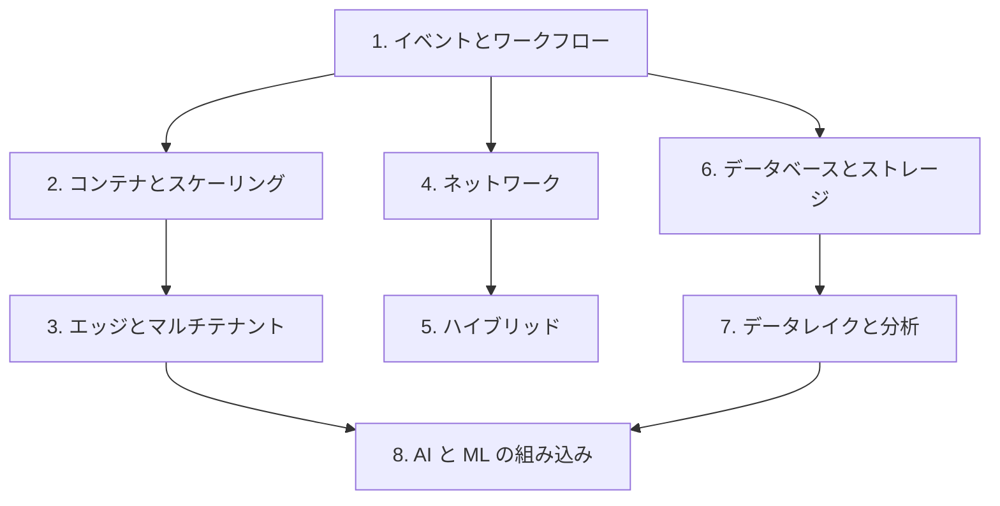

# 分野1: サービス別の学習

分野1（クラウド向けのアーキテクチャの設計と実装）は C03 の配点の 25% を占め、最も範囲が広い分野です。タスクは 5 つで、34 のスキルがあります。

イベントとコンテナの基礎から始め、ネットワーク、データの順に進めます。AI の組み込みは、それらの上に載る話なので後半に置いています。

| 順番 | 話題 | 問われること | 重要度 |
|---|---|---|---|
| 1 | [イベントとワークフロー](events-workflows.md) | 冪等性と順序、状態の外部化、Step Functions と durable functions、アカウントをまたぐ転送 | 高 |
| 2 | [コンテナとスケーリング](containers.md) | ECS と EKS、Service Connect と VPC Lattice、ECR、2 段のスケーリング、入口の選択 | 高 |
| 3 | [エッジとマルチテナント](edge-tenancy.md) | エッジ関数の選択、WebSocket の上限、テナントの分離 | 中 |
| 4 | [ネットワーク](network.md) | VPC の接続方式、IPAM、検査の配置、IPv6、グローバルなルーティング | 高 |
| 5 | [ハイブリッド](hybrid.md) | Direct Connect の回復性と暗号化、データ同期、レガシー統合、DNS、Outposts と Anywhere | 高 |
| 6 | [データベースとストレージ](databases-storage.md) | 目的別データベース、グローバルな構成、FSx の選択、キャッシュ | 高 |
| 7 | [データレイクと分析](data-analytics.md) | Lake Formation、Iceberg、MSK と EMR と Redshift、データの共有 | 中 |
| 8 | [AI と ML の組み込み](ai-ml.md) | Bedrock のマルチアカウント統制、AgentCore、推論の方式、RAG | 中 |

重要度は公式のスキル一覧を見たこの wiki の判断で、公式の数字ではありません。

## 他のサービスにまたがる問題 {#other-questions}

<!-- questions:start -->

この分野の問題は、すべてサービス別のページに載っています。

<!-- questions:end -->
