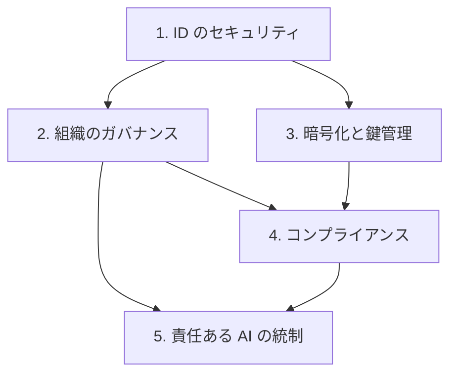

# 分野2: サービス別の学習

分野2（セキュリティ、コンプライアンス、ガバナンス）は C03 の配点の 25% を占めます。ID、暗号化、マルチアカウントの統制、規制への対応、責任ある AI の 5 つのタスクを扱います。

「1 つのアカウントを安全にする」より、「数百のアカウントに同じ統制を効かせる」ことが問われます。IAM の評価を土台にするので、ID から順に進めます。

| 順番 | 話題 | 問われること | 重要度 |
|---|---|---|---|
| 1 | [ID のセキュリティ](identity.md) | フェデレーション、アプリの認可、最小権限、データ境界、ワークロード ID | 高 |
| 2 | [マルチアカウントのガバナンス](org-governance.md) | Control Tower、ログの一元管理、RAM、SCP と RCP、準拠の監視、パッチ | 高 |
| 3 | [暗号化と鍵管理](encryption.md) | KMS のキーとローテーション、証明書、CloudHSM、耐量子暗号 | 高 |
| 4 | [コンプライアンス](compliance.md) | データ保護、データ主権、監査証跡、レジデンシー、証拠、脅威モデリング | 中 |
| 5 | [責任ある AI の統制](responsible-ai.md) | Guardrails、エージェントのアクセス制御、人による承認 | 中 |

重要度は公式のスキル一覧を見たこの wiki の判断で、公式の数字ではありません。

## 他のサービスにまたがる問題 {#other-questions}

<!-- questions:start -->

この分野の問題は、すべてサービス別のページに載っています。

<!-- questions:end -->
