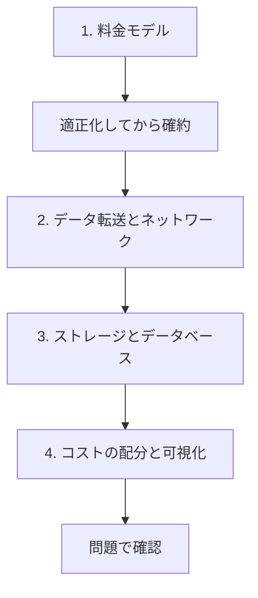

# 分野3: サービス別の学習

分野3（コストの最適化）は SAP-C03 の配点の 15% を占め、料金モデル、データ転送、コストの配分、ストレージとデータベースの費用を扱います。

どの話題でも、まず条件を満たさない安い選択肢を外してから比べます。購入の順序を押さえると、他のページの判断が読みやすくなります。

| 順番 | 話題 | 問われること | 重要度 |
|---|---|---|---|
| 1 | [料金モデル](pricing.md) | 購入オプション、Standard と Express、適正化、Bedrock のティアとキャッシュ | 高 |
| 2 | [データ転送とネットワーク費用](data-transfer.md) | Origin Shield、NAT とエンドポイント、複製の費用、接続の選択、クロスリージョン推論 | 高 |
| 3 | [ストレージとデータベースの費用](storage-db-cost.md) | S3 の階層化、EBS のタイプ、データベースの課金、バックアップ、ログの費用 | 高 |
| 4 | [コストの配分と可視化](cost-allocation.md) | タグの強制、CUR 2.0、分割コスト配分データ、Budgets と異常検出 | 中 |

重要度は公式のスキル一覧を見たこの wiki の判断で、公式の数字ではありません。

## 他のサービスにまたがる問題 {#other-questions}

<!-- questions:start -->

この分野の問題は、すべてサービス別のページに載っています。

<!-- questions:end -->
