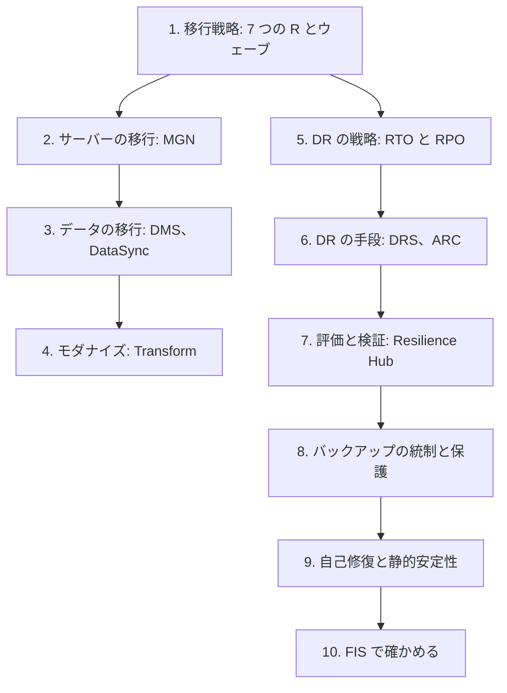

# 分野4: サービス別の学習

分野4（回復性、移行、事業継続）は C03 の配点の 15% を占めます。移行戦略、DR、回復性の 3 つのタスクを扱います。設問の多くは RTO、RPO、費用、期限の数字で答えを絞るので、数字の見方から身につけます。

| 順番 | 話題 | 問われること | 重要度 |
|---|---|---|---|
| 1 | [移行戦略](migration.md) | 7 つの R、移行ウェーブ、MGN、DMS と転送時間の計算、ストラングラーフィグ、レガシーのモダナイズ | 高 |
| 2 | [DR](dr.md) | DR 戦略の選択、DRS、Resilience Hub、ARC、データプレーンの切り替え、DR の検証、マルチクラスター | 高 |
| 3 | [回復性と事業継続](resilience.md) | バックアップの統制、RTO の計測、自己修復、ランサムウェア対策、カオスエンジニアリング | 高 |

重要度は公式のスキル一覧を見たこの wiki の判断で、公式の数字ではありません。

## 他のサービスにまたがる問題 {#other-questions}

<!-- questions:start -->

この分野の問題は、すべてサービス別のページに載っています。

<!-- questions:end -->
