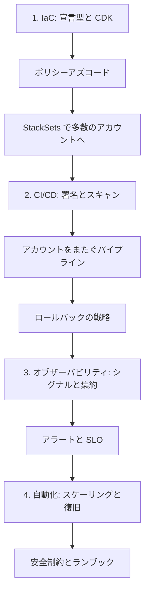

# 分野5: サービス別の学習

分野5（運用の優秀性と自動化）は C03 の配点の 20% を占めます。IaC、CI/CD、オブザーバビリティ、運用の自動化の 4 つのタスクを扱います。

Professional では、1 つのスタックの書き方より、数百のアカウントへ安全に展開する方法と、失敗をどう止めて戻すかが問われます。作る、届ける、見る、直すの順に進めます。

| 順番 | 話題 | 問われること | 重要度 |
|---|---|---|---|
| 1 | [IaC](iac.md) | 安全な更新、Hooks と Aspects、シークレット、StackSets の同時実行 | 高 |
| 2 | [CI/CD と DevSecOps](cicd.md) | 成果物の昇格、スキャンと署名、KMS とロール、AI の評価、ロールバック | 高 |
| 3 | [オブザーバビリティ](observability.md) | ADOT、ログの集約、複合アラーム、AI の監視、Synthetics と RUM、SLO | 高 |
| 4 | [運用の自動化](automation.md) | クォータと Health、レート制御とセル、スケーリング、ヘルスチェック、ランブック | 高 |

重要度は公式のスキル一覧を見たこの wiki の判断で、公式の数字ではありません。

## 他のサービスにまたがる問題 {#other-questions}

<!-- questions:start -->

この分野の問題は、すべてサービス別のページに載っています。

<!-- questions:end -->
