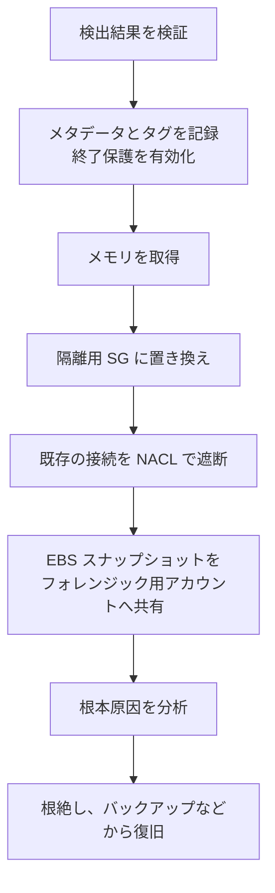

# 分野2: インシデント対応

配点は **14%** です。計画を準備して試すことと、実際の事象で証拠を残しながら封じ込めることを問います。

試験では、作業の**順序**がよく問われます。証拠を失う操作を先にしない、既存の接続が残ることを忘れない、という2点が要所です。

この分野に限らず、コース全体で使うサービスは[サービス一覧](services.md)から確認できます。

## タスク 2.1: インシデント対応計画を設計してテストする {#task-2-1}

### 2.1.1 対応計画とランブック {#skill-2-1-1}

対応の手順は、人が読む文書ではなく、実行できる形で残します。

| 手段 | 用途 | 選ぶ場面 |
|---|---|---|
| Systems Manager Automation | 定型手順のランブックを実行 | 隔離やスナップショットなどの決まった作業 |
| Systems Manager OpsCenter | 事象を OpsItem として集めて対応 | 複数のサービスの事象を担当者が追う |
| SageMaker AI のノートブック | 手順と分析を実行可能な形で残す | 調査の手順を分析と一緒に残す |
| Step Functions | 判断、待機、承認を含む手順の編成 | 複数の手順と分岐がある |
| AWS Customer Playbook Framework | AWS が公開するサンプル | 自社のプレイブックの出発点 |

`AWSSupport-ContainEC2Instance` は、セキュリティグループの設定を S3 に保存してから隔離する、元に戻せる Automation ランブックです。

!!! note "Incident Manager の状況"
    Systems Manager Incident Manager は 2025年11月7日で新規受付を終了しました。SCS-C03 の例には OpsCenter が挙げられています。

詳細: [プレイブックと実行基盤](../../services/threat-detection.md#ir-playbooks)、[OpsCenter](../../services/operations.md#opscenter)、[Automation](../../services/operations.md#automation)

### 2.1.2 インシデントへの備え {#skill-2-1-2}

攻撃を受けてからでは間に合わない準備を問います。

| 準備 | 内容 | なぜ事前に必要か |
|---|---|---|
| アクセスの用意 | 対応用のロール、フォレンジック用アカウント | 事象の最中に権限を作ると遅れ、誤りも増える |
| ツールの展開 | GuardDuty、Security Hub、組織の証跡を有効にする | **遡及しない**ものがある。CSPM は有効化後の結果だけ集める |
| 影響範囲の最小化 | アカウントの分離、SCP でログの停止を禁止、最小権限 | 侵害が広がらない |
| ログの保護 | ログ保管アカウント、Object Lock | 攻撃者に消されない |
| Shield Advanced | 保護対象の指定、Route 53 ヘルスチェック、SRT の権限 | 保護は指定したリソースにだけ効く。自動では広がらない |

Shield Advanced は月額 3,000 ドルの1年契約です。SRT に頼るには Business または Enterprise のサポートプランが必要で、`AWSShieldDRTAccessPolicy` を付けたロールを `AssociateDRTRole` で渡します。S3 の WAF ログを見せるには、バケットへのアクセスも許可します。

詳細: [準備](../../services/threat-detection.md#ir-preparation)、[Shield Advanced](../../services/threat-detection.md#shield-advanced)、[Shield Response Team](../../services/threat-detection.md#shield-srt)

### 2.1.3 計画の有効性の検証 {#skill-2-1-3}

| 手段 | 確かめること | 注意点 |
|---|---|---|
| AWS Fault Injection Service | 本物の障害を注入して、検知と復旧が動くか | 停止条件に CloudWatch アラームを指定する。`selectionMode` を `ALL` にすると全台が止まる |
| AWS Resilience Hub | RTO と RPO の目標を満たす構成か | 構成の評価であり、実際の回復は FIS などで確かめる |
| サンプルの検出結果 | GuardDuty のサンプルで EventBridge からの自動化が動くか | 実害なしで経路だけ確認できる |
| テストスクリプト | GuardDuty が公開するスクリプトで検出結果を発生させる | 専用のアカウントで実行する |

机上演習に加えて、これらで検知から修復までの経路を実際に動かします。

詳細: [計画のテスト](../../services/threat-detection.md#ir-testing)、[FIS](../../services/resilience.md#fis)、[Resilience Hub](../../services/resilience.md#resilience-hub)

### 2.1.4 自動修復 {#skill-2-1-4}

| 手段 | 向いている処理 |
|---|---|
| Lambda | 1 回の短い処理（SG の変更、キーの無効化） |
| Step Functions | 判断、待機、承認を含む複数の手順 |
| Systems Manager Automation | 定義済みのランブックの実行 |
| Automated Forensics Orchestrator for Amazon EC2 | 取得、隔離、調査、報告のフォレンジックの流れ全体 |
| Application Recovery Controller（ARC） | AZ やリージョンからトラフィックを移す |
| Security Hub の自動化ルール | 検出結果の更新や抑制。外部の操作はしない |

起点は EventBridge のルールです。自動化の範囲は慎重に決めます。誤検知で本番を止める影響が大きいものは、Security Hub CSPM のカスタムアクションで人の判断を挟みます。

**Automated Forensics Orchestrator** はマネージドサービスではなく、自分のアカウントにデプロイする AWS のガイダンスです。現在の名前は Automated Forensics Orchestrator for Amazon EC2 and EKS です。メモリを取得してから新しい SG でインスタンスを隔離し、EBS スナップショットをフォレンジック用アカウントへ共有します。対象のインスタンスに SSM Agent が必要です。

**ARC** は、被害を受けた AZ やリージョンから離れるときに使います。ゾーンシフトは AZ 単位の手動操作、ルーティングコントロールはリージョン単位のスイッチです。残りの場所に十分な容量がないと、切り替えで過負荷になります。

詳細: [EventBridge による自動化](../../services/threat-detection.md#ir-eventbridge)、[Automated Forensics Orchestrator](../../services/threat-detection.md#forensics-orchestrator)、[ARC](../../services/resilience.md#arc)、[EventBridge による修復パターン](../../services/operations.md#eventbridge-remediation)

## タスク 2.2: セキュリティイベントに対応する {#task-2-2}

### 2.2.1 フォレンジックの証拠の取得と保管 {#skill-2-2-1}

| 証拠 | 取得方法 | 注意点 |
|---|---|---|
| メモリ | SSM Run Command で取得ツールを実行 | 停止すると失われる。**停止や終了の前に**取る |
| ディスク | EBS スナップショット | 暗号化されたものの共有にはカスタマー管理キーの共有が必要。AWS 管理キーのものは共有できない |
| ログ | CloudTrail、フローログ、アプリのログを専用アカウントの S3 へ | Object Lock で保全する |
| 設定 | AWS Config の履歴 | 変更の時系列を確認 |
| CloudTrail の完全性 | ログファイルの検証 | 改ざんがないことを示す |

GuardDuty の Malware Protection for EC2 のスナップショットは、既定では保持されません。証拠に使うなら、スキャンの前に保持を有効にします。

調査用の EC2 は、フォレンジック用アカウントの隔離された VPC で起動します。スナップショットから作ったボリュームを接続して分析します。

詳細: [フォレンジックの証拠](../../services/threat-detection.md#ir-forensics)、[保護プラン](../../services/threat-detection.md#guardduty-protection-plans)、[Object Lock](../../services/s3.md#object-lock)

### 2.2.2 ログの検索と関連付け {#skill-2-2-2}

複数のログをつなぐ鍵は、**キー ID、IP、時刻**です。

CloudTrail では `userIdentity.accessKeyId` で使われたキーを、`sessionContext.sessionIssuer` でロールの発行元を追います。攻撃者の次の操作として、`CreateUser`、`CreateAccessKey`、`AttachUserPolicy`、`StopLogging`、`DeleteTrail` を探します。

| 手段 | 使いどころ |
|---|---|
| Athena | S3 の CloudTrail やフローログを SQL で横断 |
| CloudWatch Logs Insights | ロググループを対話的に絞り込み |
| Security Lake | OCSF に正規化したログをソースをまたいで検索 |
| Detective | 行動グラフで関連を図示 |

詳細: [ログの調査](../../services/threat-detection.md#log-investigation)、[CloudTrail の調査](../../services/threat-detection.md#investigate-cloudtrail)、[フローログの調査](../../services/threat-detection.md#investigate-flow-logs)

### 2.2.3 検出結果の検証と影響範囲の評価 {#skill-2-2-3}

C03 で追加されたスキルです。検出結果をそのまま信じるのではなく、誤検知かどうかと範囲を確かめます。

1. 検出結果の API、時刻、送信元 IP を、本人や担当チームに確認します。
2. リソースの重要度とデータの種類を確認します。Macie の検出結果があれば参考にします。
3. 同じ主体が他に何をしたかを CloudTrail で調べます。
4. Access Advisor や Access Analyzer で、その主体が届く範囲を確認します。

GuardDuty の重要度の意味を押さえます。Medium は「通常からの逸脱」で、説明できなければ侵害と扱います。Low は試みだけです。Critical は攻撃シーケンスで、複数の事象を Extended Threat Detection が関連付けたものです。

誤検知の例として、VPN 経由でオンプレミスから通信を出す構成では `InstanceCredentialExfiltration.OutsideAWS` が出ることがあります。確認できたら、検出結果の型と自社の送信元 IP に絞って抑制ルールを作ります。広すぎる抑制は Extended Threat Detection の関連付けも損ないます。

Security Hub の露出の検出結果と攻撃経路グラフは、そのリスクが実際に悪用されうるかの判断に使えます。

詳細: [検出結果](../../services/threat-detection.md#guardduty-findings)、[Extended Threat Detection](../../services/threat-detection.md#guardduty-extended)、[抑制ルール](../../services/threat-detection.md#guardduty-suppression)、[Security Hub の機能](../../services/threat-detection.md#security-hub-unified)

### 2.2.4 封じ込め、根絶、復旧 {#skill-2-2-4}

封じ込めは3種類に分けて考えます。

| 種類 | 内容 | 例 |
|---|---|---|
| 送信元の封じ込め | 送信元を止める | NACL、WAF で攻撃者の IP を拒否 |
| 手法とアクセスの封じ込め | 不正な手段を取り除く | キーの無効化、セッションの失効、SCP での拒否 |
| 宛先の封じ込め | リソースへのアクセスを止める | 隔離用のセキュリティグループ |

**最重要の落とし穴:** セキュリティグループを変えても、**追跡中の接続は切れません**。すぐ止めるには NACL を使います。NACL はステートレスなので即座に効きます。

| 場面 | 対応 | 注意点 |
|---|---|---|
| EC2 の隔離 | SG の置き換え、Auto Scaling からデタッチ、ELB から登録解除 | Auto Scaling の入れ替えで証拠が消えるのを防ぐ |
| `AKIA` の長期キーの漏えい | キーを無効化して削除、ローテーション | ルートユーザーのキーも同じ形式 |
| `ASIA` の一時キーの漏えい | ロールの**セッションの取り消し** | ロールの権限を変えるだけでは足りないことがある。`AWSRevokeOlderSessions` が付く |
| IMDS の認証情報の窃取 | セッションの取り消しと IMDSv2 の強制 | `InstanceCredentialExfiltration` の検出結果が手がかり |
| 組織全体への波及の阻止 | 対象のアカウントを SCP で拒否、Suspended OU へ移す | 管理アカウントには SCP は効かない |

復旧は、侵害された環境を直すより、検証済みの AMI やバックアップから作り直すほうが確実です。AWS Backup の Vault Lock や論理的にエアギャップされたボールトがあれば、攻撃者が消せないコピーから戻せます。

詳細: [インシデント対応](../../services/threat-detection.md#incident-response)、[EC2 の隔離](../../services/threat-detection.md#ir-ec2-isolation)、[認証情報の漏えい](../../services/threat-detection.md#ir-credentials)、[ランサムウェアと誤削除の防止](../../services/resilience.md#immutable-compare)、[IMDS](../../services/ec2-beanstalk.md#imds)

### 2.2.5 根本原因の分析 {#skill-2-2-5}

Detective はログから行動グラフを作り、検出結果の根本原因と影響範囲を調べます。検出や修復はしません。

| 項目 | 内容 |
|---|---|
| データ | CloudTrail、VPC フローログ（EC2 のみ）、GuardDuty の検出結果。任意で EKS 監査ログ、CSPM の検出結果 |
| 履歴 | 最大1年分 |
| 検出結果グループ | 関連する検出結果とエンティティをまとめて、一連の攻撃を図示 |
| 調査の起点 | 検出結果、検出結果グループ、エンティティのどこからでも |

| サービス | 役割 |
|---|---|
| GuardDuty | 見つける |
| Detective | なぜ起きたかを調べる |
| Security Hub | 優先度を決める |
| Config | 設定がいつどう変わったかを示す |
| CloudTrail | 誰がどの API を呼んだかを示す |

「何がどう変わり、誰が変えたか」は、Config のタイムラインから CloudTrail のイベントをたどって確認します。

詳細: [Detective](../../services/threat-detection.md#detective)、[Config と CloudTrail の違い](../../services/governance.md#config-vs-cloudtrail)

## 確認問題 {#self-check}

??? question "問1: GuardDuty が EC2 の暗号通貨の採掘を検出しました。法的な調査のために証拠を残す必要があります。次の作業を正しい順に並べてください。(a) EBS スナップショットの取得 (b) メモリの取得 (c) 隔離用 SG への置き換え (d) インスタンスの終了保護の有効化"
    (d)、(b)、(c)、(a) の順です。先に誤って終了されないようにし、消えやすいメモリを取ってから隔離し、ディスクを保全します。実際の手順ではメタデータとタグの記録を最初に行い、隔離の後に NACL で既存の接続を切ります。被害の拡大を止めることを優先して、メモリの取得より先に隔離する手順もあり、順番は組織の手順書で決めます。

??? question "問2: 攻撃者の EC2 からの通信を止めるためセキュリティグループのルールを削除しましたが、通信が続いています。なぜですか？どうしますか？"
    セキュリティグループはステートフルで、追跡中の接続はルールを変えても切れません。サブネットのネットワーク ACL で攻撃者の IP を拒否します。NACL はステートレスなので、既存の接続にもすぐ効きます。

??? question "問3: インスタンスのロールの一時認証情報が AWS の外で使われたと GuardDuty が報告しました。ロールのポリシーを修正する以外に何が必要ですか？"
    IAM のセッションの取り消しです。指定時刻より前に発行されたセッションを拒否する `AWSRevokeOlderSessions` のインラインポリシーがロールに付きます。一時キーは有効期限まで使えるので、これがないと盗まれた認証情報が使われ続ける可能性があります。IMDSv2 の強制や、インスタンスの調査も合わせて行います。

??? question "問4: 暗号化された EBS スナップショットをフォレンジック用アカウントへ共有しようとしましたが、できません。ボリュームは AWS 管理キーで暗号化されています。どうしますか？"
    AWS 管理キーのスナップショットは共有できません。カスタマー管理キーで暗号化してスナップショットをコピーし、キーポリシーでフォレンジック用アカウントを許可してから共有します。平時にカスタマー管理キーを使っておくと、この手間を省けます。

??? question "問5: GuardDuty の検出結果に応じた隔離を自動化します。重要度7以上なら自動で実行し、途中で承認を挟み、スナップショットと通知も行いたいです。最小の運用負荷で作るには？"
    EventBridge のルールを重要度7以上で作り、Step Functions を起動します。Step Functions から Systems Manager Automation のランブックを呼び、承認の待機と SNS の通知を組み込みます。Lambda だけでは待機と分岐の管理が複雑になります。

??? question "問6: 既知の取引先の IP からの通信で GuardDuty の検出結果が繰り返し出ます。記録は残しつつ担当者への通知を減らしたいです。ただし Extended Threat Detection の精度は落としたくありません。どうしますか？"
    検出結果の型と取引先の IP に絞った抑制ルールを作ります。自動でアーカイブされて EventBridge や Security Hub CSPM には送られず、90日は残ります。リソースの種類全体を抑制するような広い条件にすると、攻撃シーケンスの関連付けに使えなくなります。
