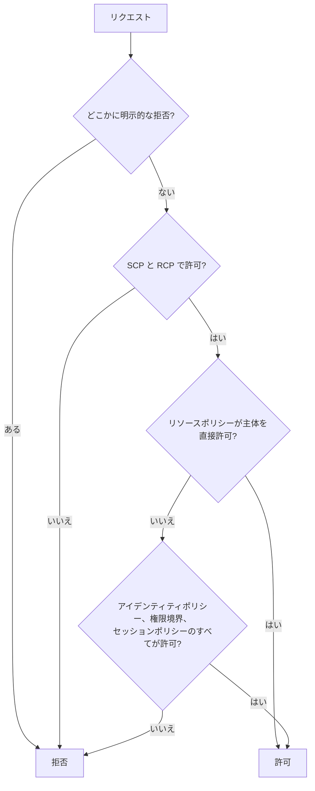

# 分野4: ID とアクセス管理

配点は **20%** で、6分野の中で最大です。認証（誰か）と認可（何ができるか）を分けて考え、拒否の原因を切り分ける力を問います。

ポリシーを読み解く問題が多いので、評価の順序と、どのポリシーがどこに効くかを正確に押さえます。

この分野に限らず、コース全体で使うサービスは[サービス一覧](services.md)から確認できます。

## タスク 4.1: 認証の戦略を設計し、実装し、トラブルシュートする {#task-4-1}

### 4.1.1 人、アプリ、システムの ID {#skill-4-1-1}

| 主体 | 第一の選択肢 | 認証情報 |
|---|---|---|
| 従業員 | IAM Identity Center | IdP や AD の認証から、権限セットの一時認証情報 |
| Web やモバイルの一般利用者 | Cognito ユーザープール | JWT |
| 利用者が AWS を直接呼ぶ | Cognito ID プール | 一時的な AWS 認証情報 |
| AWS 上のアプリ | ロール（インスタンスプロファイル、実行ロール） | 自動で更新される一時認証情報 |
| AWS の外のサーバー | IAM Roles Anywhere | X.509 証明書から一時認証情報 |
| CI/CD | OIDC フェデレーション | `AssumeRoleWithWebIdentity` |

**IAM Identity Center の ID ソース:** 組織に 1 つです。

| ID ソース | 向いている場面 | 注意点 |
|---|---|---|
| Identity Center ディレクトリ | 小規模、IdP なし | MFA は既定で有効 |
| 外部 IdP（SCIM で同期） | すでに IdP がある | MFA は IdP 側で設定。SCIM のトークンは1年で切れる |
| Active Directory | 既存の AD | Managed AD か AD Connector。**Simple AD は使えない** |

!!! danger "ID ソースの変更"
    Active Directory へ変更すると、ユーザー、グループ、割り当てがすべて完全に削除されます。

**MFA:** フィッシング耐性が要件なら FIDO2 です。Identity Center の RADIUS MFA は AWS Managed Microsoft AD 経由です。Cognito では `Required` にすると、要素を設定できない利用者はサインインできなくなります。Cognito の Plus プランの脅威保護は、漏えい認証情報の検出とアダプティブ認証を提供します。

詳細: [IAM Identity Center](../../services/identity-directory.md#identity-center)、[ID ソース](../../services/identity-directory.md#idc-identity-sources)、[Identity Center の MFA](../../services/identity-directory.md#idc-mfa)、[ユーザープールと ID プール](../../services/cognito.md#user-vs-identity-pools)、[Cognito の MFA](../../services/cognito.md#mfa-settings)、[脅威保護](../../services/cognito.md#threat-protection)、[フェデレーション](../../services/iam.md#federation)

### 4.1.2 一時認証情報の発行 {#skill-4-1-2}

| API | 呼べる主体 | 期間（最短 / 最大 / 既定） | MFA |
|---|---|---|---|
| `AssumeRole` | IAM ユーザー、ロール | 15分 / ロールの設定値 / 1時間 | 可 |
| `AssumeRoleWithSAML` | SAML 応答を持つ人 | 15分 / 設定値 / 1時間 | 不可 |
| `AssumeRoleWithWebIdentity` | OIDC トークンを持つ人 | 15分 / 設定値 / 1時間 | 不可 |
| `GetSessionToken` | IAM ユーザー、ルート | 15分 / 36時間 / 12時間（ルートは最大1時間） | 可 |
| `GetFederationToken` | IAM ユーザー、ルート | 同上 | 不可 |

**S3 の署名付き URL:** 認証情報を持たない相手に、期限付きで特定のオブジェクトの操作を許可します。権限は**署名した主体の権限**です。

| 署名に使う認証情報 | 最長 |
|---|---|
| コンソール | 12時間 |
| IAM ユーザー（SigV4） | 7日 |
| ロール、STS の一時認証情報 | 認証情報の期限まで |

期限内でも、署名した主体の権限を外すと URL は使えなくなります。ロールで署名すると、ロールのセッションが切れた時点で URL も失効します。「7日間有効な URL が数時間で使えなくなる」ならこれが原因です。

詳細: [API の比較](../../services/iam.md#sts-api-compare)、[最大セッション時間](../../services/iam.md#max-session-duration)、[GetSessionToken と MFA](../../services/iam.md#mfa)、[署名付き URL](../../services/s3.md#presigned-urls)

### 4.1.3 認証のトラブルシューティング {#skill-4-1-3}

| 症状 | 確認すること |
|---|---|
| 権限セットの割り当てが失敗する | カスタマー管理ポリシーが各アカウントに同じ名前とパスであるか、IAM のクォータ |
| ロールがポータルに出ない | ユーザーやグループの割り当て、SCIM の同期 |
| サインインできるがアクセス拒否 | 権限セット、SCP、権限境界 |
| 突然 KMS や EKS に入れない | 権限セットを外して再度割り当てると、ロールの ARN の接尾辞が変わる |
| SCIM の同期が止まった | トークンの期限 |
| SAML のサインインに失敗 | `NameID` と SCIM の Username の一致 |
| AD のユーザーが見つからない | ディレクトリの場所、信頼、Foreign Security Principal は同期されない |
| AD Connector が接続できない | DNS と SRV レコード、TCP/UDP 53、88、389 |
| Cognito で MFA を設定できずサインイン不可 | `Required` の設定、メッセージの送信設定 |
| Cognito のトークンで AWS を呼べない | ID プールのロールマッピング、基本フローか拡張フローか |

CloudTrail では、`errorCode`、`sourceIPAddress`、`userIdentity` で失敗の主体と原因を確認します。`aws sts get-caller-identity` で、実際に使われている主体を確かめます。

詳細: [Identity Center のトラブルシュート](../../services/identity-directory.md#idc-troubleshooting)、[権限セット](../../services/identity-directory.md#idc-permission-sets)、[AD Connector](../../services/identity-directory.md#ad-connector)、[信頼関係](../../services/identity-directory.md#ad-trust)、[ロールマッピング](../../services/cognito.md#role-mapping)、[CloudTrail の調査](../../services/threat-detection.md#investigate-cloudtrail)

## タスク 4.2: 認可の戦略を設計し、実装し、トラブルシュートする {#task-4-2}



上の図は同じアカウント内の流れを単純にしたものです。別のアカウントへのアクセスでは、呼び出し元とリソースの**両方**の許可が必要です。

### 4.2.1 認可の統制の設計 {#skill-4-2-1}

| 要件 | 手段 |
|---|---|
| 自作アプリの中の細かい認可 | Verified Permissions（Cedar） |
| 外部のサーバーに AWS のロールを使わせる | IAM Roles Anywhere |
| 別アカウントのリソースをコピーする | リソースポリシー（元の権限を維持する） |
| 別アカウントで複数のサービスを操作する | ロールの引き受け（信頼ポリシー） |
| 第三者の SaaS に許可する | ロールと `sts:ExternalId` |
| ロールをチームごとに整理する | IAM パス |

**Verified Permissions:** 自作アプリの認可を外部に切り出します。判定は既定で拒否で、`forbid` が `permit` より優先されます。認証は Cognito や OIDC の IdP が担い、JWT から主体を作るなら `IsAuthorizedWithToken` です。AWS リソースへの権限を与えるものではありません。

**IAM Roles Anywhere:** AWS の外のワークロードが、X.509 証明書で一時認証情報を得ます。長期のアクセスキーが不要になります。

| 要素 | 内容 |
|---|---|
| トラストアンカー | AWS Private CA か外部 CA の証明書への参照。PKI と Roles Anywhere の信頼を作る |
| ロール | Roles Anywhere のサービスプリンシパルを信頼する。`aws:SourceArn` でトラストアンカーに結び付ける |
| プロファイル | 引き受けるロールと、権限を絞るセッションポリシー |

トラストアンカーの信頼はアカウント単位です。条件を書かないと、そのアカウントのどのトラストアンカーの証明書でも、対象のロールを引き受けられます。リソースはすべてリージョン単位で、同じアカウントとリージョンに作ります。

**IAM パス:** `arn:aws:iam::123456789012:role/application_abc/RDSAccess` のように、名前の前に階層を付けます。ポリシーの `Resource` で `role/application_abc/*` のようにまとめて指定できます。`iam:PassRole` を絞るときに便利です。パスは API や CLI で指定し、コンソールでは作れません。**パス自体は権限の境界になりません。** 同じパスのユーザーとグループを自動で関連付けることもありません。

**信頼ポリシーの要点:** OIDC の信頼では `sub` を絞らないと、他のリポジトリからも引き受けられます。AWS サービスからの混乱した代理には `aws:SourceArn` と `aws:SourceAccount` を使います。

詳細: [Verified Permissions](../../services/identity-directory.md#verified-permissions)、[クロスアカウントアクセス](../../services/iam.md#cross-account)、[信頼ポリシー](../../services/iam.md#trust-policy)、[ExternalId](../../services/iam.md#external-id)、[認証情報プロバイダーチェーン](../../services/iam.md#credential-chain)

### 4.2.2 ABAC と RBAC {#skill-4-2-2}

| 観点 | RBAC | ABAC |
|---|---|---|
| 権限の決め方 | 役割ごとにポリシーを作る | タグの一致で決める |
| 増えたときの負担 | プロジェクトごとにポリシーが増える | ポリシーは増えず、タグを付けるだけ |
| 向いている場面 | 役割が固定で権限の確認を明確にしたい | チームやプロジェクトの増減が多い |
| 注意点 | ポリシーの数とロールの上限 | タグを変更する権限を厳しく管理する |

ABAC の基本形は、主体のタグとリソースのタグの一致です。

```json
{
  "Effect": "Allow",
  "Action": ["ec2:StartInstances", "ec2:StopInstances"],
  "Resource": "*",
  "Condition": {
    "StringEquals": {"aws:ResourceTag/Project": "${aws:PrincipalTag/Project}"}
  }
}
```

タグの出どころを押さえます。

| 出どころ | 方法 |
|---|---|
| ロールのタグ | IAM のタグ |
| セッションタグ | `AssumeRole` で渡す。信頼ポリシーで `sts:TagSession` の許可が必要 |
| SAML と OIDC | アサーションの属性を `PrincipalTag` に |
| IAM Identity Center | ID ソースの属性を ABAC に使う |
| Cognito ID プール | ID プールの設定 |

**落とし穴:** 利用者が自分でタグを変更できると、権限を広げられます。`aws:RequestTag` と `aws:TagKeys` で付けられるタグを制限します。セッションタグは既定でロールチェーンに引き継がれず、`TransitiveTagKeys` の指定が必要です。

詳細: [条件とアクセス制御](../../services/iam.md#conditions)、[セッションタグ](../../services/iam.md#session-tags)、[主なグローバル条件キー](../../services/iam.md#condition-keys)、[ポリシー変数](../../services/iam.md#policy-variables)、[Identity Center の ABAC](../../services/identity-directory.md#idc-abac)

### 4.2.3 最小権限のポリシーの設計 {#skill-4-2-3}

権限の上限を決める仕組みは、**権限を与えません**。組み合わせの共通部分だけが使えます。

| 仕組み | 適用先 | 用途 |
|---|---|---|
| 権限境界 | ユーザー、ロール | 開発者に作らせるロールの上限 |
| セッションポリシー | STS のセッション | そのセッションだけ絞る（テナントごとなど） |
| SCP | 組織内の主体 | 組織全体のガードレール |
| RCP | 組織内のリソース | 外部からのアクセスの制限 |
| VPC エンドポイントポリシー | エンドポイント | 経路の上限 |

**権限境界の定番:** 開発者に `iam:CreateRole` を許すとき、`iam:PermissionsBoundary` 条件で境界付きのロールしか作れないようにします。境界を外す操作も拒否します。

**セッションポリシーの定番:** マルチテナントで、共通のロールを引き受けるときに `data/tenant-a/*` だけに絞ります。合計 2,048 文字までで、管理ポリシーは最大 10 個です。

**設計の手順:** 最初は広くなりがちなので、Access Analyzer のポリシーの生成で CloudTrail から下書きを作り、未使用アクセスの検出で減らします。

詳細: [権限境界と SCP](../../services/iam.md#boundaries-scp)、[権限境界の設定](../../services/iam.md#permissions-boundary)、[セッションポリシー](../../services/iam.md#session-policies)、[最小権限](../../services/iam.md#least-privilege)、[ポリシーの要素](../../services/iam.md#policy-elements)

### 4.2.4 認可の失敗の分析 {#skill-4-2-4}

メッセージの言い回しで原因の種類が分かります。

| メッセージの一部 | 原因 |
|---|---|
| `with an explicit deny in a service control policy` | SCP の明示的な拒否 |
| `with an explicit deny in a resource control policy` | RCP の明示的な拒否 |
| `with an explicit deny in a VPC endpoint policy` | エンドポイントポリシーの明示的な拒否 |
| `because no identity-based policy allows` | アイデンティティベースの暗黙の拒否 |
| `because no resource-based policy allows` | リソースベースの暗黙の拒否 |
| `because no permissions boundary allows` | 権限境界の暗黙の拒否 |
| `because no session policy allows` | セッションポリシーの暗黙の拒否 |

| ツール | できること | 限界 |
|---|---|---|
| ポリシーシミュレーター | 実際に呼ばずに許可か拒否かを試す | RCP は未対応。条件キーの値は自分で与える場合がある |
| `DecodeAuthorizationMessage` | エンコードされた拒否理由を読む | `sts:DecodeAuthorizationMessage` の権限が必要 |
| CloudTrail | 実際の `errorCode` と主体を確認 | 配信は平均約5分遅れる |
| Access Analyzer | ポリシーの検証、アクセスのプレビュー | ログではなくポリシーを見る |

**クロスアカウントの切り分け:** 外部の主体が自組織のバケットへアクセスする場合、SCP は効かず、RCP とバケットポリシーが効きます。KMS で暗号化されていれば、キーポリシーの許可も必要です。

**VPC エンドポイント経由の落とし穴:** `aws:SourceIp` に使うパブリック IP がないので、公開 IP を条件にした許可は効きません。`aws:SourceVpce` に書き換えます。

詳細: [アクセス拒否メッセージ](../../services/iam.md#access-denied-messages)、[ポリシーシミュレーター](../../services/iam.md#policy-simulator)、[DecodeAuthorizationMessage](../../services/iam.md#decode-authorization)、[アクセス拒否の切り分け](../../services/identity-directory.md#access-troubleshooting)、[クロスアカウントの評価](../../services/identity-directory.md#cross-account-evaluation)、[エンドポイントポリシー](../../services/networking.md#endpoint-policies)

### 4.2.5 意図しない権限の調査と修正 {#skill-4-2-5}

| Access Analyzer の分析ツール | 分かること | リージョン | 料金 |
|---|---|---|---|
| 外部アクセス | 信頼ゾーンの外への共有 | リージョンごと | 無料 |
| 内部アクセス | 組織やアカウント内から重要リソースへの経路 | リージョンごと | リソース数で課金 |
| 未使用アクセス | 未使用のロール、キー、パスワード、権限 | リージョンを問わない | ロールとユーザーの数で課金 |

**外部アクセスの注意:** アクセスログではなくポリシーを論理的に分析します。実際に使われたかではなく、**許可されているか**を判定します。意図した公開はアーカイブルールでまとめて処理します。

**パイプラインでの予防:**

| API | 用途 |
|---|---|
| `ValidatePolicy` | 文法とベストプラクティス |
| `CheckNoNewAccess` | 元のポリシーと比べて権限が増えていないか |
| `CheckAccessNotGranted` | 危険な操作を許可していないか |
| `CheckNoPublicAccess` | リソースポリシーが公開していないか |
| `CreateAccessPreview` | 変更の前に検出結果を確認 |

**組織全体の防御:** 誤って公開しても守れるように、データ境界を作ります。信頼できる ID、信頼できるリソース、想定されたネットワークの3つを SCP、RCP、エンドポイントポリシーで組み合わせます。導入後に CloudTrail のログ配信が止まるなら、サービスプリンシパルの例外を確認します。

詳細: [IAM Access Analyzer](../../services/identity-directory.md#access-analyzer)、[外部アクセスの検出](../../services/identity-directory.md#aa-external)、[未使用アクセスの検出](../../services/identity-directory.md#aa-unused)、[ポリシーの検証とチェック](../../services/identity-directory.md#aa-policy-checks)、[データ境界](../../services/identity-directory.md#data-perimeter)

## 確認問題 {#self-check}

??? question "問1: 開発チームに Lambda の実行ロールを自分で作らせたいですが、権限の昇格は防ぎたいです。どう設計しますか？"
    権限境界を使います。`iam:CreateRole` に `iam:PermissionsBoundary` 条件を付けて、指定の境界付きのロールしか作れないようにします。境界の削除や変更の操作は拒否し、`iam:PassRole` はパスや名前と `iam:PassedToService` で絞ります。SCP は全員に効くので、チームごとの細かい制限には向きません。

??? question "問2: S3 の署名付き URL を7日の有効期限で EC2 のロールから生成しましたが、数時間で使えなくなります。なぜですか？7日間使うには？"
    署名付き URL は署名した認証情報の期限までしか使えません。ロールの一時認証情報が切れると失効します。7日間必要なら、IAM ユーザーの長期の認証情報で SigV4 署名します。ただし長期の認証情報の管理が増えるので、短い期限で都度生成できないかも検討します。

??? question "問3: オンプレミスのサーバーのアプリが S3 にアクセスしており、アクセスキーの管理とローテーションが負担です。社内 PKI で証明書を発行しています。どうしますか？"
    IAM Roles Anywhere です。社内 CA をトラストアンカーに登録し、ロールとプロファイルを作ります。アプリは X.509 証明書で一時認証情報を得ます。トラストの範囲はアカウント単位なので、ロールの信頼ポリシーに条件を付けて、使える証明書を絞ります。

??? question "問4: 新しいプロジェクトのたびにポリシーとロールが増えて管理できません。プロジェクトの増減が多いです。どう変えますか？"
    ABAC にします。IdP の属性をセッションタグで渡し、`aws:ResourceTag/Project` と `aws:PrincipalTag/Project` の一致で許可します。ポリシーを増やさずにプロジェクトを追加できます。タグの変更で権限を広げられないように、`aws:RequestTag` などで付けられるタグを制限します。

??? question "問5: 利用者が S3 にアクセスすると AccessDenied になります。メッセージは「with an explicit deny in a resource control policy」です。IAM ポリシーとバケットポリシーの両方で許可しています。どう対応しますか？"
    RCP の明示的な拒否は、どの許可より優先されます。組織の RCP の条件（`aws:PrincipalOrgID` など）を確認します。正当な外部のパートナーなら RCP に例外を追加し、テスト用の OU で確認してから広げます。ポリシーシミュレーターは RCP に対応していないので、この切り分けには使えません。

??? question "問6: 全アカウントの S3 と KMS の中で、組織の外に共有されているものを継続的に見つけ、さらに新しいポリシーで公開を防ぎたいです。どうしますか？"
    組織を信頼ゾーンにした Access Analyzer の外部アクセスの分析ツールを、リージョンごとに作ります。リリース前はパイプラインで `CheckNoPublicAccess` を実行します。誤った公開を実質的に防ぐには、RCP で組織の外の主体を拒否します。Access Analyzer は検出するだけで、止めません。
