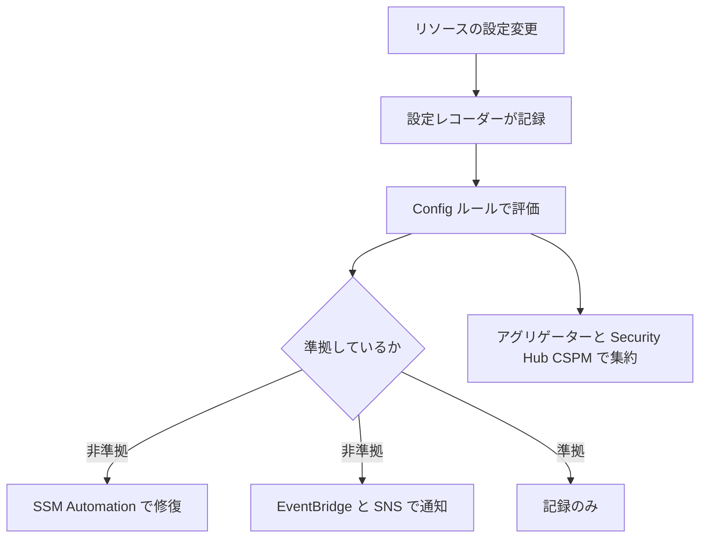

# 分野6: セキュリティの基盤とガバナンス

配点は **14%** です。マルチアカウントの土台、一貫した展開、準拠の評価を問います。

どのポリシーが何に効き、何に効かないかが要点です。「止める」のか「見つける」のか「展開する」のかで、選ぶものが変わります。

この分野に限らず、コース全体で使うサービスは[サービス一覧](services.md)から確認できます。

## タスク 6.1: アカウントを一元的に展開して管理する {#task-6-1}

### 6.1.1 Organizations の展開と設定 {#skill-6-1-1}

| 設定 | 要点 |
|---|---|
| 機能セット | SCP や RCP を使うには「すべての機能」が必要。一括請求のみでは使えない |
| OU の分け方 | 人事の部署ではなく、適用したいポリシーの違いで分ける。ネストは5階層まで |
| 管理アカウント | ワークロードを置かない。SCP が効かないので権限を絞る |

公式の推奨の OU は Security、Infrastructure、Workloads、Sandbox、Policy Staging、Suspended などです。新しいポリシーは Policy Staging OU で試してから広げます。

SCP を使おうとして使えないなら、`FeatureSet` とルートでのポリシータイプの有効化を確認します。

詳細: [Organizations](../../services/governance.md#organizations)、[機能セット](../../services/governance.md#org-feature-sets)、[OU の設計](../../services/governance.md#org-ous)、[マルチアカウントのパターン](../../services/governance.md#multi-account-patterns)

### 6.1.2 Control Tower の実装 {#skill-6-1-2}

Organizations、Service Catalog、IAM Identity Center などを組み合わせて、ベストプラクティスの環境を作ります。

| コントロールの動作 | 働き | 実装 |
|---|---|---|
| 予防的 | 操作を止める | SCP、RCP |
| 検出的 | 違反を見つける | Config ルール |
| プロアクティブ | 作成前に確認し、不適合なら作らない | CloudFormation Hooks |

適用の方針は、必須、強く推奨、選択的の3種類です。**任意のコントロールと独自の統制**を足すのが、このスキルの要点です。

| 拡張の方法 | 内容 |
|---|---|
| Customizations for Control Tower（CfCT） | テンプレートとポリシーを追加で展開 |
| Account Factory for Terraform（AFT） | Terraform と Git でアカウントを発行、カスタマイズ |

**既存の環境への導入:** 既存の組織にランディングゾーンを作り、OU を登録してアカウントを管理下に入れます。バージョン 4.0 では Security OU は必須でなくなり、自分の組織の構造を定義できます。

**ドリフト:** Control Tower の外で OU やアカウント、SCP を変更するとドリフトになります。ランディングゾーンの更新や OU の再登録で解消します。

コントロールは OU 単位で適用され、配下の全アカウントに影響します。管理アカウントには予防的コントロールが適用されません。

詳細: [Control Tower](../../services/governance.md#control-tower)、[ランディングゾーン](../../services/governance.md#ct-landing-zone)、[コントロール](../../services/governance.md#ct-controls)、[ドリフトと拡張](../../services/governance.md#ct-drift)

### 6.1.3 組織のポリシー {#skill-6-1-3}

| ポリシー | 何を制御するか | 効かないもの | 上限 |
|---|---|---|---|
| SCP | メンバーの IAM ユーザーとロールの権限の上限 | 管理アカウント、サービスリンクロール | 10 個、10,240 文字 |
| RCP | メンバーのリソースへのアクセスの上限 | 管理アカウントのリソース、サービスリンクロール、AWS 管理の KMS キー | 5 個（`RCPFullAWSAccess` を含む）、5,120 文字 |
| 宣言型ポリシー | サービスの設定そのもの | | 10 個、10,000 文字 |
| AI サービスのオプトアウト | AI サービスのサービス改善へのコンテンツ利用 | | 5 個、2,500 文字 |

**SCP と RCP の使い分け:** SCP は「自社の人に禁止したいこと」、RCP は「外部からのアクセス」です。外部の主体が自組織のバケットへアクセスする場合、SCP は効きません。

**宣言型ポリシー:** API の許可ではなく、**サービスのコントロールプレーンで設定を強制**します。

| 観点 | SCP、RCP | 宣言型ポリシー |
|---|---|---|
| 方法 | API の権限の上限 | サービスの望ましい設定を強制 |
| サービスリンクロール | 効かない | **効く** |
| 新しい API や機能 | 追加の対応が必要な場合がある | 基準の設定が維持される |
| 例 | 組織からの離脱を拒否 | VPC のインターネットアクセスの遮断、VPC の転送時暗号化の強制、Allowed Images |

アカウントステータスレポートで現状を確認でき、カスタムのエラーメッセージで利用者を案内できます。ポリシーを外すと、付ける前の状態に戻ります。

**AI サービスのオプトアウト:** AWS の AI サービスは、サービス改善のためにコンテンツを保存して使うことがあります。オプトアウトすると、サービスの提供に不要な保存済みのコンテンツも削除されます。個別のサービスか、対応する全サービスを指定できます。

!!! note "SCP の値"
    SCP の上限は、古い教材の「5 個、5,120 文字」から増えています。

詳細: [ポリシーの種類](../../services/governance.md#org-policy-types)、[SCP](../../services/governance.md#scp)、[RCP](../../services/governance.md#rcp)、[SCP と RCP の例外](../../services/identity-directory.md#guardrail-exceptions)、[データの利用とオプトアウト](../../services/ai-managed-services.md#data-use)

### 6.1.4 セキュリティサービスの一元管理 {#skill-6-1-4}

管理アカウントで日常の運用をせず、**委任管理者**を使います。Audit アカウントを各サービスの委任管理者にするのが定番です。

| サービス | 委任の注意点 |
|---|---|
| GuardDuty | リージョンごとに指定。全リージョンで同じアカウント |
| Security Hub | 管理アカウントが指定。CSPM の委任管理者がいれば自動で同じアカウント |
| Inspector | 委任管理者だけが抑制ルールを作れる |
| Macie | 委任管理者がリージョンごとにメンバーを追加 |
| Detective | 行動グラフの管理者 |
| Firewall Manager | 既定の管理者と、スコープを絞った複数の管理者 |
| IAM | 組織の root アクセス管理を委任できる |
| Organizations のポリシー | リソースベースの委任ポリシーで SCP の管理を委任 |

委任管理者はメンバーアカウントなので、**SCP の影響を受けます**。委任管理者を守るために強いコントロールをかけつつ、必要な操作を止めないようにします。

詳細: [委任管理者](../../services/governance.md#delegated-admin)、[GuardDuty の複数アカウント](../../services/threat-detection.md#guardduty-multi-account)、[Security Hub の組織と集約](../../services/threat-detection.md#security-hub-org)

### 6.1.5 ルートユーザーの認証情報の管理 {#skill-6-1-5}

ルートユーザーのアクセスを一元管理すると、メンバーアカウントの長期の認証情報をなくせます。

| 機能 | 内容 |
|---|---|
| ルート認証情報の削除 | パスワード、アクセスキー、署名証明書を削除し、MFA を無効化 |
| 新しいアカウント | 組織で作るアカウントは既定でルートの認証情報がない |
| 特権タスク | S3 バケットや SQS キューの誤ったポリシーの削除など |
| パスワードの復旧の許可 | 必要なときだけ認証情報を戻す |
| 実行できる人 | 管理アカウントか IAM の委任管理者の、`sts:AssumeRoot` を許可された主体 |

**特権タスクの仕組み:** `AssumeRoot` で、対象のアカウントとタスクポリシーを指定して短期のセッションを作ります。タスクポリシーは AWS 管理の `IAMAuditRootUserCredentials`、`IAMCreateRootUserPassword`、`IAMDeleteRootUserCredentials`、`S3UnlockBucketPolicy`、`SQSUnlockQueuePolicy` です。

- グローバルエンドポイントでは呼べず、リージョンの STS エンドポイントを使います。
- ルートユーザーの認証情報では呼べません。
- `sts:TaskPolicyArn` 条件で、できる作業を絞れます。

**MFA:** ルートユーザーには既定で MFA が強制されます。アカウントの作成時やサインイン時に追加が求められます。

**緊急アクセス（break-glass）の設計:**

| 場面 | 手段 |
|---|---|
| Identity Center の障害 | IdP から各アカウントへの直接の SAML フェデレーションを別に用意 |
| 管理者が権限を失った | 緊急用のロール。普段は使わず、利用を検知する |
| ルートユーザーが必要 | 特権タスクで済まないかを先に検討。必要なら認証情報を一時的に戻す |
| 利用の検知 | EventBridge のルールでルートのサインインと緊急用ロールの利用を通知 |

緊急用の経路は、定期的に動作を確認します。

詳細: [SCP と RCP の例外](../../services/identity-directory.md#guardrail-exceptions)、[マルチリージョンと緊急アクセス](../../services/identity-directory.md#idc-multi-region)、[Identity Center の委任管理者](../../services/identity-directory.md#idc-delegated-admin)

## タスク 6.2: 安全で一貫した展開戦略 {#task-6-2}

### 6.2.1 IaC による一貫した展開 {#skill-6-2-1}

**StackSets の権限モデル:**

| 観点 | セルフマネージド | サービスマネージド |
|---|---|---|
| ロール | 管理と実行のロールを自分で作る | 自動 |
| 対象 | 指定したアカウント | Organizations の OU |
| 新しいアカウント | 自分で追加 | 自動デプロイが可能 |
| 選ぶ場面 | 組織の外のアカウントも対象 | 組織全体に標準の統制を配る |

**検証ツールの使い分け:** 問われるのは「いつ、何を確かめるか」です。

| ツール | 確かめること | 効く場所 |
|---|---|---|
| cfn-lint | テンプレートの構文と許可された値 | 開発者の PC、CI |
| CloudFormation Guard | 組織のポリシーへの準拠（DSL で記述） | CI。**それ自体はサーバー側で強制しない** |
| CloudFormation Hooks | 作成、更新、削除の前の検証 | **サーバー側**でブロックや警告 |
| 変更セット | 何が変わるか | デプロイ前 |
| Inspector の Code Security | IaC の問題 | リポジトリ |

Guard は CloudFormation だけでなく、JSON や YAML のデータ全般を検証できます。Terraform の JSON の設定や Kubernetes の設定、Config の設定項目も対象です。Guard の規則で Hook を作れば、サーバー側で強制できます。組み込みの単体テストもあります。

**他社の IaC:** Terraform では、タグポリシーの必須タグキー、Service Catalog の Terraform 製品、Control Tower の AFT などが関わります。

詳細: [StackSets の設定](../../services/iac.md#stacksets-settings)、[StackSets の運用](../../services/operations.md#stacksets-operations)、[検証方法のまとめ](../../services/iac.md#validate-iac)、[変更セット](../../services/iac.md#change-sets)、[ドリフト検出](../../services/iac.md#drift)、[動的参照](../../services/secrets.md#dynamic-references)

### 6.2.2 タグによる整理 {#skill-6-2-2}

| 目的 | タグの例 |
|---|---|
| 部門、費用の配賦 | `CostCenter=1234` |
| 環境 | `Environment=Production` |
| 所有者 | `Owner=platform-team` |
| 自動化 | `Backup=daily` |
| アクセス制御 | `Project=alpha`（ABAC） |

タグのキーと値は大文字小文字を区別するので、統一しないと集計やポリシーが効きません。

| 目的 | 手段 | 注意点 |
|---|---|---|
| 表記の統一 | タグポリシー | タグなしの作成は止めない |
| 作成時の強制 | SCP の `aws:RequestTag`、IaC の必須タグキー | 必須タグキーは IaC 向け |
| 事後の検出 | Config の `required-tags` | 検出だけ |
| 費用への反映 | コスト配分タグの有効化 | 有効化が必要 |
| まとめて操作 | Resource Groups、Tag Editor | |

機密情報をタグに入れてはいけません。タグの値は課金や診断のログに使われることがあります。

詳細: [タグ戦略](../../services/governance.md#tagging-strategy)、[タグポリシー](../../services/governance.md#tag-policies)、[Resource Groups](../../services/governance.md#resource-groups)、[コスト配分タグ](../../services/cost-management.md#cost-allocation-tags)

### 6.2.3 ポリシーと設定の一元展開 {#skill-6-2-3}

Firewall Manager は保護の設定を組織全体に展開し、新しいアカウントやリソースにも自動で適用します。

| 前提 | 不足したときの症状 |
|---|---|
| Organizations のすべての機能 | 一括請求のみでは使えない |
| 管理者アカウントの指定 | 管理者以外はポリシーを作れない |
| AWS Config を対象で有効 | 準拠状態を評価できない |
| AWS RAM の組織共有 | Network Firewall と DNS Firewall のポリシーの展開に失敗 |

| ポリシーの種類 | 内容 |
|---|---|
| AWS WAF | 最初と最後に動くルールグループを強制。間にアカウント所有者が追加できる |
| Shield Advanced | 指定した種類のリソースを保護 |
| セキュリティグループ | 共通の適用、内容の監査、使用状況の監査 |
| ネットワーク ACL | 基準の NACL を強制 |
| Network Firewall、DNS Firewall | 組織の VPC に展開 |
| 他社製ファイアウォール | Palo Alto Cloud NGFW、Fortigate CNF |

スコープはアカウント、OU、タグ、リソースの種類で決めます。修復は「不準拠の表示だけ」か「自動修復」を選びます。監査系の SG のポリシーは、まず自動修復を無効にして影響を確認します。

| やりたいこと | 手段 |
|---|---|
| 防御の設定を展開 | Firewall Manager |
| 検査そのもの | Network Firewall、WAF |
| ルールと修復を組織に展開 | Config 適合パック |
| 権限の上限 | SCP |
| CloudFormation スタックを展開 | StackSets |

詳細: [Firewall Manager](../../services/threat-detection.md#firewall-manager)

### 6.2.4 アカウント間の安全な共有 {#skill-6-2-4}

| 観点 | Service Catalog | AWS RAM |
|---|---|---|
| 共有するもの | 承認済みの構成（製品） | リソースそのもの |
| 利用者が得るもの | セルフサービスで作成できる | 他のアカウントのリソースを使える |
| 例 | 暗号化済みの S3 の構成 | サブネット、Transit Gateway、Resolver ルール |

**Service Catalog の起動制約が最重要です。** 作成時に Service Catalog が引き受けるロールを指定すると、利用者に EC2 などの権限を与えずに作らせられます。ないと利用者自身の権限で作成することになります。テンプレート制約でパラメータの値も制限できます。

**AWS RAM:** 組織の共有を有効にすると、組織内は招待なしで共有できます。無効だと招待が必要になったり、OU を指定できなかったりします。組織を離れたアカウントは、既定で共有へのアクセスを失います。

**VPC サブネットの共有:** オーナーがサブネットやルートテーブルなどを管理し、参加者は自分のリソースだけを管理します。ネットワークの統制をネットワークアカウントに集められます。

| 選択 | 使い分け |
|---|---|
| RAM | リソース自体を他のアカウントで使わせる |
| クロスアカウントロール | 他のアカウントで操作させる |
| リソースポリシー | 特定のリソースへのアクセスを許可する |

詳細: [Service Catalog](../../services/governance.md#service-catalog)、[AWS RAM](../../services/governance.md#ram)、[VPC サブネットの共有](../../services/governance.md#ram-vpc-sharing)

## タスク 6.3: リソースの準拠を評価する {#task-6-3}

### 6.3.1 非準拠の検出、修復、通知 {#skill-6-3-1}

| やりたいこと | 手段 | 注意点 |
|---|---|---|
| 評価する | Config ルール | **止めない**。プロアクティブ評価も判定のみ |
| 修復する | SSM Automation の修復 | 実行ロールが必要。`MaximumAutomaticAttempts` の既定は 5 |
| 集約して見る | アグリゲーター | 読み取り専用。展開や修復はできない |
| ルールを組織へ配る | 適合パック、組織ルール | 組織ルールは API か CLI でのみ作成 |
| 基準でまとめて見る | Security Hub CSPM | 標準とスコア |
| 通知する | EventBridge、SNS、User Notifications | |

全アカウントの暗号化されていない EBS を探すなら、高度なクエリが使えます。サービスリンクルールの修復は管理できません。

Config と SCP の使い分けです。発見して直すなら Config、操作を止めるなら SCP です。

詳細: [Config ルール](../../services/governance.md#config-rules)、[修復](../../services/governance.md#config-remediation)、[アグリゲーター](../../services/governance.md#config-aggregators)、[適合パック](../../services/governance.md#config-conformance-packs)、[CSPM の自動化](../../services/threat-detection.md#security-hub-automation)

### 6.3.2 監査の証拠の収集と整理 {#skill-6-3-2}

| 観点 | Audit Manager | Artifact |
|---|---|---|
| 誰の資料か | 自社のワークロードの証拠 | AWS 自身の報告書と契約 |
| 内容 | フレームワークに沿って証拠を自動収集し、評価レポートにまとめる | SOC、ISO、PCI の報告書、HIPAA の BAA |
| 判定 | 証拠の準拠を**判定はしない** | |

!!! note "Audit Manager の状況"
    2026年4月30日から新しいアカウントで設定できません。既存の利用者は使い続けられますが、新しいリージョンやアカウントへは広げられず、新機能と新しいフレームワークも追加されません。AWS の代替案は Config の適合パックです。試験ガイドには名前が残っているので、役割を覚えておきます。

**Audit Manager の証拠のデータソース:** CloudTrail（ユーザーの活動）、Config と Security Hub CSPM（準拠チェック）、AWS API の呼び出し（設定のスナップショット）です。

**Artifact:** 組織全体で BAA をまとめて受諾でき、既存と将来のメンバーが対象になります。自社のシステムを証明する資料は別で、自社で用意します。

詳細: [Audit Manager](../../services/threat-detection.md#audit-manager)、[Artifact](../../services/threat-detection.md#artifact)、[責任共有モデル](../../services/cloud-foundations.md#shared-responsibility)

### 6.3.3 ベストプラクティスに対する評価 {#skill-6-3-3}

| ツール | 評価の方法 | 向いている場面 |
|---|---|---|
| Well-Architected Tool | 質問形式で設計をレビュー | 設計全体の見直し。リスクと改善計画を残す |
| Trusted Advisor | 環境を自動で点検 | セキュリティ、費用、耐障害性の幅広い点検 |
| Security Hub CSPM の FSBP | コントロールを継続的にチェック | AWS のベストプラクティスへの準拠 |
| Config 適合パック | ルールで評価 | 自社の基準 |
| Resilience Hub | RTO と RPO の目標 | 回復性の評価 |

**Well-Architected Tool:** ワークロードに Framework のレンズが自動で適用され、セキュリティの柱も含みます。Lens Catalog やカスタムレンズで質問を足せます。マイルストーンで改善前後を比較します。ツールは指摘と記録をするだけで、リソースを修正しません。

詳細: [Well-Architected Tool](../../services/cloud-foundations.md#wa-tool)、[Trusted Advisor](../../services/cloud-foundations.md#trusted-advisor)、[CSPM の標準](../../services/threat-detection.md#security-hub-cspm)

## 確認問題 {#self-check}

??? question "問1: サービスリンクロールが作るリソースを含めて、組織全体で VPC のインターネットアクセスを遮断する設定を維持したいです。将来の新しい API にも対応したいです。SCP と何が違いますか？"
    宣言型ポリシーを使います。API の権限ではなくサービスのコントロールプレーンで設定を強制するので、サービスリンクロールにも効き、新しい API や機能が増えても基準の設定が維持されます。SCP は API の上限なので、サービスリンクロールには効かず、新しい API に対応する書き換えが必要になることがあります。

??? question "問2: メンバーアカウントの S3 バケットポリシーを誤り、全主体が拒否されました。そのアカウントにはルートの認証情報を残していません。どうしますか？"
    管理アカウントか IAM の委任管理者から `AssumeRoot` を呼びます。対象のアカウントと `S3UnlockBucketPolicy` のタスクポリシーを指定し、リージョンの STS エンドポイントで短期のセッションを作ります。そのセッションで誤ったポリシーを削除し、正しく設定し直します。

??? question "問3: 全アカウントの CloudFormation テンプレートで、KMS キーでの既定の暗号化を設定していない S3 バケットの作成を CI で検知し、さらにパイプラインを通さず直接デプロイされたスタックでの作成も止めたいです。何を組み合わせますか？"
    CI で CloudFormation Guard の規則を実行し、同じ規則で CloudFormation Hook を作ってサーバー側で強制します。Guard 単体はサーバー側で強制しません。cfn-lint はテンプレートの正しさを見るもので、組織のポリシーの検証には向きません。Control Tower のプロアクティブコントロールも Hook を使う手段です。Hook の対象は CloudFormation と Cloud Control API の操作なので、コンソールや S3 API での直接の作成は Config ルールなどで検出します。

??? question "問4: 全アカウントの ALB に同じ WAF のルールグループを強制し、新しいアカウントにも自動で適用したいです。各チームが独自のルールを追加できるようにもしたいです。何を選びますか？"
    Firewall Manager の AWS WAF ポリシーです。最初と最後に動くルールグループを強制し、その間にアカウント所有者がルールを追加できます。Organizations のすべての機能と、対象の AWS Config の有効化が前提です。CloudFormation StackSets では、新しいリソースへの自動適用と準拠の評価を同じようには行えません。

??? question "問5: 開発者に EC2 の権限を与えず、承認済みの構成だけをセルフサービスで作らせたいです。何を設定しますか？"
    Service Catalog の製品とポートフォリオを作り、**起動制約**で Service Catalog が引き受けるロールを指定します。開発者にはポートフォリオへのアクセスだけを与えます。起動制約がないと、開発者自身の権限で作成することになり、EC2 や CloudFormation の権限が必要です。テンプレート制約で選べるインスタンスタイプも絞れます。

??? question "問6: 監査人から AWS の SOC 2 レポートと、自社のワークロードが基準を満たしている証拠の両方を求められました。新規の環境です。何を使いますか？"
    AWS の SOC 2 レポートは Artifact からダウンロードします。自社の証拠は、Audit Manager が新規受付を終了しているので、Config の適合パックと Security Hub CSPM の標準で評価し、CloudTrail と Config の履歴を証拠として整理します。Audit Manager を使える既存の環境なら、評価レポートにまとめられます。証拠の準拠を判定するものではありません。
