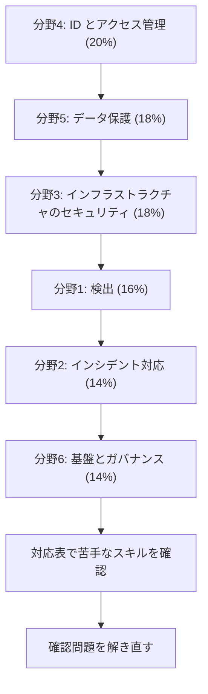

# Security - Specialty（SCS）

AWS 上のワークロードを守る設計と運用の力を問う専門知識試験です。このコースは **SCS-C03** を基準にしています。全70スキルの一覧は[対応表](coverage.md)で確認できます。

SCS-C03 は 2025年12月2日に SCS-C02 から切り替わりました（[試験ガイドの比較](https://docs.aws.amazon.com/aws-certification/latest/security-specialty-03/security-specialty-03-appendix-b.html)）。

!!! warning "2026年12月31日で一部の言語の提供が終わります"
    公式ページによると、簡体字中国語、スペイン語（ラテンアメリカ）、ポルトガル語（ブラジル）の試験は **2026年12月31日より後は提供されません**。日本語、英語、韓国語にはこの案内はありません。

[:material-format-list-bulleted: このコースのサービス一覧](services.md){ .md-button }

## 試験の概要 {#overview}

| 項目 | 内容 | 出典 |
|---|---|---|
| 問題数 | 65問（採点対象50問 + 採点対象外15問） | 試験ガイド、公式ページ |
| 試験時間 | 170分 | 公式ページ |
| 合格点 | 750点（100〜1,000点） | 試験ガイド |
| 受験料 | 300 USD（地域と為替により変わることがあります） | 公式ページ |
| 形式 | 択一、複数選択、並べ替え、組み合わせ | 試験ガイド |
| 採点方式 | 全体の得点で合否を判定します。分野ごとの合格点はありません | 試験ガイド |
| 減点 | 誤答による減点はありません。未回答は不正解になるので、すべて回答します | 試験ガイド |
| 受験方法 | Pearson VUE のテストセンター、またはオンライン監督付き | 公式ページ |
| 言語 | 英語、日本語、韓国語、ポルトガル語（ブラジル）、簡体字中国語、スペイン語（ラテンアメリカ） | 公式ページ |

形式の記載は資料で異なります。公式ページは「択一または複数選択」、試験ガイドは並べ替えと組み合わせも挙げています。ここでは、より詳しい**試験ガイド**に従います。並べ替えは3〜5個の正しい選択肢を選んで順に並べ、組み合わせは3〜7個の項目をすべて正しく対応させると得点になります。

## 学習の順番 {#study-path}

配点の大きい分野から順に進めます。分野 4 の IAM と分野 5 の KMS は他の全分野の土台なので、先に固めます。

| 分野 | 配点 | タスク数 | スキル数 | 主なサービス |
|---|---|---|---|---|
| [分野1: 検出](domain1.md) | 16% | 3 | 13 | GuardDuty、Security Hub、Security Lake、CloudTrail、CloudWatch |
| [分野2: インシデント対応](domain2.md) | 14% | 2 | 9 | Systems Manager、Step Functions、Detective、FIS、Shield Advanced |
| [分野3: インフラストラクチャのセキュリティ](domain3.md) | 18% | 3 | 16 | WAF、CloudFront、Inspector、Network Firewall、Verified Access、Bedrock |
| [分野4: ID とアクセス管理](domain4.md) | 20% | 2 | 8 | IAM、STS、IAM Identity Center、Cognito、Access Analyzer |
| [分野5: データ保護](domain5.md) | 18% | 3 | 12 | KMS、CloudHSM、Secrets Manager、Private CA、S3 Object Lock、AWS Backup |
| [分野6: セキュリティの基盤とガバナンス](domain6.md) | 14% | 3 | 12 | Organizations、Control Tower、Config、Firewall Manager、CloudFormation |

## C02 と C03 の違い {#c02-vs-c03}

古い教材を使うときに確認します。C02 の分野 1 と 2 が、「検出」と「インシデント対応」に組み直されました。

| 分野 | C02 の配点 | C03 の配点 |
|---|---|---|
| 検出（C02 は「脅威検出とインシデント対応」） | 14% | 16% |
| インシデント対応（C02 は「セキュリティログとモニタリング」） | 18% | 14% |
| インフラストラクチャのセキュリティ | 20% | 18% |
| ID とアクセス管理 | 16% | 20% |
| データ保護 | 18% | 18% |
| 基盤とガバナンス（C02 は「管理とセキュリティガバナンス」） | 14% | 14% |

分野 1 と 2 は組み直されたので、上の表の 1 行目と 2 行目は同じ内容の比較ではありません。

| 変更 | 内容 |
|---|---|
| 追加 | 2.2.3 検出結果の検証、3.1.4 OCSF と他社 WAF ルールの統合、3.2.7 生成 AI の保護、5.1.3 リソース間の転送時暗号化、5.3.3 インポートした鍵素材と AWS 生成の違い、5.3.4 機密データのマスキング、5.3.5 複数リージョンの鍵と証明書 |
| 削除 | ASFF、Security Incident Response Guide、ログの形式と構成要素、ホストベースのセキュリティ、Reachability Analyzer による分析、TCP/IP の基礎、ポリシーの構成要素、TLS の概念、プライベート VIF とパブリック VIF のリージョン間設計、S3 の静的ウェブサイトホスティング |

削除された項目も、他のスキルの前提として知っておくと役に立ちます。

## 受験者像と範囲外 {#out-of-scope}

対象は、クラウドのセキュリティで3〜5年相当の経験がある人です。試験ガイドは次の知識を挙げています。

- 責任共有モデルとその適用
- ID の大規模な管理、マルチアカウントのガバナンス
- ソフトウェアサプライチェーンのリスク管理、クラウドの脆弱性管理
- インシデントの予防と対応、根本原因の分析
- レイヤー 3〜7 のファイアウォールルールの大規模な開発
- 監査への対応、ログとモニタリングの戦略
- 保存時と転送時の暗号化、バックアップを含む DR の統制

次の作業は受験者に求められていません。

- 暗号アルゴリズムの設計
- パケットレベルの通信の分析
- クラウド全体のデプロイのアーキテクチャ設計
- 利用者の端末の管理
- 機械学習モデルの学習

範囲外のサービスとして、Amazon MWAA と AWS Payment Cryptography が挙げられています。

試験ガイドは、サービスの中でもセキュリティの側面だけが範囲になることがあると説明しています。たとえば S3 のレプリケーションの設定手順は問われませんが、バケットポリシーは問われます。また、技術と概念として CLI、SDK、コンソール、安全なリモートアクセス、証明書管理、IaC を挙げています。

## 対象サービスと解説ページ {#in-scope-services}

試験ガイドの対象サービスと、このwikiのページの対応です。一覧は網羅的なものではありません。

| 区分 | サービス |
|---|---|
| 分析 | [Athena](../../services/streaming.md#athena)、[OpenSearch Service](../../services/databases.md#opensearch) |
| アプリケーション統合 | [SNS](../../services/messaging.md#sns)、[Step Functions](../../services/step-functions.md) |
| コンピューティング | [API Gateway](../../services/api-gateway.md)、[EC2](../../services/ec2-beanstalk.md)、[EC2 Image Builder](../../services/operations.md#image-builder)、[EC2 Instance Connect](../../services/operations.md#ec2-operations)、[EKS](../../services/containers.md#eks)、[EMR](../../services/data-engineering.md#emr)、[Lambda](../../services/lambda.md)、[Data Lifecycle Manager](../../services/storage.md#ebs-snapshots) |
| 開発者ツール | [Fault Injection Service](../../services/resilience.md#fis) |
| IoT | [IoT Core](../../services/other-services.md#iot-core) |
| 機械学習 | [Bedrock](../../services/ai.md#guardrails)、[CodeGuru Security](../../services/threat-detection.md#codeguru-security)、[Q Business](../../services/ai-managed-services.md#q-business)、[Q Developer](../../services/ai.md#q-developer)、[SageMaker AI](../../services/sagemaker.md#security) |
| 管理とガバナンス | [CloudFormation](../../services/iac.md#cloudformation-template)、[CloudTrail](../../services/observability.md#cloudtrail)、[CloudTrail Lake](../../services/observability.md#cloudtrail-lake)、[CloudWatch](../../services/observability.md#cloudwatch-logs)、[Config](../../services/governance.md#config)、[Control Tower](../../services/governance.md#control-tower)、[Managed Grafana](../../services/operations.md#managed-grafana)、[Organizations](../../services/governance.md#organizations)、[Resilience Hub](../../services/resilience.md#resilience-hub)、[RAM](../../services/governance.md#ram)、[Service Catalog](../../services/governance.md#service-catalog)、[Systems Manager](../../services/operations.md#systems-manager)、[Trusted Advisor](../../services/cloud-foundations.md#trusted-advisor)、[User Notifications](../../services/operations.md#user-notifications)、[Well-Architected Tool](../../services/cloud-foundations.md#wa-tool) |
| ネットワークと配信 | [Application Recovery Controller](../../services/resilience.md#arc)、[VPC](../../services/networking.md#vpc)、[Network Access Analyzer](../../services/network-connectivity.md#network-access-analyzer)、[ネットワーク ACL とセキュリティグループ](../../services/networking.md#security-groups-nacls)、[VPC エンドポイント](../../services/networking.md#vpc-endpoints)、[Site-to-Site VPN](../../services/network-connectivity.md#site-to-site-vpn)、[フローログ](../../services/networking.md#flow-logs)、[Verified Access](../../services/identity-directory.md#verified-access)、[Client VPN](../../services/network-connectivity.md#client-vpn)、[CloudFront](../../services/networking.md#cloudfront)、[Verified Permissions](../../services/identity-directory.md#verified-permissions)、[Route 53](../../services/networking.md#route53)、[DNS Firewall](../../services/network-connectivity.md#dns-firewall)、[Direct Connect](../../services/network-connectivity.md#direct-connect)、[ELB](../../services/networking.md#elb)、[Transit Gateway](../../services/network-connectivity.md#transit-gateway) |
| セキュリティ、ID、コンプライアンス | [Artifact](../../services/threat-detection.md#artifact)、[Audit Manager](../../services/threat-detection.md#audit-manager)、[ACM](../../services/certificates.md#acm)、[CloudHSM](../../services/identity-directory.md#cloudhsm)、[Cognito](../../services/cognito.md)、[Detective](../../services/threat-detection.md#detective)、[Directory Service](../../services/identity-directory.md#directory-service)、[Firewall Manager](../../services/threat-detection.md#firewall-manager)、[Automated Forensics Orchestrator](../../services/threat-detection.md#forensics-orchestrator)、[GuardDuty](../../services/threat-detection.md#guardduty)、[IAM](../../services/iam.md)、[IAM Identity Center](../../services/identity-directory.md#identity-center)、[Inspector](../../services/threat-detection.md#inspector)、[KMS](../../services/kms.md)、[Macie](../../services/threat-detection.md#macie)、[Network Firewall](../../services/threat-detection.md#network-firewall)、[Private CA](../../services/certificates.md#private-ca)、[Secrets Manager](../../services/secrets.md#secrets-manager)、[Security Hub](../../services/threat-detection.md#security-hub)、[Security Lake](../../services/threat-detection.md#security-lake)、[Shield](../../services/threat-detection.md#shield)、[STS](../../services/iam.md#sts-settings)、[WAF](../../services/certificates.md#waf) |
| ストレージとデータ管理 | [S3](../../services/s3.md)、[AWS Backup](../../services/resilience.md#backup)、[DataSync](../../services/migration.md#datasync)、[EFS](../../services/storage.md#efs-settings)、[FSx for Lustre](../../services/storage-advanced.md#fsx-lustre) |

!!! note "試験ガイドに名前が残る、提供状況が変わったサービス"
    試験では役割が問われる可能性があるので、各分野のページで役割を解説します。実際の設計で新しく選ぶ場合は、次の状況を確認します。

    - **CodeGuru Security**: 2025年11月20日にサポート終了。後継は Inspector の Code Security
    - **Audit Manager**: 2026年4月30日で新規受付終了、保守モード
    - **CloudTrail Lake**: 2026年5月31日で新規受付終了
    - **SNS のメッセージデータ保護**: 2026年4月30日で新規受付終了
    - **Q Business**: 新規受付終了
    - **Q Developer**: IDE 部分は Kiro へ移行中。IDE プラグインのサポートは2027年4月30日で終了
    - **Amazon Glacier のボールト**（S3 Glacier ストレージクラスとは別物）: 新規受付終了

## 参考 {#references}

- [SCS-C03 試験ガイド](https://docs.aws.amazon.com/aws-certification/latest/security-specialty-03/security-specialty-03.html)
- [SCS-C02 と SCS-C03 の比較](https://docs.aws.amazon.com/aws-certification/latest/security-specialty-03/security-specialty-03-appendix-b.html)
- [認定の公式ページ](https://aws.amazon.com/certification/certified-security-specialty/)
- [スキル対応表](coverage.md)
