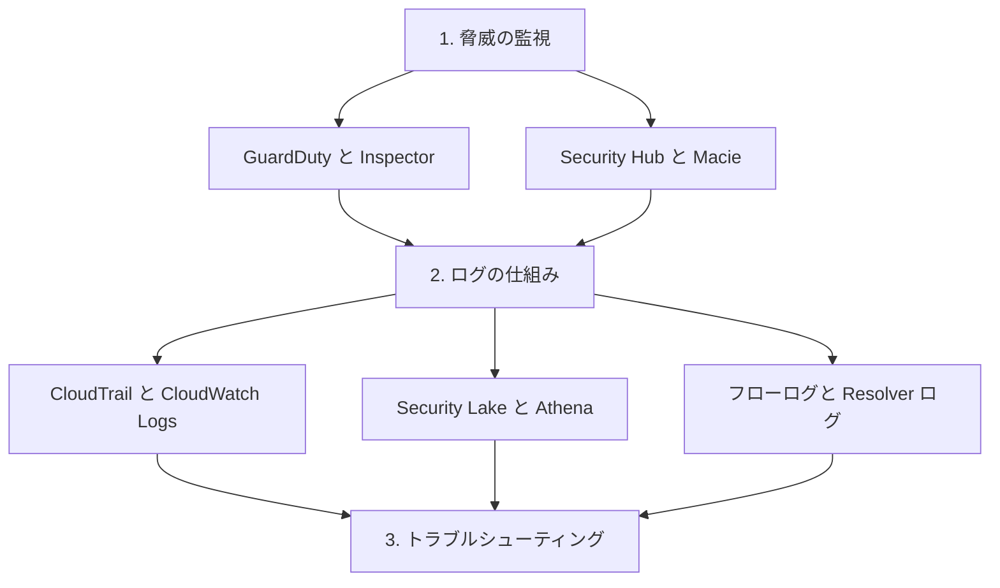

# 分野1: サービス別の学習

分野1（検出）は SCS-C03 の配点の 16% を占めます。何を監視するかを決め、ログを集め、検出できないときに直すまでを扱います。

脅威の監視から始めると、どのログが何のために必要かが分かりやすくなります。

| 順番 | 話題 | 問われること | 重要度 |
|---|---|---|---|
| 1 | [脅威の監視](threat-monitoring.md) | 要件に合うサービスの選択、組織での集約、アラート、定期的な評価 | 高 |
| 2 | [ログの仕組み](logging.md) | ログと保存先の選択、組織の証跡、Security Lake、分析、ネットワークのログ | 高 |
| 3 | [監視とログのトラブルシューティング](monitoring-troubleshooting.md) | ログが出ない原因の切り分け、権限と設定の修正 | 中 |

重要度は公式のスキル一覧を見たこの wiki の判断で、公式の数字ではありません。

## 他のサービスにまたがる問題 {#other-questions}

<!-- questions:start -->

この分野の問題は、すべてサービス別のページに載っています。

<!-- questions:end -->
