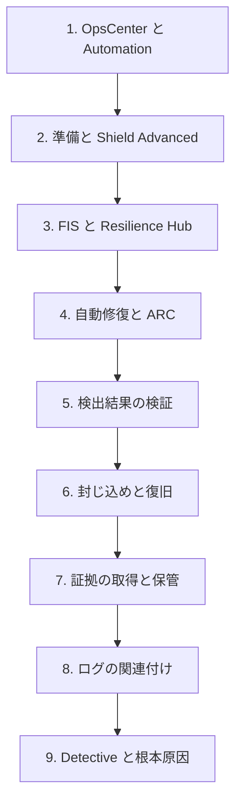

# 分野2: サービス別の学習

分野2（インシデント対応）は SCS-C03 の配点の 14% を占め、対応計画の準備と検証、実際の事象での証拠の保全、封じ込めと復旧を扱います。計画を先に学ぶと、後のページの手順が「いつ用意したものか」を意識して読めます。

| 順番 | サービス | 問われること | 重要度 |
|---|---|---|---|
| 1 | [インシデント対応計画](incident-planning.md) | ランブック、Shield Advanced の準備、FIS と Resilience Hub、自動修復の選択 | 高 |
| 2 | [検出結果の検証と封じ込め](containment.md) | 抑制ルール、影響範囲、NACL と SG、認証情報の失効、復旧 | 高 |
| 3 | [フォレンジックとログ調査](forensics.md) | 証拠の順序、スナップショットの共有、ログの関連付け、Detective | 高 |

重要度は公式のスキル一覧を見たこの wiki の判断で、公式の数字ではありません。上の図は学習の順番で、対応の現場の順番ではありません。現場の順番は[分野2のタスク 2.2](../../domain2.md#task-2-2)の図を確認してください。

## 他のサービスにまたがる問題 {#other-questions}

<!-- questions:start -->

この分野の問題は、すべてサービス別のページに載っています。

<!-- questions:end -->
