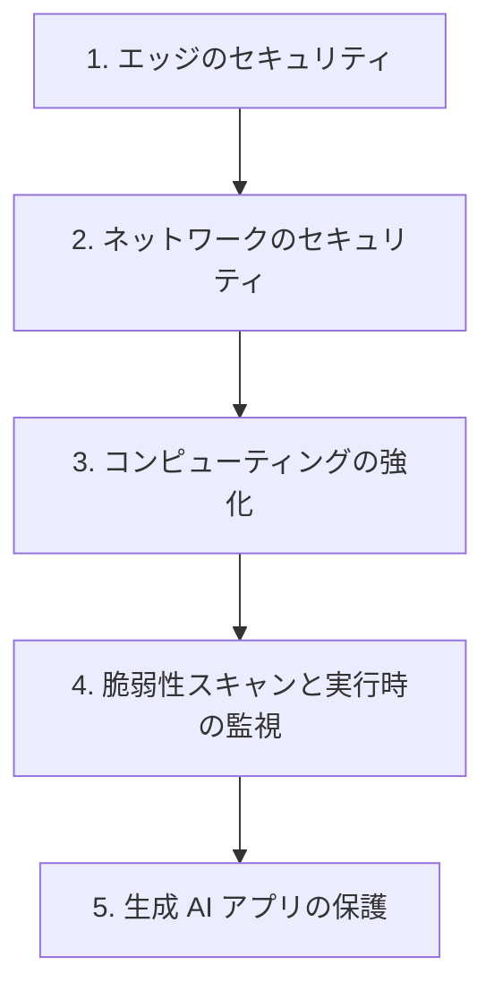

# 分野3: サービス別の学習

分野3（インフラストラクチャのセキュリティ）は SCS-C03 の配点の 18% を占め、エッジ、コンピューティング、ネットワークの3層を扱います。似た機能の使い分けと、動かないときの切り分けが中心です。

外側のエッジから順に内側へ進むと、どの層で何を止めるかを整理できます。生成 AI は C03 で追加された範囲なので、最後に単独で確認します。

| 順番 | 話題 | 問われること | 重要度 |
|---|---|---|---|
| 1 | [エッジのセキュリティ](edge-security.md) | WAF のルール、Shield Advanced の判断、オリジンの保護、OCSF | 高 |
| 2 | [ネットワークのセキュリティ](network-security.md) | Network Firewall、Direct Connect の暗号化、Verified Access、分割 | 高 |
| 3 | [コンピューティングの強化](compute-hardening.md) | イメージの強化、ロールの使い分け、パッチ、管理アクセス | 中 |
| 4 | [脆弱性スキャンと実行時の監視](vulnerability-scanning.md) | Inspector と GuardDuty の違い、カバレッジ、パイプライン | 中 |
| 5 | [生成 AI アプリの保護](genai-security.md) | OWASP LLM Top 10、Guardrails の限界と強制、AgentCore | 中 |

重要度は公式のスキル一覧を見たこの wiki の判断で、公式の数字ではありません。

## 他のサービスにまたがる問題 {#other-questions}

<!-- questions:start -->

この分野の問題は、すべてサービス別のページに載っています。

<!-- questions:end -->
