# 分野4: サービス別の学習

分野4（ID とアクセス管理）は SCS-C03 の配点の 20% で、6 分野の中で最大です。認証で「誰か」を決め、認可で「何ができるか」を決め、拒否の原因を切り分ける順に学びます。

```mermaid
flowchart TD
    A["1. Identity Center と Cognito"] --> B["2. STS と署名付き URL"]
    B --> C["3. 認証の切り分け"]
    C --> D["4. Verified Permissions と Roles Anywhere"]
    D --> E["5. ABAC と RBAC"]
    E --> F["6. 権限境界とセッションポリシー"]
    F --> G["7. 拒否メッセージの読み方"]
    G --> H["8. Access Analyzer"]
    H --> I["9. データ境界"]
```

| 順番 | サービス | 問われること | 重要度 |
|---|---|---|---|
| 1 | [認証](authentication.md) | ID ソースの選択、STS の API、署名付き URL、認証の切り分け | 高 |
| 2 | [認可](authorization.md) | 認可の統制の選択、ABAC と RBAC、権限の上限 | 高 |
| 3 | [アクセスの分析](access-analysis.md) | 拒否メッセージ、クロスアカウントの評価、Access Analyzer、データ境界 | 高 |

重要度は公式のスキル一覧を見たこの wiki の判断で、公式の数字ではありません。

## 他のサービスにまたがる問題 {#other-questions}

<!-- questions:start -->

この分野の問題は、すべてサービス別のページに載っています。

<!-- questions:end -->
