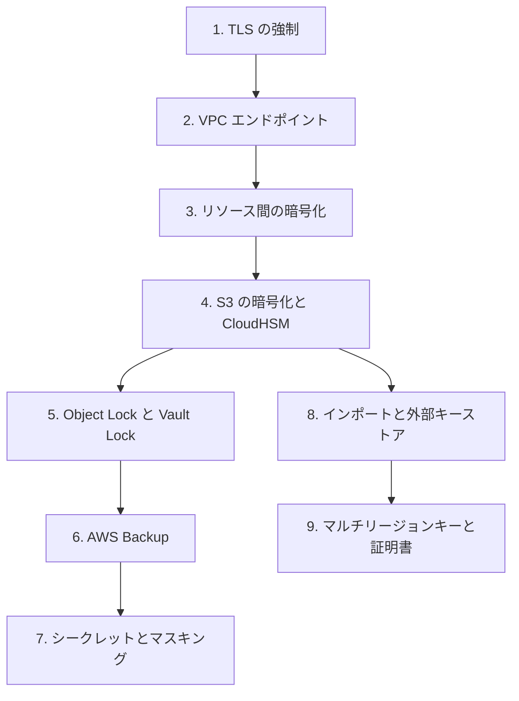

# 分野5: サービス別の学習

分野5（データ保護）は SCS-C03 の配点の 18% です。転送時と保存時の暗号化、完全性と保持、シークレットと鍵素材の管理を扱います。鍵をどのサービスで、誰の責任で持つかの判断が中心です。

| 順番 | サービス | 問われること | 重要度 |
|---|---|---|---|
| 1 | [転送時の暗号化](encryption-in-transit.md) | 強制の設定、プライベートな経路、Nitro と EMR と SageMaker AI | 中 |
| 2 | [保存時のデータ](data-at-rest.md) | 暗号化方式の選択、Object Lock、保持、バックアップの保護 | 高 |
| 3 | [鍵と証明書の管理](key-management.md) | インポートと外部キーストア、マルチリージョンキー、ACM、Private CA | 高 |
| 4 | [シークレットとマスキング](secrets-masking.md) | ローテーション、クロスアカウント、データ保護ポリシー | 中 |

重要度は公式のスキル一覧を見たこの wiki の判断で、公式の数字ではありません。

## 他のサービスにまたがる問題 {#other-questions}

<!-- questions:start -->

この分野の問題は、すべてサービス別のページに載っています。

<!-- questions:end -->
