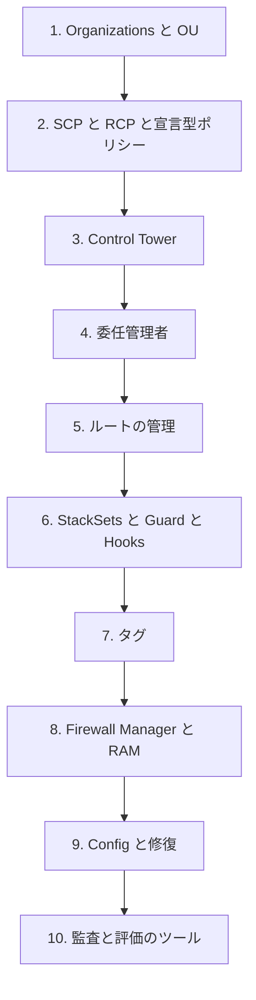

# 分野6: サービス別の学習

分野6（セキュリティの基盤とガバナンス）は SCS-C03 の配点の 14% です。マルチアカウントの土台、一貫した展開、準拠の評価を扱います。「止める」のか「見つける」のか「展開する」のかで、選ぶものが変わります。

| 順番 | サービス | 問われること | 重要度 |
|---|---|---|---|
| 1 | [Organizations と Control Tower](organizations.md) | ポリシーの効く範囲、コントロール、委任管理者、ルート | 高 |
| 2 | [一貫した展開](deployment.md) | StackSets、検証ツール、タグ、Firewall Manager、共有 | 中 |
| 3 | [準拠の評価](compliance.md) | Config と修復、Artifact と Audit Manager、ベストプラクティスの評価 | 中 |

重要度は公式のスキル一覧を見たこの wiki の判断で、公式の数字ではありません。

## 他のサービスにまたがる問題 {#other-questions}

<!-- questions:start -->

この分野の問題は、すべてサービス別のページに載っています。

<!-- questions:end -->
