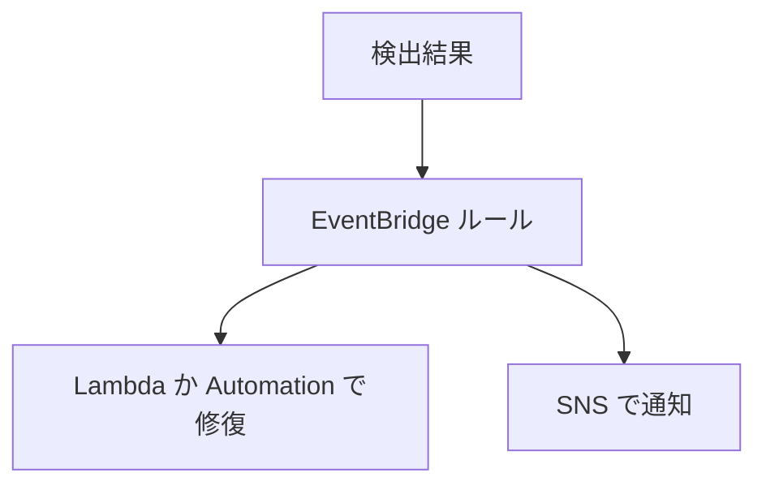

# 分野4: セキュリティとコンプライアンス

配点は **16%** です。

セキュリティの要件を定義するのは範囲外です。決まった要件を、IAM、Organizations、Config、KMS などで実装し、問題を直す力が問われます。

この分野に限らず、コース全体で使うサービスは[サービス一覧](services.md)から確認できます。

## タスク 4.1: セキュリティとコンプライアンスのツールとポリシーを実装、管理する {#task-4-1}

### 4.1.1 IAM の機能 {#skill-4-1-1}

**パスワードポリシー:**

| 項目 | 内容 |
|---|---|
| 既定 | 8〜128 文字、4 種類の文字のうち 3 種類以上、無期限 |
| カスタムの最小の長さ | 6〜128 文字 |
| 有効期限 | 1〜1,095 日 |
| 再利用の禁止 | 過去 1〜24 個 |
| 対象外 | ルートユーザーのパスワード、アクセスキー |
| ロックアウト | 設定できない。MFA を組み合わせる |

**反映のタイミング:** 長さや文字の要件は、次にパスワードを変えるときに効きます。有効期限はすぐに効きます。期限が切れてもアクセスキーは使えます。

**ほかの機能:**

| 機能 | 使う場面 |
|---|---|
| MFA | `aws:MultiFactorAuthPresent` で要求する |
| ロール | EC2 や Lambda に権限を渡す。長期のキーを置かない |
| フェデレーション | 社内の ID で AWS を使う。SAML、OIDC |
| リソースポリシー | S3 バケットや KMS キーの側で許可する |
| ポリシー条件 | `aws:SourceIp`、`aws:RequestedRegion`、`aws:PrincipalOrgID` など |
| 権限境界 | 開発者に作らせるロールの上限を決める |

**評価の順序:** 明示的な拒否が最優先です。許可がなければ拒否です。

**クロスアカウント:** 同じアカウントなら、アイデンティティベースかリソースベースのどちらかの許可で足ります。別のアカウントなら、両方が必要です。

パスワードポリシーは公式ドキュメントで確認して書いています。

詳細: [プリンシパル](../../services/iam.md#principals)、[アイデンティティベースとリソースベース](../../services/iam.md#identity-vs-resource)、[ポリシー評価](../../services/iam.md#policy-evaluation)、[条件](../../services/iam.md#conditions)、[主なグローバル条件キー](../../services/iam.md#condition-keys)、[MFA](../../services/iam.md#mfa)、[ロールの引き受け](../../services/iam.md#assume-role)、[フェデレーション](../../services/iam.md#federation)、[クロスアカウントアクセス](../../services/iam.md#cross-account)。公式: [パスワードポリシー](https://docs.aws.amazon.com/IAM/latest/UserGuide/id_credentials_passwords_account-policy.html)

### 4.1.2 アクセスの問題の調査と監査 {#skill-4-1-2}

| ツール | 答えられること | 限界 |
|---|---|---|
| CloudTrail | 誰がいつ何をして、どう失敗したか。`errorCode` が `AccessDenied` | 配信は平均で約 5 分遅れる。イベント履歴は 90 日 |
| IAM ポリシーシミュレーター | このポリシーで許可か拒否か | RCP は未対応。条件キーは自分で与える |
| IAM Access Analyzer | 外部に共有されたリソース、未使用のアクセス、ポリシーの検証 | アクセスログは見ない |
| `DecodeAuthorizationMessage` | エンコードされた拒否メッセージの中身 | 権限が必要 |

**切り分けの順序:**

1. CloudTrail で、拒否された操作、主体、リソースを確認します。
2. 拒否メッセージで、どのポリシーの種類かを確認します。
3. SCP、権限境界、セッションポリシー、リソースポリシーを順に確認します。
4. シミュレーターで修正案を試します。

**例:** 管理者権限のロールなのに拒否されます。メッセージに `service control policy` とあれば、SCP が原因です。IAM ポリシーを足しても直りません。

| 迷う組み合わせ | 見分け方 |
|---|---|
| シミュレーターと Access Analyzer | 特定の操作を試すならシミュレーター、外部への公開や未使用の権限を探すなら Access Analyzer |
| CloudTrail と Config | 誰が操作したかは CloudTrail、設定がどう変わったかは Config |

詳細: [IAM Access Analyzer](../../services/identity-directory.md#access-analyzer)、[外部アクセスの検出](../../services/identity-directory.md#aa-external)、[未使用アクセスの検出](../../services/identity-directory.md#aa-unused)、[ポリシーシミュレーター](../../services/iam.md#policy-simulator)、[アクセス拒否メッセージ](../../services/iam.md#access-denied-messages)、[DecodeAuthorizationMessage](../../services/iam.md#decode-authorization)、[アクセス拒否の切り分け](../../services/identity-directory.md#access-troubleshooting)、[CloudTrail の調査](../../services/threat-detection.md#investigate-cloudtrail)、[Config と CloudTrail の違い](../../services/governance.md#config-vs-cloudtrail)

### 4.1.3 マルチアカウントの戦略 {#skill-4-1-3}

| サービス | 役割 |
|---|---|
| Organizations | アカウントを OU にまとめ、ポリシーを適用する |
| SCP | 権限の上限を決める。権限は与えない |
| RCP | リソース側の上限を決める |
| IAM Identity Center | 1 か所のサインインで、複数アカウントへアクセスする |
| Control Tower | ランディングゾーンとコントロールを整える |

**SCP の落とし穴:**

| 落とし穴 | 内容 |
|---|---|
| 許可しない | SCP で許可しても、IAM の許可は別に必要 |
| 管理アカウント | SCP の影響を受けない |
| サービスリンクロール | 制限できない |
| 委任管理者 | メンバーアカウントなので影響を受ける |
| 上限 | 対象に 10 個、10,240 文字。古い教材の 5 個、5,120 文字は古い値 |
| 適用前の確認 | テスト用の OU にアカウントを少しずつ移す |

**Identity Center の権限セット:** 権限セットをアカウントに割り当てると、各アカウントに IAM ロールが作られます。ID ソースは、Identity Center 自体、Active Directory、外部の IdP から選びます。

**Control Tower のコントロール:**

| 動作 | 働き | 実装 |
|---|---|---|
| 予防的 | 操作を止める | SCP、RCP、宣言型ポリシー |
| 検出的 | 違反を見つける | Config ルール |
| プロアクティブ | 作成前に確認し、不適合なら作らない | CloudFormation Hooks |

詳細: [Organizations](../../services/governance.md#organizations)、[OU の設計](../../services/governance.md#org-ous)、[ポリシーの種類](../../services/governance.md#org-policy-types)、[SCP](../../services/governance.md#scp)、[RCP](../../services/governance.md#rcp)、[委任管理者](../../services/governance.md#delegated-admin)、[Control Tower](../../services/governance.md#control-tower)、[コントロール](../../services/governance.md#ct-controls)、[Identity Center](../../services/identity-directory.md#identity-center)、[権限セット](../../services/identity-directory.md#idc-permission-sets)、[マルチアカウントのパターン](../../services/governance.md#multi-account-patterns)

### 4.1.4 Trusted Advisor のセキュリティチェックと修復 {#skill-4-1-4}

| チェック | 修復 |
|---|---|
| ルートアカウントの MFA | ルートに MFA を設定する |
| S3 バケットの権限 | ブロックパブリックアクセスを有効にし、ポリシーを直す |
| EBS の公開スナップショット | 共有の設定を非公開にする |
| RDS の公開スナップショット | 共有の設定を非公開にする |
| セキュリティグループの無制限な開放 | 特定のポートを `0.0.0.0/0` から必要な範囲へ絞る |

上は Basic のプランで使えるチェックです。全チェックと API は Business Support+ 以上です。

**Trusted Advisor は助言するだけで、自動では直しません。** 自動で修復するには、結果の変化を EventBridge で受け、Lambda か Automation を動かします。イベントは `us-east-1` の EventBridge に届き、配信はベストエフォートです。

**例:** 開放された SSH の指摘が続きます。EventBridge のルールで Trusted Advisor の変化を受け、Automation で該当のルールを削除します。

組織全体のレポートは Organizational view で作ります。

| 迷う組み合わせ | 見分け方 |
|---|---|
| Trusted Advisor と Security Hub CSPM | 幅広い助言なら Trusted Advisor、基準に対する継続的な準拠チェックなら Security Hub CSPM |
| Trusted Advisor と Health Dashboard | 自分の設定の改善なら Trusted Advisor、AWS 側の障害の影響なら Health Dashboard |

詳細: [Trusted Advisor](../../services/cloud-foundations.md#trusted-advisor)、[Health Dashboard](../../services/cloud-foundations.md#health)、[S3 のブロックパブリックアクセス](../../services/s3.md#block-public-access)、[セキュリティグループのルール](../../services/networking.md#security-group-rules)

### 4.1.5 コンプライアンスと継続的な監視 {#skill-4-1-5}

**リージョンとサービスの制限:**

| 手段 | 動き |
|---|---|
| SCP の `aws:RequestedRegion` | 許可しないリージョンの操作を拒否する |
| Control Tower のリージョン拒否 | ランディングゾーンで管理する |
| SCP の `Deny` | 使わせないサービスを止める |

**例:** リージョンを制限する SCP を作るときは、IAM や Organizations などのグローバルサービスを `NotAction` で除きます。除かないと、グローバルサービスの操作まで止まります。

**AWS Config:**

| 機能 | 内容 |
|---|---|
| レコーダー | リソースの設定と変更を記録する |
| ルール | マネージドかカスタム。変更時か定期に評価する |
| 修復 | Automation のドキュメントで手動か自動で直す |
| 適合パック | ルールと修復を 1 つにまとめて展開する |
| アグリゲーター | 複数のアカウントとリージョンを集約して見る |

**Config は止めません。** プロアクティブ評価でも、判定するだけです。操作を止めるなら、SCP か Control Tower のプロアクティブコントロールを使います。

**適合パックの上限:** 1 パックあたり 130 ルール、アカウントあたり 50 パックです。パックは展開、アグリゲーターは閲覧です。

**自動修復の設定:** `MaximumAutomaticAttempts` は既定 5 回、`RetryAttemptSeconds` と組み合わせます。超えると止まります。実行ロールの権限不足もよくある失敗です。

詳細: [SCP](../../services/governance.md#scp)、[主なグローバル条件キー](../../services/iam.md#condition-keys)、[NotAction](../../services/iam.md#notaction)、[AWS Config](../../services/governance.md#config)、[レコーダー](../../services/governance.md#config-recorder)、[ルール](../../services/governance.md#config-rules)、[修復](../../services/governance.md#config-remediation)、[アグリゲーター](../../services/governance.md#config-aggregators)、[適合パック](../../services/governance.md#config-conformance-packs)

## タスク 4.2: データとインフラストラクチャを保護する {#task-4-2}

### 4.2.1 データ分類 {#skill-4-2-1}

分類の基準を決めるのは範囲外です。決まった基準を実装します。

| 手順 | 手段 |
|---|---|
| タグで分類を示す | `DataClassification=confidential` など。タグポリシーで値を統一する |
| タグを強制する | Config の `required-tags`、Control Tower |
| S3 の機密データを見つける | Macie |
| アクセスを制限する | タグの条件を使う ABAC、バケットポリシー |
| ログの機密情報を隠す | CloudWatch Logs のデータ保護ポリシー |

| 分類 | 例 |
|---|---|
| PII | 氏名、住所、メールアドレス |
| PHI | 診療記録、検査結果 |
| 機密（業務） | 認証情報、暗号鍵、財務情報 |
| 公開 | カタログ情報 |

**Macie:** S3 のデータから機密データを検出します。カスタムデータ識別子で `EMP-[0-9]{6}` のような社内の形式も検出します。検出結果は EventBridge や Security Hub へ送れます。

**Macie が検査できないとき:** KMS で暗号化したオブジェクトは、Macie がそのキーを使えることが必要です。バケットポリシーでの拒否も確認します。

詳細: [データ分類](../../services/secrets.md#data-classification)、[Macie](../../services/threat-detection.md#macie)、[識別子と許可リスト](../../services/threat-detection.md#macie-identifiers)、[検出結果](../../services/threat-detection.md#macie-findings)、[タグ戦略](../../services/governance.md#tagging-strategy)、[タグポリシー](../../services/governance.md#tag-policies)、[CloudWatch Logs のデータ保護](../../services/observability.md#logs-data-protection)

### 4.2.2 保存時の暗号化 {#skill-4-2-2}

| キーの種類 | 管理 | ポリシーの変更 | ローテーション |
|---|---|---|---|
| AWS 管理キー | AWS | 不可 | 自動 |
| カスタマー管理キー | 自分 | 可 | 任意で有効化。期間を指定できる |

**サービスごとの暗号化:**

| サービス | 手順 |
|---|---|
| S3 | バケットのデフォルト暗号化。`SSE-S3`、`SSE-KMS`。KMS の呼び出しは Bucket Key で減らす |
| EBS | リージョンの「デフォルトでの暗号化」。既存はスナップショットをコピーして暗号化する |
| RDS | 作成時に指定する。既存はスナップショットを暗号化してコピーし、復元する |
| EFS | 作成時のみ。既存は別のファイルシステムへレプリケートする |

**トラブルシューティング:**

| 症状 | 原因と対処 |
|---|---|
| `AccessDeniedException` | キーポリシー、IAM、グラントのいずれにも許可がない |
| `KMSInvalidStateException` | キーが削除待ちなど。`cancel-key-deletion` で取り消す |
| `DisabledException` | キーが無効。有効にする |
| `ThrottlingException` | リクエストの上限超過。S3 Bucket Key やキャッシュを使う |
| EC2 が `pending` から `terminated` へ | EBS のキーの権限がない |
| 別アカウントで復号できない | キーポリシーと、相手側の IAM の両方で許可する |
| 別リージョンで使えない | キーはリージョンごと。マルチリージョンキーか再暗号化する |

**キーの削除:** すぐには消えず、7〜30 日の待機期間があります。一度削除すると、暗号化したデータは戻りません。監査は CloudTrail で行います。

詳細: [保存時と転送時の暗号化](../../services/kms.md#at-rest-in-transit)、[KMS キーの種類](../../services/kms.md#key-types)、[キーポリシー、IAM、グラント](../../services/kms.md#access-control)、[サービスでの利用](../../services/kms.md#service-integration)、[ローテーション](../../services/kms.md#key-rotation)、[無効化と削除](../../services/kms.md#disable-delete)、[主なエラー](../../services/kms.md#kms-errors)、[マルチリージョンキー](../../services/kms.md#multi-region-keys)、[アカウントをまたぐ手順](../../services/kms.md#cross-account-steps)、[CloudTrail での監査](../../services/kms.md#kms-cloudtrail)、[EBS の暗号化](../../services/storage.md#ebs-encryption)、[S3 の暗号化](../../services/s3.md#encryption)

### 4.2.3 転送時の暗号化 {#skill-4-2-3}

| 課題 | 手順 |
|---|---|
| ALB で HTTPS を終端する | ACM の証明書をリスナーに設定する |
| CloudFront に証明書を付ける | `us-east-1` の ACM に作る |
| S3 で HTTPS を強制する | バケットポリシーで `aws:SecureTransport` が `false` の要求を拒否する |
| EFS の暗号化 | マウントオプション `tls` |
| RDS で TLS を強制する | パラメータグループと、クライアントの設定 |
| 社内用の証明書 | AWS Private CA |

**ACM の運用:**

| 症状 | 原因と対処 |
|---|---|
| CloudFront で証明書が選べない | `us-east-1` 以外で作っている |
| 証明書が更新されない | DNS の CNAME が消えた、統合サービスで使っていない |
| 検証が終わらない | DNS の CNAME を追加していない |
| インポートした証明書が切れた | ACM は更新しない。`DaysToExpiry` のアラームで監視する |

**監視:** `DaysToExpiry` メトリクスと、EventBridge の `ACM Certificate Approaching Expiration` を使います。

**ALB の TLS:** 古い TLS を止めるには、リスナーのセキュリティポリシーを変えます。CloudFront の 502 は、オリジンの証明書の問題が多くあります。

詳細: [ACM](../../services/certificates.md#acm)、[ドメイン検証](../../services/certificates.md#domain-validation)、[自動更新](../../services/certificates.md#auto-renewal)、[リージョンのルール](../../services/certificates.md#region-rules)、[統合サービス](../../services/certificates.md#integrated-services)、[更新の監視](../../services/certificates.md#renewal-monitoring)、[転送時の TLS](../../services/certificates.md#tls-in-transit)、[Private CA](../../services/certificates.md#private-ca)、[CloudFront の HTTPS](../../services/networking.md#cloudfront-https)、[CloudFront のエラー](../../services/networking.md#cloudfront-errors)、[RDS の SSL/TLS](../../services/databases.md#rds-ssl)

### 4.2.4 シークレットの保存 {#skill-4-2-4}

| 観点 | Secrets Manager | Parameter Store |
|---|---|---|
| 主な用途 | 資格情報、API キー | 設定値、低リスクの秘密情報 |
| 自動ローテーション | あり | なし |
| 暗号化 | KMS で必須 | `SecureString` と KMS で任意 |
| 料金 | シークレット単位の月額と API 呼び出し | スタンダードは無料 |
| 別リージョンへの複製 | あり | なし |

**ローテーションの方式:**

| 方式 | 対象 | Lambda |
|---|---|---|
| マネージドローテーション | 他のサービスが管理するシークレット（RDS など） | 不要 |
| Lambda 関数によるローテーション | その他のシークレット | 必要 |

**落とし穴:**

| 症状 | 確認すること |
|---|---|
| ローテーションで失敗する | Lambda から DB と Secrets Manager への経路、権限 |
| 別アカウントから読めない | リソースポリシーと KMS のキーポリシー。AWS 管理キーのシークレットは共有できない |
| 誤って削除した | 復旧期間（7〜30 日）の間は戻せる |

**動的参照:** CloudFormation に平文で書かず、`{{resolve:secretsmanager:...}}` で参照します。

詳細: [3 つのサービスの比較](../../services/secrets.md#comparison)、[Secrets Manager](../../services/secrets.md#secrets-manager)、[ローテーション](../../services/secrets.md#rotation)、[クロスアカウント](../../services/secrets.md#secrets-cross-account)、[削除と復旧](../../services/secrets.md#recovery-window)、[他リージョンへの複製](../../services/secrets.md#secret-replication)、[Parameter Store](../../services/secrets.md#parameter-store)、[動的参照](../../services/secrets.md#dynamic-references)、[RDS との統合](../../services/databases.md#rds-secrets-manager)

### 4.2.5 検出結果のレポートと修復 {#skill-4-2-5}

| サービス | 何を検出するか | 主なデータや対象 |
|---|---|---|
| GuardDuty | 脅威。不審な通信や認証情報の悪用 | CloudTrail、VPC フローログ、DNS ログ。ログの有効化は不要 |
| Inspector | 脆弱性 | EC2、ECR、Lambda |
| Macie | S3 の機密データ | S3 のオブジェクト |
| Config | 設定の準拠 | リソースの設定 |
| Security Hub CSPM | 基準に対する設定のチェックと集約 | Config のルール、AWS サービス |
| Security Hub | 信号を関連付けてリスクを優先付け | CSPM、GuardDuty、Inspector、Macie、Access Analyzer |
| Security Agent | 開発中のアプリのレビューと侵入テスト | 設計文書、コード、URL |

!!! note "Security Hub と Security Agent の名前"
    現在は、2025年12月に一般提供された Security Hub と、従来の製品である Security Hub CSPM の 2 つがあります。古い教材の Security Hub は CSPM を指します。AWS Security Agent は、現在 AWS Continuum の一部です。

**共通の修復の流れ:**

**サービスごとの要点:**

| 場面 | 手段 |
|---|---|
| GuardDuty の結果を全部集める | 組織の委任管理者。管理者の EventBridge にメンバーの結果も届く |
| GuardDuty の既知の誤検知を隠す | 抑制ルール |
| GuardDuty の更新の通知を早める | 既定 6 時間を 15 分か 1 時間へ変更（管理者のみ） |
| Security Hub の重要度を自動で変える | 自動化ルール。EventBridge より先に適用される |
| 人の判断の後で修復する | Security Hub のカスタムアクション |
| Inspector の結果を隠す | 抑制ルール。表示を隠すだけで閉じない |

**例:** `CryptoCurrency:EC2/BitcoinTool.B!DNS` が出ました。EventBridge で受け、Lambda で隔離用のセキュリティグループに付け替えます。証拠のためスナップショットも取ります。

**AWS Security Agent:** 組織のセキュリティ要件を一度定義すると、設計とコードのレビューで検証します。脅威モデルの作成や、オンデマンドの侵入テストも行います。

GuardDuty、Inspector、Macie の違いが最もよく問われます。

Security Agent は公式ドキュメントで確認して書いています。

詳細: [選び方の比較](../../services/threat-detection.md#choosing)、[GuardDuty](../../services/threat-detection.md#guardduty)、[GuardDuty の検出結果](../../services/threat-detection.md#guardduty-findings)、[抑制ルール](../../services/threat-detection.md#guardduty-suppression)、[イベント連携](../../services/threat-detection.md#guardduty-events)、[Security Hub](../../services/threat-detection.md#security-hub)、[製品の現在の形](../../services/threat-detection.md#security-hub-products)、[Security Hub の自動化](../../services/threat-detection.md#security-hub-automation)、[Inspector](../../services/threat-detection.md#inspector)、[Inspector の検出結果](../../services/threat-detection.md#inspector-findings)、[EC2 の隔離](../../services/threat-detection.md#ir-ec2-isolation)、[Config の修復](../../services/governance.md#config-remediation)。公式: [AWS Security Agent](https://docs.aws.amazon.com/securityagent/latest/userguide/what-is.html)

## 確認問題 {#self-check}

??? question "問1: 開発者のロールに `AdministratorAccess` が付いていますが、`us-west-2` で EC2 を起動すると拒否されます。アカウントのルールは変更していません。どこから調べますか？"
    CloudTrail で拒否された操作を確認し、拒否メッセージで SCP が原因かを確認します。組織のルート、OU、アカウントに付いた SCP の `aws:RequestedRegion` の条件が、最も疑わしい原因です。IAM ポリシーを足しても、SCP の拒否は変わりません。

??? question "問2: 全 S3 バケットで公開設定を監視し、違反したら自動で止めたいです。監査のため、複数のルールをまとめて各アカウントに展開したいです。何を組み合わせますか？"
    AWS Config の適合パックで、`s3-bucket-public-read-prohibited` などのルールと修復をまとめて展開します。修復には Automation の `AWS-DisableS3BucketPublicReadWrite` を自動で実行します。閲覧をまとめるならアグリゲーターも使います。

??? question "問3: カスタマー管理キーを削除予定にしたところ、関連する EBS を使うインスタンスが起動しなくなりました。まだ待機期間中です。どうしますか？"
    `cancel-key-deletion` で削除を取り消し、キーを有効にします。待機期間（7〜30 日）の間なら取り消せます。期間が過ぎて削除されると、そのキーで暗号化したデータは復号できません。

??? question "問4: 東京の ALB と CloudFront の両方に、同じドメインの ACM 証明書を設定したいです。東京で作った証明書が CloudFront の画面に出てきません。どうしますか？"
    CloudFront の証明書は `us-east-1` に作ります。証明書はリージョンごとのリソースなので、ALB 用は東京に、CloudFront 用は `us-east-1` に、それぞれ発行します。

??? question "問5: RDS のパスワードを 30 日ごとに自動で変更し、アプリには常に最新の値を使わせたいです。Parameter Store の `SecureString` に保存中です。どう変えますか？"
    Secrets Manager に移し、ローテーションを有効にします。アプリは実行時にシークレットを取得するように、参照先を変更します。Parameter Store には自動ローテーションがありません。RDS が管理するシークレットなら、Lambda の用意も不要です。

??? question "問6: GuardDuty の検出結果を受けて、組織の全アカウントの EC2 を自動で隔離したいです。どのアカウントにルールを作りますか？"
    GuardDuty の委任管理者アカウントで EventBridge ルールを作ります。管理者にはメンバーの検出結果も届くからです。ターゲットの Lambda か Automation は、各アカウントのロールを引き受けて、隔離用のセキュリティグループへ付け替えます。
