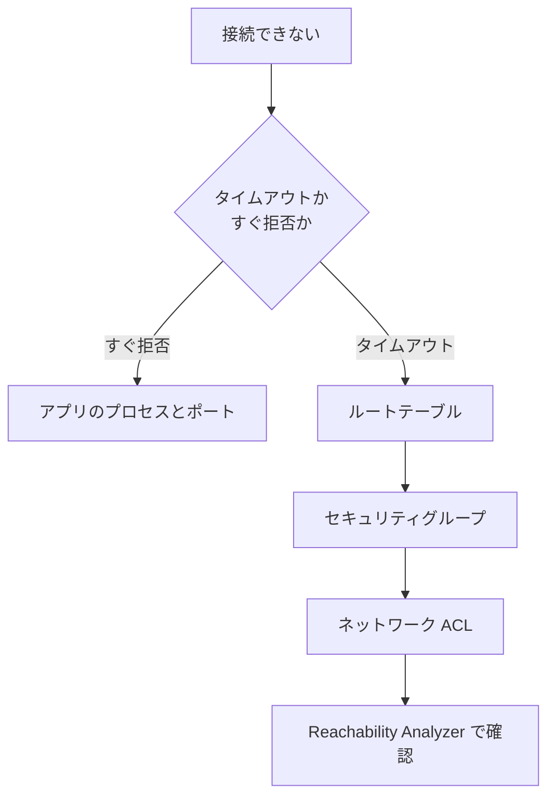

# 分野5: ネットワークとコンテンツ配信

配点は **18%** です。

ネットワークの設計は範囲外です。VPC を設定し、DNS と配信を整え、つながらないときに原因を切り分ける力が問われます。

[](../../assets/diagrams/networking-vpc.png)

この分野に限らず、コース全体で使うサービスは[サービス一覧](services.md)から確認できます。

## タスク 5.1: ネットワークの機能と接続を実装、最適化する {#task-5-1}

### 5.1.1 VPC の設定 {#skill-5-1-1}

| 部品 | 役割 | 間違えやすい点 |
|---|---|---|
| サブネット | AZ ごとの IP の範囲 | 5 個の IP は使えない |
| ルートテーブル | 次の経路を決める | 最長一致が優先 |
| インターネットゲートウェイ | IPv4、IPv6 の双方向 | パブリック IP も必要 |
| NAT ゲートウェイ | プライベートから外へ（IPv4） | AZ ごとに置く。SG は付けられない |
| Egress-only インターネットゲートウェイ | IPv6 の外向きのみ | IPv4 には使わない |
| セキュリティグループ | ENI 単位、ステートフル | 許可のみ |
| ネットワーク ACL | サブネット単位、ステートレス | 戻りのエフェメラルポートも開ける |

| 観点 | セキュリティグループ | ネットワーク ACL |
|---|---|---|
| 戻りの通信 | 自動で許可 | 明示的に許可 |
| ルール | 許可のみ。全部を評価 | 許可と拒否。番号の小さい順 |
| 特定の IP を拒否 | できない | できる |

**例:** プライベートサブネットからインターネットへ出られません。ルートテーブルの `0.0.0.0/0` の先が NAT ゲートウェイか、NAT がパブリックサブネットにあるか、そのサブネットの経路が IGW かを確認します。

**例:** IPv6 の EC2 から外へだけ通信させます。`::/0` を Egress-only インターネットゲートウェイへ向けます。

**VPC の DNS 属性:** プライベート DNS やエンドポイントのプライベート DNS には、DNS 解決と DNS ホスト名の両方を有効にします。

**VPN と Client VPN:** 旧版のタスク 4.2 から移ってきた範囲です。[5.1.2](#skill-5-1-2) を確認します。

詳細: [VPC の基本](../../services/networking.md#vpc)、[サブネットとルートテーブル](../../services/networking.md#subnets-route-tables)、[セキュリティグループと NACL](../../services/networking.md#security-groups-nacls)、[SG のルール](../../services/networking.md#security-group-rules)、[NACL のルール](../../services/networking.md#nacl-rules)、[VPC の DNS 属性](../../services/networking.md#vpc-dns-attributes)、[NAT ゲートウェイ](../../services/network-connectivity.md#nat-gateway)、[IPv6 と Egress-only](../../services/network-connectivity.md#ipv6)、[VPC の CIDR](../../services/network-connectivity.md#vpc-cidr)、[Elastic IP](../../services/network-connectivity.md#elastic-ip)

### 5.1.2 プライベート接続 {#skill-5-1-2}

| 要件 | 選択 |
|---|---|
| VPC から S3、DynamoDB へ無料で | ゲートウェイエンドポイント |
| VPC から他の AWS サービスへ | インターフェイスエンドポイント |
| 自社のサービスを他の VPC へ公開、CIDR の重複あり | PrivateLink（NLB の裏に置く） |
| 2、3 個の VPC を接続 | VPC ピアリング |
| 多数の VPC を接続 | Transit Gateway |
| オンプレミスと今日から接続 | Site-to-Site VPN |
| 利用者の端末から VPC へ | Client VPN |

**ゲートウェイとインターフェイス:**

| 観点 | ゲートウェイ | インターフェイス |
|---|---|---|
| 仕組み | ルートテーブルにルートを追加 | サブネットに ENI を作る |
| 料金 | 追加料金なし | 時間とデータ量 |
| 制御 | エンドポイントポリシー | エンドポイントポリシーと SG |

**VPC ピアリングの落とし穴:**

- 推移しません。A-B、B-C があっても A-C は通りません。
- CIDR が一部でも重複すると作れません。
- 両方のルートテーブルに経路を追加します。
- 相手の IGW や NAT は使えません。

**Site-to-Site VPN:** 1 接続に 2 本のトンネルがあります。BGP が使える機器なら動的ルーティングを選びます。VPC 側は VGW か Transit Gateway です。

**Client VPN:** 接続のためのルートと、認可ルールの両方を設定します。クライアントの CIDR は `/22` 以上です。

詳細: [VPC エンドポイントと PrivateLink](../../services/networking.md#vpc-endpoints)、[エンドポイントの選び方](../../services/networking.md#endpoint-settings)、[エンドポイントポリシー](../../services/networking.md#endpoint-policies)、[VPC ピアリング](../../services/network-connectivity.md#vpc-peering)、[Transit Gateway](../../services/network-connectivity.md#transit-gateway)、[Site-to-Site VPN](../../services/network-connectivity.md#site-to-site-vpn)、[Client VPN](../../services/network-connectivity.md#client-vpn)、[VPC 同士の接続の選び方](../../services/network-connectivity.md#choosing-multi-vpc)、[オンプレミスとの接続の選び方](../../services/network-connectivity.md#choosing-hybrid)

### 5.1.3 ネットワーク保護サービスの監査 {#skill-5-1-3}

スキルの範囲は単一アカウントの監査です。何をどのログで確認するかを押さえます。

| サービス | 守る層 | 監査で見るもの |
|---|---|---|
| WAF | HTTP（ALB、CloudFront、API Gateway） | ウェブ ACL のログ、サンプルリクエスト、ルールのメトリクス |
| Shield Standard | ネットワーク層の DDoS | 自動で有効。設定は不要 |
| Shield Advanced | 指定したリソースの DDoS | 保護の対象、攻撃の履歴 |
| Network Firewall | VPC の出入り（IP、ドメイン、IPS） | アラートログ、フローログ、TLS ログ |
| DNS Firewall | VPC Resolver のドメイン名 | Resolver クエリログ、ルールグループの関連付け |

**選ぶときの見分け方:**

| 要件 | 選択 |
|---|---|
| SQL インジェクションや IP ごとのレート制限 | WAF |
| VPC からマルウェアのドメインへの問い合わせを止める | DNS Firewall |
| IP 宛の通信や、DNS 以外のプロトコルも止める | Network Firewall |
| 大規模な DDoS と専門チームの支援 | Shield Advanced |

**WAF の落とし穴:** ログの送信先の名前は `aws-waf-logs-` で始めます。違うと選べません。

**DNS Firewall の落とし穴:** 既定はフェイルクローズです。CNAME の連鎖の先のドメインも、許可が必要です。独自の DNS サーバーや IP 直接の通信はすり抜けます。

**Network Firewall の落とし穴:** ファイアウォールは専用のサブネットに置き、ルートテーブルで通信を通します。経路が通らないと検査されません。

詳細: [AWS WAF](../../services/certificates.md#waf)、[ウェブ ACL](../../services/certificates.md#web-acl)、[WAF のログ](../../services/certificates.md#waf-logging)、[WAF の監視](../../services/certificates.md#waf-monitoring)、[Shield](../../services/threat-detection.md#shield)、[Network Firewall](../../services/network-connectivity.md#network-firewall)、[Network Firewall のルーティング](../../services/network-connectivity.md#nfw-routing)、[ログと TLS](../../services/threat-detection.md#nfw-logging)、[DNS Firewall](../../services/network-connectivity.md#dns-firewall)

### 5.1.4 ネットワークのコスト最適化 {#skill-5-1-4}

| 経路 | 料金 |
|---|---|
| インターネットから AWS へ | 無料 |
| 同じ AZ 内 | 無料 |
| AZ 間 | 有料。送受信の両方 |
| リージョン間 | 送信元で有料 |
| AWS からインターネットへ | 有料。月 100 GB まで無料 |

| よくある費用 | 減らし方 |
|---|---|
| NAT 経由の S3、DynamoDB の通信 | ゲートウェイエンドポイント（無料） |
| NAT と別の AZ のリソースの通信 | リソースと同じ AZ に NAT を置く |
| パブリック IPv4 | 1 個あたり 0.005 USD/時。使わないものを解放し、IPv6 を検討 |
| インターフェイスエンドポイント | 通信量が多ければ NAT と比較する |
| 大量の VPN の転送 | Direct Connect を検討する |
| 配信の転送料 | CloudFront でキャッシュする |

**トレードオフ:** NAT を 1 つにまとめると安くなりますが、その AZ の障害で全体の外向き通信が止まります。AZ 間の通信を減らすと、可用性が下がることもあります。

**確認:** IPAM で公開 IP の使用状況を確認できます。フローログで通信量の多い組み合わせを探します。

詳細: [データ転送の費用](../../services/cost-management.md#data-transfer)、[NAT ゲートウェイ](../../services/network-connectivity.md#nat-gateway)、[Elastic IP](../../services/network-connectivity.md#elastic-ip)、[IPAM](../../services/network-connectivity.md#ipam)、[VPC エンドポイント](../../services/networking.md#vpc-endpoints)

## タスク 5.2: ドメイン、DNS、コンテンツ配信を設定する {#task-5-2}

### 5.2.1 DNS の設定 {#skill-5-2-1}

Route 53 Resolver は、現在の AWS のドキュメントでは VPC Resolver と呼ばれることがあります。

VPC の既定のリゾルバーは、VPC の CIDR に 2 を足したアドレスです（`10.0.0.0/16` なら `10.0.0.2`）。

| 要件 | 選択 |
|---|---|
| オンプレミスから VPC のプライベートホストゾーンを引く | インバウンドエンドポイント |
| VPC からオンプレミスの名前を引く | アウトバウンドエンドポイントと転送ルール |
| 転送ルールを他のアカウントでも使う | AWS RAM で共有 |
| VPC の中だけで使う名前 | プライベートホストゾーン |

| 要素 | ポイント |
|---|---|
| インバウンドの SG | 受信で TCP、UDP の 53 を許可 |
| アウトバウンドの SG | 送信で TCP、UDP の 53 を許可 |
| IP の数 | 最低 2 個。2 つの AZ に置くことを推奨 |
| VPC+2 へのオンプレミスからの転送 | 非対応。インバウンドエンドポイントを使う |

**プライベートホストゾーンで名前が引けないとき:** VPC に関連付けたか、DNS 解決と DNS ホスト名を有効にしたかを確認します。

**例:** オンプレミスの DNS サーバーで、`aws.corp.example.com` をインバウンドエンドポイントの IP へ条件付きで転送します。

詳細: [VPC Resolver](../../services/network-connectivity.md#vpc-resolver)、[エンドポイント](../../services/network-connectivity.md#resolver-endpoints)、[転送ルール](../../services/network-connectivity.md#resolver-rules)、[プライベートホストゾーン](../../services/network-connectivity.md#private-hosted-zones)、[ハイブリッド DNS](../../services/network-connectivity.md#hybrid-dns)、[VPC の DNS 属性](../../services/networking.md#vpc-dns-attributes)

### 5.2.2 Route 53 のルーティングポリシーとログ {#skill-5-2-2}

| 要件 | ポリシー |
|---|---|
| 単一のリソース | シンプル |
| 割合で分ける、カナリア | 加重 |
| 最も遅延の小さいリージョンへ | レイテンシー |
| アクティブとパッシブの切り替え | フェイルオーバー |
| 利用者の国や地域で振り分け（法令、言語） | 位置情報 |
| リソースの位置で範囲を調整 | 地理的近接性 |
| 利用者の IP 範囲で振り分け | IP ベース |
| 最大 8 個の正常なレコードをランダムに返す | 複数値回答 |

**レコード:** ALB や CloudFront にはエイリアスを使います。追加料金なしで、ゾーンの頂点でも使えます。CNAME はゾーンの頂点に作れません。

**切り替えの速さ:** DNS はキャッシュされるので、TTL に左右されます。

**クエリログの 2 種類:**

| 種類 | 対象 | 送信先 |
|---|---|---|
| パブリック DNS のクエリログ | Route 53 が受けた、公開ホストゾーンへの問い合わせ | CloudWatch Logs |
| Resolver クエリログ | VPC からの問い合わせ、エンドポイント経由の問い合わせ、DNS Firewall の結果 | CloudWatch Logs、S3、Firehose |

**パブリック DNS のクエリログの注意:** リゾルバーがキャッシュしている間は、Route 53 に届かないので記録されません。すべての問い合わせは残りません。

ロググループは `us-east-1` に作ります。リソースポリシーで Route 53 に書き込みを許可します。

**注意:** Resolver クエリログは、Amazon DNS サーバーを使う通信の調査に使います。VPC フローログには、Amazon DNS サーバーへの問い合わせが記録されません。

パブリック DNS のクエリログと Resolver クエリログは、公式ドキュメントで確認して書いています。

詳細: [Route 53](../../services/networking.md#route53)、[レコード](../../services/networking.md#route53-records)、[ルーティングポリシー](../../services/networking.md#routing-policies)、[TTL とエイリアス](../../services/networking.md#route53-ttl)、[ポリシーの設定](../../services/networking.md#routing-settings)。公式: [パブリック DNS のクエリログ](https://docs.aws.amazon.com/Route53/latest/DeveloperGuide/query-logs.html)、[Resolver クエリログ](https://docs.aws.amazon.com/Route53/latest/DeveloperGuide/resolver-query-logs.html)

### 5.2.3 CloudFront と Global Accelerator {#skill-5-2-3}

| 観点 | CloudFront | Global Accelerator |
|---|---|---|
| 層 | レイヤー 7（HTTP、HTTPS） | レイヤー 4（TCP、UDP） |
| キャッシュ | あり | なし |
| 入口 | DNS 名 | 固定のエニーキャスト IP（IPv4 が 2 個） |
| 向く通信 | 静的コンテンツ、動画、Web | 非 HTTP、固定 IP が必要、動的な API |
| 切り替え | オリジンフェイルオーバー | 正常なエンドポイントへ。DNS のキャッシュに左右されない |

**CloudFront の設定:**

| 課題 | 設定 |
|---|---|
| S3 オリジンを直接公開しない | OAC とバケットポリシー |
| パスごとに動作を変える | ビヘイビア |
| オリジンの障害に備える | オリジングループ。`GET`、`HEAD`、`OPTIONS` のみ切り替わる |
| 独自ドメイン | 代替ドメイン名と `us-east-1` の ACM 証明書 |
| 国で制限する | 地理的制限 |
| HTTP を HTTPS にする | ビューワープロトコルポリシー |

**Global Accelerator の設定:**

| 設定 | 既定 | 用途 |
|---|---|---|
| トラフィックダイヤル | 100% | リージョンへの割合。保守で 0 に下げる |
| エンドポイントの重み | 128 | グループの中の割合 |
| クライアントアフィニティ | `None` | `Source IP` で同じ先へ |

**例:** ファイアウォールの許可リストに固定の IP を登録したい利用者がいます。ゲームの UDP も使います。Global Accelerator を選びます。

詳細: [CloudFront](../../services/networking.md#cloudfront)、[ビヘイビア](../../services/networking.md#cloudfront-behaviors)、[OAC](../../services/networking.md#oac)、[HTTPS](../../services/networking.md#cloudfront-https)、[オリジンの設定](../../services/networking.md#origin-settings)、[オリジンフェイルオーバー](../../services/networking.md#origin-failover)、[地理的制限](../../services/networking.md#geo-restriction)、[Global Accelerator](../../services/network-connectivity.md#global-accelerator)

## タスク 5.3: ネットワーク接続の問題を調査する {#task-5-3}

### 5.3.1 VPC の設定の調査 {#skill-5-3-1}

外から順に確認します。



| 症状 | 確認すること |
|---|---|
| インターネットから EC2 に届かない | パブリック IP、IGW への経路、SG、NACL |
| プライベートから外へ出られない | NAT への経路、NAT のサブネットの経路 |
| 受信は `ACCEPT`、送信は `REJECT` | NACL のエフェメラルポート |
| ALB の 504 | ターゲットの応答、SG、NACL のエフェメラルポート |
| ALB の 503 | 登録済みのターゲットがない、すべて `unused` |
| 名前解決できない | VPC の DNS 設定、プライベート DNS |
| NAT で接続エラーが増える | 同じ宛先への接続が IP あたり 55,000 の上限 |
| 大きな転送だけ止まる | MTU、ICMP を止めていないか |

**Transit Gateway:**

| 症状 | 確認すること |
|---|---|
| VPC 間が通らない | アタッチメントの関連付け、伝播、**両方の VPC のルートテーブル**の経路 |
| アタッチメントの先の AZ に届かない | そのサブネットが AZ ごとにアタッチされているか |
| 検査機器で通信が切れる | アプライアンスモード |
| ピアリングの経路が来ない | 静的ルートのみ。両側に追加 |
| 経路だけ確認したい | Route Analyzer |

**Reachability Analyzer:** 設定を解析して 2 点間の到達性を調べます。パケットを送らないので、本番に影響しません。アプリの動作や OS のファイアウォールは見えません。

詳細: [接続できないときの切り分け](../../services/networking.md#vpc-troubleshooting)、[接続の調査](../../services/network-connectivity.md#network-analysis)、[Reachability Analyzer](../../services/network-connectivity.md#reachability-analyzer)、[Route Analyzer](../../services/network-connectivity.md#route-analyzer)、[ルートテーブル](../../services/network-connectivity.md#tgw-route-tables)、[アタッチメント](../../services/network-connectivity.md#tgw-attachments)、[アプライアンスモード](../../services/network-connectivity.md#tgw-appliance-mode)、[ALB のエラーコード](../../services/networking.md#alb-errors)、[ルートの優先順位](../../services/network-connectivity.md#vpc-route-priority)

### 5.3.2 ネットワークログの収集と解釈 {#skill-5-3-2}

| ログ | 分かること | 送信先 | 注意 |
|---|---|---|---|
| VPC フローログ | IP、ポート、`ACCEPT`、`REJECT` | CloudWatch Logs、S3、Firehose | HTTP の中身はない。作成後は変更できない |
| ALB アクセスログ | リクエスト、応答コード、処理時間 | S3 | 既定で無効。ノードごとに 5 分ごと。ベストエフォート |
| NLB アクセスログ | TLS の接続 | S3 | TLS リスナーのみ |
| WAF のログ | 許可、ブロックしたリクエストとルール | CloudWatch Logs、S3、Firehose | 名前は `aws-waf-logs-` で始める |
| CloudFront のログ | 全リクエスト | CloudWatch Logs、Firehose、S3 | リアルタイムログは Kinesis Data Streams |
| Transit Gateway フローログ | Transit Gateway を通る通信 | CloudWatch Logs、S3、Firehose | 所有者が作成する |
| コンテナのログ | アプリの標準出力 | CloudWatch Logs など | ECS は `awslogs` か FireLens、EKS は Fluent Bit |

**VPC フローログの読み方:**

```text
2 123456789012 eni-EXAMPLE 10.0.1.5 203.0.113.10 49152 443 6 12 3400 1760000000 1760000060 ACCEPT OK
```

順序は `version account-id interface-id srcaddr dstaddr srcport dstport protocol packets bytes start end action log-status` です。

| パターン | 読み方 |
|---|---|
| 受信の `REJECT` | SG か NACL で拒否 |
| 受信 `ACCEPT`、送信 `REJECT` | NACL の戻り通信 |
| ログがない | 経路で届いていない、または記録の対象外 |

**記録の対象外:** Amazon DNS サーバーへの問い合わせ、インスタンスメタデータ、DHCP などです。

**配信の遅れ:** CloudWatch Logs で約 5 分、S3 で約 10 分です。

**S3 のログの分析:** ALB、CloudFront、VPC フローログは Athena で検索できます。パーティションを切るとスキャンの費用を減らせます。

**ALB のログの指標の見分け方:** `HTTPCode_ELB_5XX_Count` は ALB が返したエラー、`HTTPCode_Target_5XX_Count` はターゲットが返したエラーです。

ALB、NLB、Transit Gateway のログの項目は、公式ドキュメントで確認して書いています。

詳細: [VPC フローログ](../../services/networking.md#flow-logs)、[フローログの分析](../../services/network-connectivity.md#flow-log-analysis)、[WAF のログ](../../services/certificates.md#waf-logging)、[CloudFront のログ](../../services/networking.md#cloudfront-logs)、[Athena でログを問い合わせる](../../services/streaming.md#athena-logs)、[どのログを見るか](../../services/threat-detection.md#log-sources)、[ECS のコンテナ定義](../../services/containers.md#container-definition)。公式: [ALB のアクセスログ](https://docs.aws.amazon.com/elasticloadbalancing/latest/application/load-balancer-access-logs.html)、[NLB のアクセスログ](https://docs.aws.amazon.com/elasticloadbalancing/latest/network/load-balancer-access-logs.html)、[Transit Gateway フローログ](https://docs.aws.amazon.com/vpc/latest/tgw/tgw-flow-logs.html)、[FireLens](https://docs.aws.amazon.com/AmazonECS/latest/developerguide/using_firelens.html)

### 5.3.3 CloudFront のキャッシュの問題 {#skill-5-3-3}

| 症状 | 原因 | 対処 |
|---|---|---|
| ヒット率が低い | キャッシュキーに値が多い（全 Cookie、全ヘッダー、全クエリ） | 応答が変わる値だけにする。他はオリジンリクエストポリシーへ |
| 更新がすぐ反映されない | TTL の間はキャッシュから返る | 無効化、またはバージョン付きのファイル名 |
| 無効化をしても古い | ブラウザ側のキャッシュ | バージョン付きのファイル名 |
| キャッシュされない | `Cache-Control: no-store`、`CachingDisabled` | ヘッダーとポリシーを確認する。Minimum TTL の影響も見る |
| 言語や端末で内容が混ざる | キャッシュキーに違いが入っていない | 該当のヘッダーをキャッシュポリシーに追加 |
| エラーがキャッシュされる | エラーのキャッシュの Minimum TTL | 短くする |
| 別のビヘイビアが効く | パスパターンの優先順位 | 順序を確認する |

**TTL の決まり方:**

| 設定 | 意味 |
|---|---|
| Minimum TTL | 最低限キャッシュする時間 |
| Default TTL | オリジンが `Cache-Control` や `Expires` を返さないときの値 |
| Maximum TTL | オリジンのヘッダーの値でも、これを超えない |

**無効化の費用:** 月 1,000 パスまで無料です。`/*` は 1 パスと数えます。通常のリリースはバージョン付きのファイル名にします。

**ヒット率の確認:** 応答ヘッダーの `X-Cache` と、CloudFront の追加メトリクスの Cache hit rate を見ます。追加メトリクスはディストリビューションごとに有効にし、追加料金がかかります。

**エラーの見分け方:**

| コード | 主な原因 |
|---|---|
| 502 | オリジンとの TLS の失敗、証明書のドメインの不一致 |
| 504 | オリジンのファイアウォールが CloudFront を拒否、応答が遅い |
| 403 | 地理的制限、署名の検証失敗、OAC の権限不足 |

追加メトリクスの説明は公式ドキュメントで確認して書いています。

詳細: [キャッシュキーとポリシー](../../services/networking.md#cache-keys)、[ヘッダーに基づくキャッシュ](../../services/networking.md#header-caching)、[TTL](../../services/networking.md#cloudfront-ttl)、[TTL の計算](../../services/networking.md#ttl-worked)、[無効化](../../services/networking.md#invalidation)、[エラー応答のキャッシュ](../../services/networking.md#error-caching)、[CloudFront のエラー](../../services/networking.md#cloudfront-errors)。公式: [キャッシュヒット率の改善](https://docs.aws.amazon.com/AmazonCloudFront/latest/DeveloperGuide/cache-hit-ratio.html)、[CloudFront のメトリクス](https://docs.aws.amazon.com/AmazonCloudFront/latest/DeveloperGuide/viewing-cloudfront-metrics.html)

### 5.3.4 ハイブリッド接続とプライベート接続の問題 {#skill-5-3-4}

[](../../assets/diagrams/network-connectivity-hybrid.png)

**Site-to-Site VPN:**

| 症状 | 確認すること |
|---|---|
| `TunnelState` が 0 | CGW の設定、PSK、IKE のバージョン。トンネルログ |
| トンネルが通信なしで落ちる | `StartupAction=start`、`DPDTimeoutAction=restart`、キープアライブ |
| トンネルは上がるが通らない | VPC のルートテーブル（ルートの伝播か静的ルート）、CGW の経路 |
| 大きな転送だけ止まる | VPN は PMTUD に非対応。MTU と MSS を調整 |
| BGP の経路が来ない | ASN、経路の上限 |

**Direct Connect:**

| 症状 | 確認すること |
|---|---|
| `ConnectionState` が 0 | 物理の接続。`ConnectionErrorCount` |
| BGP が上がらない | VLAN、ASN、ピアの IP |
| BGP が `idle` で全経路が消えた | 広告の経路が上限を超えた。集約する |
| DX が正常なのに VPN を通る | VPN により具体的な経路がある。最長一致が優先 |

**経路の優先順位:** VGW では、DX の BGP、VPN の静的、VPN の BGP の順です。

**プライベート接続:**

| 症状 | 確認すること |
|---|---|
| インターフェイスエンドポイントで接続できない | エンドポイントの SG の 443、ポリシー |
| 通常の名前で公開 IP に解決される | プライベート DNS、VPC の DNS 属性 |
| ゲートウェイエンドポイントが効かない | ルートテーブルの関連付け、ポリシー |
| ピアリングで通らない | 両方の経路、SG、未承認の要求（7 日で失効） |
| オンプレミスからゲートウェイエンドポイントへ | 使えない。インターフェイス型を使う |

**Client VPN:** ルートと認可ルールの両方を確認します。接続ログで接続の失敗を確認します。

VPN と Direct Connect の CloudWatch メトリクスは、公式ドキュメントで確認して書いています。

詳細: [トンネル](../../services/network-connectivity.md#vpn-tunnels)、[トンネルオプション](../../services/network-connectivity.md#vpn-tunnel-options)、[MTU と MSS](../../services/network-connectivity.md#vpn-mtu)、[ルーティング](../../services/network-connectivity.md#vpn-routing)、[VGW の経路選択](../../services/network-connectivity.md#vgw-route-priority)、[Direct Connect](../../services/network-connectivity.md#direct-connect)、[PMTUD](../../services/network-connectivity.md#pmtud)、[経路数の上限](../../services/network-connectivity.md#bgp-route-limits)、[Client VPN](../../services/network-connectivity.md#client-vpn)、[エンドポイントの制約](../../services/networking.md#endpoint-settings)。公式: [VPN のメトリクス](https://docs.aws.amazon.com/vpn/latest/s2svpn/monitoring-cloudwatch-vpn.html)、[Direct Connect のメトリクス](https://docs.aws.amazon.com/directconnect/latest/UserGuide/monitoring-cloudwatch.html)

### 5.3.5 CloudWatch のネットワーク監視サービス {#skill-5-3-5}

旧版になかった新しいスキルです。何を監視するかで選びます。

| サービス | 監視する経路 | エージェント | 分かること |
|---|---|---|---|
| Network Synthetic Monitor | AWS からオンプレミスの宛先まで | 不要 | パケットロス、遅延、ネットワークヘルス指標 |
| Network Flow Monitor | EC2、EKS の間、S3、DynamoDB へ、別リージョンのエッジまで | 必要 | TCP の性能、パケットロス、遅延、ネットワークヘルス指標 |
| Internet Monitor | AWS のアプリと利用者の間のインターネット | 不要 | 場所や ISP ごとの影響、性能と可用性 |

**ネットワークヘルス指標（NHI）:** 劣化の原因が AWS のネットワーク側にあるかを示します。自社の設定を調べるか、AWS 側を待つかを判断できます。

**Network Synthetic Monitor の要点:**

- プローブの送信元は、自分の VPC のサブネットです。宛先はオンプレミスの IP です。
- メトリクスは CloudWatch に届くので、ダッシュボードとアラームを作れます。
- 自動のフェイルオーバーは行いません。
- モニターのサブネットは、モニターと同じアカウントのものを使います。

**Network Flow Monitor の要点:**

- インスタンスに軽量なエージェントを入れて、TCP 接続の統計を集めます。
- Organizations と連携すると、複数のアカウントを管理アカウントか委任管理者から見られます。

**Internet Monitor の要点:** AWS がグローバルなネットワークで得た接続データから、基準を計算します。影響を受ける場所と ISP（ASN）を特定できます。

| 見分けたいこと | 選択 |
|---|---|
| Direct Connect や VPN の先の遅延を測りたい | Network Synthetic Monitor |
| VPC の中のマイクロサービスの通信が遅い | Network Flow Monitor |
| 特定の国の利用者だけ遅い | Internet Monitor |
| 2 点間が設定上つながるかを確かめたい | Reachability Analyzer（監視ではなく解析） |

この節は `docs/services` に対応するページがないので、公式ドキュメントで確認して書いています。

公式: [Network Synthetic Monitor](https://docs.aws.amazon.com/AmazonCloudWatch/latest/monitoring/what-is-network-monitor.html)、[Network Flow Monitor](https://docs.aws.amazon.com/AmazonCloudWatch/latest/monitoring/CloudWatch-NetworkFlowMonitor.html)、[Internet Monitor](https://docs.aws.amazon.com/AmazonCloudWatch/latest/monitoring/CloudWatch-InternetMonitor.html)

詳細: [ダッシュボード](../../services/observability.md#dashboards)、[接続の調査](../../services/network-connectivity.md#network-analysis)

## 確認問題 {#self-check}

??? question "問1: プライベートサブネットの EC2 から S3 へ毎日数 TB を転送していて、NAT ゲートウェイの費用が高いです。通信先は同じリージョンです。設定をどう変えますか？"
    S3 のゲートウェイエンドポイントを作り、そのサブネットのルートテーブルに関連付けます。追加料金はかからず、NAT の処理料金を避けられます。インターフェイス型は時間とデータ量の料金がかかるので、この要件には向きません。

??? question "問2: ALB の裏の EC2 への通信で、VPC フローログに受信の `ACCEPT` と送信の `REJECT` が並んでいます。セキュリティグループは正しいです。何を直しますか？"
    ネットワーク ACL の送信ルールで、エフェメラルポート（1024〜65535 など）を許可します。ネットワーク ACL はステートレスで、戻りの通信を自動で許可しません。セキュリティグループはステートフルなので、原因ではありません。

??? question "問3: CloudFront のヒット率が低く、オリジンの負荷が高いです。キャッシュポリシーで全 Cookie とクエリ文字列をキーに入れています。オリジンは一部の Cookie を読みますが、応答は変わりません。どう直しますか？"
    キャッシュキーから Cookie とクエリ文字列を外し、オリジンが読む Cookie はオリジンリクエストポリシーで転送します。キャッシュキーの値が増えるほど、同じ内容のコピーが増えてヒット率が下がります。

??? question "問4: 東京の VPC のアプリから、オンプレミスの `db.corp.example` を名前で引きたいです。VPN は通っています。何を設定しますか？"
    Route 53 Resolver のアウトバウンドエンドポイントを作り、`corp.example` の転送ルールでオンプレミスの DNS サーバーを指定して、VPC に関連付けます。SG は送信の TCP、UDP の 53 を許可します。

??? question "問5: Direct Connect の先の工場との通信が遅くなることがあります。原因が AWS 側かを判断するため、継続的に遅延を測りたいです。工場にエージェントは入れられません。何を使いますか？"
    CloudWatch の Network Synthetic Monitor です。VPC のサブネットを送信元に、工場の IP を宛先にしてプローブを作ります。パケットロスと遅延のメトリクスが届き、ネットワークヘルス指標で AWS 側の問題かを判断できます。Reachability Analyzer は設定の解析で、遅延は測れません。

??? question "問6: 世界中の企業の利用者が、ファイアウォールの許可リストに固定 IP を登録する必要があります。アプリは TCP の独自プロトコルで、2 リージョンで動きます。障害時は DNS のキャッシュに関係なく切り替えたいです。何を使いますか？"
    AWS Global Accelerator です。固定のエニーキャスト IP を提供し、TCP と UDP を扱えます。正常なエンドポイントへの切り替えは DNS のキャッシュに左右されません。CloudFront は HTTP、HTTPS が対象なので、TCP の独自プロトコルには使えません。
