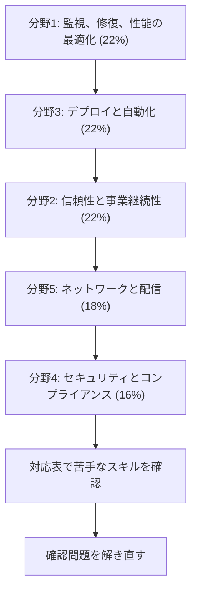

# CloudOps Engineer - Associate（SOA）

AWS 上のワークロードをデプロイ、管理、運用する力を問う試験です。旧称は SysOps Administrator - Associate です。このコースは **SOA-C03** を基準にしています。すべてのスキルは[対応表](coverage.md)で確認できます。

!!! warning "受験前に確認すること"
    - **言語:** 韓国語と簡体字中国語の試験は **2026年11月19日より後は提供されません**。
    - **試験ガイドの改訂:** 版の履歴は v1.1 が 2026年6月1日、v1.2 が 2026年10月29日です。AWS は、改訂を試験に反映する少なくとも 1 か月前に公開するとしています。受験日に合わせて、ガイドの改訂履歴を確認してください。

[:material-format-list-bulleted: このコースのサービス一覧](services.md){ .md-button } [:material-help-circle-outline: 問題集](exercises/index.md){ .md-button }

## 試験の概要 {#overview}

| 項目 | 内容 |
|---|---|
| 問題数 | 65問（採点対象50問 + 採点対象外15問） |
| 試験時間 | 130分 |
| 合格点 | 720点（100〜1,000点） |
| 受験料 | 150 USD |
| 形式 | 択一（正解 1 つ、誤答 3 つ）、複数選択（5 つ以上から 2 つ以上） |
| 採点方式 | 全体の得点で合否を判定します。分野ごとの合格点はありません |
| 言語 | 英語、日本語、韓国語、簡体字中国語 |
| 受験方法 | Pearson VUE のテストセンター、またはオンライン |
| 減点 | 誤答による減点はありません。未回答は不正解になるので、すべて回答します |
| 認定の有効期間 | 3 年 |

時間、問題数、受験料、言語、受験方法は[公式ページ](https://aws.amazon.com/certification/certified-cloudops-engineer-associate/)、採点対象の内訳と採点方式は[試験ガイド](https://docs.aws.amazon.com/aws-certification/latest/sysops-administrator-associate-03/sysops-administrator-associate-03.html)によります。

## 学習の順番 {#study-path}

配点の大きい分野から順に進めます。各分野のページでスキルごとの要点を確認し、足りないところはサービス解説で補います。分野ごとのサービス別の学習ページと[問題集](exercises/index.md)で理解を確かめます。

分野1と分野3は Systems Manager と EventBridge を共通で使うので、続けて学ぶと効率的です。

| 分野 | サービス別の学習 | 配点 | 主なサービス |
|---|---|---|---|
| [分野1: 監視、ログ、分析、修復、性能の最適化](domain1.md) | [開く](study/domain1/index.md) | 22% | CloudWatch、CloudTrail、Systems Manager、EventBridge、EBS、RDS |
| [分野2: 信頼性と事業継続性](domain2.md) | [開く](study/domain2/index.md) | 22% | Auto Scaling、ELB、Route 53、ElastiCache、AWS Backup |
| [分野3: デプロイ、プロビジョニング、自動化](domain3.md) | [開く](study/domain3/index.md) | 22% | CloudFormation、CDK、Image Builder、AWS RAM、Systems Manager |
| [分野4: セキュリティとコンプライアンス](domain4.md) | [開く](study/domain4/index.md) | 16% | IAM、Organizations、Config、KMS、ACM、Secrets Manager、GuardDuty |
| [分野5: ネットワークとコンテンツ配信](domain5.md) | [開く](study/domain5/index.md) | 18% | VPC、Route 53、CloudFront、Global Accelerator、Transit Gateway |

## 対象となる人と範囲外のもの {#out-of-scope}

対象は、AWS でのデプロイ、管理、トラブルシューティング、ネットワーク、セキュリティの経験が 1 年あり、システム管理者などの運用の経験も 1 年以上ある人です。

次の知識を前提にしています。

- 監視、ログ、トラブルシューティングの手法
- DNS、TCP、IP、ファイアウォールなどのネットワークの概念
- 1 つ以上のスクリプト言語と、主要な OS の知識
- コンテナとオーケストレーションの基本、CI/CD と Git

次の作業は受験者に求められていません。

- 分散アーキテクチャの設計
- CI/CD パイプラインの設計
- ハイブリッド、マルチ VPC のネットワークの設計
- ソフトウェアの開発
- セキュリティ、コンプライアンス、ガバナンスの要件の定義
- ランサムウェア対策の戦略の策定
- リソースの容量の評価と計画
- コストと総保有コストの分析、請求の管理

範囲外のサービスの例は、CloudHSM、Cloud WAN、App Mesh、Lightsail、EMR、MSK、Neptune、AppConfig、Transfer Family、Application Migration Service、FSx for OpenZFS です。

## 旧版との違い {#c02-vs-c03}

SOA-C02 は 2025年9月29日まで、SOA-C03 は 2025年9月30日から実施されています。名称の変更は C03 の合格者に適用され、取得済みの SysOps Administrator の認定は、取得から 3 年間有効です。

| SOA-C02 の分野 | 配点 | SOA-C03 の分野 | 配点 |
|---|---|---|---|
| 1: 監視、ログ、修復 | 20% | 1: 監視、ログ、分析、修復、性能の最適化 | 22% |
| 2: 信頼性と事業継続性 | 16% | 2: 信頼性と事業継続性 | 22% |
| 3: デプロイ、プロビジョニング、自動化 | 18% | 3: デプロイ、プロビジョニング、自動化 | 22% |
| 4: セキュリティとコンプライアンス | 16% | 4: セキュリティとコンプライアンス | 16% |
| 5: ネットワークとコンテンツ配信 | 18% | 5: ネットワークとコンテンツ配信 | 18% |
| 6: コストと性能の最適化 | 12% | タスク 1.3 へ移動 | |

| 変更 | 内容 |
|---|---|
| 追加 | CloudWatch エージェント（1.1）、CDK（3.1）、リージョンとサービスの制限（4.1）、ネットワーク監視（5.3） |
| 削除 | S3 の静的ウェブサイトホスティング（5.2） |
| 移動 | VPN はタスク 4.2 から 5.1 へ |
| ガイドの改訂で追加されたサービス | Bedrock、DevOps Agent、Health Dashboard、Kiro、Security Agent |

## 対象サービスとページの対応 {#in-scope-services}

対象のサービスの主なものと、wiki のページの対応です。公式の一覧は網羅的ではなく、変わることがあります。

| 区分 | サービスとページ |
|---|---|
| 分析 | [Athena](../../services/streaming.md#athena)、[Data Firehose](../../services/streaming.md#firehose) |
| アプリケーション統合 | [EventBridge](../../services/messaging.md#eventbridge)、[SNS](../../services/messaging.md#sns)、[SQS](../../services/messaging.md#sqs)、[Step Functions](../../services/step-functions.md) |
| ビジネスアプリケーション | [SES](../../services/other-services.md#ses) |
| コスト管理 | [Cost and Usage Reports](../../services/cost-management.md#data-exports)、[Cost Explorer](../../services/cost-management.md#cost-explorer)、[Savings Plans](../../services/cost-management.md#savings-plans) |
| コンピューティング | [EC2](../../services/ec2-beanstalk.md)、[EC2 の運用](../../services/operations.md#ec2-operations)、[Image Builder](../../services/operations.md#image-builder)、[Lambda](../../services/lambda.md) |
| コンテナ | [ECR](../../services/containers.md#ecr)、[ECS](../../services/containers.md#ecs)、[EKS](../../services/containers.md#eks) |
| データベース | [Aurora](../../services/databases.md#aurora)、[Aurora Serverless v2](../../services/databases.md#aurora-serverless-v2)、[DynamoDB](../../services/dynamodb.md)、[DAX](../../services/dynamodb.md#dax)、[ElastiCache](../../services/databases.md#elasticache)、[RDS](../../services/databases.md#rds)、[RDS Proxy](../../services/databases.md#rds-proxy) |
| 開発者ツール | [X-Ray](../../services/observability.md#xray)、[Kiro](../../services/ai.md#kiro) |
| AI | [Bedrock](../../services/ai.md#bedrock-runtime) |
| 監視 | [CloudWatch](../../services/observability.md#cloudwatch-metrics)、[CloudTrail](../../services/observability.md#cloudtrail)、[Managed Grafana](../../services/operations.md#managed-grafana)、[Managed Service for Prometheus](../../services/operations.md#managed-prometheus)、[Health Dashboard](../../services/cloud-foundations.md#health)、[DevOps Agent](../../services/operations.md#devops-agent) |
| 構成と自動化 | [Auto Scaling](../../services/operations.md#auto-scaling)、[CloudFormation](../../services/iac.md#cloudformation-template)、[CDK](../../services/iac.md#cdk)、[Systems Manager](../../services/operations.md#systems-manager)、[Compute Optimizer](../../services/cost-management.md#compute-optimizer)、[Trusted Advisor](../../services/cloud-foundations.md#trusted-advisor) |
| ガバナンス | [Config](../../services/governance.md#config)、[Control Tower](../../services/governance.md#control-tower)、[Organizations](../../services/governance.md#organizations)、[SCP](../../services/governance.md#scp)、[AWS RAM](../../services/governance.md#ram)、[Service Catalog](../../services/governance.md#service-catalog) |
| 移行と転送 | [DataSync](../../services/migration.md#datasync) |
| ネットワーク | [VPC](../../services/networking.md#vpc)、[VPC エンドポイント、PrivateLink](../../services/networking.md#vpc-endpoints)、[フローログ](../../services/networking.md#flow-logs)、[ピアリング](../../services/network-connectivity.md#vpc-peering)、[Reachability Analyzer](../../services/network-connectivity.md#reachability-analyzer)、[IPAM](../../services/network-connectivity.md#ipam)、[Elastic IP](../../services/network-connectivity.md#elastic-ip)、[Transit Gateway](../../services/network-connectivity.md#transit-gateway)、[Site-to-Site VPN](../../services/network-connectivity.md#site-to-site-vpn)、[Client VPN](../../services/network-connectivity.md#client-vpn) |
| 配信と DNS | [Route 53](../../services/networking.md#route53)、[DNS Firewall](../../services/network-connectivity.md#dns-firewall)、[CloudFront](../../services/networking.md#cloudfront)、[Global Accelerator](../../services/network-connectivity.md#global-accelerator)、[Application Recovery Controller](../../services/resilience.md#arc) |
| ネットワークの制御 | [セキュリティグループ、NACL](../../services/networking.md#security-groups-nacls)、[インターネットゲートウェイ](../../services/networking.md#subnets-route-tables)、[NAT ゲートウェイ](../../services/network-connectivity.md#nat-gateway)、[Egress-only](../../services/network-connectivity.md#ipv6)、[ELB](../../services/networking.md#elb)、[Network Firewall](../../services/network-connectivity.md#network-firewall)、[Shield](../../services/threat-detection.md#shield)、[WAF](../../services/certificates.md#waf) |
| ID とアクセス | [IAM](../../services/iam.md)、[Identity Center](../../services/identity-directory.md#identity-center)、[Access Analyzer](../../services/identity-directory.md#access-analyzer) |
| 暗号化と秘密情報 | [KMS](../../services/kms.md)、[ACM](../../services/certificates.md#acm)、[Secrets Manager](../../services/secrets.md#secrets-manager) |
| 検出 | [GuardDuty](../../services/threat-detection.md#guardduty)、[Inspector](../../services/threat-detection.md#inspector)、[Macie](../../services/threat-detection.md#macie)、[Security Hub](../../services/threat-detection.md#security-hub)、[Security Agent](domain4.md#skill-4-2-5) |
| ストレージ | [AWS Backup](../../services/resilience.md#backup)、[EBS](../../services/storage.md#ebs-volume-types)、[EFS](../../services/storage.md#efs-settings)、[FSx](../../services/storage-advanced.md#fsx-selection)、[S3](../../services/s3.md)、[Storage Gateway](../../services/migration.md#storage-gateway) |

!!! note "提供状況の変わったもの"
    Storage Gateway の FSx File Gateway は新規受付を終了しています。Cost and Usage Reports は、現在は Data Exports の CUR 2.0 が推奨です。その他のサービスの状況は、各分野のページに記載しています。

## 参考 {#references}

- [SOA-C03 試験ガイド](https://docs.aws.amazon.com/aws-certification/latest/sysops-administrator-associate-03/sysops-administrator-associate-03.html)
- [SOA-C02 と SOA-C03 の比較](https://docs.aws.amazon.com/aws-certification/latest/sysops-administrator-associate-03/sysops-administrator-associate-03-comparison.html)
- [改訂履歴](https://docs.aws.amazon.com/aws-certification/latest/sysops-administrator-associate-03/soa-03-revisions.html)
- [認定の公式ページ](https://aws.amazon.com/certification/certified-cloudops-engineer-associate/)
