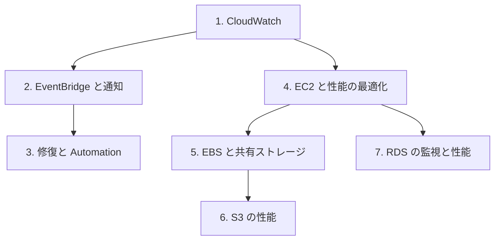

# 分野1: サービス別の学習

分野1（監視、ログ、分析、修復、性能の最適化）は配点の 22% を占めます。見つける、調べる、直す、性能を上げるの順に進めます。CloudWatch から始めると、後のページのメトリクスの話が読みやすくなります。

| 順番 | サービス | 問われること | 重要度 |
|---|---|---|---|
| 1 | [CloudWatch](cloudwatch.md) | ログの機能、エージェント、アラーム、ダッシュボード | 高 |
| 2 | [EventBridge と通知](eventbridge.md) | SNS の許可、ルールの切り分け、DLQ、Pipes | 高 |
| 3 | [修復と Automation](systems-manager.md) | 修復の手段、ランブック、複数アカウント | 高 |
| 4 | [EC2 と性能の最適化](ec2-performance.md) | Compute Optimizer、プレイスメントグループ、MTU | 中 |
| 5 | [EBS と共有ストレージ](storage.md) | メトリクス、ボリュームタイプ、EFS、FSx | 高 |
| 6 | [S3 の性能](s3.md) | マルチパート、Transfer Acceleration、DataSync | 中 |
| 7 | [RDS の監視と性能](databases.md) | RDS Proxy、ピン留め、DB 負荷の読み方 | 中 |

重要度は公式のスキル一覧を見たこの wiki の判断で、公式の数字ではありません。

## 他のサービスにまたがる問題 {#other-questions}

<!-- questions:start -->

この分野の問題は、すべてサービス別のページに載っています。

<!-- questions:end -->
