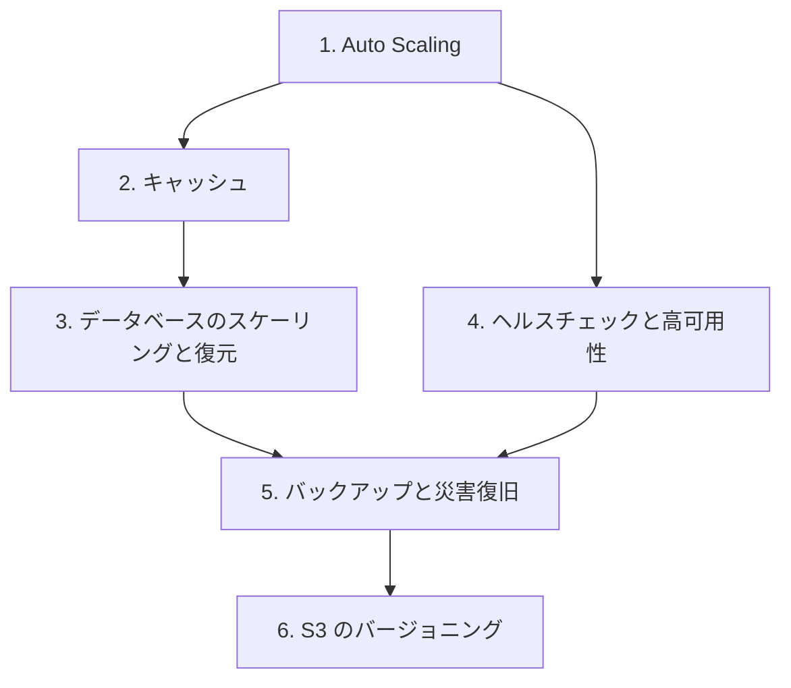

# 分野2: サービス別の学習

分野2（信頼性と事業継続性）は配点の 22% を占めます。増やす、落ちない、戻すの順に進めます。設計よりも、設定と失敗の切り分けが問われます。

| 順番 | サービス | 問われること | 重要度 |
|---|---|---|---|
| 1 | [Auto Scaling](auto-scaling.md) | ポリシー、猶予期間、ウォームプール | 高 |
| 2 | [キャッシュ](caching.md) | 要件に合うキャッシュ、シャードとレプリカ | 中 |
| 3 | [データベースのスケーリングと復元](databases.md) | 自動スケーリング、PITR、バックトラック | 高 |
| 4 | [ヘルスチェックと高可用性](high-availability.md) | 理由コード、Route 53、ゾーンシフト | 高 |
| 5 | [バックアップと災害復旧](backup-dr.md) | AWS Backup、4 つの DR 戦略 | 高 |
| 6 | [S3 のバージョニング](s3.md) | 削除マーカー、古いバージョンの整理 | 低 |

FSx の世代管理の問題は、下の一覧にあります。

重要度は公式のスキル一覧を見たこの wiki の判断で、公式の数字ではありません。

## 他のサービスにまたがる問題 {#other-questions}

<!-- questions:start -->

| 問題 | スキル | 内容 |
|---|---|---|
| [storage 問14](../../exercises/storage.md#q14) | 2.3.3 | FSx for Windows File Server の利用者が、管理者に頼まず、自分で昨日のファ… |
| [storage 問15](../../exercises/storage.md#q15) | 2.3.3 | FSx の世代管理の説明として正しいものを選んでください。（2つ選択） |

<!-- questions:end -->
