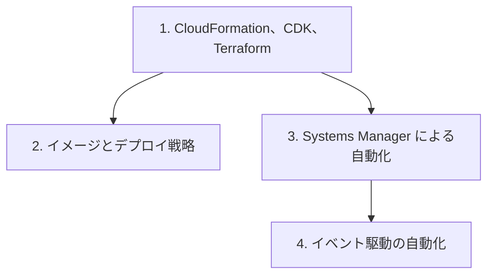

# 分野3: サービス別の学習

分野3（デプロイ、プロビジョニング、自動化）は配点の 22% を占めます。作る、配る、失敗を直す、既存のリソースを自動で管理するの順に進めます。

| 順番 | サービス | 問われること | 重要度 |
|---|---|---|---|
| 1 | [CloudFormation、CDK、Terraform](iac.md) | 運用の機能、エラーの対処、StackSets | 高 |
| 2 | [イメージとデプロイ戦略](deployment.md) | AMI、Image Builder、ECR、Blue/Green | 中 |
| 3 | [Systems Manager による自動化](systems-manager.md) | マネージドノード、Patch Manager | 高 |
| 4 | [イベント駆動の自動化](eventbridge.md) | S3 の通知、スケジュール、権限 | 中 |

重要度は公式のスキル一覧を見たこの wiki の判断で、公式の数字ではありません。

## 他のサービスにまたがる問題 {#other-questions}

<!-- questions:start -->

この分野の問題は、すべてサービス別のページに載っています。

<!-- questions:end -->
