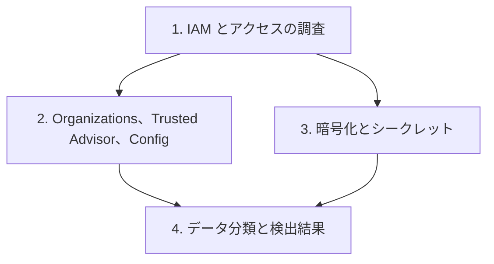

# 分野4: サービス別の学習

分野4（セキュリティとコンプライアンス）は配点の 16% を占めます。要件の定義は範囲外で、決まった要件の実装と問題の修復が問われます。

| 順番 | サービス | 問われること | 重要度 |
|---|---|---|---|
| 1 | [IAM とアクセスの調査](iam.md) | ポリシーの評価、拒否の調査 | 高 |
| 2 | [Organizations、Trusted Advisor、Config](governance.md) | SCP、助言と修復、適合パック | 高 |
| 3 | [暗号化とシークレット](encryption.md) | KMS のエラー、ACM、ローテーション | 高 |
| 4 | [データ分類と検出結果](threat-detection.md) | Macie、GuardDuty、Security Hub | 中 |

重要度は公式のスキル一覧を見たこの wiki の判断で、公式の数字ではありません。

## 他のサービスにまたがる問題 {#other-questions}

<!-- questions:start -->

この分野の問題は、すべてサービス別のページに載っています。

<!-- questions:end -->
